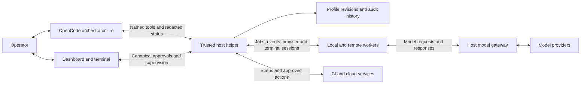

# prd_i: OpenCode orchestrator and sandbox fleet

[Index](README.md) · children: [orchestrator and dashboard](prd_i1.md),
[worker fleet](prd_i2.md), [credential broker](prd_i3.md), [LLM gateway](prd_i4.md)

## Executive summary

`oc-sandbox -o` is a control console for coding work across local, remote and cloud sandboxes.
The operator can launch agents from named profiles, follow progress, approve sensitive operations,
and take over a browser or terminal. Workers supply the CPU and RAM for development work. A trusted
host helper manages connections and approvals, brokers credentials and routes model requests through
provider-supported paths. The orchestrator can arrange dashboard views using a component catalog.
The host app owns approval text and controls.

## Scope

- [ ] **Orchestrator** — narrow tools, repo knowledge, versioned profiles, editable layouts and
      near real-time worker direction and progress alerts ([prd_i1](prd_i1.md)).
- [ ] **Worker fleet** — named hosts, SSH and NAT traversal, live headed browser views, terminal
      attach, CI and cloud work ([prd_i2](prd_i2.md)).
- [ ] **Credential broker** — named references, human approvals, grants, audit and retry
      notifications ([prd_i3](prd_i3.md)).
- [ ] **LLM gateway** — worker keys, API-key routes, provider-supported subscriptions and a
      **host-only Claude subscription feasibility spike** ([prd_i4](prd_i4.md)).
- [ ] **Shared experience** — launch preview with feature name, task description for orchestrator
      launches, pinned profile, worker, requested grants and estimated cost. Fleet view, approval
      inbox, searchable job timeline, reconnect and resume, expiring cloud capacity, and one
      action to revoke a worker's grants.

## Recommended first slice

Use one controller, a local worker, a named SSH worker and a fixed dashboard. Each stage depends
on the preceding stage passing its boundary checks. Choose an implementation option before
starting any stage that depends on it.

- [ ] Write a threat model and authority matrix for the operator, orchestrator, host helper,
      worker host and job sandbox. Record who can call each interface, see each class of data
      and approve each effect.
- [ ] Verify orchestrator isolation and helper authorization. Enroll workers with pinned SSH
      host keys and scoped identities. Verify that unauthenticated or revoked peers fail closed.
- [ ] Prove read-only health, status and reconnect in a fixed, isolated dashboard. Verify that
      untrusted worker data stays separate from operator controls.
- [ ] Prove the broker and one API-key route. Managed jobs must pass credential isolation,
      job-scoped grant and revocation checks before enabling live upstream calls.
- [ ] Enable approved actions after the approval, immutable-target and retry checks pass.
- [ ] Add browser and terminal handoff after verifying that managed jobs cannot bypass the input
      lease and that transferred content is safe to display or export.

Defer editable layouts, Tailcat, model-assisted health and cloud provisioning to later slices.
Start the Claude feasibility spike independently with the authorization check in [I4](prd_i4.md).

Project code stays BSD-2-Clause. Integrate companion programs through CLI or HTTP where practical
and carry their notices when redistributing them. Check the exact edition and its bundled code.
The child PRDs identify candidates and unresolved choices. Provider authorization is evaluated
separately from software licensing.

- [ ] **Human review**: checked only when the user says so
