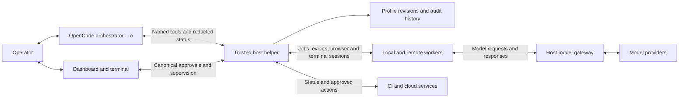

# prd_i: OpenCode orchestrator and sandbox fleet

[Index](README.md) · children: [orchestrator and dashboard](prd_i1.md),
[worker fleet](prd_i2.md), [credential broker](prd_i3.md), [LLM gateway](prd_i4.md)

## Executive summary

`oc-sandbox -o` is a control console for coding work across local, remote and cloud sandboxes.
The operator can launch agents from named profiles, follow progress, approve sensitive operations,
and take over a browser or terminal. Workers supply the CPU and RAM for development work. A trusted
host helper manages connections and approvals, brokers credentials and routes model requests through
provider-supported paths. The orchestrator can arrange dashboard views using a component catalog.
The host app owns approval text and controls.

## Scope

- [ ] **Orchestrator** — narrow tools, repo knowledge, versioned profiles, editable layouts and
      worker health summaries ([prd_i1](prd_i1.md)).
- [ ] **Worker fleet** — named hosts, SSH and NAT traversal, live headed browser views, terminal
      attach, CI and cloud work ([prd_i2](prd_i2.md)).
- [ ] **Credential broker** — named references, human approvals, grants, audit and retry
      notifications ([prd_i3](prd_i3.md)).
- [ ] **LLM gateway** — worker keys, API-key routes, provider-supported subscriptions and a
      **host-only Claude subscription feasibility spike** ([prd_i4](prd_i4.md)).
- [ ] **Shared experience** — launch preview with pinned profile, worker, requested grants and
      estimated cost. Fleet view, approval inbox, searchable job timeline, reconnect and resume,
      expiring cloud capacity, and one action to revoke a worker's grants.

## Recommended first slice

One controller, local worker and named SSH worker. Start with a fixed dashboard and a typed
approval flow. Prove browser view and handoff, terminal reconnect and an API-key route. Then add
layout editing, Tailcat where needed, model-assisted health summaries and cloud provisioning.
Run the Claude feasibility spike independently of the API-key route.

Project code stays BSD-2-Clause. Integrate companion programs through CLI or HTTP where practical
and carry their notices when redistributing them. Check the exact edition and its bundled code.
The child PRDs identify candidates and unresolved choices. Provider authorization is evaluated
separately from software licensing.

- [ ] **Human review**: checked only when the user says so
