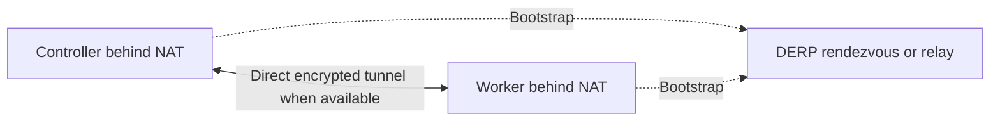

# prd_i2: Worker fleet, browser wall and terminals

Parent: [prd_i](prd_i.md) · related: [orchestrator](prd_i1.md), [broker](prd_i3.md),
[warm worker starts](prd_i5.md), [per-instance networking](prd_d.md), [local HTTPS](prd_e.md)

## Workers and connectivity

- [ ] Register local, remote and temporary cloud workers by friendly name. Keep addresses,
      host keys, connection state and engine authority in the host helper. Give orchestrator
      tools names, health, available capacity and connection status. Use worker-scoped identity
      and limits for CPU, RAM and concurrent jobs.
- [ ] Launch with pinned profile/repo revision, select the worker manually at first, and retain
      enough state to reconnect, resume and scope cleanup after controller restarts. Add
      capacity-aware placement, drain and expiring cloud leases when useful. Keep worktrees and
      sidecars on the worker, with explicit transfer of patches, logs and artifacts.
      Use [the warm-start plan](prd_i5.md) for cache-aware placement recommendations and authorized
      image, checkout and artifact reuse.
- [ ] Treat transferred files and streams as untrusted. Receive bounded blobs into private staging
      under generated names. Check declared sizes, types and digests and cap expanded size and file
      count before any supported export. Reject traversal, symlinks, hardlinks and special files.
      Never auto-extract archives or apply patches on the controller. Export only on operator
      request to a safe destination. Render logs and diffs as inert text. Test hostile paths,
      oversized or malformed transfers and active content with scratch fixtures.
- [ ] Use SSH for reachable workers. Consider a restricted reverse SSH tunnel through a
      reachable bastion where a relay is acceptable. Consider Tailcat for machines behind
      separate NATs and Tailscale/Headscale for a standing fleet that needs centralized
      enrollment and policy.
- [ ] Carry commands, results, preview streams and scoped agent messages over authenticated
      connections. Use a resumable SSE stream for status and messages to the dashboard, with
      separate authenticated requests for actions. Show direct/relayed status where available.
- [ ] Spike Tailcat across two NATs, with restricted UDP and after a network change. Check
      direct upgrade, fallback, reconnect, bootstrap and access revocation, plus PTY and video
      responsiveness. Authenticate the peers and restrict exposed services to the worker API
      or SSH. Keep enrollment material in trusted host state.

Tailcat uses DERP for rendezvous and initial communication. Both endpoints attempt UDP hole
punching. After a successful upgrade, the WireGuard-encrypted session travels peer to peer.
DERP relays the encrypted tunnel if the network prevents a direct path. Tailcat can forward
selected services without changing OS routes, so unrelated traffic stays on each machine's
normal path. SSH needs a reachable endpoint or a tunnel/bastion and does not perform this direct
upgrade on its own. The proposed dashboard browser talks to the trusted host, which handles the
native peer connection. See [Tailcat](https://github.com/tailscale/tailcat),
[Tailscale connection types](https://tailscale.com/docs/reference/connection-types) and
[OpenSSH](https://man.openbsd.org/ssh.1).

## Browser wall and terminals

- [ ] Keep the current manual launch workflow with visible local Wayland Chromium. For managed
      workers, provide an optional headed Chromium profile on a worker display or virtual display.
      Show PiP-style dashboard tiles with low-rate previews. Expand a selected browser to a live
      view. Limit preview bandwidth and show disconnect/staleness.
- [ ] Provide a trusted **Take control** / **Return to agent** action. Grant one expiring input lease
      for the selected browser, suspend agent input while it is held, and show the current owner.
      For managed workers, replace today's direct pod-local CDP access with an authenticated arbiter
      outside the job sandbox. Keep raw CDP and display/input sockets unreachable from agent code.
      Require both agent tools and operator controls to use that arbiter for all browser mutations.
      Check ownership and lease generation at dispatch and fence queued commands on handoff. Revoke
      input on expiry, disconnect, explicit release or arbiter restart. Keep preview streams separate
      from input and approvals. Test direct socket denial, simultaneous takeover, stale leases and
      disconnect or restart while commands are queued.
- [ ] Evaluate [CDP screencast](https://chromedevtools.github.io/devtools-protocol/tot/Page/#method-startScreencast)
      and [input](https://chromedevtools.github.io/devtools-protocol/tot/Input/) for page views.
      Evaluate a nested display with [noVNC](https://github.com/novnc/noVNC) for the full browser
      window, tabs and dialogs. Treat worker pixels as untrusted display content in a clearly
      labeled region, isolated from host app controls.
- [ ] Put the original OpenCode session in a controller-owned tmux session if the terminal
      spike succeeds. Allow manually launched local instances to opt in as well. Offer named
      windows for the orchestrator, worker OpenCode TUIs and worker
      shells. Use remote tmux or a PTY host so worker sessions survive a dropped connection.
      Preserve separate OpenCode and shell targets. Add **Open OpenCode** and **Open terminal**
      actions to trusted dashboard chrome, resolving registered session IDs on the host.
      Support read-only attach and explicit input handoff when attaching to an active agent TUI.
      Keep tmux sockets and terminal launch authority in the trusted helper. See
      [tmux control mode](https://github.com/tmux/tmux/wiki/Control-Mode).
- [ ] Treat worker terminal output as untrusted even in read-only mode. Use a confined terminal
      renderer with bounded buffers and an allowlist of display controls. Disable clipboard writes,
      host actions and automatic link opening from escape sequences. Authenticate and scope attach
      and input to the selected session. Test that read-only attach cannot send input, stale leases
      cannot write, and terminal output cannot change clipboard state or trusted dashboard controls.

## CI and cloud

- [ ] Watch GitHub Actions or Concourse jobs. Display status and audit history. Route dispatch,
      cancellation and deployment through canonical approval requests with resolved workflow,
      commit or run identity and exact inputs. Keep provider credentials and renewal on the host.
      Consider scoped GitHub App installation tokens for read and dispatch adapters.
- [ ] Preview Render deployment or temporary job requests with service, plan, estimated cost,
      runtime limit and cleanup. Require approval for new spend. Bind it to the approved build and
      service configuration. Enable deployment only if the adapter can hold that binding through
      execution. Verify the worker runtime before treating Render as a full sandbox host. Render
      one-off jobs use the base service's latest successful build, inherit its environment and lack
      its persistent disk. Use a dedicated service whose inherited environment contains no unrelated
      credentials, and keep dispatch disabled if the build or configuration cannot be pinned.
      See [Render one-off jobs](https://render.com/docs/one-off-jobs) and
      [GitHub Actions workflows](https://docs.github.com/en/rest/actions/workflows).

## Open choices

- [ ] (decision needed) **Transport** — SSH first (recommended, mature, reachable endpoint
      required, 3–5 days). Tailcat (direct across compatible NAT, adds pairing and fallback
      operations, 3–5 day spike). Tailscale/Headscale (fleet enrollment and ACLs, another
      service or account to operate, 1–2 weeks).
- [ ] (decision needed) **Browser view** — page previews via CDP (recommended first, efficient
      tiles, limited browser chrome and dialog visibility, 3–5 day spike) or virtual display
      with noVNC (full window, higher resource cost, 1–2 weeks).
- [ ] (decision needed) **Terminal UX** — tmux plus a scoped attach command (recommended,
      familiar and resumable, terminal rather than browser UI, 2–4 days) or an embedded web PTY
      (easier from the dashboard, more session authorization and isolation work, 1–2 weeks).

Companions include [Tailcat](https://github.com/tailscale/tailcat/blob/main/LICENSE) and
[Headscale](https://github.com/juanfont/headscale/blob/main/LICENSE) (BSD-3-Clause),
[tmux](https://github.com/tmux/tmux/wiki/Contributing#licensing) (ISC),
[Concourse](https://github.com/concourse/concourse/blob/master/LICENSE.md) (Apache-2.0), and
[noVNC](https://github.com/novnc/noVNC/blob/master/LICENSE.txt) (primarily MPL-2.0, separate
component terms). Treat noVNC as an optional companion and preserve its file-level terms if bundled.
