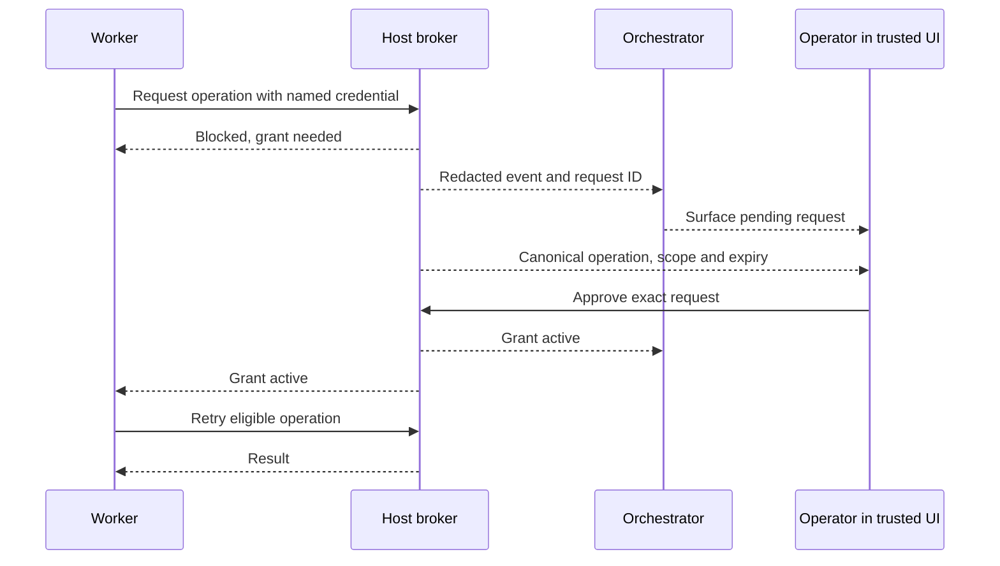

# prd_i3: Host credential broker and approvals

Parent: [prd_i](prd_i.md) · related: [dashboard](prd_i1.md), [worker fleet](prd_i2.md),
[LLM gateway](prd_i4.md)

## Credential access

- [ ] Keep provider, CI and infrastructure credentials in trusted host storage. Workers
      receive named placeholders and narrowly scoped broker credentials. Resolve references
      only inside approved adapters. Deliver results without logging or returning raw provider
      credentials. Give clients that require raw secrets an explicit protocol adapter or
      report the client as unsupported for brokered access.
- [ ] Bind grants to worker, operation, destination, scope and expiry. Enforce checks at use
      time. Support grant expiry, individual revocation and revoking all grants for a worker.
      Keep usable, blocked, expired and revoked status visible without exposing values.
- [ ] Report allowed and blocked requests, grant updates and revocations as redacted events.
      Include a stable request ID, worker, target, decision and reason. Keep raw secrets and
      sensitive headers out of dashboards, logs and model-visible events.

## Approval and retry

- [ ] Create a canonical server-side record for each proposed grant or privileged action.
      Bind approval to the exact immutable payload, operator, request revision and expiry.
      Show material fields in the trusted UI. Reject stale or replayed decisions and request
      fresh approval if the payload changes.
- [ ] After a grant takes effect, notify the orchestrator and targeted worker. Show whether
      the request is eligible to retry. Retry automatically only when safe to repeat and
      still covered by the grant. Use a deduplication key where the target supports it.

## Open choices

- [ ] (decision needed) **Broker integration** — typed host adapters for CI and model calls
      (recommended, narrow and easy to audit, protocol work per provider, 3–5 days), or
      OpenShell as a worker backend (wider network and credential policies, additional runtime
      integration, 1–2 week spike). Verify placeholder substitution, event coverage, live
      policy updates and enforcement with the exact release selected.
- [ ] (decision needed) **Secret storage** — OS keyring (recommended for attended use, native
      unlock, headless setup varies, 1–2 days), or age-encrypted store (portable files, needs
      key management and an operator unlock flow, 2–4 days).

Companions include [OpenShell](https://github.com/NVIDIA/OpenShell/blob/main/LICENSE)
(Apache-2.0, [sandbox policies](https://docs.nvidia.com/openshell/latest/sandboxes/policies)),
[age](https://github.com/FiloSottile/age/blob/main/LICENSE) (BSD-3-Clause), and
[SQLite](https://sqlite.org/copyright.html) (public domain) for profile and audit metadata.
