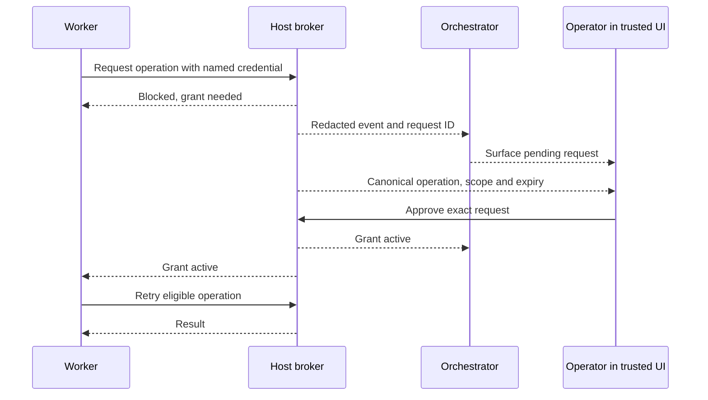

# prd_i3: Host credential broker and approvals

Parent: [prd_i](prd_i.md) · related: [dashboard](prd_i1.md), [worker fleet](prd_i2.md),
[LLM gateway](prd_i4.md)

## Credential access

- [ ] Keep provider, CI and infrastructure credentials in trusted host storage. Workers
      receive named placeholders and a revocable broker identity bound to their authenticated job
      channel. Resolve references only inside approved adapters. Deliver results without logging
      or returning raw provider credentials. Give clients that require raw secrets an explicit
      protocol adapter or report the client as unsupported for brokered access.
- [ ] Give managed jobs isolated homes. Do not mount the shared `oc-home` or any host login,
      subscription or provider auth state. Replace legacy `FWD_ENV` passthrough with a managed-job
      allowlist that excludes upstream credentials, including any inherited via profiles or
      sidecars. Use synthetic markers to verify that argv, environment, mounts, job files and
      diagnostics contain no upstream credentials.
- [ ] Bind grants to worker and job identity, operation, destination, scope and expiry. Enforce
      checks at use time. Expiry or revocation blocks new calls, closes brokered streams and
      cancels upstream work where supported. Record any operation already dispatched that cannot
      be recalled. Support individual revocation and revoking all grants for a worker. Test cross-job
      use on the same worker and revocation during an active stream. Show grant state without
      exposing values.
- [ ] Report allowed and blocked requests, grant updates and revocations as redacted events.
      Include a stable request ID, worker, target, decision and reason. Keep raw secrets and
      sensitive headers out of dashboards, logs and model-visible events.

## Approval and retry

- [ ] Create a canonical server-side record for each proposed grant or privileged action.
      Bind approval to the exact immutable payload, operator, request revision and expiry.
      Resolve mutable names before approval. Record immutable targets such as commit SHA and
      workflow version, run ID, build and service configuration version, and the applicable spend
      limit and expiry. Show these material fields in the trusted UI. Revalidate them at dispatch
      and execute only against those identities. If the adapter cannot ensure the approved target
      is the one acted on, keep the mutation disabled. Reject stale or replayed decisions and
      request fresh approval if the payload or resolved target changes. Test branch, workflow and
      service changes between preview, approval and dispatch.
- [ ] After a grant takes effect, notify the orchestrator and targeted worker. Show whether
      the request is eligible to retry. Retry automatically only when safe to repeat and
      still covered by the grant. Consume one-shot approvals atomically and use a deduplication key
      where the target supports it. Reconcile an uncertain outcome before reissuing a mutation.

## Offline approval core

- `oc-sandbox reviewer` cleared the offline approval design at SHA-256
  `a2f4cc26dfb6ff214f60dd4f9f8e963e4cb3da306b19ace7bd98fc0c737149f2`.
- [x] **Human approval of the offline controller approval core**
      (`codex/controller-approval-core` at `c61637f`), including exact approval binding,
      revocation, one-shot invocation, uncertain-effect reconciliation and audit status
      using a synthetic adapter. Live credentials, worker transport and dashboard
      integration have separate qualification requirements.

## Open choices

- [ ] (decision needed) **Broker integration** — typed host adapters for CI and model calls
      (recommended, narrow and easy to audit, protocol work per provider, 3–5 days), or
      OpenShell as a worker backend (wider network and credential policies, additional runtime
      integration, 1–2 week spike). Verify placeholder substitution, event coverage, live
      policy updates and enforcement with the exact release selected.
- [ ] (decision needed) **Secret storage** — OS keyring (recommended for attended use, native
      unlock, headless setup varies, 1–2 days), or age-encrypted store (portable files, needs
      key management and an operator unlock flow, 2–4 days).

Companions include [OpenShell](https://github.com/NVIDIA/OpenShell/blob/main/LICENSE)
(Apache-2.0, [sandbox policies](https://docs.nvidia.com/openshell/latest/sandboxes/policies)),
[age](https://github.com/FiloSottile/age/blob/main/LICENSE) (BSD-3-Clause), and
[SQLite](https://sqlite.org/copyright.html) (public domain) for profile and audit metadata.
