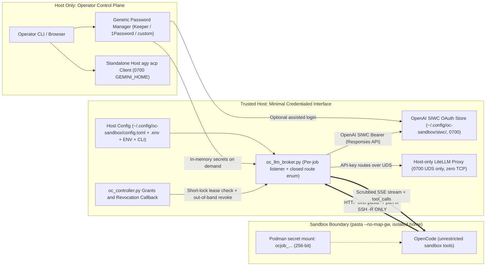

# prd_i4a: Host LLM broker, subscription lifecycle, and standalone `agy acp` adapter

Parent: [prd_i4](prd_i4.md) · related: [prd_i](prd_i.md), [credential broker](prd_i3.md),
[SSH remote host onboarding](prd_i2a.md), [host tools](prd_f.md), [host config](prd_j.md)

## Goal, authority matrix, and trust boundary

Unrestricted OpenCode runs inside each managed sandbox (local Podman pod or remote SSH worker pod)
with full access to its own sandbox worktree, shell, and sidecars, and **zero access** to upstream
provider credentials, password managers, host login state (`oc-home`), SSH agents, Podman sockets,
or host-side ACP/agent runtimes.

| Principal | Can call | Can see | Explicitly denied |
|---|---|---|---|
| **Operator (host)** | Config/auth CLI, password-manager PTY recovery, `oc_controller` approve/revoke, standalone `agy acp` | Redacted status, model catalogs, OAuth prompts, own host vaults | N/A (trust root on workstation) |
| **Host broker (`oc_llm_broker.py`)** | `oc_controller` lease check, host-only LiteLLM UDS, OpenAI SIWC HTTPS (`api.openai.com`), password manager on startup/demand | In-memory secrets, active leases, redacted usage/audit metadata | Never exposes secrets, admin routes, or host tools to sandboxes |
| **Host-only LiteLLM** | Configured upstream HTTPS APIs (Gemini, Anthropic, OpenAI) | Scoped API keys passed via child `env=` only | No TCP listener, no UI/Swagger/DB/telemetry, unreachable from sandboxes |
| **Worker host (remote SSH)** | Podman container lifecycle, reverse-forwarded broker port | Container stdout/stderr, job-scoped `ocjob_...` secret mount | Zero upstream API keys, zero OAuth tokens, zero SSH signing keys |
| **Managed sandbox (OpenCode)** | Assigned broker HTTP endpoint ONLY (`ocjob_...`), own sandbox tools | Own worktree, streaming model output, lease-filtered `/models` | Host loopback (`--no-map-gw`), `oc-home`, `FWD_ENV`, `.bridge`, host files, ACP, LiteLLM admin routes |



## Resolved open choices and cross-PRD alignment

- **Gateway architecture** (resolves [prd_i4](prd_i4.md#open-choice)):
  - A thin trusted Python host broker (`oc_llm_broker.py`) integrates with
    [oc_controller.py](../../oc_controller.py) for per-job leases, model allowlists, streaming
    cancellation, redacted audit events, and out-of-band revocation.
  - **LiteLLM Proxy** (MIT core, hash-locked in `pyproject.toml` + `uv.lock`) runs host-only behind
    `oc_llm_broker.py`, bound **exclusively to a `0o700` Unix domain socket** (`uvicorn --uds`,
    zero TCP ports), serving **Gemini, Claude, and GPT** API-key routes (plus compatible endpoints
    such as OpenRouter).
  - **OpenAI / Codex subscription** uses OpenAI's documented open-source **Sign in with ChatGPT
    (SIWC)** flow (`https://auth.openai.com/.well-known/openid-configuration`, scope
    `chatgpt.tokens.use.direct`, `offline_access`, `ext_agent_host_id`) targeting only
    `https://api.openai.com/v1/models` and `https://api.openai.com/v1/responses` (`store: false`,
    `stream: true`), reusing the tested OAuth, optional Playwright-assisted login, and `0o700` state
    pattern from `api-agent`. LiteLLM's `chatgpt/` provider is not used for SIWC because it defaults
    to the internal ChatGPT backend rather than the public Responses API.
- **Container-to-broker transport (OpenCode HTTP compatibility + SELinux + `pasta` isolation)**:
  - OpenCode's Vercel AI SDK providers (`@ai-sdk/openai`, `@ai-sdk/openai-compatible`,
    `@ai-sdk/anthropic`, `@ai-sdk/google`) speak standard `http://`, not `unix://`, and SELinux
    enforcing (`container_t`) blocks direct `connectto` on host `unconfined_t` sockets.
  - **Local managed Linux Podman pods** run with `--network pasta:--no-map-gw,-T,<job_port>`:
    `--no-map-gw` blocks all arbitrary host `127.0.0.1` access, while `-T <job_port>` forwards
    **only** that job's dedicated ephemeral broker port (`127.0.0.1:<job_port>`) into container
    `127.0.0.1:<job_port>`. Each per-job listener accepts **only** its single bound `lease.id` and
    256-bit `ocjob_...` token.
  - **Remote SSH workers** use OpenSSH native TCP-to-UDS forwarding (`ssh -R 127.0.0.1:0:<local_uds>`)
    so the workstation opens zero host TCP ports for remote jobs (see [prd_i2a](prd_i2a.md)).
  - **Host runtime socket directory**: All host UDS paths (LiteLLM UDS, per-job SSH-target UDS)
    live under `$XDG_RUNTIME_DIR/oc-sandbox/` (`0o700`), which is visible identically from host and
    `devbox` distrobox and stays well below the 108-byte `AF_UNIX` `sun_path` limit.
- **Secret storage and configuration** (resolves [prd_i3](prd_i3.md#open-choices), aligns with
  [prd_j](prd_j.md)):
  - **Generic pluggable password-manager interface** modeled on `api-agent`
    (`cfg/managers.toml` + `version = 1` modules exposing `command(source, kind, cli)`,
    `parse(output, kind)`, and optional `classify_login(stderr)`, `login_probe(source, cli)`, and
    `retrieve_login(...)`), shipping with **Keeper** (interactive POSIX PTY recovery for master
    password, TOTP, FIDO security keys, plus passkey support) and **1Password** adapters; custom
    adapters (including dummy/file test adapters) are permitted when registered in host-trusted
    configuration.
  - **Declarative config schema (`schema_version = 1`)** aligned with [prd_j](prd_j.md#later-configuration-and-editor):
    namespaced tables (`[llm]`, `[secrets]`, `[workers]`, leaving `[bridge]`/`[merge]` open),
    precedence `defaults < ~/.config/oc-sandbox/config.toml < ~/.config/oc-sandbox/.env < ENV < CLI`,
    unknown-key rejection, raw-secret rejection (rejecting `OPENAI_API_KEY`, `ANTHROPIC_API_KEY`,
    `GEMINI_API_KEY`, `sk-`, `sk-ant-`, `AIza`), effective-source reporting, and shared atomic
    host-trusted TOML read/write helpers.
  - **Persistent state location**: All persistent operator files (`config.toml`, `.env`,
    `workers.toml`, `known_hosts/`, `siwc/`, `agy-profile/`) live under `$CONF_DIR`
    (`~/.config/oc-sandbox/`, `0o700`) — **never** under `$STATE` (`~/.local/share/oc-sandbox/`),
    which `oc-sandbox -d -a` wipes.
- **Host tool prerequisites** (aligns with [prd_f](prd_f.md)):
  - `tools/mise.toml` + `tools/mise.lock` (isolated `MISE_*_DIR` under
    `~/.local/share/oc-sandbox/mise`, inherited `MISE_*` unset, `MISE_PARANOID=1`, no `lazy = true`)
    pins `python` and `uv`.
  - `pyproject.toml` + `uv.lock` hash-locks `litellm` and keeps `playwright` as an optional extra so
    API-key and manual-SIWC users do not pull browser binaries unless needed.
- **Provider authorization boundaries (Stage 0 findings)**:
  - **Google / Antigravity consumer OAuth (`antigravity-oauth`)**: Restricted by Google ToS to
    unmodified official Antigravity clients (`agy` / IDE / App). Permanently **policy-blocked** at
    the OpenCode LLM broker dispatch gate via `PolicyBlockedError(RuntimeError)` -> HTTP `403`.
    OpenCode uses `gemini-api-key` or Vertex AI through LiteLLM.
  - **Standalone Host `agy acp` Lifecycle Adapter**: Separate host-only official ACP client modeled
    on T3 Code (`agy >= 1.5.12`, currently `1.5.13` on workstation): isolated `0o700` `GEMINI_HOME`
    + `TMPDIR`, strict env allowlist, `SSH_CONNECTION` keyring isolation + `agy acp --login`
    URL/code-paste, verified `BROWSER` helper, strict Google OAuth URL + `state` CSRF validation,
    ACP `initialize` with zero host tools/capabilities, model discovery, direct host single-turn
    prompt, and ACP `logout`. Never exports tokens to the OpenCode proxy or any sandbox.
  - **Anthropic / Claude Code subscription (`claude-subscription`)**: Kept policy-blocked via
    `PolicyBlockedError(RuntimeError)` -> HTTP `403` pending Stage 0 confirmation in
    [prd_i4](prd_i4.md#feasibility-spike--host-only-claude-subscription-routing). Anthropic API-key
    access works immediately through LiteLLM.

## Scope checklist

- [ ] **Unified host config & password-manager subsystem** — `schema_version = 1` TOML schema,
      `config.toml` + `.env` + `ENV` + CLI loader (never reading `.env` from `cwd`), raw-secret and
      unknown-key rejection, `trusted_path` + ancestor-walk verification, `O_NOFOLLOW` fd-only
      adapter execution (zero TOCTOU), Keeper & 1Password adapters, interactive POSIX PTY recovery
      with process-group cleanup, echo suppression, and redacted logging.
- [ ] **Controller lease extension (`oc_controller.py`)** — additive, backward-compatible standing
      LLM job-lease API (`admit_llm_lease`, short-lock `check_lease_active(actor, request_id)`,
      post-lock `register_revocation_listener(cb)` on `revoke`/`revoke_worker`), keeping existing
      offline approval-core behavior and tests intact.
- [ ] **Minimal Host LLM Broker (`oc_llm_broker.py`)** — strict HTTP/1.1 framing parser, closed
      canonical route enum (`/siwc/v1/*`, `/litellm/v1/*`, `/litellm/v1beta/models/<id>:*`),
      per-job listener bound to one `lease.id` + constant-time SHA-256 `ocjob_...` token check,
      duplicate-key JSON rejection, LiteLLM override-key stripping & JSON re-serialization, outbound
      header allowlist, response header/error scrubbing, lease-filtered `GET /*/models`, out-of-band
      stalled-stream abort on revocation, and `PolicyBlockedError` fail-closed gate.
- [ ] **LiteLLM host-only backend (`oc_litellm_host.py`)** — UDS-only (`0o700`) startup, `0o600`
      env-referenced YAML (no plaintext keys on disk), scoped child `env=`, telemetry/UI/Swagger/DB
      disabled, `PR_SET_PDEATHSIG` + watchdog pipe, health probe, and Gemini/Claude/GPT tests.
- [ ] **OpenAI SIWC lifecycle (`oc_siwc_auth.py`)** — pinned OIDC discovery, PKCE `S256` +
      loopback/paste callback, optional isolated Playwright login, `chatgpt.tokens.use.direct` scope
      verification, `flock`-protected atomic `0o600` token rotation, coalesced refresh, `/v1/models`
      + `/v1/responses` (`store: false`, `stream: true`, `400` on `stream: false`, `503` on expired
      refresh with zero paid fallback).
- [ ] **Standalone Host `agy acp` lifecycle adapter (`oc_agy_acp.py`)** — `agy >= 1.5.12` preflight,
      strict allowlisted env, private empty scratch `cwd`, `0o700` `GEMINI_HOME` + `TMPDIR`,
      verified `0o700` `BROWSER` helper, strict Google OAuth URL + `state` CSRF validation, ACP
      `initialize` (zero client `fs`/`terminal` caps, MCP/tools disabled, auto-deny
      `session/request_permission`), model probe, direct host prompt, ACP `logout`, and fake-ACP
      test suite.
- [ ] **`oc-sandbox` managed mode** — headless managed launch flag (no Wayland, no Chromium/CDP,
      no `oc-home`, no `FWD_ENV`, no shared `$SB`/`.bridge`), isolated per-job home, `--network
      pasta:--no-map-gw,-T,<job_port>`, `podman secret` delivery of `ocjob_...`, injected
      `OPENCODE_CONFIG`, and synthetic-marker leak tests in `tests/security.sh`.

## Gate 1: Pseudocode walkthrough (before implementation)

### 1. Host config resolution and password-manager secret loading

```text
function assert_host_trusted_file(path, expected_parent=None):
    # Reuse oc-sandbox's trusted-path discipline: reject any symlink or component
    # resolving into ~/opencode-sandbox; walk every ancestor up to / asserting
    # owner in (euid, 0) and (mode & 0o022 == 0 or sticky root dir).
    # Open leaf with O_RDONLY | O_NOFOLLOW | O_NONBLOCK; fstat S_ISREG,
    # st_uid == euid, st_mode & 0o022 == 0, st_nlink == 1, size <= MAX_BYTES.

function load_host_config(cli_argv, env, conf_dir=CONF_DIR):
    schema = load_schema(REPO_ROOT / "cfg/config.toml")          # schema_version = 1
    host_toml = read_optional_trusted_toml(conf_dir / "config.toml")
    dotenv = read_optional_trusted_dotenv(conf_dir / ".env")     # NEVER read cwd/.env
    # Precedence: schema default < host config.toml < host .env < process ENV < CLI
    resolved, sources = merge_strict(schema, host_toml, dotenv, env, cli_argv)
    reject_unknown_keys_and_raw_secrets(resolved)                # blocks *_API_KEY, sk-, AIza, etc.
    return resolved, sources

function load_verified_adapter(registry_path, manager_id):
    reg_bytes = read_host_trusted_fd(registry_path)
    entry = parse_managers_toml(reg_bytes)[manager_id]
    adapter_fd = open_host_trusted_no_follow(entry.resolved_path, max_bytes=262_144)
    source_bytes = read_all_bounded(adapter_fd, 262_144)
    close(adapter_fd)
    # Compile & exec strictly from the verified in-memory bytes (zero pathname reopen TOCTOU)
    ns = {}
    exec(compile(source_bytes, entry.resolved_path, "exec"), ns)
    if ns.get("version") != 1 or not callable(ns.get("command")) or not callable(ns.get("parse")):
        raise ManagerError("invalid adapter interface")
    return Adapter(ns)

function acquire_secret(registry, descriptor, kind, interaction, deadline):
    adapter = load_verified_adapter(registry, descriptor.manager)
    resolved_cli = resolve_trusted_executable(descriptor.cli_path)   # non-writable host path
    argv = adapter.command(descriptor, kind, resolved_cli)
    if not isinstance(argv, list) or not argv or argv[0] != resolved_cli:
        raise ManagerError("adapter command must invoke resolved cli_path")
    clean_env = minimal_cli_env()                                    # excludes all loaded LLM keys
    rc, out, err = spawn_bounded(argv, env=clean_env, stdin=DEVNULL, max_bytes=65_536, timeout=deadline)
    if rc == 0:
        return adapter.parse(out, kind)
    if adapter.classify_login is not None and adapter.classify_login(err):
        if interaction is None:
            raise AuthRecoveryRequired("Password manager login required")
        probe_argv = adapter.login_probe(descriptor, resolved_cli)
        if not isinstance(probe_argv, list) or not probe_argv or probe_argv[0] != resolved_cli:
            raise ManagerError("adapter login_probe must invoke resolved cli_path")
        # Owned POSIX PTY with start_new_session=True, termios echo suppression on secret input,
        # killpg cleanup on cancel/EOF/timeout, zero logging of entered bytes.
        run_pty_login_recovery(probe_argv, clean_env, interaction, deadline)
        rc2, out2, err2 = spawn_bounded(argv, env=clean_env, stdin=DEVNULL, max_bytes=65_536,
                                        timeout=remaining(deadline))
        if rc2 == 0:
            return adapter.parse(out2, kind)
        raise CredentialUnavailable(scrub_operator_error(err2))
    raise CredentialUnavailable(scrub_operator_error(err))
```

**Failure & recovery paths:**
- Tampered, symlinked, FIFO, hardlinked, or world-writable `managers.toml` / adapter / `cli_path` -> fails closed before loading or spawning anything.
- Keeper persistent login expired -> `classify_login(err)` triggers bounded POSIX PTY recovery for master password / TOTP / FIDO touch; retries once on remaining deadline and reports redacted `err2` if retry fails.
- Lookup errors (wrong vault/item) -> NOT misclassified as login errors; fails fast without prompting.

### 2. Host-only LiteLLM subprocess lifecycle

```text
function start_litellm_backend(resolved_secrets, model_specs):
    run_dir = mkdtemp_0700(XDG_RUNTIME_DIR / "oc-sandbox", prefix="litellm-")
    uds_path = run_dir / "proxy.sock"                                # <= 96 bytes
    internal_key = "oc_litellm_" + secrets.token_hex(32)             # 256-bit, per-start only
    child_env = minimal_python_env()
    child_env["LITELLM_MASTER_KEY"] = internal_key
    child_env["LITELLM_TELEMETRY"] = "False"
    child_env["LITELLM_LOCAL_MODEL_COST_MAP"] = "True"
    yaml_models = []
    for spec in model_specs:                                         # explicit allowlist only; no wildcards
        env_var = f"OC_LITELLM_KEY_{spec.env_id}"
        child_env[env_var] = resolved_secrets[spec.secret_ref]       # NEVER in broker os.environ
        yaml_models.append({
            "model_name": spec.alias,
            "litellm_params": {"model": spec.litellm_model, "api_key": f"os.environ/{env_var}"},
        })
    cfg_path = write_0600_no_follow(run_dir / "config.yaml", {
        "model_list": yaml_models,
        "general_settings": {"disable_spend_logs": True, "disable_error_logs": True},
        "litellm_settings": {"telemetry": False, "drop_params": False},
    })
    # Run LiteLLM ASGI app via uvicorn --uds ONLY (zero TCP listener, docs/openapi disabled)
    # Use start_new_session=True, Linux PR_SET_PDEATHSIG(SIGTERM), and watchdog pipe.
    proc = spawn_litellm_uvicorn_uds(cfg_path, uds_path, env=child_env, watchdog_pipe=r_fd)
    wait_uds_health_ready(uds_path, internal_key, timeout=15s)
    return LiteLLMBackend(proc, run_dir, uds_path, internal_key)
```

**Failure & recovery paths:**
- LiteLLM fails health check within 15s or crashes mid-run -> process group terminated, `run_dir` removed; broker returns HTTP `502` with neutral diagnostic (never leaks keys, config paths, or tracebacks).
- Broker receives `SIGKILL` -> `PR_SET_PDEATHSIG` + watchdog pipe EOF terminates LiteLLM immediately so keys are not retained in an orphaned process.

### 3. OpenAI SIWC OAuth and refresh-token rotation lifecycle

```text
function siwc_discover():
    doc = https_get_json("https://auth.openai.com/.well-known/openid-configuration", timeout=15s)
    assert_exact(doc["issuer"] == "https://auth.openai.com")
    assert_https_host(doc["authorization_endpoint"], ALLOWED_OPENAI_AUTH_HOSTS)
    assert_https_host(doc["token_endpoint"], ALLOWED_OPENAI_AUTH_HOSTS)
    return doc

function siwc_sign_in(state_dir, mode="attended", pm_descriptor=None):
    ensure_0700_outside_sandbox(state_dir)                           # ~/.config/oc-sandbox/siwc
    doc = siwc_discover()
    verifier, challenge = generate_pkce_s256()
    state, nonce = secrets.token_urlsafe(32), secrets.token_urlsafe(32)
    cb_server = start_127_0_0_1_callback_listener(expected_state=state, timeout=300s)
    auth_url = build_authorize_url(doc, challenge, state, nonce, cb_server.redirect_uri,
                                   scope="openid profile email offline_access resource.invoke chatgpt.tokens.use.direct")
    if mode == "playwright":
        # Ephemeral 0o700 browser profile deleted in finally; traces/HAR/screenshots disabled;
        # origin-restricted; credentials pulled on demand via acquire_secret(); MFA yields to human.
        code = run_isolated_playwright_login(auth_url, cb_server, pm_descriptor)
    else:
        code = wait_callback_or_manual_paste(cb_server, auth_url, expected_state=state)
    tokens = exchange_code_for_tokens(doc["token_endpoint"], code, verifier, cb_server.redirect_uri)
    verify_required_scope(tokens.scope, "chatgpt.tokens.use.direct")
    verify_id_token_nonce_if_present(tokens, nonce, doc["jwks_uri"])
    save_tokens_locked_atomic_0600(state_dir, tokens)

function siwc_get_valid_access_token(state_dir):
    with cross_process_flock(state_dir / "session.lock"):            # coalesces concurrent refreshes
        rec = load_tokens_0600(state_dir)
        if rec is None or rec.status == "reauth_required":
            raise ReauthRequired("OpenAI SIWC sign-in required")
        if now() + 60 < rec.expires_at:
            return rec.access_token
        try:
            refreshed = refresh_token_http(rec.token_endpoint, rec.client_id, rec.refresh_token)
            verify_required_scope(refreshed.scope, "chatgpt.tokens.use.direct")
            save_tokens_locked_atomic_0600(state_dir, refreshed)     # O_EXCL tmp + fsync + os.replace
            return refreshed.access_token
        except RefreshRejected:
            mark_reauth_required_atomic(state_dir)
            raise ReauthRequired("OpenAI SIWC refresh failed; re-authentication required")
```

**Failure & recovery paths:**
- State or nonce mismatch -> callback rejected immediately; no token exchange occurs.
- Missing `chatgpt.tokens.use.direct` scope -> rejected with clear message telling operator to enable ChatGPT token sharing; never stored as active.
- Refresh token rejected/revoked upstream -> marks session `reauth_required` and broker returns HTTP `503`; **never** silently falls back to a paid OpenAI API key.
- Rotating refresh tokens -> serialized by `flock` and written via `O_CREAT|O_EXCL` temp file + `fsync` + atomic `os.replace` so concurrent callers or crashes never lose the newest refresh token.

### 4. Minimal Host LLM Broker dispatch, controller integration, and out-of-band revocation

```text
# Additive oc_controller.py extension (existing offline approval core unchanged):
# - controller.admit_llm_lease(worker, job, subject, allowed_routes, allowed_models, ttl) -> request_id
# - controller.check_lease_active(actor: Principal, request_id: str) -> bool   # short lock, no I/O
# - controller.register_revocation_listener(callback)                          # called post-lock on revoke/revoke_worker

function on_controller_revoked(revoked_request_ids):
    for req_id in revoked_request_ids:
        lease = broker.lease_by_controller_id(req_id)
        if lease is not None:
            with lease.stream_lock:
                lease.revoked = True
                for transport in list(lease.active_streams):
                    transport.abort_now()                            # closes socket out-of-band, unblocking stalled reads

function handle_sandbox_http(listener_lease, raw_conn):
    req = parse_strict_http11(raw_conn, max_body=16_777_216, max_headers=32_768)
        # Rejects CL+TE, duplicate CL, Upgrade/Expect, malformed headers, oversized bodies
    route = match_closed_route(req.method, req.path)
        # Closed enum ONLY:
        #   SIWC_MODELS:     GET  /siwc/v1/models
        #   SIWC_RESPONSES:  POST /siwc/v1/responses
        #   LITELLM_MODELS:  GET  /litellm/v1/models
        #   LITELLM_CHAT:    POST /litellm/v1/chat/completions
        #   LITELLM_RESP:    POST /litellm/v1/responses
        #   LITELLM_ANTH:    POST /litellm/v1/messages
        #   LITELLM_GEM:     POST /litellm/v1beta/models/<id>:generateContent
        #   LITELLM_GEM_SSE: POST /litellm/v1beta/models/<id>:streamGenerateContent
        #   BLOCKED_ROUTE:   /blocked/(antigravity-oauth|claude-subscription)/...
        # Note: <id> validated ^[A-Za-z0-9._-]{1,128}$; raw req.path is NEVER forwarded.
    if route is None:
        return http_json(404, {"error": "endpoint_not_exposed"})

    token = extract_allowed_auth_header(route, req.headers)          # Bearer / x-api-key / x-goog-api-key; NEVER query params
    if not constant_time_token_matches(token, listener_lease.token_sha256):
        return http_json(401, {"error": "unauthorized"})
    if listener_lease.revoked or not controller.check_lease_active(listener_lease.actor, listener_lease.request_id):
        return http_json(403, {"error": "lease_revoked_or_expired"})

    if route.kind == BLOCKED_ROUTE:
        raise PolicyBlockedError(policy_blocked_message(route.provider_id))   # HTTP handler maps PolicyBlockedError -> 403

    if route.kind in (SIWC_MODELS, LITELLM_MODELS):
        catalog = fetch_backend_models(route.kind)
        filtered = [m for m in catalog if listener_lease.allows_model(route.backend, m.id)]
        return http_json(200, format_models_response(filtered))

    body = parse_json_reject_duplicate_keys(req.body)
    model_id = extract_model_id(route, body)
    if model_id in BLOCKED_PROVIDER_ALIASES:
        raise PolicyBlockedError(policy_blocked_message(model_id))
    if not listener_lease.allows_model(route.backend, model_id):
        return http_json(403, {"error": "model_not_allowed"})

    clean_body = strip_litellm_control_overrides_recursive(body)
    if route.kind in (LITELLM_GEM, LITELLM_GEM_SSE):
        clean_body.pop("model", None)                                # Gemini model comes strictly from validated path
    else:
        clean_body["model"] = canonical_upstream_model_id(route.backend, model_id)
    if route.kind == SIWC_RESPONSES:
        if clean_body.get("stream") is False:
            return http_json(400, {"error": "siwc_requires_streaming"})
        clean_body["store"] = False
        clean_body["stream"] = True
        access_token = siwc_get_valid_access_token(siwc_state_dir)   # ReauthRequired -> HTTP 503 (zero paid fallback)
        upstream_url = "https://api.openai.com/v1/responses"
        upstream_headers = allowlist_outbound_headers(route, req.headers, bearer=access_token)
        transport = open_https_stream(upstream_url, upstream_headers, json_dumps(clean_body), timeouts=UPSTREAM_TIMEOUTS)
    else:
        upstream_path = canonical_litellm_path(route, model_id)      # e.g. /v1/chat/completions or /gemini/v1beta/models/<id>:streamGenerateContent?alt=sse
        upstream_headers = allowlist_outbound_headers(route, req.headers, litellm_key=litellm.internal_key)
        transport = open_uds_stream(litellm.uds_path, upstream_path, upstream_headers, json_dumps(clean_body), timeouts=UPSTREAM_TIMEOUTS)

    with listener_lease.stream_lock:
        if listener_lease.revoked:
            transport.abort_now()
            return http_json(403, {"error": "lease_revoked"})
        listener_lease.active_streams.add(transport)
    try:
        if transport.status >= 500:
            transport.drain_and_discard()
            return http_json(502, {"error": "upstream_error"})
        if transport.status >= 400:
            err_payload = scrub_bounded_4xx_error(transport.read_bounded(16_384))
            return http_json(transport.status, err_payload)
        write_scrubbed_response_headers(raw_conn, transport.status, transport.headers)
        for chunk in transport.iter_chunks():
            write_and_flush(raw_conn, chunk)
    finally:
        with listener_lease.stream_lock:
            listener_lease.active_streams.discard(transport)
        transport.close()
        audit_redacted(request_id, listener_lease.job_id, route.backend, model_id, transport.status, parsed_usage)
```

**Injected OpenCode configuration (in managed sandbox):**
- Written to `/run/oc-config/opencode.json` (read-only mount) with `OPENCODE_CONFIG=/run/oc-config/opencode.json`, `enabled_providers` restricted to the leased routes (`oc-siwc` pointing to `http://127.0.0.1:<job_port>/siwc/v1` and/or `oc-litellm` pointing to `http://127.0.0.1:<job_port>/litellm/v1`), and `apiKey` resolved via OpenCode's `{file:/run/secrets/oc_broker_token}` from the job's `mode=0400` Podman secret mount — never exposing any upstream credential or Chrome DevTools MCP by default.

### 5. Standalone Host `agy acp` lifecycle (isolated from OpenCode proxy)

```text
function prepare_agy_profile(agy_bin, profile_dir, auth_method):
    verify_agy_version_at_least(agy_bin, (1, 5, 12))
    ensure_0700_outside_sandbox(profile_dir, profile_dir / "antigravity-acp")
    runtime_tmp = mkdtemp_0700(XDG_RUNTIME_DIR / "oc-sandbox", prefix="agy-tmp-")
    try:
        scratch_cwd = mkdtemp_0700(runtime_tmp, prefix="cwd-")
        # Single-path 0o700 executable wrapper (no spaces or %s so both Python webbrowser and Node `open` execute it cleanly)
        helper_path = write_0700_excl_no_follow(runtime_tmp / "browser_capture.sh",
                                                f"#!/bin/sh\nexec {shlex.quote(sys.executable)} -I {shlex.quote(str(runtime_tmp / 'capture.py'))} \"$1\"\n")
        write_0700_excl_no_follow(runtime_tmp / "capture.py", BROWSER_CAPTURE_PY)
        preflight_verify_browser_helper(helper_path)
        # Strict env allowlist ONLY (excludes DBUS_SESSION_BUS_ADDRESS, SSH_AUTH_SOCK, proxies, LD_*, NODE_OPTIONS, all API keys)
        env = {
            "PATH": TRUSTED_MINIMAL_PATH, "LANG": "C.UTF-8", "TERM": "dumb",
            "HOME": str(profile_dir), "XDG_CONFIG_HOME": str(profile_dir / "xdg-cfg"),
            "XDG_DATA_HOME": str(profile_dir / "xdg-data"), "XDG_CACHE_HOME": str(runtime_tmp / "cache"),
            "GEMINI_HOME": str(profile_dir), "TMPDIR": str(runtime_tmp),
            "AGY_ACP_FORCE_FILE_STORAGE": "1", "AGY_CLI_DISABLE_AUTO_UPDATE": "1",
            "BROWSER": str(helper_path),
        }
        if auth_method == "oauth-personal":
            env["SSH_CONNECTION"] = "127.0.0.1 0 127.0.0.1 0"        # isolates from desktop keyring
        write_0600_settings(profile_dir / "antigravity-acp/settings.json",
                            auth_type=auth_method, disable_mcp_and_tools=True)
        return AgyRuntimeContext(profile_dir, runtime_tmp, scratch_cwd, env)
    except Exception:
        remove_tree_verified(runtime_tmp)
        raise

function agy_login(agy_bin, profile_dir, prompt_user_for_code):
    ctx = prepare_agy_profile(agy_bin, profile_dir, "oauth-personal")
    proc = spawn_no_shell([agy_bin, "acp", "--login", "--gemini-dir", str(ctx.profile_dir),
                           "--app-data-dir", "antigravity-acp"],
                          cwd=ctx.scratch_cwd, env=ctx.env, start_new_session=True)
    try:
        auth_url, expected_state = read_and_validate_google_oauth_url(proc, timeout=90s)
            # Strict check: https://accounts.google.com/o/oauth2/auth (no userinfo/port/ANSI/dup params),
            # redirect_uri == https://antigravity.google/oauth-callback, response_type == code, state <= 512
        raw_input = prompt_user_for_code(auth_url)
        code = extract_and_verify_code(raw_input, expected_state)    # verifies callback state if URL; rejects \r\n/ctrl
        proc.stdin.write(code + "\n"); proc.stdin.flush()
        wait_for_login_completion(proc, timeout=300s)
    finally:
        killpg_and_reap(proc)
        remove_tree_verified(ctx.runtime_tmp)

function agy_probe_or_prompt(agy_bin, profile_dir, prompt_text=None, logout=False):
    ctx = prepare_agy_profile(agy_bin, profile_dir, "oauth-personal")
    proc = spawn_no_shell([agy_bin, "acp", "--gemini-dir", str(ctx.profile_dir),
                           "--app-data-dir", "antigravity-acp"],
                          cwd=ctx.scratch_cwd, env=ctx.env, start_new_session=True)
    try:
        # ACP JSON-RPC over stdio: advertise ZERO client fs/terminal capabilities;
        # auto-deny EVERY session/request_permission RPC from agent.
        caps = acp_initialize(proc, client_capabilities={"fs": False, "terminal": False}, timeout=90s)
        if logout:
            if not caps.supports_logout:
                raise RuntimeError("agy version does not support ACP logout")
            return acp_request(proc, "logout", {}, timeout=90s)
        session = acp_session_new(proc, cwd=ctx.scratch_cwd, timeout=60s)
        if prompt_text is not None:
            return acp_single_turn_prompt(proc, session.id, prompt_text, deny_all_permissions=True, timeout=120s)
        return session.models
    finally:
        killpg_and_reap(proc)
        remove_tree_verified(ctx.runtime_tmp)
```

## Verification plan

1. **Offline unit & adversarial security tests (deterministic, scratch `HOME`, no network/secrets):**
   - **Config & password managers**: precedence (`defaults < config.toml < .env < ENV < CLI`), `cwd/.env` ignored, unknown-key & raw-secret (`OPENAI_API_KEY`/`sk-`) rejection, symlink/FIFO/hardlink/world-writable adapter rejection, fd-only exec (no TOCTOU), `argv[0]` enforcement on both `command()` and `login_probe()`, Keeper & 1Password fixtures, Keeper PTY recovery (`start_new_session`/`killpg`/echo suppression/redacted `err2`).
   - **Broker & controller**: HTTP/1.1 smuggling (`CL+TE`, duplicate `CL`, `Upgrade`, oversized body), path traversal (`..`, `%2e%2e`) on Gemini routes, duplicate JSON keys, LiteLLM override-key stripping (`api_base`, `api_key`, `fallbacks`, `extra_headers`), outbound header allowlist, response header/error scrubbing, `GET /*/models` lease filtering, cross-lease token rejection on per-job listener, **stalled-stream out-of-band revocation** (`< 1s` abort via `oc_controller.revoke()` / `revoke_worker()` while mock upstream sends 0 bytes), and `PolicyBlockedError` -> HTTP `403` for `antigravity-oauth` & `claude-subscription` (while internal `RuntimeError` stays `500`).
   - **LiteLLM host backend**: UDS-only binding (zero TCP), `0o600` config contains zero plaintext API keys, `502` on crash with key-free diagnostic, `PR_SET_PDEATHSIG`/watchdog cleanup, and mocked Gemini/Claude/GPT round trips.
   - **OpenAI SIWC**: OIDC issuer pinning, PKCE `state`/`nonce` mismatch rejection, missing `chatgpt.tokens.use.direct` scope rejection, `stream: false` -> `400`, `flock` concurrent refresh coalescing + atomic rotating refresh-token persistence, and `503` on expired refresh with zero paid API-key fallback.
   - **Standalone `agy acp`**: version `< 1.5.12` rejection, strict allowlisted env (no `DBUS_*`/`SSH_AUTH_SOCK`/proxies/API keys), private empty scratch `cwd`, `BROWSER` helper preflight, malformed/ANSI/port/userinfo URL rejection, callback `state` mismatch CSRF rejection, `session/request_permission` auto-denial, direct prompt turn, `logout`, and `killpg` + `TMPDIR` cleanup.
2. **Real Podman sandbox isolation tests (`tests/security.sh` + real container wire smoke test):**
   - Launch managed sandbox (`--network pasta:--no-map-gw,-T,<job_port>`) with synthetic canary markers in host env, password-manager fixture, and `oc-home`; prove (a) container cannot connect to an unforwarded host `127.0.0.1` canary port, (b) zero canary occurrences in `podman inspect`, `/proc/*/environ`, container filesystem, and broker audit logs, and (c) real OpenCode container (`opencode:2.3.0`) wire-round-trips generated `opencode.json` against the broker + fake upstream while executing sandbox tools unrestricted.
3. **Live readiness & acceptance (after maintainer setup batch):**
   - Standalone `agy acp` live model probe and single host prompt against host `agy >= 1.5.12`.
   - OpenAI SIWC live `/siwc/v1/models` + `/siwc/v1/responses` through broker from a real sandbox.
   - Host-only LiteLLM live readiness check for configured API-key models (Gemini, Claude, GPT) through broker from a real sandbox.

## Review record

- Gate 1 design review round 1 (internal adversarial security + PR-style architecture reviewers):
  all P1/P2/P3 findings addressed.
- Gate 1 design re-review: **CLEARED** by both internal reviewers (with 3 localized P2 pseudocode
  fixes folded into this revision: upstream 4xx/5xx body scrubbing + canonical model rewrite,
  single-path `BROWSER` executable wrapper with setup failure cleanup, and `{file:/run/secrets/...}`
  in `opencode.json`). External Daybreak Blue review pending PR push.
- Implementation PR review (Gate 2): pending.
