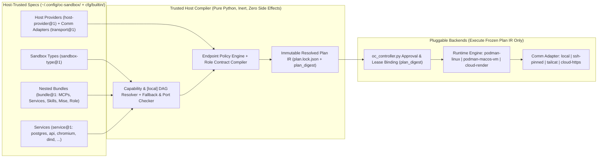

# prd_l: Composable sandbox configuration, host providers, communication adapters, and orchestrator config management

[Index](README.md) · children: [external secret isolation](prd_l1.md) · related:
[Postgres host access](prd_a.md), [per-instance networking](prd_d.md),
[local HTTPS](prd_e.md), [host tools](prd_f.md), [orchestrator](prd_i.md),
[orchestrator UI and profiles](prd_i1.md), [SSH onboarding](prd_i2a.md),
[credential broker](prd_i3.md), [host LLM broker](prd_i4a.md),
[warm worker starts](prd_i5.md), [host config](prd_j.md)

## Goal

Replace hardcoded top-level sandbox flags and imperative Bash special cases (such as `-p` Postgres,
`-D` DinD, and hardcoded Chromium) with a **holistic, host-trusted configuration and compilation
architecture** that cleanly separates:

1. **What runs inside a sandbox** (composable named Sandbox Types, Bundles, Services, MCPs, Skills,
   compiled `mise` toolchains, and standing Personas),
2. **How containers execute** (pluggable Runtime Engines / Host Providers), and
3. **How the controller communicates with the worker** (pluggable Communication Adapters).

At the same time, give the restricted **`oc-sandbox orchestrate` (`-o`)** agent safe, human-gated
configuration-management capabilities via typed MCP tools and curated base Skills — **without**
granting generic host filesystem, shell, Podman, or SSH access.

## Coordination with active workstreams and open PRD choices

- **Warm worker seeding (`codex/warm-worker-seeding` / [prd_i5](prd_i5.md)):** Tier-2 dependency
  seeding, OCI provenance verification, and cache-aware placement remain owned by `prd_i5`. This
  PRD consumes `prd_i5`'s digest-pinned image/seed layer contracts without duplicating or altering
  `prd_i5.md`.
- **Open choices in [prd_i1](prd_i1.md) and [prd_j](prd_j.md):** This spike PoC uses an
  append-only, file-backed monotonic revision journal under an explicit `--config-dir` (pure Python
  stdlib, zero new dependencies) so it does not prematurely force `prd_i1`'s SQLite-vs-Git profile
  history choice or `prd_j`'s plain-editor-vs-TUI choice; the store interface stays cleanly
  pluggable behind a `ConfigStore` protocol.

## Architecture: 3-Axis Compiler Model



### Axis 1: Workload (Named Sandbox Types, Bundles, Services)

- **Inert `schema_version = 1` TOML by default**, with an optional **host-only registered Python
  factory (`factory_id`)** for complex built-in or host-installed services and providers.
- Discovery, `--help`, `plan`, and validation read **only** declarative TOML; zero Python executes
  until runtime activation. Mutable workload TOML (`sandbox-type`, `bundle`, `service`) **never**
  accepts a raw `file.py:factory` path — it may reference only an opaque `factory_id` mapped by a
  separate host-only registry (`factories.toml`, outside orchestrator MCP reach), whose files are
  loaded exclusively from host-trusted directories (`<repo>/cfg/builtin/` or
  `~/.config/oc-sandbox/`, verified via `trusted_path` + ancestor walk + `O_NOFOLLOW` fd-only byte
  capture + size cap per [prd_i4a](prd_i4a.md), zero TOCTOU).
- **Recursive Capability DAG with `api-agent`-style `[local]` Conditional Acquisition:**
  - Services (`service@1`) declare `provides` (e.g., `cap:db.postgres@17.4`), `requires` (e.g.,
    `cap:db.postgres@^17`), `cardinality` (`singleton` | `named-instance`), `image` (digest-pinned
    `@sha256:<64hex>`), `readiness_probe`, `endpoints[]`, `volumes[]` (named volumes, `tmpfs`, or
    digest-pinned RO image mounts ONLY — **never** arbitrary host bind-mount paths in mutable
    declarative specs), `secret_slots[]`, `env` (strictly filtered, see M8), `resources` (`memory`,
    `pids_limit`), and `security_profile` (partial order with `"standard"` at bottom;
    `"desktop-wayland"` and `"elevated-nested"` are incomparable).
  - **Active-root `[local]` pruning, remote endpoint validation & remote read-only by default:**
    A tool or bundle declaring a `[local]` service branch (e.g., `myapp/api` requiring
    `cap:db.postgres@^17`) adds `myapp/api` as a root only when its remote endpoint binding
    (`API_ENDPOINT`) is blank. When a remote endpoint is bound, that `[local]` root edge is omitted:
    shared transitive dependencies (e.g., `builtin/postgres`) remain active if another active root
    still requires them, and are pruned if unreachable from all active roots. Externally bound
    remote endpoints are validated against scheme (`https` by default; `http` only via explicit host
    policy) and host policy (rejecting non-global IPs including loopback `127.0.0.0/8`, `::1`,
    link-local `169.254.0.0/16`, `fe80::/10`, CGNAT `100.64.0.0/10`, cloud metadata, non-canonical
    numeric/octal/hex IPv4 forms, and host-gateway addresses unless explicitly allowlisted by host
    policy), and the canonical remote binding is included in `plan_digest` and `security_delta`.
    - **Remote MCP endpoints are read-only by default:** Because local sidecars are disposable
      per-instance state while remote endpoints may be shared staging or production services, any
      MCP server bound to a remote endpoint (either statically via `https://...` or dynamically via
      `[mcp.<name>.local]` + `env_bindings`) **fails closed to read-only by default**.
    - **Explicit local vs. remote tool surface & separate credential slots:** `[mcp.<name>]`
      explicitly declares `read_only_tools` and `write_tools` (never inferred from tool names), plus
      target-scoped credentials under `[mcp.<name>.local]` (`headers`, `secret_env`) and
      `[mcp.<name>.remote]` (`read_only_headers`, `read_only_secret_env`, `write_headers`,
      `write_secret_env`). Any secret slot referenced in `remote.write_*` must be strictly distinct
      from all slots in `remote.read_only_*` and `local.*` so a write-capable staging token is never
      mounted into a read-only or local session. If a remote endpoint is active and no explicit
      `read_only_tools` surface is declared, compilation fails closed.
    - **Explicit per-endpoint write grant:** Admitting remote `write_tools` (and mounting
      `remote.write_headers` / `remote.write_secret_env`) requires an explicit operator opt-in
      (`--allow-remote-write <mcp>=<url>` / `overrides.remote_write_grants`) bound to the **exact
      canonical remote endpoint URL**. Mismatched or unused write grants fail closed. Granted remote
      write bindings are hashed into `plan_digest` and surfaced in `security_delta`
      (`remote_write_granted` and `mcp_tool_surface_widened`). Persona restrictions (such as
      `builtin/persona-security-reviewer`) still override/narrow `allowed_tools` even when a remote
      write grant is supplied — and if persona filtering eliminates all `write_tools`, the compiler
      downgrades effective credentials back to `remote.read_only_*` so a write-capable token is
      never mounted for a read-only persona.
  - **0-MCP service bundles:** A bundle with `mcp = []` can unconditionally declare
    `requires_services = ["builtin/postgres"]` so the sandbox has Postgres running with
    `PGPASSFILE`/`DATABASE_URL` ready for app development.
  - **Deterministic provider/fallback selection, diamonds, and named instances:**
    - Provider matching and explicit `fallback_service` selection run **inside** DAG resolution
      (before Kahn topological sort, diamond unification, and port-collision validation).
    - If multiple services satisfy a capability without an explicit `provider` / `instance` pin,
      compilation **fails closed** (never relying on filesystem or dictionary iteration order).
    - A fallback service is rejected if its `security_profile` is neither equal to the primary's
      nor `"standard"` (partial-order non-escalation: `"desktop-wayland"` and `"elevated-nested"`
      never fall back to each other), or if **any** fallback endpoint widens `max_exposure`, adds
      an exposed endpoint absent from the primary, or relaxes `requires_auth = true` to `false`.
    - `cardinality = "named-instance"` services (e.g., `pg-primary`, `pg-analytics`) declare an
      explicit `instance_port` (bound in the Plan IR) and consumers bind explicitly via
      `{capability = "cap:db.postgres@^17", instance = "pg-analytics"}` so pod ports never collide
      and wiring is unambiguous.
    - Cycles, unsatisfied capabilities, incompatible version diamonds, duplicate pod ports, and
      silent overwrites fail closed at compile time unless resolved explicitly via
      `[composition] replace = [...]` (which cannot weaken or replace `builtin/*` security
      invariants).
- **Built-in Service Modules (`builtin/*`, strictly immutable/non-overridable via orchestrator):**
  `builtin/postgres` (preserving 100% of [prd_a](prd_a.md) SCRAM `hba_file`, `PGPASSFILE`
  `mode=0600` secret, HMAC-keyed `oc.pgcfg` volume signature, and `5432` auth gate), `builtin/dind`
  (`security_profile = "elevated-nested"`), `builtin/chromium-wayland` (local desktop), and
  `builtin/chromium-managed-cdp` (managed/remote). Legacy CLI flags (`-p`, `-D`, etc.) are dropped
  cleanly in the reworked CLI.

### Axis 2: Runtime Engine (`host-provider@1`)

- Lowers a frozen Target-Bound Plan IR onto a target runtime:
  - `podman-linux`: rootless Podman, `pasta:--no-map-gw,-T,<port>` (managed), Podman secrets,
    native `--mount type=image` + `:O` overlay, SELinux confinement.
  - `podman-macos-vm`: Podman Machine VM, `host.containers.internal:<port>`, `GatewayPorts` guard
    ([prd_i2a](prd_i2a.md)), `arm64` target binding.
  - `cloud-render`: signed OCI digest deployment, external managed service bindings, mandatory
    `max_ttl` / `idle_timeout` / `spend_cap_usd` lease contract, `supports_sidecars = false`.
- Every Runtime Engine advertises a **Capability Manifest** (`arch`, `os`, `supports_pods`,
  `supports_pasta`, `supports_image_mounts`, `supports_reflink`, `supports_wayland`,
  `supports_dind`, `multi_tenant_loopback`). The compiler fails closed at plan time if a Sandbox
  Type demands an unsupported capability (unless a validated, non-escalating `fallback_service`
  satisfies it during DAG resolution).

### Axis 3: Communication Adapter (`transport@1`)

- Exposes four narrow typed primitives:
  1. `exec_bounded(argv, stdin_stream, max_stdout, timeout)` — zero remote shell interpolation.
  2. `open_reverse_channel(local_host_uds) -> remote_endpoint` — bridges host-only
     `oc_llm_broker.py` or Tier-1 reverse-proxy mirror UDS into the worker.
  3. `transfer_blob(digest, stream, direction)` — bounded, digest-verified transfers for Git
     bundles/artifacts ([prd_i5](prd_i5.md)).
  4. `attach_session(target_id, mode)` — PTY/tmux or browser arbiter stream ([prd_i2](prd_i2.md)).
- Implementations: `local`, `ssh-pinned` ([prd_i2a](prd_i2a.md)), future `tailcat` (reusing 100% of
  the Podman Runtime Engines), and `cloud-https`.

## Structured Role Contracts (Personas, Groupings, Skills, MCPs)

Raw depth-first system-prompt concatenation is **not** used (replacing OpenCode's `agent.prompt`
breaks core tool-calling/compaction behavior, causes persona contradictions across nested bundles,
and busts prompt caching). Instead, nested bundles (`bundle@1`) compile into **idiomatic OpenCode
v2 primitives** staged read-only under `/run/oc-config/`:

| Artifact | Merge Rule | Compiled Target in `/run/oc-config/` |
|---|---|---|
| **Primary Persona** | **Singular (non-merging).** One standing mission, authority posture, and completion rubric per sandbox. Conflicting primary personas fail compile unless `[composition] replace = ["persona"]`. | `agents/<name>.md` (`default_agent` in `opencode.json`) + concise `MISSION.md`. Additional bundle personas register as callable `subagent`s. |
| **Standing Invariants** | Topological post-order deduplicated list, byte-capped (16 KiB total), optional single-pass `{{slot}}` templates (see below). | `instructions/<nn>-<bundle>.md` referenced in `opencode.json` `instructions` array (appends without replacing OpenCode's core prompt). |
| **Services Inventory** | Auto-synthesized fact table from resolved Plan IR (never drifts). | `SERVICES.md` (included in `instructions`). |
| **Skills (0..N)** | Set union (conflict on identical skill ID fails closed). | `skills/<name>/SKILL.md` (progressive disclosure; 0 tokens until invoked). |
| **MCPs (0..N)** | Strict map merge + **Role-Filtered Tool Surface** (persona can narrow allowed tools, e.g., read-only DB queries for a reviewer). | `opencode.json` `mcp` map; secrets strictly via typed `{file:/run/secrets/<slot>}`. |

- **Safe `{{slot}}` expansion:** Slot files must live strictly inside the declaring host-trusted
  bundle directory, opened with `O_RDONLY | O_NOFOLLOW | O_NONBLOCK` + `fstat` (`S_ISREG`,
  `st_uid == euid`, `st_mode & 0o022 == 0`, `st_nlink == 1`, size <= 16 KiB), and expanded in a
  **single non-recursive regex pass** (never `str.format`, never re-expanding `{{...}}` tokens
  appearing inside slot content).
- **Managed-tier workspace lockout (explicit assumption to verify against real OpenCode v2):** In
  `managed` tier, we assume OpenCode v2 can be configured/launched to ignore workspace
  `./opencode.json` and `.opencode/` plugins so untrusted repos in `~/opencode-sandbox` cannot
  override broker routing, MCP permissions, or persona rules. Verifying the exact OpenCode v2 flags
  and precedence behavior against a live container is out of scope for the offline spike PoC and is
  a required qualification check before production managed-tier launch.

## Compiled Workload `mise`, Base Images, and Minimal Worker Bootstrap

- **Strict two-domain `mise` split:**
  - Host `mise` (`tools/mise.toml` + `tools/mise.lock`, [prd_f](prd_f.md)) stays strictly on the
    workstation (`MISE_PARANOID=1`, scrubbed inherited `MISE_*`).
  - Workload `mise` comes strictly from constrained data-only `executables.toml` manifests inside
    host-trusted bundles (exact pinned `[tools]` only; max 64 manifests / 64 tools; no `[hooks]`,
    `[env]`, or `[tasks]`; no moving channels such as `latest` or ranges; version conflicts fail
    closed unless overridden in the leaf Sandbox Type).
- **Compile-time lock merging -> Immutable RO OCI Toolchain Image:**
  - `oc-sandbox config lock` merges `executables.toml` pins into a multi-platform `mise.lock`
    (`linux-x64`, `linux-arm64`), verified with `lockcmp.py`, and builds a content-addressed
    read-only OCI Toolchain Image (`localhost/oc-toolchain:<key>`) in a split-phase offline builder.
  - Delivered via Podman `--mount type=image,src=localhost/oc-toolchain:<key>,dst=/opt/oc-tools,ro`
    (0ms startup, zero base-image rebuilds across tool combinations, unpoisonable), with automatic
    `COPY --from=` fallback for engines without image mounts.
- **Base Containerfile & post-install hooks:** Base images are digest-pinned (`@sha256:...`).
  Optional `mise` post-install hooks are host-only (never mutable via orchestrator MCP proposals)
  and run **strictly inside an offline, networkless, credential-free Phase-2 builder container**
  ([prd_i5](prd_i5.md)), hashed into the image cache key — never on the host.
- **Minimal zero-trust remote worker TCB:** Remote SSH/Tailcat workers do **not** require host
  `mise` — only rootless `podman` (or `podman machine`) and hardened `sshd` (`GatewayPorts no`) /
  `tailcat`. Startup runs read-only `HostProvider.probe()`; `oc-sandbox worker bootstrap <name>`
  provides an explicit, previewed, opt-in bootstrap script (never silent `curl | sh`).

## 2-Tier Zero-Poisoning Application Package Caching

Shared writable package caches across sandboxes are prohibited (cross-sandbox poisoning and private
package disclosure). Self-hosted Artifactory/Nexus is out of scope as a managed component (pointing
at an *existing external* Artifactory URL via config is supported). *(Both tiers are documented
for architectural completeness and are out of scope for the offline spike PoC.)*

1. **Tier 1 (Default, Universal):** A lightweight host/worker **reverse-proxy registry mirror**
   (plain HTTP on `pasta -T` / internal UDS configured via ecosystem index URLs such as
   `NPM_CONFIG_REGISTRY`, `UV_INDEX_URL`, `CARGO_REGISTRIES_*`; **zero TLS MITM** — the host proxy
   originates verified TLS to allowlisted upstreams, validates redirects, exposes `GET`/`HEAD` only
   to sandboxes, caches immutable `.tgz`/`.whl`/`.crate`/`.nupkg` blobs verified by client lockfiles,
   injects private registry credentials strictly on the host side, and partitions private-registry
   cache entries by job grant scope).
2. **Tier 2 (Hot-Path Acceleration, owned by [prd_i5](prd_i5.md)):** Content-addressed immutable
   materialized dependency layers built offline via Tier 1, mounted locally via Podman `:O` overlay
   or Btrfs reflink and promoted to signed OCI Image Volumes for remote/cloud workers.

## Universal Capability-Scoped Endpoint Policy Engine

Every `service@1` declares its `endpoints[]` (`name`, `port`, `protocol`, `default_exposure`,
`max_exposure`, `requires_auth`, `auth_enforcer`, `tls_policy`, `readiness_probe`,
`host_url_template`). Hardcoded port numbers are removed from core code:

- `default_exposure = "pod-only"` by default; undeclared ports are never published.
- `max_exposure = "pod-only"` (e.g., Chromium DevTools `9222`) is unconditionally refused by CLI
  `--port`, [prd_d](prd_d.md) loopback forwarding, and remote `ssh -L`.
- `requires_auth = true` (e.g., Postgres `5432` with `auth_enforcer = "pg-scram-ro-hba"`) cannot be
  exposed to host loopback, [prd_d](prd_d.md) instance DNS, or remote `ssh -L` unless its auth
  enforcer is attached and its authenticated `readiness_probe` passes.
- `tls_policy = "required-when-ca-ready"` automatically wires [prd_e](prd_e.md)/[prd_e3](prd_e3.md)
  instance leaf certificates when the constrained host CA is active.
- **`host_url_template` hardening:** Accepts only closed schemes (`http`, `https`, `postgresql`,
  `redis`, `tcp`) and closed placeholders (`{host}`, `{port}`, `{user}`, `{db}`, `{path}`) with
  strict URL percent-encoding; password placeholders are permanently forbidden.

## Reworked Clean-Slate CLI Interface

| Command | Purpose |
|---|---|
| `oc-sandbox run [NAME] [--type TYPE] [--host WORKER] [--with MOD]... [--without MOD]... [--port SPEC]... [--allow-remote-write MCP=URL]... [--worktree REPO[:REF]]` | Compile plan, verify grants/drift, start services and OpenCode sandbox. |
| `oc-sandbox plan [NAME] [...]` | Pure, inert dry-run emitting `plan.lock.json`, `plan_digest`, security elevations, port/auth summary, and drift diff against `applied_plan.json`. |
| `oc-sandbox build [--type TYPE] [--host WORKER]` | Build/verify pinned images, compiled `mise` OCI toolchain layer, and warm seeds without launching OpenCode. |
| `oc-sandbox orchestrate` (alias `oc-sandbox -o`) | Launch restricted host orchestrator with typed Config/Orchestration MCP tools and curated base Skills (no generic host file/shell/Podman/SSH access). |
| `oc-sandbox config {list,show,validate,diff,history,approve,reject,reconcile,restore,lock}` | Host-operator config inspection, live-helper approval/rejection/reconciliation (`--operator-socket`, `--digest`), rollback, and `mise.lock` compilation. |
| `oc-sandbox worker {list,enroll,probe,bootstrap,reconcile}` | Enroll pinned SSH/Tailcat/cloud workers, probe capabilities, run opt-in previewed bootstrap, reap verified orphans. |
| `oc-sandbox ps` / `attach NAME` / `down NAME [--purge]` / `rollback NAME` | Inspect running sandboxes/services, attach, tear down via ownership labels/receipts, or restore prior `applied_plan.json`. |

## Restricted Orchestrator (`-o`) Config Management & Base Skills

Aligned with [prd_i1](prd_i1.md), the orchestrator runs in a restricted OS sandbox with **zero**
generic host file reads/writes, shell, Podman socket, SSH agent, or raw secret access.

### Typed Host Config MCP Surface (Over Private `0o700` UDS)

- **Defense-in-depth peer authentication:**
  - Helper creates a fresh per-incarnation `0o700` socket directory under
    `$XDG_RUNTIME_DIR/oc-sandbox/orch-<incarnation>/mcp.sock` mounted/exposed exclusively to the
    orchestrator sandbox.
  - Helper generates a fresh **per-incarnation 256-bit random session token** delivered to the
    orchestrator via a `mode=0400` secret mount and verified in constant time
    (`hmac.compare_digest`) on every request; restarting the helper rotates the incarnation and
    token so stale/replayed authority fails closed.
  - Helper additionally verifies kernel `SO_PEERCRED` (`uid == expected_uid`, plus `gid`/`pidfd`
    or sandbox cgroup/SELinux peer checks in production; in the offline single-host PoC test
    harness, verifies `uid == os.geteuid()` plus the per-incarnation session token and restart
    rotation).
- **Strict framing, bounds, and JSON rules:**
  - `Content-Length: <n>\r\n\r\n<json>` framing over UDS; max frame `256 KiB`; per-read timeout
    (5s) and overall request deadline (15s); max 8 concurrent connections; per-client rate limiter.
  - Strict JSON parser rejecting duplicate keys (`object_pairs_hook`), `NaN`/`Infinity`, unpaired
    surrogates, nesting depth > 32, and trailing/pipelined junk bytes.
- **Exact opaque ID grammar:**
  - Every object ID must match `^[a-z0-9][a-z0-9_-]{0,31}(/[a-z0-9][a-z0-9_-]{0,31})?$` (at most
    one `/` namespace separator, no leading/trailing `/`, no `//`, no `..`, max 65 chars).
  - Namespace `builtin/*` is strictly **read-only and non-overridable**.
- **Closed read-only vs. mutable kind allowlists:**
  - `READABLE_ORCHESTRATOR_KINDS = ("sandbox-type", "bundle", "service", "worker", "host-provider", "transport")`
    (returns redacted metadata only — no host filesystem paths, no raw secrets, no private worker
    IPs/hostnames beyond registered logical name/arch/capabilities).
  - `MUTABLE_ORCHESTRATOR_KINDS = ("sandbox-type", "bundle", "service")` — **strict allowlist**
    (all other kinds — `worker`, `host-provider`, `transport`, `factory`, `known_hosts`, `manager`,
    `policy` — are permanently refused to orchestrator mutations).
  - Additional orchestrator-proposal prohibitions: cannot modify or shadow `builtin/*`; cannot
    register a service claiming a `builtin/*` capability with weakened `requires_auth`,
    `auth_enforcer`, or `max_exposure`; cannot specify `file.py:factory` paths, host bind mounts,
    unpinned container images (missing `@sha256:`), arbitrary shell `post_install_hooks`, or
    arbitrary host-path MCP commands.
- **Read-only MCP tools:**
  - `config_list(kind, include_archived=false, cursor=None, limit=50)` — bounded `limit` (1..100)
    and validated opaque `cursor`; secret presence/ref metadata only.
  - `config_get(kind, id)` — returns validated TOML/Markdown document and monotonic revision number.
  - `config_schema(kind)` — returns `schema_version = 1` schema, built-in capabilities, and valid
    enum values.
  - `plan_preview(sandbox_type, worker, overrides, draft=None)` — overlays at most 16 validated
    in-memory draft objects (each <= 64 KiB, strictly within `MUTABLE_ORCHESTRATOR_KINDS`, never
    `builtin/*`, max 64 DAG nodes), runs `compile_plan`, and returns a **redacted plan summary**
    (no host filesystem paths, vault IDs, or private worker addresses).
  - `config_diff(kind, id, from_rev, to_rev)` and `config_history(kind, id, cursor=None, limit=50)`.
- **Human-gated mutation MCP tool (`config_propose_revision`) & durable `oc_controller.py` flow:**
  - Validates the proposed TOML against `schema_version = 1`, structural secret/env rules, and
    `MUTABLE_ORCHESTRATOR_KINDS` / `builtin/*` protections.
  - Captures `base_store_revision` (store-wide monotonic integer) AND `closure_digest` (SHA-256 of
    canonical `(kind, id, rev)` tuples for the target + every transitively referenced object), runs
    the pure Plan Compiler across affected sandbox types, and computes a closed-set
    **`security_delta`** (`security_profile_elevation`, `exposure_widened`,
    `auth_requirement_changed`, `new_service_added`, `service_image_changed`,
    `new_mcp_server_added`, `mcp_tool_surface_widened`, `new_mise_tool_added`, `persona_changed`,
    `remote_endpoint_added`, `remote_write_granted`, `secret_slot_added`,
    `resource_limit_increased`).
  - Persists an immutable proposal record (`status = "pending"`, closed `action` in
    `("upsert", "archive", "unarchive")` — permanent deletion forbidden per `prd_i1`, with
    `proposed_toml is None` required for `"archive"`/`"unarchive"`, TTL `expires_at`, bounded quota
    of at most 32 pending proposals) under the store's exclusive persistent-inode `flock`, and
    submits an `Intent.APPLY_ONCE` `Proposal` into the real
    [oc_controller.py](../../oc_controller.py) `Controller` API using `_ID`-compliant identifiers
    (`alias = "config_store"`, `reference = "config_store_apply"`, `target = "config_store_target"`,
    `target_revision = sha256(f"store-rev:{store_revision}")`), proposed by a `Role.JOB` principal
    and inspected via `controller.view(operator_principal, request_id)` (no modifications to
    production `oc_controller.py`).
  - **Restart & crash boundary:** Because `oc_controller.Controller` is in-memory and
    incarnation-scoped, across a helper restart all prior-incarnation `"pending"` proposals fail
    closed and must be re-proposed in the new incarnation (matching `prd_i1` replay-after-restart
    rejection). Any `"uncertain"` proposal left from a crash is reconciled against the on-disk
    journal before accepting new publishes.
  - **Operator-only publish (`operator_approve_config_proposal`) & host-only operator UDS:**
    The live helper exposes a **separate** host-only `0o700` operator control socket
    (`operator.sock`, mode `0o600`, paired with a `0o600` per-incarnation `operator.token`, NEVER
    mounted into the orchestrator sandbox) guarded by `SO_PEERCRED` (`uid == expected_uid`),
    Content-Length framing, strict JSON parsing, and a closed operator method allowlist
    (`operator_approve`, `operator_reject`, `operator_reconcile`, `operator_status`). Fresh host
    CLI invocations (`oc-sandbox config approve/reject/reconcile --operator-socket ...`) invoke the
    live helper incarnation over this UDS so in-incarnation approvals succeed cross-process while
    restarting the helper rotates the incarnation and rejects prior pending proposals fail-closed.
    Under the same exclusive persistent-inode `flock` (`O_NOFOLLOW`, `0o600`, lock file never
    unlinked, matching `oc-setup-lock.py`):
    1. Verifies `proposal.incarnation == controller.incarnation`, `proposal.status == "pending"`,
       `now() < proposal.expires_at`, and constant-time `proposal.digest == expected_digest`.
    2. Verifies `store.store_revision == proposal.base_store_revision` AND `closure_digest` still
       matches (eliminating transitive-dependency TOCTOU); if `action == "archive"`, re-verifies
       `not store.has_active_dependents(kind, obj_id)`.
    3. Re-runs `compile_plan` + re-computes `security_delta` and asserts exact digest match.
    4. Transitions proposal durably to `applying` (`fsync`), calls `controller.decide(..., APPROVE)`
       with `(view.payload.revision, view.digest)` and `controller.invoke(config_job_principal, ...)`
       whose journaled `ConfigPublishAdapter` atomically writes monotonic revision `N + 1`
       (`O_CREAT|O_EXCL` + `0o600` + `fsync` + `os.replace`) and commits the durable journal entry:
       - `State.SUCCEEDED` -> mark proposal terminal `"applied"`.
       - `State.UNCERTAIN` -> mark proposal **non-terminal `"uncertain"`** (preserving the
         controller's one-shot fence until settled via `ConfigPublishAdapter.reconcile()` ->
         `controller._reconcile(request_id)` -> `"applied"` or `"failed"`).
       - `State.FAILED` / `State.STALE` / `State.EXPIRED` -> mark proposal terminal `"failed"` /
         `"expired"` accordingly.
    5. Archiving a resource still referenced by any non-archived spec fails closed; `restore`
       always publishes a new monotonic revision `N + 1` so prior approvals can never replay.

### Curated Orchestrator Base Skills (`/run/oc-config/skills/`, mounted `:ro`)

1. **`oc-config-architecture`** — explains the 3-axis model (`Workload` × `Runtime Engine` ×
   `Comm Adapter`), `plan.lock.json` IR, trust boundaries (host-trusted vs. hostile workspace,
   `factory_id` indirection, zero raw secrets), and the clean-slate CLI.
2. **`oc-sandbox-authoring`** — step-by-step authoring guide and complete examples:
   - Full-stack app sandbox with `builtin/postgres` and **0 MCP tools** (app dev against local DB).
   - API sandbox using `[local]` conditional acquisition (auto-spins local API + transitive
     Postgres when `API_ENDPOINT` is blank; prunes both when pointed at staging).
   - Security-reviewer standing persona (`default_agent` + role-filtered read-only MCPs +
     progressive-disclosure skills) vs. implementer persona, and `[composition] replace`.
3. **`oc-services-and-ports`** — endpoint exposure classes (`pod-only` / `host-loopback` /
   `instance-dns`), auth verifiers (Postgres SCRAM, `prd_e3` TLS), constrained `executables.toml`
   `mise` locking, and 2-tier zero-poisoning package caching.
4. **`oc-workers-and-providers`** — enrolling and targeting Local Podman, SSH Linux/macOS Podman
   Machine (Keeper SSH agent + pinned `known_hosts`), Tailcat, and Render cloud providers, handling
   capability mismatches, and using `plan_preview` + `config_propose_revision` safely.

## Additional Hardening Invariants (M1–M8)

- **M1 (Host-trusted vs. hostile workspace):** Validate all `$CONF_DIR` files (`0o700` dirs,
  `0o600` files, `st_nlink == 1`, `trusted_path` outside `~/opencode-sandbox`). Never parse or load
  factories, Containerfiles, `mise` hooks, or MCP commands from `~/opencode-sandbox`; any future
  repo `.oc-sandbox.toml` is parsed inside `safe_run --network=none` as non-authoritative capability
  hints only.
- **M2 (Retire shared `oc-home` & `npx -y ...@latest`):** Managed sandboxes use isolated per-job
  homes, read-only OpenCode binary mounts, and digest-pinned RO MCP layers.
- **M3 (Cross-arch determinism):** Logical Plans stay arch-agnostic; multi-arch OCI digests and
  `mise.lock` platform entries bind against `HostProvider.probe().arch` (`x86_64` vs. `arm64`).
- **M4 (Drift detection & rollback):** Persist `applied_plan.json` per instance under `$CONF_DIR`;
  classify relaunch deltas as `hot-safe`, `recreate-stateless`, or `stateful-migration-required`
  (fail closed); support `oc-sandbox rollback NAME`.
- **M5 (Diamond & port conflicts):** Fail closed on incompatible SemVer/pin diamonds, ambiguous
  capability providers, or duplicate pod ports unless resolved by named service instances or
  `[composition] replace`.
- **M6 (Universal ownership & cloud leases):** Standardize ownership labels (`oc.sandbox=1`,
  `oc.instance`, `oc.service`, `oc.volume.durable`, `oc.incarnation`), write-before-create receipts
  (`$CONF_DIR/remote-state/`), and mandatory `max_ttl`/`idle_timeout`/`spend_cap_usd` cloud leases.
- **M7 (Intra-pod topology & resource baselines):** Support explicit `pod-shared` vs.
  `isolated-sidecars` topology modes; enforce mandatory `memory`/`pids_limit`/`--cap-drop=ALL`/
  `--security-opt=no-new-privileges` on every service.
- **M8 (Universal Secret Materializer & Structural Env Filtering):** Generalize HMAC `pg_sig()` +
  stdin `podman secret` (`mode=0400`) + [prd_i4a](prd_i4a.md) `managers.toml` vault refs to all
  services and MCPs. Secret slots and sensitive MCP headers accept **only** typed `SecretRef` /
  `{file:/run/secrets/<slot>}` schemas; declarative `env` maps reject dangerous keys (`PATH`,
  `LD_*`, `PYTHON*`, `NODE_OPTIONS`, `GIT_*`, `MISE_*`, `OPENCODE_CONFIG*`, `SSH_AUTH_SOCK`,
  `DBUS_*`, `*_API_KEY`, `*_TOKEN`, `*_SECRET`, `*_PASSWORD`).

## Gate 1: Pseudocode Walkthrough (PoC Scope)

### 1. Pure Plan Compiler (`compile_plan`)

```text
function compile_plan(store, sandbox_type_id, worker_spec, overrides, applied_plan=None):
    st = store.load_trusted_sandbox_type(sandbox_type_id)       # schema_version == 1; no Python imported
    bundles = resolve_bundle_dag_topological(store, st.bundles, overrides.with_mods, overrides.without_mods)
        # Fails closed on cycle, missing bundle, or unacknowledged [composition] replace collision
        # Rejects any [composition] replace targeting builtin/* security invariants

    # 1. Collect active roots (applying [local] pruning + validating external remote endpoints)
    active_roots, remote_bindings = collect_active_service_roots(bundles, overrides.env_bindings, host_policy)
        # If a tool's [local] slot has an external remote endpoint bound, validate scheme/host policy
        # (reject loopback/link-local/metadata unless allowlisted) and omit that local root edge;
        # shared transitive deps survive if still reachable from another active root.

    # 2. Resolve service DAG with capability-aware provider & fallback selection INSIDE DAG resolution
    services = resolve_service_dag(store, active_roots, worker_spec.capabilities)
        # For each required capability/service:
        #   - Resolve deterministically (fail closed on >1 matching provider without explicit pin)
        #   - If worker lacks required_capabilities, select explicit fallback_service ONLY if
        #     fallback.security_profile in (primary.security_profile, "standard") AND
        #     every fallback endpoint preserves per-endpoint max_exposure and requires_auth (no widening/relaxation)
        #   - Recursively traverse selected service's `requires`
        # Then run Kahn topological sort; reject cycles, incompatible version diamonds,
        # un-remapped named-instance collisions, and duplicate pod ports.

    # 3. Compile Endpoint Exposure Policy (zero hardcoded port numbers)
    endpoints = compile_endpoints(services, st.ports, overrides.cli_ports)
        # Rejects any requested exposure exceeding endpoint.max_exposure (e.g., 9222 -> pod-only)
        # Rejects any host/DNS exposure of requires_auth=true without verified auth_enforcer
        # Validates host_url_template against closed schemes & placeholders (no password placeholder)

    # 4. Compile Structured Role Contract (singular persona + instructions + skills + filtered MCPs)
    role, granted_remote_writes = compile_role_contract(
        bundles, st.default_agent, services, remote_bindings, overrides.remote_write_grants
    )
        # Rejects >1 primary persona without [composition] replace = ["persona"]
        # Generates SERVICES.md from resolved services; enforces 16 KiB byte cap on instructions
        # Expands {{slot}} in a single non-recursive pass from O_NOFOLLOW bundle-confined files
        # Remote MCP endpoints default to explicit read_only_tools + remote.read_only_* creds
        # (failing closed if no read_only_tools declared); remote write_tools + remote.write_* creds
        # require an exact canonical-URL match in overrides.remote_write_grants AND surviving persona
        # write tools (mismatched/unused grants fail closed; persona narrowing still downgrades creds
        # back to remote.read_only_* if no write tools survive).
        # Enforces typed SecretRef / {file:/run/secrets/...}; rejects forbidden env keys.

    # 5. Merge constrained mise executables.toml (data-only [tools], <= 64 manifests / 64 tools)
    mise_tools = merge_executable_pins(bundles, services, st.mise_overrides)
        # Fails closed on version conflict, moving channel ('latest'), or hooks/env/tasks keys

    # 6. Target-bind digests for worker_spec.arch and hash IMMUTABLE Plan IR BEFORE drift
    plan = build_canonical_plan_ir(
        st, worker_spec, services, remote_bindings, granted_remote_writes, endpoints, role, mise_tools
    )
    plan_digest = sha256_canonical_json(plan)                   # excludes mutable drift!
    drift = classify_drift(applied_plan, plan)                  # hot-safe | recreate-stateless | stateful-migration-required
    return CompiledPlanResult(plan=plan, plan_digest=plan_digest, drift=drift)
```

### 2. Restricted Orchestrator Config MCP Server & Human-Gated Publish

```text
function handle_orchestrator_mcp_connection(conn, peer_cred, expected_uid, incarnation_token):
    if peer_cred.uid != expected_uid:
        close_immediately(conn); return
    if not rate_limiter.allow(peer_cred.uid):                   # check BEFORE reading/parsing 256 KiB JSON
        return json_rpc_error(-32002, "rate_limited")
    raw_frame = read_content_length_frame(conn, max_bytes=262_144, read_timeout=5s, total_timeout=15s)
        # Rejects trailing/pipelined junk bytes, missing/invalid Content-Length, oversized frames
    req = parse_strict_json_rpc(raw_frame, max_depth=32)
        # Rejects duplicate keys, NaN/Infinity, unpaired surrogates
    if not hmac.compare_digest(req.auth_token, incarnation_token):
        return json_rpc_error(-32001, "invalid_or_stale_session_token")
    if req.method not in ALLOWED_MCP_METHODS:
        return json_rpc_error(-32601, "method_not_allowed")

    if req.method in ("config_list", "config_get", "config_schema", "config_diff", "config_history"):
        validate_kind_in(req.params.kind, READABLE_ORCHESTRATOR_KINDS)
        validate_opaque_id_if_present(req.params.id)            # ^[a-z0-9][a-z0-9_-]{0,31}(/[a-z0-9][a-z0-9_-]{0,31})?$
        validate_paging(req.params.limit, req.params.cursor)    # 1 <= limit <= 100
        return execute_read_only_store_query(req.method, req.params)

    if req.method == "plan_preview":
        draft_store = overlay_validated_draft(host_store, req.params.draft,
                                              allowed_kinds=MUTABLE_ORCHESTRATOR_KINDS,
                                              forbid_builtin=True, max_objects=16, max_bytes=65_536)
        res = compile_plan(draft_store, req.params.sandbox_type, req.params.worker, req.params.overrides)
        return redact_plan_summary(res)                         # omits host paths, vault IDs, private worker hosts

    if req.method == "config_propose_revision":
        kind, obj_id, proposed_toml, action = validate_proposal_inputs(req.params)
            # Closed action enum: ("upsert", "archive", "unarchive"); proposed_toml MUST be None for archive/unarchive
        if kind not in MUTABLE_ORCHESTRATOR_KINDS or obj_id.startswith("builtin/"):
            return json_rpc_error(-32003, "kind_or_namespace_not_mutable")
        if action == "upsert":
            validate_schema_and_orchestrator_limits(kind, proposed_toml)
                # Rejects file.py:factory paths, host bind mounts, unpinned images, shell post_install_hooks,
                # builtin/* capability downgrade, unknown keys, forbidden env keys, and raw secrets
        with host_store.persistent_flock():                     # exclusive lock prevents quota/publish races
            host_store.assert_no_unresolved_uncertain_proposals()
            if action == "archive" and host_store.has_active_dependents(kind, obj_id):
                return json_rpc_error(-32004, "referenced_by_active_config")
            base_store_rev = host_store.store_revision
            draft_store = host_store.with_in_memory_overlay(kind, obj_id, proposed_toml, action)
            affected_plans, closure_digest = dry_run_compile_affected(host_store, draft_store, kind, obj_id)
            security_delta = compute_closed_security_delta(host_store, draft_store, affected_plans)
            proposal = host_store.create_pending_proposal(
                kind, obj_id, action, proposed_toml,
                incarnation=controller.incarnation,
                base_store_rev=base_store_rev, closure_digest=closure_digest,
                security_delta=security_delta, ttl_seconds=900, max_pending=32,
            )
            # Submit via real oc_controller.Controller API (Role.JOB + _ID-compliant alias/reference)
            # Adapter target_revision("config_store_target") returns sha256(f"store-rev:{store_revision}")
            ctrl_status = controller.propose(config_job_principal,
                                             Proposal(Intent.APPLY_ONCE, "config_store", "config_store_apply"))
            ctrl_view = controller.view(operator_principal, ctrl_status.request_id)
            host_store.bind_controller_request(proposal.id, ctrl_status.request_id,
                                               ctrl_view.payload.revision, ctrl_view.digest)
            return {"proposal_id": proposal.id, "proposal_digest": proposal.digest,
                    "controller_request_id": ctrl_status.request_id,
                    "security_delta": security_delta, "status": "pending"}

function operator_approve_config_proposal(operator_principal, proposal_id, expected_digest):
    with host_store.persistent_flock():                         # O_NOFOLLOW, 0o600, lock file never unlinked
        host_store.assert_no_unresolved_uncertain_proposals()
        proposal = host_store.load_proposal(proposal_id)
        if proposal.incarnation != controller.incarnation:
            raise StaleProposal("Proposal belongs to a prior helper incarnation; re-propose")
        if proposal.status != "pending":
            raise Conflict("Proposal is not pending")
        if now() >= proposal.expires_at:
            host_store.mark_proposal_terminal(proposal.id, "expired")
            raise Expired("Proposal expired")
        if not hmac.compare_digest(proposal.digest, expected_digest):
            raise DigestMismatch("Approval digest mismatch")
        if host_store.store_revision != proposal.base_store_revision:
            raise StaleProposal("Store changed since proposal; re-propose against latest revision")
        if proposal.action == "archive" and host_store.has_active_dependents(proposal.kind, proposal.obj_id):
            raise Conflict("Target is now referenced by an active config; cannot archive")
        # Re-verify closure & security_delta under write lock to prevent transitive TOCTOU
        draft_store = host_store.with_in_memory_overlay(proposal.kind, proposal.obj_id,
                                                        proposal.proposed_toml, proposal.action)
        affected_plans, cur_closure = dry_run_compile_affected(host_store, draft_store,
                                                               proposal.kind, proposal.obj_id)
        cur_delta = compute_closed_security_delta(host_store, draft_store, affected_plans)
        if cur_closure != proposal.closure_digest or cur_delta.digest != proposal.security_delta_digest:
            raise StaleProposal("Transitive dependencies or security delta changed")
        host_store.mark_proposal_state(proposal.id, "applying") # durable fsync before invoke
        controller.decide(operator_principal, proposal.controller_request_id,
                          proposal.controller_rev, proposal.controller_digest, Decision.APPROVE)
        # ConfigPublishAdapter.dispatch atomically publishes monotonic rev N+1 (O_EXCL + fsync + os.replace)
        # and appends the durable journal record; reconcile() settles uncertain outcomes idempotently.
        status = controller.invoke(config_job_principal, proposal.controller_request_id)
        if status.state is State.SUCCEEDED:
            host_store.mark_proposal_terminal(proposal.id, "applied")
            return host_store.current_revision(proposal.kind, proposal.obj_id)
        if status.state is State.UNCERTAIN:
            host_store.mark_proposal_state(proposal.id, "uncertain")   # non-terminal; reconcile before next publish
            raise PublishUncertain("Publish outcome uncertain; run config reconcile")
        if status.state is State.EXPIRED:
            host_store.mark_proposal_terminal(proposal.id, "expired")
            raise Expired("Controller approval expired")
        host_store.mark_proposal_terminal(proposal.id, "failed")
        raise PublishFailed(status.reason)

function operator_reconcile_uncertain_proposal(proposal_id):
    with host_store.persistent_flock():
        proposal = host_store.load_proposal(proposal_id)
        if proposal.status != "uncertain":
            raise Conflict("Proposal is not uncertain")
        if proposal.incarnation == controller.incarnation:
            status = controller._reconcile(proposal.controller_request_id)
            if status.state is State.SUCCEEDED:
                host_store.mark_proposal_terminal(proposal.id, "applied")
            elif status.state is State.FAILED:
                host_store.mark_proposal_terminal(proposal.id, "failed")
            return status.state
        # Cross-restart crash recovery: settle strictly from durable on-disk journal
        settled = host_store.reconcile_from_journal(proposal.id)
        host_store.mark_proposal_terminal(proposal.id, settled) # "applied" or "failed"
        return settled
```

## PoC Scope (Spike Branch `spike-outside-in-poc`)

Per [AGENTS.md](../../AGENTS.md#branches), the spike PoC lives strictly under
`docs/prds/spikes/l/` (Python stdlib only; 100% offline; requires explicit scratch `--config-dir`,
enforces refusal of real `~/.config/oc-sandbox` / `$XDG_CONFIG_HOME/oc-sandbox` and existing
non-empty non-PoC directories via `.oc-sandbox-poc-store` marker; leaves `oc-sandbox`,
`oc-bridge.py`, `oc_controller.py`, and production tests untouched). Inside Distrobox where `/tmp`
may be owned by a mapped UID, run tests and CLI examples with a user-owned `TMPDIR` (e.g.
`mktemp -d -p "${XDG_RUNTIME_DIR:-$HOME/.cache}"`) rather than weakening `assert_trusted_dir`:

- [x] **Pure-Python Plan Compiler & Schema (`docs/prds/spikes/l/oc_plan.py`, `oc_schema.py`)** —
      `schema_version = 1` TOML loader (host-state validation, unknown-key rejection, structural
      secret & forbidden-env checks), active-root `[local]` pruning & remote-endpoint policy,
      capability-aware DAG + non-escalating fallback resolver, diamond/cycle/named-instance/
      port-collision checks, Universal Endpoint Policy Engine (closed `host_url_template`),
      Structured Role Contract -> OpenCode v2 config/instructions/skills/MCP emitter (single-pass
      `O_NOFOLLOW` `{{slot}}`), constrained `executables.toml` merger, immutable `plan_digest`
      (excluding `drift`), and `applied_plan` drift classifier.
- [x] **Built-in Reference Catalog (`docs/prds/spikes/l/builtin/`)** — `service/postgres` (full
      SCRAM + `PGPASSFILE` + `5432` policy), `service/api-demo` (requiring `cap:db.postgres@^17`
      with `[local]` conditional pruning), `service/chromium-wayland`, `service/chromium-managed`,
      `service/dind`, `host-provider/{podman-linux,podman-macos-vm,cloud-render}`,
      `transport/{local,ssh-pinned,tailcat,cloud-https}`, and example `sandbox-type` / `bundle`
      definitions (including 0-MCP Postgres app-dev and read-only security-reviewer persona).
- [x] **Restricted Orchestrator Config MCP Server + Host-Only Operator Control UDS + Curated Base Skills (`docs/prds/spikes/l/oc_config_mcp.py`, `oc_store.py`, `docs/prds/spikes/l/orchestrator_skills/`)** —
      Content-Length framed strict JSON-RPC MCP server over private `0o700` UDS (per-incarnation
      256-bit session token + `SO_PEERCRED` UID check + early rate limiting + byte/depth caps,
      closed `READABLE`/`MUTABLE` allowlists, `builtin/*` immutability, redacted `plan_preview`,
      `config_propose_revision` wired to real `oc_controller.Controller` via `ConfigPublishAdapter`,
      persistent-inode `flock`, monotonic revisions, durable proposal state machine with
      `"applying"`/`"uncertain"` recovery, `decide()` expiry/staleness check, `unarchive`
      re-validation, transitive closure re-verification, and safe `restore`/`archive`), separate
      host-only `OperatorControlServer` UDS (`operator.sock` + `operator.token`) for cross-process
      CLI `approve`/`reject`/`reconcile` against the live helper incarnation, scratch-only
      `--config-dir` isolation + `.oc-sandbox-poc-store` marker, plus the 4 curated orchestrator
      base Skills.
- [x] **Reworked CLI PoC (`docs/prds/spikes/l/oc_sandbox_cli.py`)** — implements `plan` (including
      `--allow-remote-write MCP=URL`), `config` (including `--operator-socket` for live-helper
      `approve`/`reject`/`reconcile`), and `worker` subcommands against an explicit scratch
      `--config-dir`.
- [x] **Comprehensive Offline Adversarial & Unit Test Suite (`docs/prds/spikes/l/test_poc.py`)** —
      33 tests verifying DAG cycles, ambiguous provider & diamond conflicts, fallback inside DAG
      (and refusing escalating/incomparable fallbacks), alternate-port builtin capability
      downgrade prevention, same-service multi-instance `instance_port` & `service@instance`
      disambiguation, `[local]` active-root pruning + remote-endpoint SSRF denial (including
      CGNAT `100.64.0.0/10`, octal/decimal/hex IPv4, and `;` path parameters), remote MCP read-only
      default + explicit canonical-URL write grant + separate local/remote-RO/remote-RW credential
      slots (including top-level overlap rejection) + persona override & credential downgrade,
      pod-local MCP SSRF & port `9222` rejection, 0-MCP Postgres wiring, endpoint exposure denial
      (`9222`, unauthenticated `5432`), persona conflict & `[composition] replace`, single-pass
      `{{slot}}` & symlink rejection, kernel-order `symlink/..` & multi-hop `$SB` / host-production
      rejection, scratch-only `--config-dir` isolation (refusing `~/.config/oc-sandbox`,
      `$XDG_CONFIG_HOME/oc-sandbox`, and existing non-empty non-PoC dirs), cross-process CLI
      `config approve` via `--operator-socket` (with shared-socket-dir refusal, `config_dir` match
      verification without side-effect dir creation, socket mode & `SO_PEERCRED` peer UID check
      before sending `operator.token`, and fail-closed rejection after helper restart), MCP role
      filtering, token-boundary raw secret & forbidden-env checks, `executables.toml` hook/latest
      rejection, 64-node DAG cap, `plan_digest` invariance across drift, `security_delta`
      (`remote_write_granted`, MCP `secret_slot_added`, etc.) & `classify_drift` coverage,
      injective `/` -> `@` store paths, duplicate CLI key rejection, and orchestrator MCP framing/
      write-timeout/redacted-`config_diff`/duplicate-key/depth/token/restart-rotation/opaque-ID/
      allowlist/`builtin/*`/archive-dependent/`unarchive`-revalidation/stale-closure/`"applying"`-
      and-`"uncertain"`-recovery/rollback-replay/digest-mismatch/TTL-bound/CLI-`O_NOFOLLOW`
      rejection.
- [x] **Human approval of the offline spike PoC slice** (`spike-outside-in-poc` at `2f95207`).
      Covers the offline compiler, schema/SSRF/path-walk guards, remote MCP read-only default &
      canonical-URL write grant policy, scratch-only `--config-dir` isolation, restricted `-o`
      orchestrator MCP + host-only `OperatorControlServer` UDS, and 4 base Skills (safe for local
      ephemeral sidecars and offline config governance). External secret isolation against
      exfiltration from unrestricted sandboxes is explicitly split out below.

## Open Follow-Up & Production Port Items

- [ ] **External secret isolation for unrestricted sandboxes** — tracked in child PRD
      [prd_l1](prd_l1.md) (coordinated with [prd_i3](prd_i3.md) and [prd_i4a](prd_i4a.md));
      required before mounting or brokering credentials for real external, accessible targets.
- [ ] **Production port & live qualification** — port reviewed compiler/store/MCP/CLI onto
      production `oc-sandbox`, qualify live OpenCode v2 `managed`-tier workspace lockout flags,
      wire real Podman / SSH-macOS / Render runtime engines, and integrate Tier-1 registry mirror +
      [prd_i5](prd_i5.md) warm seeding.

## Review record

- Gate 1 design review round 1 (`Security-Focused PR Reviewer Setup`, `9b67f520932e..3b5d95d1d0d1`):
  5 P1 and 4 P2 findings addressed.
- Gate 1 design review round 2 (`Security-Focused PR Reviewer Setup`, `3b5d95d1d0d1..3ce6887cc8f7`):
  1 P1 and 2 P2 findings addressed.
- Gate 1 design review round 3 (`Security-Focused PR Reviewer Setup`, `3ce6887cc8f7..325ab192f9c1`):
  **CLEARED** at commit `325ab192f9c151043cd8a9f8a689f67e1d190f64` (`docs/prds/prd_l.md` SHA-256
  `dd848a069a9937fffda9b955264b2ebb48ff91473ead9a562a065d28308d4310`).
- Gate 2 PoC implementation review round 1 (`Security-Focused PR Reviewer Setup`,
  `325ab192f9c1..3a7f22b02f69`): 4 P1 and 4 P2 findings addressed with 7 new regression tests
  verified failing on `3a7f22b` and passing on `9ab446b`.
- Gate 2 PoC implementation review round 2 (`Security-Focused PR Reviewer Setup`,
  `3a7f22b02f69..9ab446ba19ca`): **CLEARED** at commit `9ab446ba19ca28dcca555aa43ebbd99eb1c96726`
  (29/29 tests passing; full Gate 2 range `325ab192f9c1..9ab446ba19ca`).
- Human-review follow-up delta round 1 (`Security-Focused PR Reviewer Setup`,
  `84001c046ee6..c38cde791b7a`): implemented all 3 human-review items (remote MCP read-only by
  default + explicit canonical-URL write grant + separate credential slots; scratch-only
  `--config-dir` isolation + `.oc-sandbox-poc-store` marker; separate host-only
  `OperatorControlServer` UDS + `--operator-socket`) plus both Gate 2 Round 2 P3 notes; 1 P1, 2 P2,
  and 3 P3 findings addressed in `0de621d7ec91`.
- Human-review follow-up delta round 2 (`Security-Focused PR Reviewer Setup`,
  `c38cde791b7a..0de621d7ec91`, full delta `84001c046ee6..0de621d7ec91`): **CLEARED** at commit
  `0de621d7ec9166f36e53e2ecc9e036a98e51e06c` (33/33 tests passing; zero remaining findings).

- [ ] **Human review**: checked only when the user says so
