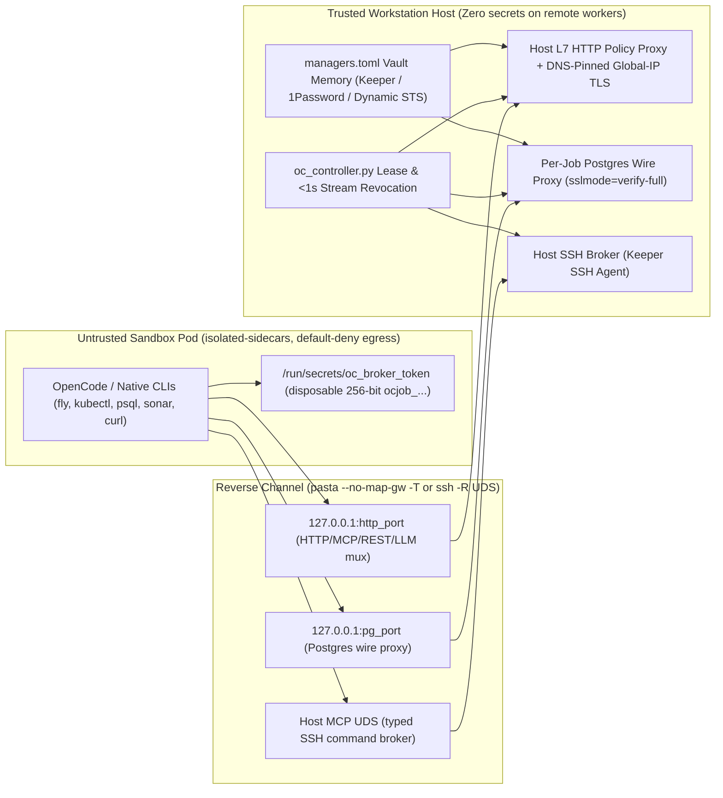

# prd_l1: External secret isolation for unrestricted sandboxes (Path A: Host L7 Reverse Proxy & Protocol Adapters)

Parent: [prd_l](prd_l.md) · [Index](README.md) · related: [credential broker](prd_i3.md),
[outside-in broker and subscriptions](prd_i4a.md), [SSH onboarding](prd_i2a.md),
[Postgres host access](prd_a.md), [per-instance networking](prd_d.md), [local HTTPS](prd_e.md)

## Problem Statement

The offline spike PoC slice approved in [prd_l](prd_l.md) (`2f95207`) validates configuration
compilation, remote MCP read-only defaults, explicit canonical-URL write grants, and schema-level
secret-slot separation, but still models remote MCP credentials as container-side
`{file:/run/secrets/...}` file mounts.

Because our sandboxes intentionally give the LLM full environment access, file read, shell
execution, arbitrary code execution, and network egress, **any real external credential mounted into
the container filesystem or environment is exfiltratable**:
- Local ephemeral sidecar passwords (`builtin/postgres`, `builtin/api-demo`) are acceptable as
  `credential_delivery = "local-ephemeral"` because they are randomly generated per disposable pod
  and valid only against `127.0.0.1` inside that pod.
- Real external, accessible targets (staging/production HTTPS MCP servers, Concourse CI, Kubernetes,
  SonarQube, Mend, GitHub, AWS, external Postgres/RDS, or remote SSH targets) **must not** expose
  raw external credentials—or short-lived upstream tokens—inside the sandbox container. This aligns
  [prd_l](prd_l.md) directly with [prd_i3](prd_i3.md) and [prd_i4a](prd_i4a.md).

## Architectural Decision: Path A (Unified Zero-MITM Host Broker & Protocol Adapters)

Selected after Best-of-N + adversarial red-team review comparing (1) host-side typed reverse proxies
& protocol adapters, (2a) direct NVIDIA OpenShell adoption, (2b) native L7 `CONNECT`+MITM proxy with
placeholder substitution, and (3) short-lived/dynamic credentials inside the container:

- **Chosen (Path A):**
  1. **Unified Host L7 HTTP Policy Reverse Proxy (zero TLS MITM):** Extends `oc_llm_broker.py`
     ([prd_i4a](prd_i4a.md)) with a declarative L7 rule engine (`allowed_methods`, `allowed_paths`,
     `denied_paths`, header/response scrubbing, and pluggable body policies for MCP JSON-RPC,
     GraphQL query-only filtering, and future AWS `AWS_ENDPOINT_URL` SigV4 re-signing). Covers
     remote MCPs, LLM APIs, Concourse CI (`fly`), Kubernetes (`kubectl`), SonarQube, Mend, and
     custom REST APIs using native client base-URL configuration (`opencode.json`, `~/.flyrc`,
     `kubeconfig`, `SONAR_HOST_URL`, `MEND_URL`, `AWS_ENDPOINT_URL`) with zero unconstrained CA
     certs in the container.
  2. **Non-HTTP Host Protocol & Command Adapters:**
     - **Per-job Host Postgres Wire Proxy** (Teleport DB Access / Cloud SQL Auth Proxy pattern):
       terminates sandbox Postgres connections on a pod-local proxy authenticated with a disposable
       per-job secret and connects upstream over `sslmode=verify-full` using host-held credentials
       and **separate upstream least-privilege RO vs. RW DB roles**.
     - **Host-mediated SSH Command Broker / MCP:** zero SSH keys or SSH agent in the sandbox; the
       host executes allowlisted read-only presets or `oc_controller`-approved commands over the
       workstation's Keeper-backed SSH agent (`oc-worker`).
  3. **Host-side short-lived/dynamic upstream credentials (never in container):** Where upstreams
     support short-lived tokens (AWS `sts:AssumeRole` with RO session policy, RDS/Cloud SQL IAM DB
     auth, Vault dynamic DB roles, GitHub App installation tokens), the **host broker** mints and
     holds them in host memory—never mounting them into the sandbox.
- **Explicitly Rejected / Deferred:**
  - **Direct NVIDIA OpenShell adoption (rejected):** `openshell-driver-podman` runs
    `openshell-supervisor` on `--network=host` with Podman secrets on the Podman host, colliding
    with `pasta --no-map-gw`, SELinux (`oc_chromium.cil`), Wayland Chromium, `oc_controller.py`,
    and violating [prd_i2a](prd_i2a.md)'s zero-secrets-on-remote-macOS-worker guarantee, while
    still punting Postgres and SSH to raw TCP passthrough.
  - **Placeholder-substitution MITM + binary-identity rules (rejected for core):** Placeholder
    substitution in queries/bodies suffers reflection-oracle exfiltration on allowed hosts, and
    binary-path rules collapse inside an unrestricted shell (`LD_PRELOAD`, `python3 -c`, `ptrace`).
  - **Optional future extension (Path B, deferred):** A narrow, opt-in host `CONNECT` proxy
    (header/SigV4 injection only, zero body placeholders) remains deferred unless unmodified
    hardcoded-host HTTPS CLIs (`gh` targeting `https://api.github.com`, multi-service `aws`) later
    prove `GH_HOST` / `AWS_ENDPOINT_URL` / host MCP wrappers ergonomically insufficient.

## Architecture Overview



## Plan IR Split (`broker_routes` vs. Container `/run/oc-config/`)

`compile_plan()` splits target coordinates and credentials into two strictly separated views:

1. **Host-only `plan["broker_routes"]`** (hashed into `plan_digest`, **never** mounted into
   `/run/oc-config/`, stripped by `redact_plan_summary()`, tracked by `compute_closed_security_delta()`):
   - `route_id`: stable key (`mcp:<name>`, `http:<name>`, `pg:<name>`, `ssh:<name>`, `llm:<name>`).
   - `protocol`: `"mcp-jsonrpc"` | `"http-rest"` | `"http-graphql"` | `"aws-sigv4"` | `"postgres"` | `"ssh-command"`.
   - `credential_delivery`:
     - `"host-brokered"` — mandatory default for all external targets (including external-credential
       `pinned-artifact` MCPs).
     - `"local-ephemeral"` — allowed strictly for disposable pod-local sidecars (`builtin/postgres`,
       `builtin/api-demo`).
     - `"raw-container-mount"` — opt-in break-glass only, refused by default, **permanently
       forbidden in `tier == "managed"`**, surfaced as `raw_remote_secret_mounted` in
       `security_delta`.
   - `upstream`: canonical upstream URL (`canonicalize_remote_url`) or `{host, port, database, user, sslmode="verify-full"}` for Postgres.
   - `secret_ref`: host vault reference (`managers.toml`, e.g., distinct `remote.read_only_*` vs.
     `remote.write_*` slots / DB roles / STS role ARN).
   - `wire_policy`: declarative L7 allow/deny rules enforced strictly on the host wire (see below).
2. **Container-visible `/run/oc-config/opencode.json` & env:**
   - Remote MCP entries rewrite `url` to `http://<sandbox_broker_host>:<http_port>/mcp/<name>` and
     `headers` to `{"Authorization": "Bearer {file:/run/secrets/oc_broker_token}"}` (disposable
     per-job 256-bit `ocjob_...` secret, `mode=0400`).
   - Native HTTP CLIs receive proxy-pointed config/env (`~/.flyrc` target, `kubeconfig` `server:`,
     `SONAR_HOST_URL`, `MEND_URL`, `AWS_ENDPOINT_URL`) carrying only the disposable `ocjob_...`
     token.
   - External Postgres injects `DATABASE_URL=postgresql://ocjob:<token>@<sandbox_broker_host>:<pg_port>/<db>?sslmode=disable` (or `PGHOST`/`PGPORT` + `PGPASSFILE` holding only `ocjob_...`).
   - **`cloud-https` fail-closed:** `compile_plan()` refuses any `"host-brokered"` route when the
     selected transport lacks `open_reverse_channel` (`cloud-https`), rather than silently falling
     back to raw secrets.

## Declarative L7 Wire Policies Across Target Systems

One generic host HTTP policy engine handles all HTTP-based systems via declarative `broker_routes`:

| System | Client Wiring (Zero MITM) | Default Read-Only Wire Policy (Safe on Shared RW Token?) |
|---|---|---|
| **Remote MCP** | `opencode.json` `url` -> `/mcp/<name>` | Closed JSON-RPC methods (`initialize`, `notifications/initialized`, `ping`, `tools/list`, `tools/call`); filter `tools/list` output and reject ungranted `tools/call` + JSON-RPC batch arrays. Requires distinct RO/RW slots. |
| **Concourse CI (`fly`)** | `~/.flyrc` target -> `/http/concourse` | `allowed_methods = ["GET", "HEAD"]`, allow `/api/v1/info`, `/api/v1/teams/*/pipelines*`, `/jobs*`, `/builds*` (including SSE logs); **deny** `PUT`/`POST`/`DELETE` and **`/api/v1/teams/*/containers/*/hijack`**. |
| **Kubernetes (`kubectl`)** | `kubeconfig` `server:` -> `/http/k8s` (host holds mTLS cert / OIDC) | `allowed_methods = ["GET", "HEAD"]`, allowlist namespaces/resources (`pods`, `pods/*/log`, `deployments`, `events`, `services`, `ingresses`); **explicitly deny `GET /secrets`**, `/exec`, `/attach`, `/portforward`, `/proxy`, and all mutating verbs. |
| **SonarQube / Mend** | `SONAR_HOST_URL` / `MEND_URL` -> `/http/sonar` | `allowed_methods = ["GET", "HEAD"]` on read endpoints (`/api/qualitygates/*`, `/api/issues/search`, `/api/measures/*`, `/api/hotspots/*`); deny `POST`/`PUT`/`DELETE`. |
| **GitHub (`gh` / API)** | `GH_HOST` or host RO MCP -> `/http/github` | Allow `GET` REST; on `POST /graphql`, **parse GraphQL AST and reject `mutation`/`subscription`** (verb-only fails because `gh` reads via `POST /graphql`). Strongly prefer a host-held fine-grained RO PAT / GitHub App token. |
| **AWS CLI (`aws`)** | `AWS_ENDPOINT_URL` -> `/aws/<svc>` (host SigV4 re-signer) | Allow `Describe*`/`List*`/`Get*`, **deny** `secretsmanager:*`, `ssm:GetParameter*`, `iam:*`, `sts:AssumeRole`; strongly prefer host-side `sts:AssumeRole` with a read-only IAM session policy. |
| **External Postgres** | `DATABASE_URL` -> `127.0.0.1:<pg_port>` | **Wire GUC alone is unsafe** (`SET default_transaction_read_only = off` bypasses it). **Must use a separate upstream least-privilege RO DB role** (`SELECT`-only; no superuser, `COPY TO PROGRAM`, `dblink`, `postgres_fdw`, or `CREATE EXTENSION`). |
| **Remote SSH** | Host MCP tool `remote_exec_ro` (zero keys in sandbox) | Closed preset command allowlist (`journalctl`, `systemctl status`, `df`, `podman ps`) over host Keeper SSH agent; arbitrary commands require `oc_controller` approval. |

## Non-Negotiable Security Invariants (Red-Team Hardening)

1. **Zero external secrets or body placeholders in container:** Close `oc_plan.py`'s
   `pinned-artifact` local bypass (any artifact MCP referencing external targets/secrets must go
   through `broker_routes`) and expand sensitive-header validation beyond `Authorization` /
   `X-API-Key` / `X-Goog-API-Key` to cover `Cookie`, `Proxy-Authorization`, `X-Auth-Token`, and
   `X-Access-Token`.
2. **Connect-time DNS pinning & anti-SSRF on host:** Compile-time URL syntax checks cannot stop DNS
   rebinding. The host proxy resolves DNS at connect time, rejects every non-global IPv4/IPv6 range
   (including `127.0.0.0/8`, `127.0.1.0/24`, CGNAT `100.64.0.0/10`, link-local, metadata, RFC1918,
   `::ffff:*`), and connects directly to the validated IP socket with explicit TLS SNI/hostname
   verification (`ssl.create_default_context()`).
3. **Hard redirect refusal, destination pinning & header/error scrubbing:** Always set
   `follow_redirects=False` when injecting credentials; ignore client `Host`, `Forwarded`,
   `X-Forwarded-*`, `X-Original-URL`, and target URI overrides (derive upstream strictly from
   `broker_routes`); normalize and reject `..`, `%2e`, `%2f`, `;`, and control chars on inbound
   paths; allowlist outbound request headers; strip `Set-Cookie`/`WWW-Authenticate` and scrub
   `4xx`/`5xx` bodies (plus canary-scan responses so reflected secrets never cross back into the
   sandbox).
4. **Strict framing & canonical JSON re-serialization:** Reject `CL+TE`, duplicate `CL`, `Upgrade`
   (except on explicitly opted-in SSE/stream routes), pipelining, and duplicate JSON keys;
   re-serialize canonical JSON before forwarding. Reject JSON-RPC batch arrays on MCP routes and
   verify at runtime that `remote.read_only_*` and `remote.write_*` resolved secret values are
   strictly distinct.
5. **Per-job Postgres proxy isolation & upstream RO roles:** Run one isolated Postgres wire proxy
   per job (never shared PgBouncer pools across jobs); pin upstream `user`, `database`, and
   `options` from `broker_routes` (ignoring client `StartupMessage` overrides); enforce upstream
   `sslmode=verify-full`; enforce RO via an actual upstream read-only PostgreSQL role (treating
   `default_transaction_read_only=on` strictly as non-authoritative defense-in-depth); block
   unauthenticated cross-job `CancelRequest`; scrub upstream `ErrorResponse` strings; abort sockets
   and send upstream `CancelRequest` within `<1s` on `oc_controller.revoke()`.
6. **Mandatory `isolated-sidecars` topology & container egress restriction:** In `tier == "managed"`
   whenever any `host-brokered` external grant is active, require `topology = "isolated-sidecars"`
   (so Chromium `--no-sandbox` and `dind` cannot share `127.0.0.1:<broker_port>`) and enforce
   default-deny/allowlisted container egress so broker-read data cannot be exfiltrated via `curl`
   or DNS tunneling.
7. **Per-job authentication & `<1s` out-of-band revocation:** Every `127.0.0.1` /
   `host.containers.internal` broker listener binds to a single `oc_controller` job lease, verifies
   the 256-bit `ocjob_...` secret via `hmac.compare_digest` on every request/startup, and registers
   all active sockets in `lease.active_streams` for immediate `<1s` teardown on `revoke()` /
   `revoke_worker()`.
8. **Synthetic canary qualification:** Automated tests must prove with synthetic secret markers
   that `podman inspect`, `/proc/*/environ`, `/run/oc-config/*`, `302` redirect traps, DNS-rebinding
   fixtures, `SET default_transaction_read_only = off`, `kubectl GET /secrets`, Concourse
   `/hijack`, GitHub GraphQL `mutation`, and JSON-RPC batch/duplicate-key smuggling all fail closed.

## Gate 1 Pseudocode Walkthrough (Brokered Execution Path)

```text
function handle_broker_http_request(conn, job_lease, broker_routes):
    req = parse_strict_http11(conn, max_headers=16KiB, max_body=1MiB)
        # Rejects CL+TE, duplicate CL, obs-fold, Upgrade, pipelining, control chars
    if not hmac.compare_digest(extract_bearer(req), job_lease.ocjob_token):
        return http_error(401, "invalid_job_token")
    if not controller.check_lease_active(job_lease.request_id):
        return http_error(403, "lease_revoked_or_expired")

    route_id, rel_path = split_and_canonicalize_route_path(req.path)
        # Rejects '..', '%2e', '%2f', ';', '\\', null bytes
    route = broker_routes.get(route_id)
    if route is None or route.credential_delivery != "host-brokered":
        return http_error(404, "unknown_route")

    if req.method not in route.wire_policy.allowed_methods:
        return http_error(403, "method_not_allowed")
    if matches_any(rel_path, route.wire_policy.denied_paths) or not matches_any(rel_path, route.wire_policy.allowed_paths):
        return http_error(403, "path_not_allowed")

    if route.protocol == "mcp-jsonrpc":
        body_obj = parse_strict_json_object(req.body)           # rejects batch arrays & dup keys
        if body_obj.get("method") not in CLOSED_MCP_WIRE_METHODS:
            return http_error(403, "mcp_method_not_allowed")
        if body_obj.get("method") == "tools/call":
            if body_obj["params"]["name"] not in route.wire_policy.allowed_tools:
                return http_error(403, "mcp_tool_not_allowed")
        out_body = canonical_json_bytes(body_obj)
    elif route.protocol == "http-graphql":
        gql_obj = parse_strict_json_object(req.body)
        if contains_graphql_mutation_or_subscription(gql_obj["query"]):
            return http_error(403, "graphql_mutation_denied")
        out_body = canonical_json_bytes(gql_obj)
    else:
        out_body = req.body

    secret_val = host_vault_memory.get(route.secret_ref)        # never leaves host process
    ip = resolve_and_validate_global_ip(route.upstream.host)    # blocks loopback/RFC1918/CGNAT/metadata
    upstream_sock = connect_tls_pinned_ip(ip, route.upstream.port, server_hostname=route.upstream.host)
    job_lease.register_active_stream(upstream_sock)
    try:
        resp = send_upstream(upstream_sock, method=req.method,
                             path=join_upstream_path(route.upstream.path, rel_path),
                             headers=build_allowlisted_headers(req, secret_val),
                             body=out_body, follow_redirects=False)
        if route.protocol == "mcp-jsonrpc" and body_obj.get("method") == "tools/list":
            resp.body = filter_mcp_tools_list(resp.body, route.wire_policy.allowed_tools)
        return scrub_response_headers_and_canary(resp, secret_val)
    finally:
        job_lease.unregister_active_stream(upstream_sock)

function handle_broker_postgres_conn(client_sock, job_lease, pg_route):
    client_startup = read_pg_startup(client_sock)               # reply 'N' to SSLRequest on loopback
    if not verify_scram_or_password(client_sock, job_lease.ocjob_token):
        return pg_error(client_sock, "28P01", "authentication failed")
    if not controller.check_lease_active(job_lease.request_id):
        return pg_error(client_sock, "28000", "lease revoked")

    ip = resolve_and_validate_global_ip(pg_route.upstream.host)
    up_sock = pg_connect_verify_full_tls(ip, pg_route.upstream.port, pg_route.upstream.host)
    job_lease.register_active_stream(client_sock, up_sock)
    try:
        # Ignore client user/db/options; pin strictly from pg_route (separate RO vs RW DB role!)
        pg_auth_upstream(up_sock, user=pg_route.upstream.user, database=pg_route.upstream.database,
                         password=host_vault_memory.get(pg_route.secret_ref),
                         options=("-c default_transaction_read_only=on" if pg_route.access_mode == "ro" else ""))
        backend_pid, backend_key = capture_backend_key_data(up_sock)
        job_lease.register_pg_cancel_handle(ip, pg_route.upstream.port, backend_pid, backend_key)
        bidirectional_splice_with_error_scrubbing(client_sock, up_sock)
    finally:
        job_lease.unregister_active_stream(client_sock, up_sock)
```

## Open Implementation & Qualification Checkboxes

- [ ] **Gate 1 external security review of `prd_l1.md`** — clear Path A architecture, `broker_routes`
      schema, L7 policy rules, Postgres wire proxy design, and all 8 red-team invariants before
      coding.
- [ ] **Plan IR host-vs-container split (`oc_schema.py`, `oc_plan.py`)** — add `broker_routes`,
      `credential_delivery` enum (`"local-ephemeral"` / `"host-brokered"` / `"raw-container-mount"`),
      close `pinned-artifact` local bypass, expand sensitive-header validation, enforce
      `isolated-sidecars` + `open_reverse_channel` transport gating, and add
      `raw_remote_secret_mounted` to `security_delta`.
- [ ] **Unified Host L7 HTTP Policy Proxy** — extend `oc_llm_broker.py` with declarative
      `allowed_methods`/`allowed_paths`/`denied_paths`, connect-time DNS-pinned global-IP TLS,
      hard `follow_redirects=False`, MCP JSON-RPC wire filtering (`tools/list` + `tools/call`),
      GraphQL mutation rejection, response/error canary scrubbing, and `<1s` `oc_controller`
      revocation.
- [ ] **Per-job Host Postgres Wire Proxy** — pure-Python `asyncio` v3 handshake + `verify-full`
      TLS splice + upstream RO/RW role pinning + `CancelRequest` on revocation + `ErrorResponse`
      scrubbing.
- [ ] **Host-mediated SSH Command Broker / MCP** — preset read-only remote commands +
      `oc_controller`-approved exec over host Keeper SSH agent (zero SSH keys in sandbox).
- [ ] **AWS `AWS_ENDPOINT_URL` SigV4 Re-Signer (optional adapter)** — host-side SigV4 re-signing +
      `sts:AssumeRole` RO session-policy scoping + action allow/deny list.
- [ ] **Adversarial & live canary qualification + Gate 2 review** — prove zero secret leakage and
      fail-closed L7/Postgres/SSH enforcement across Linux (`pasta -T`) and macOS SSH (`ssh -R`).

## Review record

- Best-of-N + adversarial red-team review completed (`2026-11-21`); Path A selected by user.
- Gate 1 design review (`Security-Focused PR Reviewer Setup`): pending.
- Gate 2 implementation review (`Security-Focused PR Reviewer Setup`): pending.
