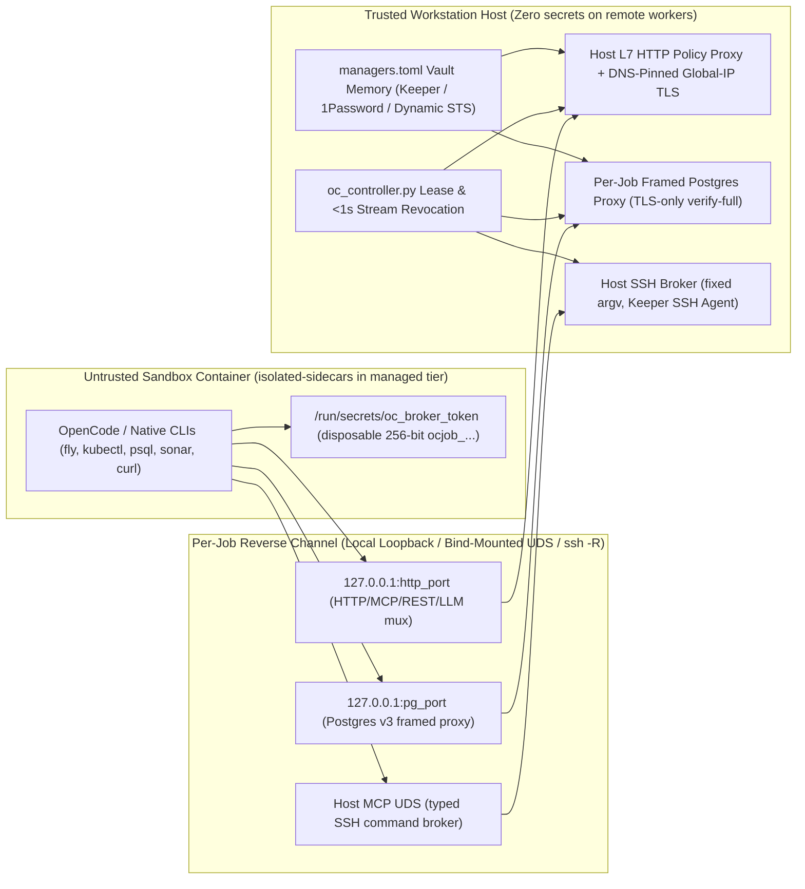

# prd_l1: External secret isolation for unrestricted sandboxes (Path A: Host L7 Reverse Proxy & Protocol Adapters)

Parent: [prd_l](prd_l.md) · [Index](README.md) · related: [credential broker](prd_i3.md),
[outside-in broker and subscriptions](prd_i4a.md), [SSH onboarding](prd_i2a.md),
[Postgres host access](prd_a.md), [per-instance networking](prd_d.md), [local HTTPS](prd_e.md)

## Problem Statement

The offline spike PoC slice approved in [prd_l](prd_l.md) (`2f95207`) validates configuration
compilation, remote MCP read-only defaults, explicit canonical-URL write grants, and schema-level
secret-slot separation, but still models remote MCP credentials as container-side
`{file:/run/secrets/...}` file mounts.

Because our sandboxes intentionally give the LLM full environment access, file read, shell
execution, and arbitrary code execution, **any real external credential mounted into the container
filesystem or environment is exfiltratable**:
- Local ephemeral sidecar passwords (`builtin/postgres`, `builtin/api-demo`) are acceptable as
  `credential_delivery = "local-ephemeral"` because they are randomly generated per disposable pod
  and valid only against `127.0.0.1` inside that pod.
- Real external, accessible targets (staging/production HTTPS MCP servers, Concourse CI, Kubernetes,
  SonarQube, Mend, GitHub, AWS, external Postgres/RDS, or remote SSH targets) **must not** expose
  raw external credentials—or short-lived upstream tokens—inside the sandbox container. This aligns
  [prd_l](prd_l.md) directly with [prd_i3](prd_i3.md) and [prd_i4a](prd_i4a.md).

### Threat-Model Scope (`interactive` vs. `managed`)

- **`tier == "interactive"` (unrestricted outbound egress):** Path A guarantees that the sandbox
  **cannot exfiltrate external credentials** and **cannot invoke unauthorized mutations** (wire-level
  L7 method/path/JSON-RPC/GraphQL enforcement + upstream RO DB roles). Because the container retains
  outbound internet egress in `interactive` tier, broker-read *data* exfiltration (e.g., copying
  query output via `curl`) is **not** prevented in `interactive` tier.
- **`tier == "managed"` (default-deny egress + `isolated-sidecars`):** Adds default-deny container
  egress so broker-read *data* cannot be exfiltrated out of band either, while permanently
  forbidding `"raw-container-mount"` break-glass.

## Architectural Decision: Path A (Unified Zero-MITM Host Broker & Protocol Adapters)

Selected after Best-of-N + adversarial red-team review comparing (1) host-side typed reverse proxies
& protocol adapters, (2a) direct NVIDIA OpenShell adoption, (2b) native L7 `CONNECT`+MITM proxy with
placeholder substitution, and (3) short-lived/dynamic credentials inside the container:

- **Chosen (Path A):**
  1. **Unified Host L7 HTTP Policy Reverse Proxy (zero TLS MITM):** Extends `oc_llm_broker.py`
     ([prd_i4a](prd_i4a.md)) with a declarative per-rule L7 engine (global `denied_paths` evaluated
     first, followed by ordered `(methods, path_patterns, body_policy)` allow rules, per-route
     `inbound_auth`, safe response header allowlisting, and pluggable body policies for MCP
     JSON-RPC, GraphQL query-only AST filtering, and future AWS `AWS_ENDPOINT_URL` SigV4
     re-signing). Covers remote MCPs, LLM APIs, Concourse CI (`fly`), Kubernetes (`kubectl`),
     SonarQube, Mend, and custom REST APIs using native client base-URL configuration
     (`opencode.json`, `~/.flyrc`, `kubeconfig`, `SONAR_HOST_URL`, `MEND_URL`, `AWS_ENDPOINT_URL`)
     with zero unconstrained CA certs in the container.
  2. **Non-HTTP Host Protocol & Command Adapters:**
     - **Per-job Message-Framed Host Postgres Wire Proxy** (Teleport DB Access / Cloud SQL Auth
       Proxy pattern): terminates sandbox Postgres connections on a pod-local proxy authenticated
       with a disposable per-job secret and connects upstream over strict TLS-only
       `sslmode=verify-full` using host-held credentials and **separate upstream least-privilege
       RO vs. RW DB roles**.
     - **Host-mediated SSH Command Broker / MCP:** zero SSH keys or SSH agent in the sandbox; the
       host executes fixed-`argv` allowlisted read-only presets (strictly validated parameters, zero
       remote shell interpolation) or `oc_controller`-approved commands over the workstation's
       Keeper-backed SSH agent (`oc-worker`) with `ForwardAgent=no`, `ClearAllForwardings=yes`,
       `StrictHostKeyChecking=yes`, and pinned `UserKnownHostsFile`.
  3. **Host-side short-lived/dynamic upstream credentials (never in container):** Where upstreams
     support short-lived tokens (AWS `sts:AssumeRole` with RO session policy, RDS/Cloud SQL IAM DB
     auth, Vault dynamic DB roles, GitHub App installation tokens), the **host broker** mints and
     holds them in host memory—never mounting them into the sandbox.
- **Explicitly Rejected / Deferred:**
  - **Direct NVIDIA OpenShell adoption (rejected):** `openshell-driver-podman` runs
    `openshell-supervisor` on `--network=host` with Podman secrets on the Podman host, colliding
    with `pasta --no-map-gw`, SELinux (`oc_chromium.cil`), Wayland Chromium, `oc_controller.py`,
    and violating [prd_i2a](prd_i2a.md)'s zero-secrets-on-remote-macOS-worker guarantee, while
    still punting Postgres and SSH to raw TCP passthrough.
  - **Placeholder-substitution MITM + binary-identity rules (rejected for core):** Placeholder
    substitution in queries/bodies suffers reflection-oracle exfiltration on allowed hosts, and
    binary-path rules collapse inside an unrestricted shell (`LD_PRELOAD`, `python3 -c`, `ptrace`).
  - **Optional future extension (Path B, deferred):** A narrow, opt-in host `CONNECT` proxy
    (header/SigV4 injection only, zero body placeholders) remains deferred unless unmodified
    hardcoded-host HTTPS CLIs (`gh` targeting `https://api.github.com`, multi-service `aws`) later
    prove `GH_HOST` / `AWS_ENDPOINT_URL` / host MCP wrappers ergonomically insufficient.

## Architecture Overview



### Channel Plumbing & Egress Isolation by Tier and Worker

| Tier / Worker | Network Mode & Reverse Channel | Egress Posture |
|---|---|---|
| **`podman-linux` (`tier == "interactive"`)** | `--network pasta:--no-map-gw,-T,<http_port>[, -T,<pg_port>]` (sandbox connects to `127.0.0.1:<port>`; never uses `host.containers.internal`). | Standard outbound internet; host gateway blocked (`--no-map-gw`). |
| **`podman-linux` (`tier == "managed"`)** | **Default-deny egress:** `--network=none` + bind-mounted per-job `0o700` host UDS (`$XDG_RUNTIME_DIR/oc-sandbox/jobs/<id>/broker.sock`, paired with an explicit `oc_broker.cil` SELinux type/rule allowing only that job's container label to `connectto` its UDS, plus a minimal unprivileged container-side loopback TCP->UDS forwarder on `127.0.0.1:<port>` for CLIs requiring TCP) — **or** `pasta:--no-map-gw,-T,<port>` paired with an explicit egress-denying netns firewall (`nftables` dropping all non-loopback egress). Exact mechanism must pass Fedora Silverblue SELinux qualification before enabling `managed` external grants. | **Default-deny:** zero unbrokered internet, LAN, or DNS egress. |
| **`podman-macos-vm` + `ssh-pinned` (`prd_i2a`)** | Workstation runs broker on `0o700` UDS; `ssh -R 127.0.0.1:0:<local_uds>` (with `GatewayPorts no` preflight) forwards to macOS loopback; container connects via `host.containers.internal:<remote_port>` strictly when lowered for `podman-macos-vm` (zero secrets on the macOS worker). | Interactive egress (or managed VM-level egress block when qualified). |
| **`cloud-render` + `cloud-https`** | **Fails closed:** `compile_plan()` refuses any `"host-brokered"` route because `cloud-https` lacks `open_reverse_channel`. | N/A (refused at compile time). |

## Plan IR Split (`broker_routes` vs. Container `/run/oc-config/`)

`compile_plan()` splits target coordinates and credentials into two strictly separated views:

1. **Host-only `plan["broker_routes"]`** (hashed into `plan_digest`, **never** mounted into
   `/run/oc-config/`, stripped by `redact_plan_summary()`, tracked by `compute_closed_security_delta()`):
   - `route_id`: stable key (`mcp:<name>`, `http:<name>`, `pg:<name>`, `ssh:<name>`, `llm:<name>`).
   - `credential_delivery`:
     - `"host-brokered"` — mandatory default for all external targets.
     - `"local-ephemeral"` — allowed strictly for disposable pod-local sidecars (`builtin/postgres`,
       `builtin/api-demo`).
     - `"raw-container-mount"` — opt-in break-glass only: requires an **explicit operator runtime
       opt-in** (never silently enabled by a bundle or orchestrator proposal), is **permanently
       forbidden in `tier == "managed"`**, and emits `raw_remote_secret_mounted` (added to
       `SECURITY_DELTA_TRIGGERS`).
   - `inbound_auth`: per-route job-token authentication scheme verified on the host via
     `hmac.compare_digest` and **stripped** before injecting upstream credentials:
     - `"bearer"` (default: `Authorization: Bearer <ocjob_token>`)
     - `"basic-token"` (e.g., SonarQube `Authorization: Basic base64("<ocjob_token>:")`)
     - `"aws-sigv4-job-key"` (AWS CLI signed with disposable `AWS_ACCESS_KEY_ID`/`AWS_SECRET_ACCESS_KEY`
       derived from `ocjob_token`, verified then stripped before host SigV4 re-signing)
     - `"header"` (explicit custom header name such as `X-API-Key: <ocjob_token>`)
   - `upstream`: canonical upstream URL (`canonicalize_remote_url`) or `{host, port, database, user, sslmode="verify-full"}` for Postgres.
   - `secret_ref`: host vault reference (`managers.toml`, e.g., distinct `remote.read_only_*` vs.
     `remote.write_*` slots / DB roles / STS role ARN).
   - `allow_streaming`: explicit boolean (`false` by default) gating SSE (`text/event-stream`)
     responses with lease-bound stream teardown; HTTP `Upgrade` / `101` is **always** rejected.
   - `wire_policy`:
     - `denied_paths`: segment-bounded glob list evaluated **globally first across all HTTP methods**
       (where `*` matches within a single path segment and **never** crosses `/`).
     - `allow_rules`: ordered list of `{methods: [...], path_patterns: [...], body_policy: "none" | "mcp-jsonrpc" | "graphql-query-only" | "aws-sigv4"}`
       entries so mixed-verb routes (e.g., GitHub `GET` REST + `POST /graphql`) never suffer
       Cartesian-product method widening.
2. **Container-visible `/run/oc-config/opencode.json` & env:**
   - Remote MCP entries rewrite `url` to `http://<sandbox_broker_host>:<http_port>/mcp/<name>` and
     `headers` to `{"Authorization": "Bearer {file:/run/secrets/oc_broker_token}"}` (disposable
     per-job 256-bit `ocjob_...` secret, `mode=0400`).
   - Native HTTP CLIs receive proxy-pointed config/env (`~/.flyrc` target, `kubeconfig` `server:`,
     `SONAR_HOST_URL`, `MEND_URL`, `AWS_ENDPOINT_URL`) carrying only the disposable `ocjob_...`
     credential formatted for that route's `inbound_auth`.
   - External Postgres injects `DATABASE_URL=postgresql://ocjob:<token>@<sandbox_broker_host>:<pg_port>/<db>?sslmode=disable` (or `PGHOST`/`PGPORT` + `PGPASSFILE` holding only `ocjob_...`).

## Declarative L7 Wire Policies Across Target Systems

One generic host HTTP policy engine handles all HTTP-based systems via declarative `broker_routes`:

| System | Client Wiring (Zero MITM) | Default Read-Only Wire Policy (`denied_paths` first, then per-rule `allow_rules`) |
|---|---|---|
| **Remote MCP** | `opencode.json` `url` -> `/mcp/<name>` (`inbound_auth = "bearer"`) | `allow_rules`: `[{methods: ["POST"], path_patterns: ["/"], body_policy: "mcp-jsonrpc"}]` (+ optional `GET /` only if `allow_streaming = true`). Enforces closed JSON-RPC 2.0 keys & methods, `tools/list` filtering, `tools/call` allowlist, and distinct RO/RW slots. |
| **Concourse CI (`fly`)** | `~/.flyrc` target -> `/http/concourse` (`inbound_auth = "bearer"`) | `denied_paths`: `["/api/v1/teams/*/containers/*/hijack*"]`. `allow_rules`: `[{methods: ["GET", "HEAD"], path_patterns: ["/api/v1/info", "/api/v1/teams/*/pipelines*", "/api/v1/teams/*/pipelines/*/jobs*", "/api/v1/builds*", "/api/v1/teams/*/builds*"], body_policy: "none"}]` (`allow_streaming = true` for `/events` SSE only). |
| **Kubernetes (`kubectl`)** | `kubeconfig` `server:` -> `/http/k8s` (host holds mTLS cert / OIDC) | `denied_paths`: `["/api/v1/secrets*", "/api/v1/namespaces/*/secrets*", "/api/v1/namespaces/*/pods/*/exec*", "/api/v1/namespaces/*/pods/*/attach*", "/api/v1/namespaces/*/pods/*/portforward*", "/api/v1/namespaces/*/pods/*/proxy*", "/api/v1/namespaces/*/services/*/proxy*"]`. `allow_rules`: `[{methods: ["GET", "HEAD"], path_patterns: ["/version", "/api", "/apis", "/api/v1/namespaces/*/pods*", "/api/v1/namespaces/*/events*", "/api/v1/namespaces/*/services*", "/apis/apps/v1/namespaces/*/deployments*"], body_policy: "none"}]`. |
| **SonarQube / Mend** | `SONAR_HOST_URL` / `MEND_URL` -> `/http/sonar` (`inbound_auth = "basic-token"` or `"bearer"`) | `allow_rules`: `[{methods: ["GET", "HEAD"], path_patterns: ["/api/qualitygates/*", "/api/issues/search", "/api/measures/component*", "/api/hotspots/search"], body_policy: "none"}]`. |
| **GitHub (`gh` / API)** | `GH_HOST` or host RO MCP -> `/http/github` (`inbound_auth = "bearer"`) | `allow_rules`: `[{methods: ["GET", "HEAD"], path_patterns: ["/repos/*/*", "/repos/*/*/pulls*", "/repos/*/*/issues*", "/repos/*/*/commits*"], body_policy: "none"}, {methods: ["POST"], path_patterns: ["/graphql"], body_policy: "graphql-query-only"}]`. Strongly prefer a host-held fine-grained RO PAT / GitHub App token. |
| **AWS CLI (`aws`)** | `AWS_ENDPOINT_URL` -> `/aws/<svc>` (`inbound_auth = "aws-sigv4-job-key"`) | `body_policy = "aws-sigv4"` inspects Query/Form `Action=`, JSON-RPC `X-Amz-Target`, and REST verb+path across AWS service families; denies `secretsmanager:*`, `ssm:GetParameter*`, `iam:*`, `sts:AssumeRole`; strongly prefer host-side `sts:AssumeRole` with a read-only IAM session policy. |
| **External Postgres** | `DATABASE_URL` -> `127.0.0.1:<pg_port>` | **Wire GUC alone is unsafe** (`SET default_transaction_read_only = off` bypasses it). **Must use a separate upstream least-privilege RO DB role** (`SELECT`-only; no superuser, `COPY TO PROGRAM`, `dblink`, `postgres_fdw`, or `CREATE EXTENSION`). |
| **Remote SSH** | Host MCP tool `remote_exec_ro` (zero keys in sandbox) | Fixed `argv` preset commands (`journalctl`, `systemctl status`, `df`, `podman ps`) with strict parameter allowlists (zero remote shell interpolation), `ForwardAgent=no`, `ClearAllForwardings=yes`, `StrictHostKeyChecking=yes`, pinned `UserKnownHostsFile`, over host Keeper SSH agent. |

## Non-Negotiable Security Invariants (Red-Team Hardening)

1. **Zero external secrets or body placeholders in container & `pinned-artifact` closure:**
   - Reject `secret_env` or sensitive `headers` on `type = "pinned-artifact"` MCPs unless
     `credential_delivery == "local-ephemeral"` (pod-local sidecar) or explicit interactive
     break-glass `"raw-container-mount"` (with operator runtime opt-in + `raw_remote_secret_mounted`
     in `security_delta`).
   - Expand sensitive-header validation beyond `Authorization`, `X-API-Key`, and `X-Goog-API-Key`
     to cover `Cookie`, `Proxy-Authorization`, `X-Auth-Token`, and `X-Access-Token`.
2. **Connect-time DNS pinning & anti-SSRF on host (aligned with `prd_l.md`):**
   - Resolve DNS at connect time on the host and connect directly to the validated IP socket with
     explicit TLS SNI and hostname verification (`ssl.create_default_context()`).
   - Deny all non-global IPv4/IPv6 ranges by default. Allow explicit host-policy CIDR opt-in
     **only** for operator-pinned RFC1918 (`10.0.0.0/8`, `172.16.0.0/12`, `192.168.0.0/16`) or
     Tailscale CGNAT (`100.64.0.0/10`) corporate staging targets; keep loopback (`127.0.0.0/8`,
     `::1`), link-local / cloud metadata (`169.254.0.0/16`, `fe80::/10`), multicast, and
     unspecified addresses **non-overridably blocked**.
3. **Strict path/query canonicalization, redirect blocking & response allowlisting:**
   - Split raw request target into `rel_path` and `query` before matching `denied_paths` /
     `allow_rules` (never match path rules against raw `path?query`; validate query characters
     separately and preserve sanitized query when forwarding).
   - Reject (case-insensitively) `..`, `.`, `//` (empty segments), `\`, control chars, and encoded
     delimiters/traversals (`%2e`, `%2f`, `%5c`, `%3b`, `%3f`, `%23`, `%25` double-encoding,
     `%00`–`%1f`, `%7f`) before matching segment-bounded patterns (`*` never crosses `/`).
   - Disable redirects (`follow_redirects=False`) and convert any upstream `3xx` into a synthesized
     `502 upstream_redirect_blocked` response with **no `Location` header and no upstream body**.
   - Ignore inbound `Host`, `Forwarded`, `X-Forwarded-*`, `X-Original-URL`, and URI overrides;
     force `Accept-Encoding: identity` upstream (failing closed if upstream still returns
     compressed `Content-Encoding` on inspected/MCP routes).
   - **Allowlist safe response headers** (e.g., `Content-Type`, `Content-Length`, `Cache-Control`,
     `ETag`, `X-Request-Id`, `Mcp-Session-Id`) instead of blocklisting only `Set-Cookie` /
     `WWW-Authenticate`; scrub `4xx`/`5xx` bodies; scan streaming responses with an overlap window
     for raw, URL-encoded, and base64 forms of `secret_val` as defense-in-depth (explicitly noting
     canary scanning cannot defeat arbitrary upstream encoding/reflection).
4. **Strict HTTP/1.1 framing, MCP JSON-RPC, and GraphQL AST enforcement:**
   - Reject `CL+TE`, duplicate `CL`, obs-fold, pipelining, and **unconditionally reject HTTP
     `Upgrade` / `101 Switching Protocols`** (blocking K8s `/exec`/`/attach`/`/portforward` and
     Concourse `/hijack` at the framing layer); gate SSE (`text/event-stream`) strictly via
     per-route `allow_streaming = true`.
   - **MCP (`body_policy == "mcp-jsonrpc"`):** Require `POST` + `Content-Type: application/json`,
     reject batch arrays and duplicate JSON keys, enforce closed top-level JSON-RPC 2.0 keys
     (`{"jsonrpc", "id", "method", "params"}` with `jsonrpc == "2.0"`), closed method allowlist
     (`initialize`, `notifications/initialized`, `ping`, `tools/list`, `tools/call`), and strict
     type checks (`isinstance(params, dict)` and `type(params.get("name")) is str`) before
     `tools/call` allowlist lookup; re-serialize canonical JSON. On `tools/list` responses, filter
     both `application/json` and SSE `text/event-stream` JSON-RPC events (failing closed with `502`
     on unexpected/unparseable content types).
   - **GraphQL (`body_policy == "graphql-query-only"`):** Require `POST` +
     `Content-Type: application/json`, closed top-level keys `{"query", "variables", "operationName"}`
     (rejecting APQ `extensions`), parse the GraphQL AST strictly, and verify **every**
     `OperationDefinition` has `operation == "query"` (failing closed on parse errors or any
     `mutation`/`subscription`).
   - **Runtime RO/RW distinctness check:** At startup/route load, assert that resolved
     `remote.read_only_*` and `remote.write_*` secret values (and Postgres upstream `(user, password)`
     pairs) are strictly distinct; fail closed on equality without logging any secret material.
5. **Per-job message-framed Postgres proxy & TLS-only upstream:**
   - Decode and forward Postgres v3 messages by `(1-byte type, int32 length)` frame boundaries (never
     mutating `ErrorResponse`/`NoticeResponse` inside a raw byte splice); stream large
     `DataRow`/`CopyData` frames without full buffering; enforce handshake byte/time limits.
   - Reply `'N'` to client `SSLRequest` (`80877103`) and `GSSENCRequest` (`80877104`) on the
     protected reverse-channel leg; require upstream `'S'` to `SSLRequest` and abort immediately if
     upstream returns `'N'` (never downgrade to cleartext).
   - Never forward real upstream `BackendKeyData` (`'K'`) to the sandbox; synthesize a job-local
     `(local_pid, local_key)` and translate client `CancelRequest` (`80877102`) strictly within that
     job's own connection table. On `oc_controller.revoke()`, abort active sockets and send upstream
     `CancelRequest` over `verify-full` TLS to the pinned `(ip, port)` within `<1s`.
   - Enforce RO via an actual upstream least-privilege read-only PostgreSQL role (`SELECT`-only,
     zero `COPY TO PROGRAM`/`dblink`/`postgres_fdw`/superuser grants); treat
     `default_transaction_read_only=on` strictly as defense-in-depth.
6. **Mandatory `isolated-sidecars` topology in `managed` tier:** Prevent Chromium (`--no-sandbox`)
   and `dind` (`label=disable`) from sharing `127.0.0.1:<broker_port>` or `/run/secrets/` with the
   agent container.
7. **Per-job authentication & `<1s` out-of-band revocation:** Bind each listener to a single
   `oc_controller` lease, verify the 256-bit `ocjob_...` secret via `hmac.compare_digest` using the
   route's `inbound_auth` scheme, and register all sockets in `lease.active_streams` for `<1s`
   teardown on `revoke()` / `revoke_worker()`.
8. **Synthetic canary qualification:** Automated tests prove with synthetic secret markers that
   `podman inspect`, `/proc/*/environ`, `/run/oc-config/*`, `302` redirect traps, DNS-rebinding
   fixtures, `//` and `%2f`/`%25` path tricks, `SET default_transaction_read_only = off`, `kubectl`
   `GET /api/v1/secrets` & `/api/v1/namespaces/default/secrets`, Concourse `/hijack`, GitHub
   GraphQL `mutation` + APQ `extensions`, and JSON-RPC batch/duplicate-key/compressed-SSE probes
   all fail closed.

## Gate 1 Pseudocode Walkthrough (Brokered Execution Path)

```text
function handle_broker_http_request(conn, job_lease, broker_routes):
    req = parse_strict_http11(conn, max_headers=16KiB, max_body=1MiB)
        # Unconditionally rejects CL+TE, duplicate CL, obs-fold, pipelining, and HTTP Upgrade / 101
    if not controller.check_lease_active(job_lease.request_id):
        return http_error(403, "lease_revoked_or_expired")

    route_id, rel_path, raw_query = split_and_canonicalize_target(req.target)
        # Splits path vs '?query' FIRST; rejects case-insensitive %2e/%2f/%5c/%3b/%3f/%23/%25,
        # %00-%1f, %7f, '..', '.', '//', '\\', and control chars; validates query characters separately
    route = broker_routes.get(route_id)
    if route is None or route.credential_delivery != "host-brokered":
        return http_error(404, "unknown_route")

    if not verify_and_strip_inbound_auth(req, route.inbound_auth, job_lease.ocjob_token):
        return http_error(401, "invalid_job_auth")              # hmac.compare_digest; strips job auth

    # Global deny first (across all methods), then ordered per-rule (methods, path_patterns, body_policy)
    if matches_segment_glob_any(rel_path, route.wire_policy.denied_paths):
        return http_error(403, "path_denied")
    rule = first_matching_allow_rule(req.method, rel_path, route.wire_policy.allow_rules)
    if rule is None:
        return http_error(403, "method_or_path_not_allowed")

    if rule.body_policy == "mcp-jsonrpc":
        require_content_type(req, "application/json")
        body_obj = parse_strict_json_object(req.body)           # rejects batch arrays & dup keys
        require_closed_keys(body_obj, {"jsonrpc", "id", "method", "params"})
        if body_obj.get("jsonrpc") != "2.0" or body_obj.get("method") not in CLOSED_MCP_WIRE_METHODS:
            return http_error(403, "mcp_method_not_allowed")
        if body_obj["method"] == "tools/call":
            params = body_obj.get("params")
            if not isinstance(params, dict) or type(params.get("name")) is not str:
                return http_error(400, "invalid_mcp_params")
            if params["name"] not in route.wire_policy.allowed_tools:
                return http_error(403, "mcp_tool_not_allowed")
        out_body = canonical_json_bytes(body_obj)
    elif rule.body_policy == "graphql-query-only":
        require_content_type(req, "application/json")
        gql_obj = parse_strict_json_object(req.body)
        require_closed_keys(gql_obj, {"query", "variables", "operationName"})  # blocks APQ extensions
        if not all_graphql_operations_are_query(gql_obj.get("query")):
            return http_error(403, "graphql_non_query_denied")
        out_body = canonical_json_bytes(gql_obj)
    elif rule.body_policy == "aws-sigv4":
        enforce_aws_action_policy(req, route.wire_policy)       # inspects Action=, X-Amz-Target, REST verb+path
        out_body = req.body
    else:
        out_body = req.body

    secret_val = host_vault_memory.get(route.secret_ref)        # never leaves host process
    ip = resolve_and_validate_ip(route.upstream.host, route.allowed_cidrs)
        # Blocks loopback/link-local/metadata/unspecified unconditionally; blocks RFC1918/CGNAT unless pinned
    upstream_sock = connect_tls_pinned_ip(ip, route.upstream.port, server_hostname=route.upstream.host)
    job_lease.register_active_stream(upstream_sock)
    try:
        # Force Accept-Encoding: identity; follow_redirects=False; inject upstream auth (or SigV4 re-sign)
        resp = send_upstream(upstream_sock, method=req.method,
                             path=join_upstream_path(route.upstream.path, rel_path),
                             query=raw_query,
                             headers=build_allowlisted_upstream_headers(req, secret_val, accept_encoding="identity"),
                             body=out_body, follow_redirects=False)
        if 300 <= resp.status <= 399:
            return http_error(502, "upstream_redirect_blocked") # no Location header, no body
        if resp.is_sse and not route.allow_streaming:
            return http_error(502, "streaming_not_allowed")
        if rule.body_policy == "mcp-jsonrpc" and body_obj["method"] == "tools/list":
            resp = filter_mcp_tools_list_json_or_sse(resp, route.wire_policy.allowed_tools)
                # Fails closed with 502 on compressed/unexpected/unparseable content types
        return filter_safe_response_headers_and_canary_scan(resp, secret_val)
    finally:
        job_lease.unregister_active_stream(upstream_sock)

function handle_broker_postgres_conn(client_sock, job_lease, pg_route):
    startup = read_pg_startup_bounded(client_sock, timeout=10s, max_bytes=16KiB)
        # Replies 'N' to SSLRequest (80877103) and GSSENCRequest (80877104) on loopback leg
        # If CancelRequest (80877102): look up (local_pid, local_key) in job_lease.pg_cancel_map ONLY
        # and forward TLS-only CancelRequest to pinned upstream (ip, port)
    if not verify_pg_client_auth(client_sock, job_lease.ocjob_token):
        return pg_error_frame(client_sock, "28P01", "authentication failed")
    if not controller.check_lease_active(job_lease.request_id):
        return pg_error_frame(client_sock, "28000", "lease revoked")

    ip = resolve_and_validate_ip(pg_route.upstream.host, pg_route.allowed_cidrs)
    up_sock = pg_connect_strict_tls_only(ip, pg_route.upstream.port, server_hostname=pg_route.upstream.host)
        # Sends SSLRequest -> ABORTS immediately if upstream returns 'N' (zero cleartext downgrade)
    job_lease.register_active_stream(client_sock, up_sock)
    try:
        # Pin upstream user/database/options from pg_route (separate RO vs RW upstream DB role!)
        pg_auth_upstream(up_sock, user=pg_route.upstream.user, database=pg_route.upstream.database,
                         password=host_vault_memory.get(pg_route.secret_ref),
                         options=("-c default_transaction_read_only=on" if pg_route.access_mode == "ro" else ""))
        real_pid, real_key = read_and_intercept_backend_key_data(up_sock)
        local_pid, local_key = job_lease.register_pg_cancel_mapping(ip, pg_route.upstream.port, real_pid, real_key)
        write_pg_backend_key_data(client_sock, local_pid, local_key)
        # Message-framed proxy: parses (type_byte, int32 len), scrubs/re-encodes ErrorResponse/NoticeResponse
        # with exact int32 lengths, and streams large DataRow/CopyData frames without full buffering
        relay_pg_v3_frames(client_sock, up_sock, scrub_error_and_notice=True)
    finally:
        job_lease.unregister_active_stream(client_sock, up_sock)
```

## Open Implementation & Qualification Checkboxes

- [x] **Gate 1 external security review of `prd_l1.md`** — cleared at commit `a8ef3c5d031f`
      (SHA-256 `53cbcb1aeac334b2d3add6f1cac8d87393d704b2722d489872c45eb8e9080d0a`).
- [x] **Plan IR host-vs-container split (`oc_schema.py`, `oc_plan.py`)** — implemented on
      `spike-prd-l1`: `broker_routes`, `credential_delivery` enum (`"local-ephemeral"` /
      `"host-brokered"` / `"raw-container-mount"`), `pinned-artifact` local bypass closure,
      expanded 7-header sensitive-header validation, `isolated-sidecars` + `open_reverse_channel`
      transport gating, exact `PlanOverrides.allow_raw_remote_mounts` break-glass binding, and
      `raw_remote_secret_mounted` in `SECURITY_DELTA_TRIGGERS` (`test_plan_broker.py`).
- [x] **Unified Host L7 HTTP Policy Proxy (`oc_broker_http.py`)** — implemented on `spike-prd-l1`:
      global `denied_paths` + ordered per-rule `(methods, path_patterns, body_policy)` allow rules,
      per-route `inbound_auth`, connect-time DNS-pinned IP validation + TLS SNI, hard
      `follow_redirects=False` (`502` on `3xx`), unconditional HTTP `Upgrade`/`101` rejection,
      `Accept-Encoding: identity`, MCP JSON-RPC & SSE `tools/list` filtering, pure-stdlib GraphQL
      AST query-only enforcement, safe response header allowlisting + overlap canary scanning, and
      `<1s` `oc_controller` revocation (`test_broker_http.py`).
- [x] **Per-job Message-Framed Host Postgres Wire Proxy (`oc_broker_pg.py`)** — implemented on
      `spike-prd-l1`: bounded single-threaded `selectors` v3 framed proxy handling
      `SSLRequest`/`GSSENCRequest`, strict TLS-only `verify-full` upstream (including TLS
      `CancelRequest`), pure-stdlib SCRAM-SHA-256 (with `v=` verification), synthetic job-local
      `BackendKeyData`, upstream RO/RW role pinning, `ParameterStatus` allowlist scrubbing, and
      length-accurate `ErrorResponse`/`NoticeResponse` scrubbing (`test_broker_pg_ssh.py`).
- [x] **Host-mediated SSH Command Broker (`oc_broker_ssh.py`)** — implemented on `spike-prd-l1`:
      fixed-`argv` preset read-only remote commands (strict allowlists + `shlex.quote`, zero shell
      interpolation) + `oc_controller` `APPLY_ONCE` digest-pinned exec over hardened OpenSSH
      (`-F /dev/null`, `ForwardAgent=no`, `ClearAllForwardings=yes`, `StrictHostKeyChecking=yes`,
      DNS-pinned `HostName`/`HostKeyAlias`, pinned `0600` `UserKnownHostsFile`, bounded streaming
      output + `<1s` revoke kill) (`test_broker_pg_ssh.py`).
- [x] **AWS `AWS_ENDPOINT_URL` SigV4 Re-Signer (`oc_broker_http.py`)** — implemented on
      `spike-prd-l1`: inbound `aws-sigv4-job-key` HMAC-SHA256 verification + host-side SigV4
      re-signing + action inspection (`Action=` across query & body with duplicate/encoded
      smuggling rejection, `X-Amz-Target`, REST verb+path) (`test_broker_http.py`).
- [x] **Gate 2 external security review & offline synthetic canary qualification** — cleared on
      `spike-prd-l1` at commit `72ac4444bcd8583d139c16d737612aba5770fe23` (97/97 offline unit,
      adversarial, and cross-lane E2E canary tests passing in `docs/prds/spikes/l/`).
- [ ] **Live host transport & SELinux qualification** — live Linux (`pasta -T` / `managed` UDS
      SELinux relabeling) and macOS (`ssh -R`) host qualification pending prior to production
      promotion.

## Review record

- Best-of-N + adversarial red-team review completed (`2026-11-21`); Path A selected by user.
- Gate 1 design review round 1 (`Security-Focused PR Reviewer Setup`, `97b6771..06ea0a7`,
  SHA-256 `b10c97a35f0d7744d05540d6fadb5a6a44f24db9e181120dc139ea13ea63e45b`): 3 P1, 3 P2, and 3 P3
  findings addressed.
- Gate 1 design review round 2 (`Security-Focused PR Reviewer Setup`, `06ea0a7..a8ef3c5`):
  **CLEARED** at commit `a8ef3c5d031f9f9e18ef145beec9c2b6fec2055c` (`docs/prds/prd_l1.md` SHA-256
  `53cbcb1aeac334b2d3add6f1cac8d87393d704b2722d489872c45eb8e9080d0a`).
  - Implementation reminders for Gate 2:
    1. Because segment-bounded `*` does not cross `/`, list explicit multi-segment patterns where
       needed (e.g., `/api/v1/namespaces/*/pods/*` and `/api/v1/namespaces/*/pods/*/log`).
    2. Enforce bounded concurrent connections and read/write timeouts on HTTP and Postgres broker
       listeners (matching `oc_config_mcp.py`).
- Gate 2 implementation review round 1 (`Security-Focused PR Reviewer Setup`, `1b5dd3d..4ee66c8`):
  4 P1, 3 P2, and 4 P3 findings identified and addressed at commit `5691af5`.
- Gate 2 implementation review round 2 (`Security-Focused PR Reviewer Setup`, `4ee66c8..5691af5`):
  10/11 findings verified resolved; 1 residual AWS semicolon smuggling bypass in
  `_extract_action_params()` (and 1 optional `_canonicalize_write_grants()` nit) addressed at
  commit `72ac444`.
- Gate 2 implementation review round 3 (`Security-Focused PR Reviewer Setup`, `5691af5..72ac444`):
  **GATE 2 CLEARED** at commit `72ac4444bcd8583d139c16d737612aba5770fe23` (97/97 offline tests
  passing; live host transport qualification and user Human Review remain open).
