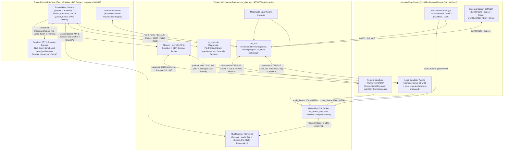

# prd_m: Model telemetry, cross-model orchestration, and unified control plane

[Index](README.md) · children: [model selection, reasoning variants & dual-window quotas](prd_m1.md),
[cross-model & cross-sandbox orchestration](prd_m2.md),
[unified control plane, threads, embedded browser & confined terminals](prd_m3.md) · related:
[per-instance DNS](prd_d.md), [local HTTPS/TLS](prd_e.md), [orchestrator fleet](prd_i.md),
[worker fleet & browser wall](prd_i2.md), [credential broker](prd_i3.md),
[LLM gateway](prd_i4.md), [composable config & external brokers](prd_l.md),
[host credential brokering](prd_l1.md)

## Executive summary

PRD M extends `oc-sandbox` from single-sandbox launches and scattered browser/terminal windows into
a cohesive, zero-trust multi-model control plane covering three tightly linked areas:

1. **Normalized model selection, reasoning levels, and dual-window (`5h` + `7d`) quota telemetry**
   ([prd_m1](prd_m1.md)) for Codex (OAuth subscription / Responses / host-confined App Server) and
   Claude (Claude Code / OAuth / API) routed through OpenCode and the host LLM broker — closing the
   gap where ACP exposes only per-session context/cost (`usage_update`) and omits account-level
   rolling 5-hour and 7-day weekly quotas, while enforcing strict request-body allowlisting (blocking
   provider-side egress tools) and durable pre-flight spend-cap reservations.
2. **Cross-model, cross-sandbox orchestration ("orchestrator of orchestrators")**
   ([prd_m2](prd_m2.md)) supporting intra-sandbox OpenCode `task` subagents, capability-scoped
   inter-sandbox messaging across different model families and local/remote Podman hosts (e.g.,
   parallel Codex implementors each paired with an adversarial Claude reviewer), and host-enrolled
   external top-level peer streams, all addressed unambiguously as `"NAME"` (local),
   `"REMOTE / NAME"` (remote), or `"@PEER"` (external harness).
3. **Unified native + web control plane (Tauri v2 + hardened loopback web UI)**
   ([prd_m3](prd_m3.md)) replacing per-sandbox Chrome windows and terminals with a single
   `Project -> Sandbox -> Thread` workspace where both the human operator and the root orchestrator
   message the same targets, alongside confined embedded terminal emulation (`opencode-tui` and
   `shell`) and **opt-in embedded sandbox browser views** (per-sandbox `Browser` tab + fleet-wide
   PiP "Browser Wall" shown only for sandboxes with `cap:browser.chromium@1.0`, powered by pod-local
   `builtin/chromium-managed`, [prd_d](prd_d.md) `<NAME>.oc-sandbox.internal` DNS, [prd_e](prd_e.md)
   name-constrained leaf certs, composable browser bundles defaulting to token-efficient
   `builtin/browser-axi`, and an authenticated CDP arbiter) inside zero-network null-origin iframes
   with `oc_controller` generation-fenced input leases.

## Architecture ranking and synthesis (3-way design review)

Three independent architecture lenses evaluated all three requirements against `oc-sandbox`'s
zero-trust invariants (`prd_i`, `prd_i3`, `prd_i4`, `prd_l`, `prd_l1`):

| Rank | Lens / Approach | Core Strengths | Key Weaknesses / Limits | Role in Selected Synthesis |
|---|---|---|---|---|
| **#1 (Selected Combination)** | **First-Principles Protocol & Threat Model** anchored on **Existing `oc-sandbox` Stack**, **Mirroring T3Code Patterns** | Preserves every `prd_i`/`prd_l1` boundary (zero secrets in sandboxes, host-owned `oc_controller` approvals, no host `git` or host writes in `~/opencode-sandbox`); clean 3-subplane model/reasoning/quota split with provider-tool egress allowlisting and atomic budget reservations; bijective RFC-1123 addressing (`"NAME"`, `"REMOTE / NAME"`, `"@PEER"`); unforgeable host write-ahead provenance; lightweight Tauri v2 + web UI. | Requires building our own React/Tauri frontend views and `oc_daemon` SQLite event/mailbox projection (~3.5–5 weeks across phased slices). | **Adopted baseline** across `prd_m1`, `prd_m2`, and `prd_m3`. |
| **#2** | **Pure Incremental Patch on Existing `oc-sandbox` + tmux CLI** | Fastest path to M1/M2 (~1.5–2 weeks); zero frontend toolchain. | Does not eliminate Chrome/terminal window sprawl or deliver unified desktop/web agent threads + embedded terminal emulation. | Incorporated directly into M1/M2 (`oc_broker_http`, `oc_plan`, `oc_config_mcp`, host-trusted `$STATE/worktrees` auto-discovery) while adding M3 UI/PTY cleanly on top. |
| **#3 (Rejected for Direct Adoption)** | **Fork or Embed `pingdotgg/t3code` (MIT)** | Polished out-of-the-box React thread/diff UI, `packages/contracts`, SQLite Command/Event/Projection + Outbox, `CheckpointReactor`, mid-thread provider handoff. | **Inverted trust model:** Node + `node-pty` + Electron server runs directly on host UID/worktrees with local CLI credentials; retrofitting rootless Podman `pasta`, `safe_run` git isolation, `prd_l1` host-only brokers, SSH workers, and autonomous multi-sandbox lanes costs more (~5–8 weeks + rebase debt) than mirroring its best patterns cleanly. | **Mirror patterns only** (shared contracts, SQLite Command/Event/Projection + Outbox, mid-thread handoff, containerized `safe_run` turn checkpoints); do **not** fork/embed T3Code. |

## Shared `oc_controller.py` extensions & cascade invariants

All three child PRDs share three explicit extensions to `oc_controller.py` ([prd_i3](prd_i3.md)):

1. **`Role.EXTERNAL_PEER`:** Authenticates host-enrolled `@PEER` harnesses with `ocpeer_...` tokens
   and zero approval, spawn, or filesystem authority.
2. **`PaidFallbackGrant`:** Durable operator-approved record bound to
   `(source_bucket_id, target_api_route_id, allowed_models, max_spend_usd, max_concurrent, expires_at)`
   with persistent `spent_usd` and pre-flight reservations surviving daemon/controller restarts.
3. **`InputLease`:** Strictly ephemeral in-memory PTY and Browser write lease bound to
   `(operator_session, target_addr, surface_kind: "opencode-tui" | "shell" | "browser", generation,
   expires_at)`. On `oc_daemon` or `oc_controller` restart, all `InputLease`s invalidate
   immediately and bump `generation` ([prd_i2](prd_i2.md)).
4. **Unified `<1s` Revocation Cascade:** Revoking a sandbox, worker, or `@PEER` in `oc_controller`
   cascades in `<1s` across `/llm/*` streams, `/mcp/oc-swarm`, `oc_hub` (`RoutingEdge` removal +
   waking blocked `agent_wait` callers), `oc_pty_relay`, and the browser CDP arbiter (`InputLease`
   revocation + PTY/browser stream disconnect).

## Scope and phased milestones

- [ ] **M1 — Model selection, reasoning variants, and dual-window (`5h` + `7d`) quota telemetry**
      ([prd_m1](prd_m1.md)): unify `/llm/*` onto `oc_broker_http.py` with per-provider request-body
      allowlisting (blocking provider-executed network tools in `managed` pods), compile
      host-authorized OpenCode `variants` (`OPENCODE_DISABLE_MODELS_DEV=1`) with host-side provider
      lowering, capture passive 5h/7d headers + OS-confined `codex app-server`
      `account/rateLimits/read` into `$STATE/telemetry/quota_state.json`, and enforce pre-dispatch
      quota admission + durable `PaidFallbackGrant` pre-flight spend reservations.
      *(Estimated: 4–6 days.)*
- [ ] **M2 — Cross-model, cross-sandbox orchestration and unambiguous addressing**
      ([prd_m2](prd_m2.md)): lock RFC-1123 addressing (`"NAME"`, `"REMOTE / NAME"`, `"@PEER"`),
      resolve the `worker@1` slash-free ID migration (preserving `is_builtin_id()` immutability),
      upgrade `oc-opencode-run.py` to per-job UDS `opencode serve` + `tmux`, harden `oc_daemon`'s
      HTTP/SSE client against hostile `opencode serve`, and add capability-scoped `oc_hub` MCP
      messaging with monotonic `SubtreeBudget` attenuation, per-edge turn budgets, nonce-framed
      `UNTRUSTED_PEER_DATA`, cycle-free waits, and host-owned `:ro` `/run/oc-inbox/` patch staging.
      *(Estimated: 5–7 days.)*
- [ ] **M3 — Unified Tauri v2 + hardened web control plane, confined PTY, and opt-in embedded
      browser views** ([prd_m3](prd_m3.md)): build `oc_daemon.py` (`$STATE/registry.sqlite`
      Command/Event/Projection + Outbox, auto-importing host-trusted `$STATE/worktrees/<NAME>` via
      `O_NOFOLLOW`), React + Vite SPA served via Tauri v2 minimal Rust UDS bridge and hardened
      loopback web mode (bootstrap-code exchange + `HttpOnly` cookie + CSRF + single-use WS
      tickets), full-key write-ahead provenance receipts, Trusted Chrome Approval Inbox + 5h/7d
      quota bar, zero-network null-origin `xterm.js` iframe behind an allowlist host VT/UTF-8
      scrubber + non-blocking PTY relay, opt-in per-sandbox `Browser` view + fleet PiP Browser Wall
      (backed by `builtin/chromium-managed`, [prd_d](prd_d.md)/[prd_e](prd_e.md) internal HTTPS,
      authenticated `managed` CDP arbiter, and composable `builtin/browser-axi` / MCP bundles),
      and Pattern 4 in `orchestrator_skills/oc-sandbox-authoring/SKILL.md`.
      *(Estimated: 10–15 days including M3 browser views & arbiter.)*

## Open decisions

- [ ] (decision needed) **Control-plane UI strategy** — **Mirror T3Code architectural patterns on
      `oc_daemon` + Tauri v2 + React/Vite (recommended)**: keeps BSD-2-Clause core, preserves
      rootless Podman + zero-secret host boundaries, ~30–60 MB idle Tauri shell, 8–12 days for M3;
      *vs.* **Fork/embed `pingdotgg/t3code`**: instant thread/diff UI, but Electron (~150–300 MB+
      RAM), Node/`node-pty` host-UID trust inversion, and 5–8 weeks of retrofit + rebase debt.
- [ ] (decision needed) **Embedded PTY renderer** — **Sandboxed-iframe `xterm.js` behind allowlist
      host VT/UTF-8 scrubber (recommended first)**: mature, OSC 52 off by default, standard GC, no
      `wasm-unsafe-eval` CSP relaxation on Linux WebKitGTK (included in M3); *vs.*
      **`libghostty-vt` / `ghostty-web` WASM**: superior Unicode/TUI fidelity, but younger JS
      bindings, requires `wasm-unsafe-eval`, and WASM linear memory does not shrink after output
      floods without worker recycling (keep `MessageChannel` iframe interface pluggable for later
      upgrade).
- [ ] (decision needed) **Embedded browser streaming mode** ([prd_i2](prd_i2.md), [prd_m3](prd_m3.md))
      — **CDP screencast (`Page.startScreencast`) + authenticated host arbiter (recommended
      first)**: lightweight JPEG/PNG frames ideal for PiP Browser Wall tiles and remote SSH links,
      no X11/VNC server in pod, ~3–5 days; limited to page viewport (no full browser URL bar, tabs,
      DevTools, or native dialogs); *vs.* **Pod-local virtual display + noVNC / WayVNC**: renders
      complete browser chrome (URL bar, HTTPS lock icon, tabs, DevTools, dialogs), higher CPU/RAM
      footprint and MPL-2.0 companion terms for `noVNC`, ~1–2 weeks (can be added as an optional
      full-chrome escalation mode sharing the exact same `InputLease` and confined iframe boundary).
- [ ] (decision needed) **Default opt-in browser automation bundle** ([prd_m3](prd_m3.md),
      [prd_l](prd_l.md)) — **0-MCP `builtin/browser-axi` (`chrome-devtools-axi`, recommended
      default)**: pinned CLI + progressive-disclosure skill using TOON-compressed a11y snapshots
      with generation-prefixed refs (`STALE_REF` protection) and bundled multi-step actions,
      cutting token usage ~40–66% while preserving console/network/perf debugging with zero MCP
      server schema bloat (~2–3 days; requires version/checksum pin in `mise.lock` and supply-chain
      license check); *vs.* **`chrome-devtools-mcp` (current baseline)**: mature DevTools MCP
      working in shell-restricted personas, higher token/schema overhead (~1–2 days); *vs.*
      **`@playwright/mcp`**: ARIA ref-based E2E ergonomics, heavier Playwright runtime and weaker
      low-level DevTools profiling (~2–3 days). All three remain swappable `bundle@1` variants over
      the same `cap:browser.chromium@1.0` / CDP arbiter endpoint.
- [ ] (decision needed) **Worker ID migration (`prd_l` compatibility)** — migrate `worker@1` IDs
      from `OPAQUE_ID_RE` (`builtin/local-workstation`) to strict slash-free `WORKER_NAME_RE`
      (`"local"` & `"peer"` permanently reserved; update `oc_schema.py`'s `is_builtin_id()`
      immutability guard to check explicit built-in origin / `"local"` so built-in worker
      immutability is preserved) (**recommended**, 0.5–1 day); *vs.* adding a separate slash-free
      `remote_alias` field on `worker@1` (avoids `worker.id` migration but introduces dual-name
      mapping).

## Review record

- 3-way architecture synthesis completed (`2026-11-22`) across current-stack (`arch-current`),
  ecosystem/T3Code (`arch-t3code-eco`), and first-principles (`arch-first-prin`) lenses, with a
  follow-up convergence pass resolving untrusted `opencode serve` provenance, dynamic model/variant
  lowering, `xterm.js` vs `libghostty-vt`, and DNS-1123 / `@PEER` addressing.
- Gate 1 design review round 1 (`Security-Focused PR Reviewer Setup`, `3f43443`): 5 P1, 4 P2, and
  3 P3 findings addressed in `5d618be`.
- Gate 1 design review round 2 (`Security-Focused PR Reviewer Setup`, `3f43443..5d618be`):
  **GATE 1 CLEARED** at commit `5d618bed556bea41e48c46a8a90d4b453a9f2c85` (prior to embedded
  browser & composable browser bundle additions).
- Gate 1 design review round 3 (`Security-Focused PR Reviewer Setup`, `5495ae3..d620f70`, embedded
  browser & composable bundle additions): 3 P1, 2 P2, and 2 P3 findings addressed in this revision.
- Gate 1 design review round 4 (`Security-Focused PR Reviewer Setup`): pending.

- [ ] **Human review**: checked only when the user says so
