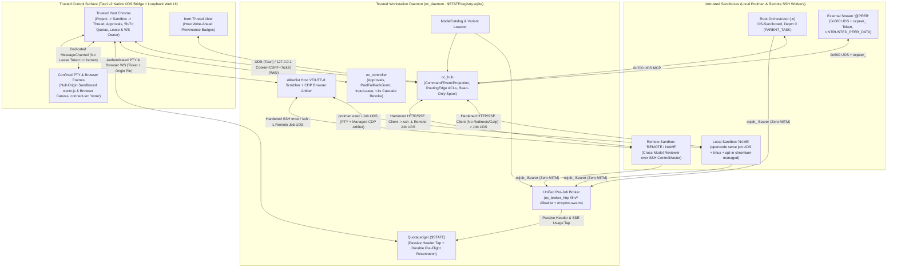

# prd_m: Model telemetry, cross-model orchestration, and unified control plane

[Index](README.md) · children: [model selection, reasoning variants & dual-window quotas](prd_m1.md),
[cross-model & cross-sandbox orchestration](prd_m2.md),
[unified control plane, threads, embedded browser & confined terminals](prd_m3.md) · related:
[per-instance DNS](prd_d.md), [local HTTPS/TLS](prd_e.md), [orchestrator fleet](prd_i.md),
[worker fleet & browser wall](prd_i2.md), [credential broker](prd_i3.md),
[LLM gateway](prd_i4.md), [composable config & external brokers](prd_l.md),
[host credential brokering](prd_l1.md)

## Executive summary

PRD M extends `oc-sandbox` from single-sandbox launches and scattered browser/terminal windows into
a cohesive, zero-trust multi-model control plane covering three tightly linked areas:

1. **Normalized model selection, reasoning levels, and dual-window (`5h` + `7d`) quota telemetry**
   ([prd_m1](prd_m1.md)) for Codex (OAuth subscription / Responses / host-confined App Server) and
   Claude (Claude Code / OAuth / API) routed through OpenCode and the host LLM broker — closing the
   gap where ACP exposes only per-session context/cost (`usage_update`) and omits account-level
   rolling 5-hour and 7-day weekly quotas, while enforcing strict request-body allowlisting (blocking
   provider-side egress tools) and durable pre-flight spend-cap reservations.
2. **Cross-model, cross-sandbox orchestration ("orchestrator of orchestrators")**
   ([prd_m2](prd_m2.md)) supporting intra-sandbox OpenCode `task` subagents, capability-scoped
   inter-sandbox messaging across different model families and local/remote Podman hosts (e.g.,
   parallel Codex implementors each paired with an adversarial Claude reviewer), and host-enrolled
   external top-level peer streams, all addressed unambiguously as `"NAME"` (local),
   `"REMOTE / NAME"` (remote), or `"@PEER"` (external harness).
3. **Shared SvelteKit control plane (hardened loopback web first, then Tauri v2)**
   ([prd_m3](prd_m3.md)) replacing per-sandbox Chrome windows and terminals with a single
   `Project -> Sandbox -> Thread` workspace where both the human operator and the root orchestrator
   message the same targets, alongside confined embedded terminal emulation (`opencode-tui` and
   `shell`) and **opt-in embedded sandbox browser views** (per-sandbox `Browser` tab + fleet-wide
   PiP "Browser Wall" shown only for sandboxes with `cap:browser.chromium@1.0`, powered by pod-local
   `builtin/chromium-managed`, [prd_d](prd_d.md) `<NAME>.oc-sandbox.internal` DNS, [prd_e](prd_e.md)
   name-constrained leaf certs, composable browser bundles defaulting to token-efficient
   `builtin/browser-axi`, and an authenticated CDP arbiter) inside zero-network null-origin iframes
   with `oc_controller` generation-fenced input leases.

## Architecture ranking and synthesis (3-way design review)

Three independent architecture lenses evaluated all three requirements against `oc-sandbox`'s
zero-trust invariants (`prd_i`, `prd_i3`, `prd_i4`, `prd_l`, `prd_l1`):

| Rank | Lens / Approach | Core Strengths | Key Weaknesses / Limits | Role in Selected Synthesis |
|---|---|---|---|---|
| **#1 (Selected Combination)** | **First-Principles Protocol & Threat Model** anchored on **Existing `oc-sandbox` Stack**, **Mirroring T3Code Patterns** | Preserves every `prd_i`/`prd_l1` boundary (zero secrets in sandboxes, host-owned `oc_controller` approvals, no host `git` or host writes in `~/opencode-sandbox`); clean 3-subplane model/reasoning/quota split with provider-tool egress allowlisting and atomic budget reservations; bijective RFC-1123 addressing (`"NAME"`, `"REMOTE / NAME"`, `"@PEER"`); unforgeable host write-ahead provenance; SvelteKit loopback UI followed by Tauri v2. | Requires building our own SvelteKit frontend views and Tauri packaging and `oc_daemon` SQLite event/mailbox projection (~3.5–5 weeks across phased slices). | **Adopted baseline** across `prd_m1`, `prd_m2`, and `prd_m3`. |
| **#2** | **Pure Incremental Patch on Existing `oc-sandbox` + tmux CLI** | Fastest path to M1/M2 (~1.5–2 weeks); zero frontend toolchain. | Does not eliminate Chrome/terminal window sprawl or deliver unified desktop/web agent threads + embedded terminal emulation. | Incorporated directly into M1/M2 (`oc_broker_http`, `oc_plan`, `oc_config_mcp`, host-trusted `$STATE/worktrees` auto-discovery) while adding M3 UI/PTY cleanly on top. |
| **#3 (Rejected for Direct Adoption)** | **Fork or Embed `pingdotgg/t3code` (MIT)** | Polished out-of-the-box React thread/diff UI, `packages/contracts`, SQLite Command/Event/Projection + Outbox, `CheckpointReactor`, mid-thread provider handoff. | **Inverted trust model:** Node + `node-pty` + Electron server runs directly on host UID/worktrees with local CLI credentials; retrofitting rootless Podman `pasta`, `safe_run` git isolation, `prd_l1` host-only brokers, SSH workers, and autonomous multi-sandbox lanes costs more (~5–8 weeks + rebase debt) than mirroring its best patterns cleanly. | **Mirror patterns only** (shared contracts, SQLite Command/Event/Projection + Outbox, mid-thread handoff, containerized `safe_run` turn checkpoints); do **not** fork/embed T3Code. |

## Shared `oc_controller.py` extensions & cascade invariants

All three child PRDs share three explicit extensions to `oc_controller.py` ([prd_i3](prd_i3.md)):

1. **`Role.EXTERNAL_PEER`:** Authenticates host-enrolled `@PEER` harnesses with `ocpeer_...` tokens
   and zero approval, spawn, or filesystem authority.
2. **`PaidFallbackGrant`:** Durable operator-approved record bound to
   `(source_bucket_id, target_api_route_id, allowed_models, max_spend_usd, max_concurrent, expires_at)`
   with persistent `spent_usd` and pre-flight reservations surviving daemon/controller restarts.
3. **`InputLease`:** Strictly ephemeral in-memory PTY and Browser write lease bound to
   `(operator_session, connection_id, target_addr, sandbox_incarnation, surface_kind, generation,
   expires_at)`, with surfaces `opencode-tui`, `shell`, and `browser`. Expiry, handoff, or a
   daemon/controller restart invalidates old stamps. Enforce the stamp at actual dispatch and
   discard queued input for the previous generation ([prd_m3](prd_m3.md)).
4. **Unified `<1s` Revocation Cascade:** Revoking a sandbox, worker, or `@PEER` in `oc_controller`
   cascades in `<1s` across `/llm/*` streams, `/mcp/oc-swarm`, `oc_hub` (`RoutingEdge` removal +
   waking blocked `agent_wait` callers), `oc_pty_relay`, and the browser CDP arbiter (`InputLease`
   revocation + PTY/browser stream disconnect).

## First PoC split

Build two local PoCs in parallel. The first integration test is one operator-driven OpenCode turn
that streams a response, edits a scratch file, and loses access when its job grant is revoked.

- [ ] **Local OpenCode integration** — launch one real OpenCode worker in a disposable Podman job.
      Use a private job endpoint and one model route through a host broker with a synthetic
      upstream ([I4](prd_i4.md), [M1.1–M1.2](prd_m1.md#concrete-gaps-and-checkboxes), and
      the local transport slice of [M2.2](prd_m2.md#concrete-gaps-and-checkboxes)). Own the
      local launch and broker adapter, isolated scratch workspace, and prompt, file edit, and
      revocation checks. Use synthetic credentials throughout this slice.
  - [x] Standalone devbox transport proof with OpenCode 2.3.0 and a synthetic model.
        The probe verified the streamed reply, native file write, revocation, and cleanup on
        rootless Podman with SELinux enforcing. See the [probe and run instructions](spikes/m/local/README.md).
  - [x] Attach the local transport to the coordination hub and verify the joint restart case below.
        The [joint synthetic proof](spikes/m/local/README.md#joint-coordhub-proof)
        verified live stream revocation, zero delivery on reopen against the same worker,
        and a fresh incarnation at the original address.
- [*] **PRD M coordination** — implement local target addressing and the send, status, and revoke
      workflow with a fake worker. Own the hub and registry together, including the thread
      projection and persistence tests ([M2.1 and M2.3](prd_m2.md#concrete-gaps-and-checkboxes)
      and [M3.1](prd_m3.md#concrete-gaps-and-checkboxes)). Start with the local address grammar
      and leave the worker ID migration, remote peers, and cross-model handoff for later slices.

Agree on one small command/event contract before implementation, with host-assigned job and thread
identities, bounded events with provenance, and terminal revocation semantics. Use the same fixture
in both lanes. The coordination lane owns the registry and outbox. The local integration lane
owns the worker transport and broker lifecycle. Make shared controller and schema changes through a
single coordinated integration change. The joint test replaces the fake worker with the local
OpenCode job and verifies that revocation stops its stream and denies the next call. It also
queues a turn, revokes before transport handoff, restarts the outbox with the same worker
incarnation, and verifies zero delivery under the old grant ([M2 recovery](prd_m2.md#failure-recovery-and-verification-tests)).

The [existing reservations](README.md#workstream-reservations) cover real subscription sign-in,
first SSH onboarding, and maintainer acceptance. Those integrations, full quota telemetry,
desktop and browser surfaces, and human review remain open. Review each lane's implementation
walkthrough and final diff under the [implementation review gates](README.md#implementation-review-gates).

The next local proofs are the [compiled profile](prd_l.md#local-compiled-profile-proof) and the
read-only M3.1 thread projection. They can run in parallel using synthetic fixtures and the
merged M command/event contract. M3a frontend implementation follows the projection.

## Scope and phased milestones

- [ ] **M1 — Model selection, reasoning variants, and dual-window (`5h` + `7d`) quota telemetry**
      ([prd_m1](prd_m1.md)): unify `/llm/*` onto `oc_broker_http.py` with per-provider request-body
      allowlisting (blocking provider-executed network tools in `managed` pods), compile
      host-authorized OpenCode `variants` (`OPENCODE_DISABLE_MODELS_DEV=1`) with host-side provider
      lowering, capture passive 5h/7d headers + OS-confined `codex app-server`
      `account/rateLimits/read` into `$STATE/telemetry/quota_state.json`, and enforce pre-dispatch
      quota admission + durable `PaidFallbackGrant` pre-flight spend reservations.
      *(Estimated: 4–6 days.)*
- [ ] **M2 — Cross-model, cross-sandbox orchestration and unambiguous addressing**
      ([prd_m2](prd_m2.md)): lock RFC-1123 addressing (`"NAME"`, `"REMOTE / NAME"`, `"@PEER"`),
      resolve the `worker@1` slash-free ID migration (preserving `is_builtin_id()` immutability),
      upgrade `oc-opencode-run.py` to per-job UDS `opencode serve` + `tmux`, harden `oc_daemon`'s
      HTTP/SSE client against hostile `opencode serve`, and add capability-scoped `oc_hub` MCP
      messaging with monotonic `SubtreeBudget` attenuation, per-edge turn budgets, nonce-framed
      `UNTRUSTED_PEER_DATA`, cycle-free waits, and host-owned `:ro` `/run/oc-inbox/` patch staging.
      *(Estimated: 5–7 days.)*
- [ ] **M3 — Unified Tauri v2 + hardened web control plane, confined PTY, and opt-in embedded
      browser views** ([prd_m3](prd_m3.md)): build `oc_daemon.py` (`$STATE/registry.sqlite`
      Command/Event/Projection + Outbox, auto-importing host-trusted `$STATE/worktrees/<NAME>` via
      `O_NOFOLLOW`), a SvelteKit static SPA served first through hardened
      [loopback web mode](prd_m3a.md) (bootstrap-code exchange + `HttpOnly` cookie + CSRF +
      single-use WS tickets), followed by [Tauri v2](prd_m3b.md) with a minimal Rust UDS
      bridge, full-key write-ahead provenance receipts, Trusted Chrome Approval Inbox + 5h/7d
      quota bar, zero-network null-origin `xterm.js` iframe behind an allowlist host VT/UTF-8
      scrubber + non-blocking PTY relay, opt-in per-sandbox `Browser` view + fleet PiP Browser Wall
      (backed by `builtin/chromium-managed`, [prd_d](prd_d.md)/[prd_e](prd_e.md) internal HTTPS,
      authenticated `managed` CDP arbiter, and composable `builtin/browser-axi` / MCP bundles),
      and Pattern 4 in `orchestrator_skills/oc-sandbox-authoring/SKILL.md`.
      *(Estimated: 10–15 days including M3 browser views & arbiter.)*

## Delivery order

Operator direction from the 2026-11-28 planning session. This section orders the control-plane
side. The workflow side is ordered in [prd_n](prd_n.md#delivery-order). The two lists share wave
numbers and the same [shared blockers and decisions](#shared-blockers-and-decisions). Change both
in one PR when a wave moves.

A `[ ]` below tracks delivery in this plan. It does not open or release a
[reservation](README.md#workstream-reservations). An item inside a reserved scope keeps its
owner, named in brackets where the index reserves it.

Direction recorded:

- Prove the tech stack on a thin live slice before porting the whole
  [locked design](spikes/m/dashboard-design/DESIGN.md).
- Tauri becomes the only shipping shell if the tech-stack spike passes. See the
  [control-plane decision](#control-plane-decision).
- The first end-to-end example is a minimal crew pipeline ([prd_n](prd_n.md#delivery-order)).
- Assumption, not yet confirmed by the operator: the slice uses a synthetic model route first, as
  the [local proof](spikes/m/local/README.md) does, so it does not wait on live providers.

### Wave 0: prove and decide

These unblock every later stream. They can run in parallel with each other.

- [ ] **Tech-stack spike** ([prd_m3b](prd_m3b.md#tech-stack-spike)). Decides the shell order and
      the [UI SDK decision](prd_m3a2.md#open-decision).
- [ ] **Shared UI contract and one fixture set**
      ([Gap M3.6](prd_m3.md#concrete-gaps-and-checkboxes)). Every view stream builds against the
      fixtures and every host stream against the contract.
- [ ] **Design supplement** ([prd_m3a1](prd_m3a1.md#design-supplement)) for the screens the
      locked design lacks. [Reserved: Dashboard design.]
- [ ] **Production code home and toolchain pins.** Decide where the frontend, the Tauri shell and
      the daemon modules live outside `docs/prds/spikes/`
      ([prd_k](prd_k.md#later-runtime-layout)), and pin Node and Rust ([prd_f](prd_f.md)).

### Wave 1: thin live slice

Parallel once Wave 0 lands. Workflow-side items for this wave are in
[prd_n](prd_n.md#wave-1-thin-live-slice).

- [ ] Port the daemon core: registry, hub and the read projection, served over the host-only
      socket ([Gap M3.1](prd_m3.md#concrete-gaps-and-checkboxes),
      [M2](prd_m2.md#concrete-gaps-and-checkboxes)). [Reserved: PRD M coordination.]
- [ ] Port the local worker transport: one OpenCode job with the synthetic broker
      ([first PoC split](#first-poc-split)).
- [ ] Port the design system and shell: tokens, trust primitives, header and footer bands, stage,
      sidebar and drawer ([prd_m3a1](prd_m3a1.md)).
- [ ] Fleet overview and sidebar tree.
- [ ] Read-only thread view with provenance badges.
- [ ] Tier A Approval Inbox wired to `oc_controller`, at least for the run lease the pipeline
      needs.
- [ ] The shell, chosen by the outcome of the
      [tech-stack spike](prd_m3b.md#tech-stack-spike):
  - **If the spike passes:** the Tauri bridge, packaging and the session-generation fence
    ([prd_m3b](prd_m3b.md)).
  - **If the spike fails:** the loopback dashboard with its web sign-in qualification, including
    the cookie port-sharing item ([prd_m3a](prd_m3a.md)). Tauri then follows loopback, as in the
    earlier order.

Finish line, shared with prd_n. The steps are the same for either shell: on a synthetic model,
the operator starts a crew pipeline run, approves its lease, watches the ship lane work, sees the
verification pass, resolves the human gate and sees the run complete.

- **If the spike passes,** the operator does this in the packaged Tauri app.
- **If the spike fails,** the operator does this in the authenticated loopback dashboard.

Either way the slice is local and synthetic. It needs no live provider route and no SSH worker,
provided the operator confirms the synthetic route recorded above as an assumption. Without that
confirmation Wave 1 also waits on a live route ([prd_i4](prd_i4.md)). Live and remote
qualification of the same pipeline stays in Wave 3.

### Wave 2: widen

- [ ] Composer, target picker and message sending
      ([M3 §2](prd_m3.md#2-symmetric-human--root-orchestrator-messaging--full-key-write-ahead-provenance)).
- [ ] Diff drawer and checkpoints.
- [ ] Health Ribbon and account usage strip ([prd_m1](prd_m1.md)).
- [ ] Settings view and review of orchestrator-proposed changes
      ([Gap M3.7](prd_m3.md#concrete-gaps-and-checkboxes)).
- [ ] Observe-only browser view over the Chromium each pod already runs, with headless as the
      default mode. This removes the separate desktop Chromium window. It is a subset of
      [Gap M3.4](prd_m3.md#concrete-gaps-and-checkboxes) and takes no input.

### Wave 3: later

- [ ] Operator-only secret entry and the form editor
      ([Gap M3.7](prd_m3.md#concrete-gaps-and-checkboxes)).
- [ ] Confined terminals ([Gap M3.3](prd_m3.md#concrete-gaps-and-checkboxes)).
- [ ] Hardened interactive browser view ([Gap M3.4](prd_m3.md#concrete-gaps-and-checkboxes)),
      which needs [prd_d](prd_d.md) and [prd_e](prd_e.md).
- [ ] Agent bridge runtime ([Gap M3.5](prd_m3.md#concrete-gaps-and-checkboxes),
      [prd_m3a2](prd_m3a2.md)).
- [ ] Live providers and remote workers ([prd_i4](prd_i4.md), [prd_i2](prd_i2.md)).
      [Reserved: Outside-in integrations.]

### Shared blockers and decisions

[prd_n](prd_n.md#shared-blockers-and-decisions) carries the same list. Keep the two in step.

Decisions:

- Shell order: [control-plane decision](#control-plane-decision), settled by the
  [tech-stack spike](prd_m3b.md#tech-stack-spike).
- How much of the UI is built on UI SDK primitives: [prd_m3a2](prd_m3a2.md#open-decision).
- Process for the design supplement: [prd_m3a1](prd_m3a1.md#design-supplement).
- Workflow authoring surface and authored deterministic steps:
  [prd_n1](prd_n1.md#authoring-surface-and-authored-deterministic-steps).
- Configuration editing interface: [prd_j](prd_j.md#later-configuration-and-editor).
- Secret storage and broker integration: [prd_i3](prd_i3.md#open-choices).
- Loopback cookie port-sharing ([prd_m3a](prd_m3a.md)) matters only if loopback ever carries real
  authority again.

Dependencies owned elsewhere:

- Credential brokering for sandboxes: [prd_i3](prd_i3.md), [prd_i3a](prd_i3a.md),
  [prd_i4](prd_i4.md) and [prd_l1](prd_l1.md). The dashboard's part is the Approval Inbox and
  grant revocation.
- Sandbox profiles and the config tools the orchestrator uses: the
  [prd_l](prd_l.md) production port.
- Named workstream [reservations](README.md#workstream-reservations). Take an epic by reserving it
  there.

## Control-plane decision

- [x] Use SvelteKit with the static adapter and a client-rendered SPA. Qualify the
      [loopback dashboard](prd_m3a.md) before packaging the shared frontend for
      [Tauri v2](prd_m3b.md). Reuse the documented T3Code architectural patterns.
- [ ] **Shell order.** The operator chose Tauri only on 2026-11-28. The choice takes effect when
      the [tech-stack spike](prd_m3b.md#tech-stack-spike) passes. Until then, and if it fails,
      the loopback-first order above stands. Time estimates are rough.
  - **Tauri only; loopback serves fixtures for tests (chosen).** The dashboard has no TCP
    listener. The web sign-in work and the cookie port-sharing problem in
    [prd_m3a](prd_m3a.md) are not needed. Each stream surface is qualified once. No access from a
    browser or another device. WebKitGTK becomes the only production engine on Linux, and Rust
    and desktop packaging become foundations. Saves roughly 4–6 days of loopback sign-in work and
    adds roughly 3–5 days of packaging and bridge work up front.
  - **Both shells, Tauri first.** Browser access stays possible. Two sign-in surfaces to review
    and keep in step, and cookie port-sharing still has to be solved before loopback ships. The
    full cost of both.
  - **Loopback first, then Tauri (the earlier order).** Mature Chromium test tooling and direct
    reuse of the web-host and web-ui spikes. Consolidating the sandbox browser waits, and cookie
    port-sharing blocks the first shippable build.
  - Under every option the typed client stays transport-neutral, so a second shell can be added
    later without reworking views.

## Open decisions

- [ ] (decision needed) **Embedded PTY renderer** — **Sandboxed-iframe `xterm.js` behind allowlist
      host VT/UTF-8 scrubber (recommended first)**: mature, OSC 52 off by default, standard GC, no
      `wasm-unsafe-eval` CSP relaxation on Linux WebKitGTK (included in M3); *vs.*
      **`libghostty-vt` / `ghostty-web` WASM**: superior Unicode/TUI fidelity, but younger JS
      bindings, requires `wasm-unsafe-eval`, and WASM linear memory does not shrink after output
      floods without worker recycling (keep `MessageChannel` iframe interface pluggable for later
      upgrade).
- [ ] (decision needed) **Embedded browser streaming mode** ([prd_i2](prd_i2.md), [prd_m3](prd_m3.md))
      — **CDP screencast (`Page.startScreencast`) + authenticated host arbiter (recommended
      first)**: lightweight JPEG/PNG frames ideal for PiP Browser Wall tiles and remote SSH links,
      no X11/VNC server in pod, ~3–5 days; limited to page viewport (no full browser URL bar, tabs,
      DevTools, or native dialogs); *vs.* **Pod-local virtual display + noVNC / WayVNC**: renders
      complete browser chrome (URL bar, HTTPS lock icon, tabs, DevTools, dialogs), higher CPU/RAM
      footprint and MPL-2.0 companion terms for `noVNC`, ~1–2 weeks (can be added as an optional
      full-chrome escalation mode sharing the exact same `InputLease` and confined iframe boundary).
- [ ] (decision needed) **Default opt-in browser automation bundle** ([prd_m3](prd_m3.md),
      [prd_l](prd_l.md)) — **0-MCP `builtin/browser-axi` (`chrome-devtools-axi`, recommended
      default)**: pinned CLI + progressive-disclosure skill using TOON-compressed a11y snapshots
      with generation-prefixed refs (`STALE_REF` protection) and bundled multi-step actions,
      cutting token usage ~40–66% while preserving console/network/perf debugging with zero MCP
      server schema bloat (~2–3 days; requires version/checksum pin in `mise.lock` and supply-chain
      license check); *vs.* **`chrome-devtools-mcp` (current baseline)**: mature DevTools MCP
      working in shell-restricted personas, higher token/schema overhead (~1–2 days); *vs.*
      **`@playwright/mcp`**: ARIA ref-based E2E ergonomics, heavier Playwright runtime and weaker
      low-level DevTools profiling (~2–3 days). All three remain swappable `bundle@1` variants over
      the same `cap:browser.chromium@1.0` / CDP arbiter endpoint.
- [ ] (decision needed) **Worker ID migration (`prd_l` compatibility)** — migrate `worker@1` IDs
      from `OPAQUE_ID_RE` (`builtin/local-workstation`) to strict slash-free `WORKER_NAME_RE`
      (`"local"` & `"peer"` permanently reserved; update `oc_schema.py`'s `is_builtin_id()`
      immutability guard to check explicit built-in origin / `"local"` so built-in worker
      immutability is preserved) (**recommended**, 0.5–1 day); *vs.* adding a separate slash-free
      `remote_alias` field on `worker@1` (avoids `worker.id` migration but introduces dual-name
      mapping).

## Review record

- 3-way architecture synthesis completed (`2026-11-22`) across current-stack (`arch-current`),
  ecosystem/T3Code (`arch-t3code-eco`), and first-principles (`arch-first-prin`) lenses, with a
  follow-up convergence pass resolving untrusted `opencode serve` provenance, dynamic model/variant
  lowering, `xterm.js` vs `libghostty-vt`, and DNS-1123 / `@PEER` addressing.
- Gate 1 design review round 1 (`Security-Focused PR Reviewer Setup`, `3f43443`): 5 P1, 4 P2, and
  3 P3 findings addressed in `5d618be`.
- Gate 1 design review round 2 (`Security-Focused PR Reviewer Setup`, `3f43443..5d618be`):
  **GATE 1 CLEARED** at commit `5d618bed556bea41e48c46a8a90d4b453a9f2c85` (prior to embedded
  browser & composable browser bundle additions).
- Gate 1 design review round 3 (`Security-Focused PR Reviewer Setup`, `5495ae3..d620f70`, embedded
  browser & composable bundle additions): 3 P1, 2 P2, and 2 P3 findings addressed in `84a4ccf`.
- Gate 1 design review round 4 (`Security-Focused PR Reviewer Setup`, `d620f70..84a4ccf`):
  **GATE 1 CLEARED** (full PRD M suite) at commit `84a4ccfde832904bfe2901a950d23f4db7a2034c`:
  - `docs/prds/prd_m.md` SHA-256: `6b21cc6ff4c3d6d8f1c1b6da25582a41b9d7d83410a7ab4278f0b26406d26270`
  - `docs/prds/prd_m1.md` SHA-256: `2d2df8b2026c6e46dfe91e1226b6c64c11dfc71d3d28a70c5abc052168ceca50`
  - `docs/prds/prd_m2.md` SHA-256: `fff8fbeee3b0ecba6f7f92c62dfc57b72be2669ef4f8ba90a78c3fcc5a3b402c`
  - `docs/prds/prd_m3.md` SHA-256: `05a06cec57e1cecfe31453edb7fecd8bd41a6e8535b0682d8851b860c53a83dd`
  - Implementation reminders for Gate 2:
    1. Qualify the paired browser frame and metadata envelope and observed TLS label against
       dropped frames and missing security evidence.
    2. Qualify the target-route spend bound and durable send transition. A proven pre-send
       failure may release the reservation. Uncertain transmission holds the full bound.
    3. Verify null-origin PTY/Browser iframe `script-src` hash/static URL behavior under both
       WebKitGTK (Linux Tauri v2) and Chromium loopback web mode.

- Independent review of PR #48 at `a06276e` raised four security findings and one design
  consistency finding. The follow-up pins outbox deliveries and surface input to current grants
  at handoff, scopes managed browser takeover to the arbiter, pairs frames with observed TLS
  evidence, and reserves the full worst-case cost of the selected paid route. The new verification
  cases describe planned evidence for the PoCs and later qualifications.

- [ ] **Human review**: checked only when the user says so
