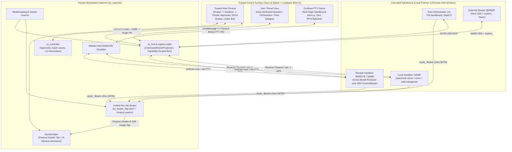

# prd_m: Model telemetry, cross-model orchestration, and unified control plane

[Index](README.md) · children: [model selection, reasoning variants & dual-window quotas](prd_m1.md),
[cross-model & cross-sandbox orchestration](prd_m2.md),
[unified control plane, threads & confined terminals](prd_m3.md) · related:
[orchestrator fleet](prd_i.md), [credential broker](prd_i3.md), [LLM gateway](prd_i4.md),
[composable config & external brokers](prd_l.md), [host credential brokering](prd_l1.md)

## Executive summary

PRD M extends `oc-sandbox` from single-sandbox launches and scattered browser/terminal windows into
a cohesive, zero-trust multi-model control plane covering three tightly linked areas:

1. **Normalized model selection, reasoning levels, and dual-window (`5h` + `7d`) quota telemetry**
   ([prd_m1](prd_m1.md)) for Codex (OAuth subscription / Responses / App Server) and Claude (Claude
   Code / OAuth / API) routed through OpenCode and the host LLM broker — closing the gap where ACP
   exposes only per-session context/cost (`usage_update`) and omits account-level rolling 5-hour
   and 7-day weekly quotas.
2. **Cross-model, cross-sandbox orchestration ("orchestrator of orchestrators")**
   ([prd_m2](prd_m2.md)) supporting intra-sandbox OpenCode `task` subagents, capability-scoped
   inter-sandbox messaging across different model families and local/remote Podman hosts (e.g.,
   parallel Codex implementors each paired with an adversarial Claude reviewer), and host-enrolled
   external top-level peer streams, all addressed unambiguously as `"NAME"` (local),
   `"REMOTE / NAME"` (remote), or `"@PEER"` (external harness).
3. **Unified native + web control plane (Tauri v2 + hardened loopback web UI)**
   ([prd_m3](prd_m3.md)) replacing per-sandbox Chrome windows and terminals with a single
   `Project -> Sandbox -> Thread` workspace where both the human operator and the root orchestrator
   message the same targets, alongside confined embedded terminal emulation (`opencode-tui` and
   `shell`) with host-side ANSI scrubbing and generation-fenced input leases.

## Architecture ranking and synthesis (3-way design review)

Three independent architecture lenses evaluated all three requirements against `oc-sandbox`'s
zero-trust invariants (`prd_i`, `prd_i3`, `prd_i4`, `prd_l`, `prd_l1`):

| Rank | Lens / Approach | Core Strengths | Key Weaknesses / Limits | Role in Selected Synthesis |
|---|---|---|---|---|
| **#1 (Selected Combination)** | **First-Principles Protocol & Threat Model** anchored on **Existing `oc-sandbox` Stack**, **Mirroring T3Code Patterns** | Preserves every `prd_i`/`prd_l1` boundary (zero secrets in sandboxes, host-owned `oc_controller` approvals, no host `git` in `~/opencode-sandbox`); clean 3-subplane model/reasoning/quota split; bijective RFC-1123 addressing (`"NAME"`, `"REMOTE / NAME"`, `"@PEER"`); unforgeable host write-ahead provenance; lightweight Tauri v2 + web UI. | Requires building our own React/Tauri frontend views and `oc_daemon` SQLite event/mailbox projection (~3.5–5 weeks across phased slices). | **Adopted baseline** across `prd_m1`, `prd_m2`, and `prd_m3`. |
| **#2** | **Pure Incremental Patch on Existing `oc-sandbox` + tmux CLI** | Fastest path to M1/M2 (~1.5–2 weeks); zero frontend toolchain. | Does not eliminate Chrome/terminal window sprawl or deliver unified desktop/web agent threads + embedded terminal emulation. | Incorporated directly into M1/M2 (`oc_broker_http`, `oc_plan`, `oc_config_mcp`, `$STATE/worktrees` auto-discovery) while adding M3 UI/PTY cleanly on top. |
| **#3 (Rejected for Direct Adoption)** | **Fork or Embed `pingdotgg/t3code` (MIT)** | Polished out-of-the-box React thread/diff UI, `packages/contracts`, SQLite Command/Event/Projection + Outbox, `CheckpointReactor`, mid-thread provider handoff. | **Inverted trust model:** Node + `node-pty` + Electron server runs directly on host UID/worktrees with local CLI credentials; retrofitting rootless Podman `pasta`, `safe_run` git isolation, `prd_l1` host-only brokers, SSH workers, and autonomous multi-sandbox lanes costs more (~5–8 weeks + rebase debt) than mirroring its best patterns cleanly. | **Mirror patterns only** (shared contracts, SQLite Command/Event/Projection + Outbox, mid-thread handoff, containerized `safe_run` turn checkpoints); do **not** fork/embed T3Code. |

## Scope and phased milestones

- [ ] **M1 — Model selection, reasoning variants, and dual-window (`5h` + `7d`) quota telemetry**
      ([prd_m1](prd_m1.md)): unify `/llm/*` onto `oc_broker_http.py`, compile host-authorized
      OpenCode `variants` (`OPENCODE_DISABLE_MODELS_DEV=1`) with host-side provider lowering,
      capture passive 5h/7d headers + `codex app-server` `account/rateLimits/read` into
      `QuotaLedger`, and enforce pre-dispatch quota admission + paid-fallback approval locks.
      *(Estimated: 4–6 days.)*
- [ ] **M2 — Cross-model, cross-sandbox orchestration and unambiguous addressing**
      ([prd_m2](prd_m2.md)): lock RFC-1123 addressing (`"NAME"`, `"REMOTE / NAME"`, `"@PEER"`),
      migrate `worker@1` IDs off slash-bearing `builtin/*` to slash-free names (`"local"`
      reserved), upgrade `oc-opencode-run.py` to `opencode serve` + `tmux`, and add capability-scoped
      `oc_hub` MCP messaging (`sandbox_spawn`, `sandbox_send`, `sandbox_wait`, `peer_send`) with
      host write-ahead provenance, nonce-framed `UNTRUSTED_PEER_DATA`, cycle-free waits, and
      `safe_run` patch handoff. *(Estimated: 5–7 days.)*
- [ ] **M3 — Unified Tauri v2 + hardened web control plane and confined embedded PTY**
      ([prd_m3](prd_m3.md)): build `oc_daemon.py` (`registry.sqlite` Command/Event/Projection +
      Outbox, auto-importing `$STATE/worktrees`), React + Vite SPA served in both Tauri v2 and
      hardened loopback web mode with `Project -> Sandbox -> Thread` navigation, trusted Approval
      Inbox + 5h/7d quota chrome, symmetric human + `-o` messaging, and null-origin sandboxed
      `xterm.js` behind a host stateful ANSI scrubber + generation-fenced `InputLease`.
      *(Estimated: 8–12 days.)*

## Open decisions

- [ ] (decision needed) **Control-plane UI strategy** — **Mirror T3Code architectural patterns on
      `oc_daemon` + Tauri v2 + React/Vite (recommended)**: keeps BSD-2-Clause core, preserves
      rootless Podman + zero-secret host boundaries, ~30–60 MB idle Tauri shell, 8–12 days for M3;
      *vs.* **Fork/embed `pingdotgg/t3code`**: instant thread/diff UI, but Electron (~150–300 MB+
      RAM), Node/`node-pty` host-UID trust inversion, and 5–8 weeks of retrofit + rebase debt.
- [ ] (decision needed) **Embedded PTY renderer** — **Sandboxed-iframe `xterm.js` behind host ANSI
      scrubber (recommended first)**: mature, OSC 52 off by default, standard GC, no
      `wasm-unsafe-eval` CSP relaxation on Linux WebKitGTK (included in M3); *vs.*
      **`libghostty-vt` / `ghostty-web` WASM**: superior Unicode/TUI fidelity, but younger JS
      bindings, requires `wasm-unsafe-eval`, and WASM linear memory does not shrink after output
      floods without worker recycling (keep iframe interface pluggable for later upgrade).
- [ ] (decision needed) **Worker ID migration (`prd_l` compatibility)** — migrate `worker@1` IDs
      from `OPAQUE_ID_RE` (`builtin/local-workstation`) to strict slash-free `WORKER_NAME_RE`
      (`"local"` permanently reserved; remotes e.g. `"mac-studio"`) so `"REMOTE / NAME"` is
      unambiguous everywhere (**recommended**, 0.5–1 day); *vs.* adding a separate `display_alias`
      field on `worker@1` (avoids schema migration but creates dual-name ambiguity).

## Review record

- 3-way architecture synthesis completed (`2026-11-22`) across current-stack (`arch-current`),
  ecosystem/T3Code (`arch-t3code-eco`), and first-principles (`arch-first-prin`) lenses, with a
  follow-up convergence pass resolving untrusted `opencode serve` provenance, dynamic model/variant
  lowering, `xterm.js` vs `libghostty-vt`, and DNS-1123 / `@PEER` addressing.
- Gate 1 external security review (`prd_m.md`, `prd_m1.md`, `prd_m2.md`, `prd_m3.md`): pending.

- [ ] **Human review**: checked only when the user says so
