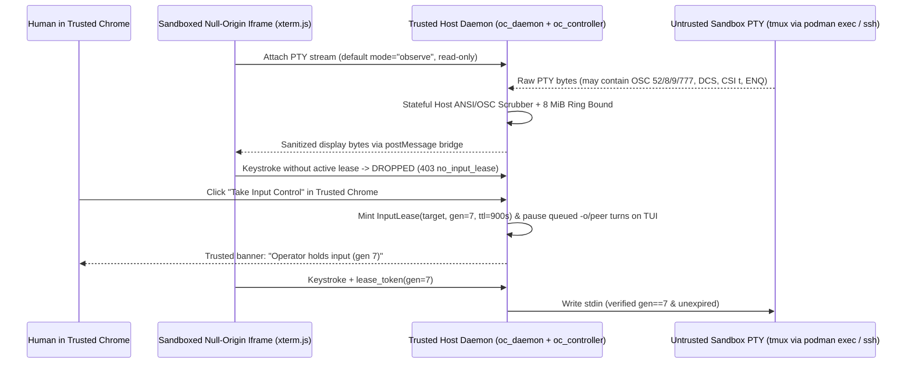

# prd_m3: Unified control plane, agent threads, and confined embedded terminals

Parent: [prd_m](prd_m.md) · related: [orchestrator and dashboard](prd_i1.md),
[worker fleet and terminals](prd_i2.md), [credential broker](prd_i3.md),
[model telemetry](prd_m1.md), [cross-model orchestration](prd_m2.md)

## Problem statement

Running parallel local and remote sandboxes currently scatters operator attention across multiple
Chrome profiles/windows and ad-hoc host terminals. We want a single, lightweight **native desktop
app + hardened loopback web UI** (Tauri v2 + shared React/Vite frontend) that:

1. Replaces flat project lists with a clear three-level hierarchy:
   **`Project -> Sandbox (local or REMOTE, -i NAME) -> Chat / Thread`** (plus a pinned **Root
   Orchestrator `-o`** supervisor view).
2. Renders active agent work as normal structured **agent threads** (like Antigravity, Codex, or
   Claude Code Desktop) where **both the human operator and the root orchestrator LLM** can message
   any authorized `"NAME"`, `"REMOTE / NAME"`, or `"@PEER"` target.
3. Provides **embedded terminal emulation** (`opencode-tui` and `shell`) inside the same app without
   weakening `oc-sandbox`'s trust boundary against hostile terminal escape sequences, fake approval
   prompts, or sandbox-forged session events.

## Design specification

### 1. Unified state hierarchy (`oc_daemon.py` + `registry.sqlite`)

`oc_daemon.py` extends `OperatorControlServer` (`oc_config_mcp.py`) with a host-only `0o600` SQLite
WAL database (`$CONF_DIR/registry.sqlite`) following T3Code's **Command -> Event -> Projection +
Outbox** pattern:

```text
Workspace Header
 ├── Root Orchestrator ('-o')       (Singleton supervisor thread; same Thread renderer + target picker)
 ├── Approval Inbox                 (Trusted Host Chrome ONLY — bound directly to oc_controller.view())
 └── Global Quota Bar               (Live 5h + 7d multi-window meters per provider account + Paid-Fallback lock)

Sidebar Tree (3-Level Hierarchy)
 └── Project (project_id, name, canonical_repo_key)
      │  Auto-discovers existing CLI sandboxes from $STATE/worktrees/<NAME> (prd_c);
      │  repo-less sandboxes group under "Scratch / Ad-hoc".
      └── Sandbox (canonical_addr: "NAME" | "REMOTE / NAME", worker_ref: "local"|REMOTE,
                   instance: NAME, incarnation_id, branch, sandbox_type, plan_digest,
                   status, model_selection, active_grants[], 1-click "Revoke Grants")
           ├── Threads[]            (Structured sessions synced from opencode serve + oc_hub)
           │    ├── #main           (Primary thread; collapsible child sub-threads for `task` subagents)
           │    └── #<side-thread>  (Optional scoped review/debug thread)
           ├── Diff & Checkpoints   (On-demand turn diffs via containerized `safe_run` + oc-bridge.py)
           └── Terminals[]          (Persistent tmux PTYs attached via podman exec / pinned ssh)
                ├── pty:opencode-tui  (Live TUI viewing the exact same opencode serve session)
                └── pty:shell         (Interactive sandbox shell)
```

### 2. Symmetric human + root orchestrator messaging & unforgeable provenance

- **One Target Graph:** Both the Human Operator (typing in a thread composer or targeting
  `@NAME` / `@REMOTE / NAME` / `@@PEER`) and the Root Orchestrator (`-o` calling `sandbox_send`)
  resolve through the exact same `oc_daemon.resolve_target()` and append to the same `seq`-ordered
  thread projection.
- **Zero-Drift Thread <-> `opencode-tui` Coherence:** Because the sandbox runs `opencode serve`
  with `tmux` window 0 running `opencode attach http://127.0.0.1:4096`, structured thread updates
  arrive as typed JSON/SSE events (text deltas, reasoning blocks, tool calls, token counts) without
  scraping ANSI, while switching to the `opencode-tui` terminal tab displays the exact same live
  session.
- **Unforgeable Host Write-Ahead Provenance (Defeats Hostile `opencode serve` Spoofing):**
  - Because the sandbox LLM shares the container UID with `opencode serve`, it can read
    `/run/secrets/oc_server_pw` and call `127.0.0.1:4096` locally. Therefore **`oc_daemon` NEVER
    trusts `opencode serve`'s self-reported sender/role metadata**.
  - Before dispatching any host-originated message, `oc_daemon` writes a receipt
    `(dispatch_id, session_id, message_id, sha256(canonical_body), verified_actor)` to
    `registry.sqlite`.
  - Incoming `/event` SSE user messages receive **`[Operator]`**, **`[Orchestrator -o]`**, or
    **`[Peer: <addr>]`** badges **if and only if** they match an unconsumed host receipt by
    `(message_id, body_sha256)`.
  - Unmatched turns are **never** badged `[Operator]`:
    - If an operator `InputLease` on `pty:opencode-tui` was active and the host PTY relay observed
      operator Enter/stdin bytes in that window, render **`[TUI Input · In-Sandbox]`** (amber).
    - Otherwise render **`[Sandbox-Local / Unverified]`** (warning badge, zero authority).

### 3. Shared React/Vite frontend in Tauri v2 + hardened loopback web mode

- **One SPA, Two Shells:** Build a single schema-validated (`contracts/` JSON Schema + TypeScript)
  React + Vite UI served identically by:
  1. **Tauri v2 Native Desktop App** (~30–60 MB idle RAM, zero browser extensions, minimal Rust
     bridge limited to OS notifications and window focus), and
  2. **Hardened Loopback Web Mode** (`127.0.0.1` only, per-launch 256-bit `operator_ui_token`,
     strict `Host` check, exact `Origin` check on every mutation and WebSocket upgrade, CSRF token,
     `SameSite=Strict`, `frame-ancestors 'none'`, per [prd_i1](prd_i1.md)).
- **Trusted Host Chrome Separation ([prd_i1](prd_i1.md), [prd_i3](prd_i3.md)):**
  - The Sidebar Tree, Model/Variant Picker, 5h/7d Quota Bar, Paid-Fallback Lock, **Approval Inbox**
    (rendering `oc_controller.view(operator, request_id)` with exact `security_delta`, `plan_digest`,
    and `(request_id, revision, digest)` binding), **Revoke Grants**, and **PTY Input Lease Bar**
    live exclusively in Trusted Host Chrome.
  - Thread Markdown renders strictly as an inert AST (raw HTML disabled; external `` blocked to
    prevent tracking-pixel exfiltration). Pending approvals appear inside threads only as read-only
    `request_id` reference chips resolved by Trusted Chrome against `oc_controller`.
- **Containerized Turn Diffs & Safe Editor Handoff:**
  - Turn diffs and checkpoints (mirroring T3Code's `CheckpointReactor`) execute strictly inside a
    throwaway `safe_run` container on the worker (never running host `git` inside
    `~/opencode-sandbox`), streaming bounded UTF-8 diffs to the right-hand diff drawer. "Open in
    Editor / 3-Way Merge" hands off through `oc-bridge.py` (`openat(O_NOFOLLOW)` staging).

### 4. Confined embedded PTY emulation and generation-fenced input leases



- **Zero `node-pty` in containers:** Host `oc_daemon` attaches directly to worker-side `tmux` via
  `podman exec -it` (local) or pinned-hostkey `ssh` (`ControlMaster`, remote) and bridges bytes
  over an authenticated binary WebSocket.
- **Two-Layer Escape-Sequence Confinement ([prd_i2](prd_i2.md)):**
  1. **Host stateful ANSI/OSC scrubber (`oc_daemon`):** Strips **OSC 52** (clipboard read/write
     poisoning), **OSC 9/99/777** (fake desktop notifications), **DCS/APC/PM/SOS** passthrough,
     **CSI window ops (`CSI Ps t`)**, **terminal query/answerback loops (`ENQ`, `CSI c`,
     `OSC 10/11`)**, and unconfirmed **OSC 8** links; enforces bounded scrollback (`<= 8 MiB` /
     `5,000–10,000` lines server ring, `<= 512 KiB` client buffer) and byte-rate backpressure
     against output floods.
  2. **Opaque null-origin iframe (`<iframe sandbox="allow-scripts">`):** Hosts `xterm.js` (chosen
     first over `libghostty-vt` WASM to avoid `wasm-unsafe-eval` CSP relaxation on Linux WebKitGTK
     and WASM linear-memory retention, while keeping the `postMessage` iframe contract pluggable
     for a future `libghostty-vt` upgrade). Possesses **zero** operator cookies, **zero**
     `__TAURI_INTERNALS__` access, and **zero** DOM reach into Trusted Chrome. Clicking an allowed
     `http`/`https` link opens a Trusted Chrome confirmation modal showing the literal punycode
     host.
- **Read-Only Default & Generation-Fenced Input Lease:**
  - Every PTY attach opens strictly **read-only (`observe`)**.
  - Clicking **Take Input Control** in Trusted Chrome mints `InputLease(target, generation=g, ttl)`
    in `oc_controller` and pauses queued orchestrator/peer injections to `opencode-tui` until release,
    disconnect, or expiry (which bumps `generation = g + 1`, fencing any in-flight keystroke frame).

## Gate 1 pseudocode walkthrough

```text
function handle_pty_websocket(ws, operator_session, target_addr, pty_kind):
    require_exact_host_and_origin(ws.headers)
    require_valid_operator_session(operator_session)
    sandbox = registry.resolve_running_sandbox(parse_canonical_addr(target_addr))
    if pty_kind not in ("opencode-tui", "shell"):
        return close(ws, 4400, "invalid_pty_kind")

    scrubber = StatefulAnsiScrubber(strip_osc52=True, strip_osc8=True, strip_osc9_99_777=True,
                                    strip_dcs_apc=True, strip_queries=True, max_ring_bytes=8*1024*1024)
    pty_fd = open_confined_tmux_attach(sandbox, pty_kind)   # local podman exec or pinned ssh
    try:
        while ws.open and sandbox.is_running():
            if pty_fd.readable():
                clean = scrubber.feed(pty_fd.read_bounded(16384))
                if clean:
                    ws.send_binary(clean)
            if ws.has_client_frame():
                frame = parse_pty_client_frame(ws.recv())
                if frame.kind == "resize":
                    if controller.verify_input_lease(operator_session, sandbox, pty_kind, frame.gen):
                        pty_fd.resize_clamped(frame.cols, frame.rows)
                elif frame.kind == "stdin":
                    if not controller.verify_input_lease(operator_session, sandbox, pty_kind, frame.gen):
                        ws.send_json({"type": "stdin_rejected", "reason": "no_or_stale_input_lease"})
                        continue
                    record_tui_operator_stdin_window(sandbox, pty_kind, now=clock())
                    pty_fd.write_all(frame.data)
    finally:
        controller.release_input_lease_for_conn(ws.id)      # bumps generation immediately on disconnect
        pty_fd.close()
```

### Failure, recovery, and verification tests

- **Failure / recovery:**
  - If `oc_daemon` or the WebSocket disconnects, any held `InputLease` immediately revokes and bumps
    `generation`, returning the PTY to read-only `observe` on reconnect; container-side `tmux`
    preserves running TUI/shell sessions seamlessly across disconnects.
  - Stopping or disconnecting a remote sandbox marks its sidebar node `offline/stopped` while
    keeping cached threads and audit history readable from `registry.sqlite`.
- **Verification tests:**
  1. Hostile ANSI red-team suite feeding split-chunk OSC 52, OSC 8, OSC 9/777, DCS, `CSI 8 t`,
     `ENQ`, and 50 MiB output floods through `StatefulAnsiScrubber`, verifying zero forbidden
     sequences survive and memory remains bounded (`<= 8 MiB`).
  2. Provenance spoofing test proving a container-local `POST /session/:id/message` with
     `OPENCODE_SERVER_PASSWORD` can NEVER earn an `[Operator]` or `[Orchestrator -o]` badge in
     `oc_daemon`'s thread projection.
  3. Lease-fencing test proving read-only attach drops `stdin`, taking control pauses queued
     orchestrator TUI injections, and stale-generation keystrokes after release/disconnect fail
     closed.
  4. Origin/CSRF/iframe isolation tests verifying foreign origins, DNS rebinding, and code inside
     the sandboxed `xterm.js` iframe cannot access operator tokens, Tauri IPC, or `oc_controller`
     approvals.

## Concrete gaps and checkboxes

- [ ] **Gap M3.1 — `oc_daemon.py` & `registry.sqlite` projection (`oc_daemon.py`):** evolve
      `OperatorControlServer` into SQLite Command/Event/Projection + Outbox with automatic import
      of `$STATE/worktrees/<NAME>` (`prd_c`) into `Project -> Sandbox -> Thread` and write-ahead
      provenance receipts.
- [ ] **Gap M3.2 — Shared React/Vite frontend + Tauri v2 native shell (`ui/`):** implement
      3-level sidebar tree, pinned `-o` orchestrator view, inert Markdown thread renderer,
      Trusted Chrome Approval Inbox & 5h/7d quota bar, `safe_run` turn diff drawer, and
      `oc-bridge.py` handoff; pin Node/Rust toolchains via `mise` ([prd_f](prd_f.md)).
- [ ] **Gap M3.3 — Confined PTY relay & null-origin `xterm.js` iframe (`oc_pty_relay.py`):**
      implement stateful host ANSI/OSC scrubber, bounded ring buffer, `oc_controller`
      generation-fenced `InputLease`, and sandboxed `xterm.js` iframe (keeping the iframe boundary
      pluggable for future `libghostty-vt`).
