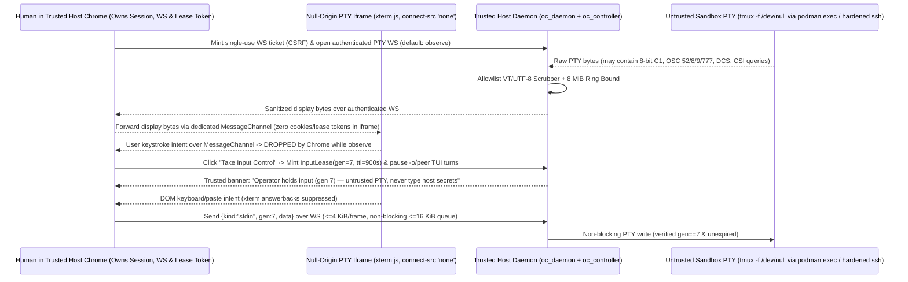

# prd_m3: Unified control plane, agent threads, embedded browser views, and confined terminals

Parent: [prd_m](prd_m.md) · related: [per-instance DNS](prd_d.md), [local HTTPS/TLS](prd_e.md),
[orchestrator and dashboard](prd_i1.md), [worker fleet, browser wall & terminals](prd_i2.md),
[credential broker](prd_i3.md), [composable config & bundles](prd_l.md),
[host credential brokering](prd_l1.md), [model telemetry](prd_m1.md),
[cross-model orchestration](prd_m2.md)

Delivery order: **[M3a — Loopback dashboard](prd_m3a.md)**, then
**[M3b — Tauri desktop dashboard](prd_m3b.md)**. Both use the same SvelteKit static SPA
and typed control-plane contract.

## Problem statement

Running parallel local and remote sandboxes currently scatters operator attention across multiple
Chrome profiles/windows and ad-hoc host terminals, and launches Chromium even for sandboxes that
only run backend code or security reviews. We want a single, lightweight **native desktop app +
hardened loopback web UI** with a shared SvelteKit frontend that:

1. Replaces flat project lists with a clear three-level hierarchy:
   **`Project -> Sandbox (local or REMOTE, -i NAME) -> Chat / Thread`** (plus a pinned **Root
   Orchestrator `-o`** supervisor view and an optional fleet-wide PiP **"Browser Wall"**).
2. Renders active agent work as normal structured **agent threads** (like Antigravity, Codex, or
   Claude Code Desktop) where **both the human operator and the root orchestrator LLM** can message
   any authorized `"NAME"`, `"REMOTE / NAME"`, or `"@PEER"` target.
3. Provides **embedded terminal emulation** (`opencode-tui` and `shell`) and **opt-in embedded
   sandbox browser views** (zero separate host Chrome windows, even locally) inside the same app —
   backed by composable opt-in browser bundles (`cap:browser.chromium@1.0`, mirroring
   `builtin/postgres-app`), internal HTTPS via [prd_d](prd_d.md)/[prd_e](prd_e.md), and an
   authenticated CDP arbiter — without weakening `oc-sandbox`'s trust boundary against hostile
   terminal escapes, browser canvas spoofing, WebSocket hijacking, or sandbox-forged events.

## Design specification

### 1. Unified state hierarchy (`oc_daemon.py` + `$STATE/registry.sqlite`)

`oc_daemon.py` extends `OperatorControlServer` (`oc_config_mcp.py`) with a host-only `0o600` SQLite
WAL database under runtime `$STATE` (`~/.local/share/oc-sandbox/registry.sqlite`, verified via
`check_not_in_sandbox`, `assert_trusted_dir`, `O_NOFOLLOW`, guarded by
`check_not_host_production_dir` in tests) following T3Code's **Command -> Event -> Projection +
Outbox** pattern:

```text
Workspace Header (Trusted Host Chrome)
 ├── Root Orchestrator ('-o')       (Singleton supervisor thread; same Thread renderer + target picker)
 ├── Approval Inbox                 (Trusted Host Chrome ONLY — bound directly to oc_controller.view())
 ├── Browser Wall (PiP, Optional)   (Fleet-wide low-rate tile grid ONLY for sandboxes with cap:browser.chromium@1.0)
 └── Global Quota Bar               (Live 5h + 7d multi-window meters per provider account + Paid-Fallback lock)

Sidebar Tree (3-Level Hierarchy)
 └── Project (project_id, name, canonical_repo_key)
      │  Auto-discovers existing CLI sandboxes by reading ONLY host-trusted $STATE/worktrees/<NAME>
      │  metadata via O_NOFOLLOW (never running host git or parsing .git inside ~/opencode-sandbox);
      │  repo-less sandboxes group under "Scratch / Ad-hoc".
      └── Sandbox (canonical_addr: "NAME" | "REMOTE / NAME", worker_ref: "local"|REMOTE,
                   instance: NAME, incarnation_id, branch, sandbox_type, plan_digest,
                   status, model_selection, active_grants[], 1-click "Revoke Grants")
           ├── Threads[]            (Structured sessions synced from opencode serve + oc_hub)
           │    ├── #main           (Primary thread; collapsible child sub-threads for `task` subagents)
           │    └── #<side-thread>  (Optional scoped review/debug thread)
           ├── Diff & Checkpoints   (On-demand turn diffs via containerized `safe_run` + oc-bridge.py)
           ├── Browser (Optional)   (Shown ONLY when compiled plan provides cap:browser.chromium@1.0)
           └── Terminals[]          (Persistent tmux PTYs attached via podman exec / hardened ssh)
                ├── pty:opencode-tui  (Live TUI viewing the exact same opencode serve session)
                └── pty:shell         (Interactive sandbox shell)
```

### 2. Symmetric human + root orchestrator messaging & full-key write-ahead provenance

- **One Target Graph & Unambiguous Target Picker:** Both the Human Operator (via a structured target
  pill selector or explicit `/to NAME`, `/to REMOTE / NAME`, `/to @PEER` composer command — never an
  ambiguous `@@PEER` prefix) and the Root Orchestrator (`-o` calling `sandbox_send`) resolve through
  the exact same `oc_daemon.resolve_target()` and append to the same `seq`-ordered thread
  projection.
- **Zero-Drift Thread <-> `opencode-tui` Coherence:** Because the sandbox runs `opencode serve`
  with `tmux` window 0 running `opencode attach`, structured thread updates arrive as typed JSON/SSE
  events (text deltas, reasoning blocks, tool calls, token counts) without scraping ANSI, while
  switching to the `opencode-tui` terminal tab displays the exact same live session.
- **Unforgeable Full-Key Write-Ahead Provenance (Defeats Hostile `opencode serve` Spoofing &
  Cross-Thread Replay):**
  - Because the sandbox LLM shares the container UID with `opencode serve`, it can read
    `/run/secrets/oc_server_pw` and call `opencode serve` locally. Therefore **`oc_daemon` NEVER
    trusts `opencode serve`'s self-reported sender/role metadata**.
  - Before dispatching any host-originated message, `oc_daemon` mints a **host-generated 128-bit
    cryptographic `message_id`** (never trusting a server-chosen ID; if `opencode serve` does not
    preserve caller-supplied IDs on a given version, `oc_daemon` binds an explicit host-minted
    correlation nonce) and persists a write-ahead receipt keyed by the full 5-tuple
    `(sandbox_addr, incarnation_id, session_id, message_id, sha256(canonical_body)) ->
    verified_actor` in `$STATE/registry.sqlite`.
  - Incoming `/event` SSE user messages earn **`[Operator]`**, **`[Orchestrator -o]`**, or
    **`[Peer: <addr>]`** badges **if and only if** they match and atomically consume an unconsumed
    host receipt on the exact same `(sandbox_addr, incarnation_id, session_id, message_id,
    body_sha256)` — preventing cross-thread or cross-sandbox replay of an `[Operator]` badge.
  - Unmatched turns are **never** badged `[Operator]`:
    - If an operator `InputLease` on `pty:opencode-tui` (never `shell`) was active and the host PTY
      relay observed an unconsumed operator Enter keystroke in that window, consume that one-shot
      Enter token and render **`[TUI Input · In-Sandbox]`** (amber, zero directive/approval
      authority).
    - Otherwise render **`[Sandbox-Local / Unverified]`** (warning badge, zero authority).

### 3. Shared SvelteKit frontend, loopback web auth, and Tauri v2 UDS bridge

- **One static SPA, two authenticated shells:** Reach initial acceptance in M3a first. M3b
  then packages the same client with a typed native transport.
  - **Tauri v2 Native Desktop App (M3b):** zero browser
     extensions. A minimal Rust backend opens `oc_daemon`'s host-only `0o600` UDS directly
     (`SO_PEERCRED` UID verified) to proxy API/SSE/PTY/Browser streams to the WebView without
     opening any cross-origin HTTP/CORS hole on loopback. The Tauri v2 capabilities JSON grants
     **zero** `fs`, `shell`, `http`, or `clipboard` plugin permissions (only native window focus,
     notifications, and the typed `oc_daemon` UDS IPC bridge).
  - **Hardened Loopback Web Mode (M3a, [prd_i1](prd_i1.md)):** Binds `127.0.0.1` only. Launch CLI
     prints/passes a **single-use, 60-second bootstrap code** (never putting a reusable
     `operator_ui_token` in URL query strings, browser history, or CLI `argv`), exchanged via
     `POST /api/auth/exchange` for an `HttpOnly; SameSite=Strict` session cookie (with idle +
     absolute TTL) plus a double-submit CSRF token. Every HTTP request validates `Host`; every
     mutation validates exact `Origin` + CSRF token; every WebSocket upgrade requires a
     **single-use, CSRF-minted WS ticket** bound to `(session_id, target_addr, surface_kind)`.
- **Explicit CSP & Trusted Host Chrome Separation ([prd_i1](prd_i1.md), [prd_i3](prd_i3.md)):**
  - **Loopback dashboard CSP ([M3a](prd_m3a.md)):** The daemon sends the enforcing header on
    each HTML response. Emit the **exact bound ephemeral port** at runtime when WebSockets
    are enabled:
    `default-src 'none'; script-src 'self'; style-src 'self'; img-src 'self' data:;
    connect-src 'self' ws://127.0.0.1:<bound_port>; frame-src 'self'; frame-ancestors 'none';
    base-uri 'none'; form-action 'self'`. If the production build has an inline bootstrap,
    add its exact build hash to `script-src`.
  - **Desktop dashboard CSP ([M3b](prd_m3b.md)):** Load only bundled assets and enable only
    the platform's required local IPC endpoints. Omit the loopback WebSocket destination.
  - **Null-Origin Sandboxed Iframes (PTY & Browser Canvas):** Because `<iframe sandbox="allow-scripts">`
    assigns an opaque `null` origin where `'self'` does not match, pin iframe scripts via an
    explicit CSP SHA-256 hash or exact static origin URL (`script-src 'sha256-...'` /
    `http://127.0.0.1:<bound_port>/static/confined/`), with `default-src 'none'; connect-src 'none'`.
    The Browser Canvas iframe additionally locks `img-src 'none'; worker-src 'none'` and decodes
    host-verified JPEG/PNG `ArrayBuffer` frames strictly onto `<canvas>` via
    `createImageBitmap(new Blob(...))`.
  - The Sidebar Tree, Model/Variant Picker, 5h/7d Quota Bar, Paid-Fallback Lock, **Approval Inbox**
    (rendering `oc_controller.view(operator, request_id)` with exact `security_delta`, `plan_digest`,
    and `(request_id, revision, digest)` binding), **Revoke Grants**, and **Input Lease Bar** live
    exclusively in Trusted Host Chrome.
  - Thread Markdown renders strictly as an inert AST (raw HTML disabled; remote `` blocked).
    Pending approvals appear inside threads only as read-only `request_id` chips resolved by Trusted
    Chrome against `oc_controller`.
- **Containerized Turn Diffs & Safe Editor Handoff:**
  - Turn diffs and checkpoints (mirroring T3Code's `CheckpointReactor`) execute strictly inside a
    throwaway `safe_run` container on the worker (never running host `git` inside
    `~/opencode-sandbox`), streaming bounded UTF-8 diffs to the right-hand diff drawer. "Open in
    Editor / 3-Way Merge" hands off through `oc-bridge.py` (`openat(O_NOFOLLOW)` staging).
- **Agent-Assisted Dashboard Control ([UI SDK](https://ui-sdk.dev) & `data-agent-confirm`):**
  - Evaluate integrating Vercel Labs' open-source **UI SDK** (`vercel-labs/ui`, Apache-2.0, Svelte
    adapter `@ui-sdk/svelte/agent`) behind a thin local adapter in the shared SvelteKit SPA so an
    authorized assistant/orchestrator (`-o`) can inspect view state (`snapshot()` / `query()`) and
    drive safe dashboard navigation (`act()`) across both [M3a loopback web](prd_m3a.md) and
    [M3b Tauri desktop](prd_m3b.md) without brittle screenshots or arbitrary JS execution.
  - **Asymmetric confirmation via `data-agent-confirm`:** Annotate every protected control in
    advance with `data-agent-confirm="<impact summary>"` (e.g., revoking grants, stopping,
    restarting or deleting a sandbox, changing active provider/model/fallback settings, exporting
    diffs, or toggling input control). A normal human click follows the ordinary UI flow without an
    extra prompt. When an agent triggers that same control through UI SDK
    (`details.source === "agent"`), the `allow` callback intercepts `step.confirm` and pops up a
    **human confirmation modal in Trusted Host Chrome** showing the exact action, target,
    parameters, and impact summary — requiring an explicit human click before execution even when a
    direct human click would not prompt. Without an `allow` handler, or on human cancel/timeout,
    the action fails closed.
  - **Defense in depth & self-approval prevention:**
    - Mark the confirmation modal itself, the **Approval Inbox** (approve/deny controls), provider
      sign-in/credential flows, and auth/bootstrap chrome with **`data-agent-hidden`** so an agent
      cannot inspect or click "Confirm" on its own confirmation dialog or approve its own
      `oc_controller` request. Mark sensitive displayed values with **`data-agent-secret`**
      (`[redacted]`).
    - Confirmation dialogs accept only trusted human input (rejecting agent-originated or synthetic
      events), bind to the exact action, target, and active session generation (auto-cancelling on
      logout, expiry, reconnect, or target state drift), and never replace backend `oc_daemon`,
      `oc_controller`, or Tauri Rust IPC authorization checks.
    - Keep the UI SDK bridge strictly scoped to host-authorized orchestrator sessions via
      `oc_daemon` — never exposed to untrusted sandbox containers or null-origin PTY/Browser
      iframes (`connect-src 'none'`). Pin any `@ui-sdk/*` npm package and verify its Apache-2.0
      license and lockfile integrity via `mise` ([prd_f](prd_f.md)).

### 4. Confined embedded PTY emulation, allowlist ANSI scrubber, and `MessageChannel` bridge



- **Zero `node-pty` in containers & hardened attach:** Host `oc_daemon` attaches directly to
  worker-side `tmux -f /dev/null` via `podman exec -it` (local) or `oc_broker_ssh.py`-grade
  hardened OpenSSH (`-F /dev/null`, `ForwardAgent=no`, `ClearAllForwardings=yes`,
  `StrictHostKeyChecking=yes`, pinned `0600` `UserKnownHostsFile`, minimal sanitized env, remote).
  Enforce max concurrent PTY attachments per operator/sandbox.
- **Trusted Chrome Owns the WebSocket & `lease_token` (Zero Network / Zero Secrets in Iframe):**
  - The PTY renderer runs in `<iframe sandbox="allow-scripts">` (opaque `null` origin) with
    `connect-src 'none'`.
  - The iframe **never** opens a WebSocket and **never** sees `operator_session`, cookies,
    `lease_token`, or `__TAURI_INTERNALS__`. Trusted Host Chrome owns the authenticated WS/UDS
    connection and transfers sanitized display bytes and keystroke intents strictly over a dedicated
    `MessageChannel` (`port1`/`port2`).
  - `xterm.js` is recommended first (OSC 52 off by default, standard GC, no `wasm-unsafe-eval` CSP
    relaxation on WebKitGTK), keeping the `MessageChannel` iframe boundary pluggable for a future
    `libghostty-vt` upgrade.
- **Strict Allowlist VT/UTF-8 Scrubber & Answerback Suppression ([prd_i2](prd_i2.md)):**
  - `AllowlistVtUtf8Scrubber` in `oc_daemon` is a **strict display allowlist state machine** (not a
    denylist):
    - Permits valid UTF-8 printable text, safe C0 controls (`\r`, `\n`, `\t`, `\b`, `\x07` bell
      optionally muted), and a closed set of standard SGR/cursor/erase/scroll CSI display sequences.
    - **Drops ALL 8-bit C1 controls (`0x80..0x9F`, including `0x90` DCS, `0x9B` CSI, `0x9D` OSC,
      `0x9F` APC), ALL OSC sequences (`52`, `8`, `9`, `99`, `777`, `10`/`11`, title changes), ALL
      DCS/APC/PM/SOS strings, ALL CSI window manipulation (`CSI Ps t`), and ALL terminal query
      sequences (`ENQ`, `CSI 6 n` DSR, `CSI c` DA, `CSI > q` XTVERSION, `CSI ? ... $ p` DECRQM)**
      so a hostile sandbox cannot trigger synthetic `xterm.js` answerback bytes into stdin.
  - Inside the iframe, `xterm.js` `onData` answerback emission is suppressed; only explicit DOM
    keyboard and explicit user-initiated paste intents cross `MessageChannel` to Trusted Chrome.
  - Enforces bounded scrollback (`<= 8 MiB` / `5,000–10,000` lines host ring; `<= 512 KiB` client
    buffer) and byte-rate backpressure.
- **Read-Only Default, Non-Blocking PTY Writes, & Generation-Fenced Input Lease:**
  - Every PTY attach opens strictly **read-only (`observe`)** with a persistent Trusted Chrome banner
    reminding the operator that PTY content is untrusted sandbox output (never paste/type host
    secrets).
  - Clicking **Take Input Control** mints an ephemeral in-memory `InputLease(target, surface_kind,
    generation=g, ttl)` in `oc_controller` and pauses queued `-o`/peer injections on `opencode-tui`.
  - Host PTY writes are strictly **non-blocking** (`O_NONBLOCK`) with a bounded per-PTY outbound
    queue (`<= 16 KiB`), per-frame stdin cap (`<= 4 KiB`), and clamped `cols`/`rows` (`10..500` ×
    `4..200`) so a stalled sandbox cannot block lease release.
  - Bind each queued operation to the host-verified lease, connection, generation, and sandbox
    incarnation. At the final trusted write boundary, order each nonblocking write or resize
    against expiry, release, and handoff using the same surface fence. Discard old queue entries
    on transition, including bytes left after a partial write. Only committed input can produce
    a TUI Enter receipt. A transport with its own buffers must enforce the same fence at the
    final sink before enabling operator writes. Leave that surface in observe mode until this
    boundary is qualified.

### 5. Unified embedded sandbox browser views (opt-in, zero separate Chrome windows)

- **Conditional Sidebar Surface & PiP "Browser Wall" ([prd_i2](prd_i2.md)):**
  - Each `Sandbox` node (`"NAME"` or `"REMOTE / NAME"`) shows a **`Browser`** item **only** when
    its compiled `plan.lock.json` includes a resolved service providing `cap:browser.chromium@1.0`.
  - An optional fleet-wide **"Browser Wall"** workspace view displays live low-rate PiP tiles
    (`<= 1–2 fps`, capped JPEG/PNG frame bytes, explicit staleness/disconnect indicator) strictly
    for running sandboxes with `cap:browser.chromium@1.0`; clicking any tile expands it into the
    live per-sandbox `Browser` view.
- **Pod-Local `builtin/chromium-managed`, Unidirectional `isolated-sidecars` Wiring, & Internal
  HTTPS (`prd_d` + `prd_e`), Zero Host Ports:**
  - Keeps Chromium strictly inside the sandbox pod (`builtin/chromium-managed`,
    `security_profile = "standard"`, `memory = "2g"`, `pids_limit = 256` — **no host Wayland
    Chrome window required even on local workstations**).
  - **Container/OS confinement + Chromium managed enterprise policy (primary browser egress &
    scheme boundary):** In `managed` (`isolated-sidecars`), Chromium's sidecar runs with
    `--network=none` (blocking all external egress even via JS `fetch`/`WebSocket`), an empty
    disposable filesystem (zero `/run/secrets/`, zero host files), and a read-only
    `/etc/chromium/policies/managed/oc-policy.json` (`URLBlocklist: ["file://*", "chrome://*",
    "chrome-extension://*", "devtools://*", "javascript:*"]`, `DownloadRestrictions: 3`,
    `ExtensionInstallBlocklist: ["*"]`, `AllowFileSelectionDialogs: false`,
    `DefaultClipboardSetting: 2`).
  - **Internal HTTPS & strict cert separation (`prd_d` + `prd_e`):** Both containers receive
    `--add-host <NAME>.oc-sandbox.internal:127.0.0.1` ([prd_d](prd_d.md)). The CA private key
    NEVER enters the sandbox; `builtin/chromium-managed` receives **only the CA public certificate**
    (read-only trust store), while the instance's **leaf private key + certificate** (SAN restricted
    strictly to `<NAME>.oc-sandbox.internal`, Profile E recommended in [prd_e1](prd_e1.md) excluding
    IP SANs) stays **strictly in the app container** (never mounted into Chromium).
  - **Unidirectional `isolated-sidecars` network wiring (zero raw `:9222` to agent or host):**
    - DevTools port `9222` (`max_exposure = "pod-only"`, [prd_d](prd_d.md)) is **never** published
      on the host or LAN.
    - In `managed` (`isolated-sidecars`), Chromium's isolated sidecar binds raw CDP strictly on a
      **Chromium-only `0o600` UDS** (never mounted into the agent container; reachable only by the
      host CDP arbiter locally or via pinned-hostkey `ssh -L <local_uds>:<remote_job_uds>` on
      `REMOTE` workers).
    - Because Chromium's isolated netns has its own `127.0.0.1`, a unidirectional host/pod UDS
      forwarder (or `nftables`-scoped internal link blocking all `agent -> chromium` traffic)
      bridges **only declared app preview port(s)** (e.g., `443` / app HTTP port — **never**
      `9222`, `4096`, or broker ports) from Chromium's `127.0.0.1:<app_port>` to the agent
      container's app listener. Every sandbox's Chromium therefore reaches
      `https://<NAME>.oc-sandbox.internal` with valid TLS, zero exposed host ports, and zero port
      collisions across parallel `local` and `REMOTE` sandboxes.
- **Two In-App Browser Streaming Modes (Open Decision in [prd_m](prd_m.md)):**

| Mode | Visual Fidelity | Footprint & Transport | License & Trade-Offs |
|---|---|---|---|
| **(a) CDP Screencast (`Page.startScreencast`) + Authenticated Host Arbiter (Recommended First)** | Page viewport only (no browser URL bar, HTTPS lock icon, tabs, DevTools UI, or native OS dialogs; Trusted Chrome displays punycode-sanitized URL and explicit `Sandbox HTTPS (Internal CA)` state). | Lightweight throttled JPEG/PNG frames via a **single per-sandbox `ScreencastHub` fan-out** in `oc_daemon` (managing `Page.screencastFrameAck` backpressure once per sandbox so PiP Wall + expanded Browser views never clobber Chromium's single screencast); zero X11/VNC daemon in pod. | Pure BSD-2-Clause host arbiter; fastest path (~3–5 days). |
| **(b) Pod-Local Virtual Display (Xvfb / headless Wayland) + noVNC / WayVNC** | Full Chromium window: native URL bar, HTTPS lock icon, tab strip, interactive DevTools, file/print/auth dialogs. | Higher pod CPU/RAM and RFB/VNC framebuffer bandwidth; requires virtual display + VNC sidecar/entrypoint inside pod. | `noVNC` carries MPL-2.0 companion file-level terms ([prd_i2](prd_i2.md)); ~1–2 weeks; can layer on later as an optional "Full Chrome" view using the same confined iframe & `InputLease`. |

- **Identical Zero-Trust Isolation, Frame Validation, PiP Lockout, & `InputLease` Model as PTYs:**
  - Untrusted browser pixels render strictly inside a **zero-network null-origin `<iframe
    sandbox="allow-scripts">` (`connect-src 'none'; img-src 'none'; worker-src 'none'`)** over a
    dedicated **`MessageChannel`** owned by **Trusted Host Chrome** (which owns the operator
    session, CSRF-minted single-use WS ticket bound to `(session_id, target_addr,
    surface_kind="browser", mode in {"pip_wall", "interactive_view"})`, and `InputLease` token).
  - **Strict binary frame & URL validation in `oc_daemon`:** Allowlist MIME strictly to
    `"image/jpeg"` and `"image/png"` (**never** `image/svg+xml`), verify exact magic bytes
    (`\xff\xd8\xff` / `\x89PNG\r\n\x1a\n`), transfer as binary `ArrayBuffer` for `<canvas>`
    `createImageBitmap`, and sanitize display URLs by stripping control/bidi chars, converting IDN
    hosts to ASCII punycode and capping length (`<= 2048`). Bind the verified image, frame ID,
    browser target and incarnation, navigation ID, sanitized URL, and observed TLS state in a
    single bounded frame envelope. Derive TLS state from trusted browser security and navigation
    observations for that same document. Use `sandbox_internal_ca` only when verification and
    the sandbox CA match. Distinguish `http_unencrypted`, `tls_error`, and `unknown`. Missing or
    mismatched evidence is `unknown`. Trusted Chrome commits the image and its label together
    after successful decoding and discards stale or mismatched frames as a unit.
  - **Read-only default, PiP input lockout, & non-blocking input bounds:** Opens strictly
    **read-only (`observe`)** with a persistent Trusted Chrome warning that rendered pixels are
    untrusted sandbox content (never enter host credentials or click fake approval modals drawn
    inside the page). `pip_wall` mode **unconditionally rejects all input frames** (no blind
    clicking on tiny PiP tiles). In `interactive_view`, managed browsers use **Take Control** and
    **Return to Agent**. Direct CDP mode shows **Enable Shared Input** and **Stop Input**.
    The host mints/releases an ephemeral `oc_controller` `InputLease` under the mode's control
    rules, with capped input payloads (`<= 1 KiB`),
    viewport-clamped coordinates, input rate limits, and a non-blocking bounded dispatch queue
    (`<= 64` events). The control acknowledgement follows mode-specific takeover below.
    Bind queued events to the owning lease generation and sandbox incarnation.
    Recheck at actual dispatch under the surface fence and discard old events on handoff.
  - Disable RFB/VNC clipboard sync (`ClientCutText`/`ServerCutText`), host drag-and-drop/file
    chooser access, and automatic pop-out links by default.

### 6. Composable opt-in browser bundles, authenticated CDP arbiter, AXI vs. MCP, and orchestrator skill

- **Opt-In Composable Dependency Grouping (Mirroring `builtin/postgres-app`, [prd_l](prd_l.md)):**
  - Browser capability is strictly an optional `bundle@1` declaring capability requirement
    `{ capability = "cap:browser.chromium@1.0", provider = "builtin/chromium-managed" }` (so
    swapping to `builtin/browser-desktop` composes cleanly without singleton conflicts and zero
    host Wayland windows open by default).
  - Toggleable per `sandbox-type@1` or per launch via `with_mods` / `without_mods`: backend,
    library, and adversarial security-reviewer sandboxes incur **0 MiB Chromium RAM** and **zero
    CDP attack surface** by default.
  - **Offline `--network=none` delivery (`prd_l` `toolchain_delivery`):** Browser automation CLIs
    (`chrome-devtools-axi`) and MCP servers are pre-baked into a digest-pinned image or read-only
    image volume verified by exact `X.Y.Z` semver + checksums in `mise.lock` — never fetched via
    `npm` at runtime inside `--network=none` managed sandboxes.
- **Agent CDP Access (`interactive` vs. `managed` Authenticated CDP Arbiter & Loopback Shim):**
  - **`interactive` (`pod-shared`):** Agent tools connect directly to pod-local `127.0.0.1:9222`
    (never published to host). The operator control is cooperative in this mode. Trusted Chrome
    labels it shared input because the agent retains its direct CDP access.
  - **`managed` (`isolated-sidecars`, [prd_i2](prd_i2.md), [prd_l1](prd_l1.md)):** Raw Chromium
    CDP lives on the Chromium-only `0o600` UDS unreachable from agent code. Because standard CDP
    clients (`chrome-devtools-axi`, `chrome-devtools-mcp`, `@playwright/mcp`) do not send custom
    `Authorization: Bearer <ocjob_token>` headers on CDP HTTP/WS calls, the per-job container-side
    loopback TCP->UDS shim ([prd_l1](prd_l1.md)) listens on agent-local `127.0.0.1:9222`
    (`$OC_CDP_URL=http://127.0.0.1:9222`), dials the job-exclusive SELinux-labeled `0o700` UDS
    (`$XDG_RUNTIME_DIR/oc-sandbox/jobs/<job_id>/cdp.sock`), and injects `ocjob_...` auth to the
    host **CDP arbiter** enforcing:
    1. **Managed CDP takeover:** Close agent admission under the browser fence. Detach existing agent
       sessions, retire subscriptions, and discard queued agent commands, replies, and events.
       Wait for accepted commands to complete or establish cancellation before acknowledging
       exclusive arbiter control. Merely closing a connection does not prove cancellation. If
       quiescence cannot be established within the bound, keep the view in observe mode, or
       replace the browser target and validate the new incarnation before granting input.
       While takeover is pending or active, deny all agent CDP commands and event delivery.
       On return, require fresh agent sessions for the current generation. This governs
       the arbiter channel. Page code and data remain untrusted throughout, including any
       activity initiated before takeover, so operators must keep host secrets out of the page.
    2. **Explicit closed CDP method allowlist (no `DOM.*`/`Runtime.*`/`Emulation.*` wildcards):**
       Permits only an enumerated closed set of safe inspection & interaction methods (e.g.,
       `Page.navigate` [URL-checked as defense-in-depth behind Chromium enterprise policy],
       `Page.reload`, `Page.captureScreenshot`, `Accessibility.getFullAXTree`,
       `Accessibility.queryAXTree`, `DOM.getDocument`, `DOM.querySelector`, `DOM.querySelectorAll`,
       `DOM.describeNode`, `DOM.getBoxModel`, `Runtime.evaluate`, `Input.dispatchMouseEvent`,
       `Input.dispatchKeyEvent`, `Input.insertText`, `Console.enable`, `Log.enable`,
       `Network.enable`, `Performance.getMetrics`, `Emulation.setDeviceMetricsOverride`), while
       unconditionally rejecting `DOM.setFileInputFiles`, `Page.setDownloadBehavior`,
       `Page.setInterceptFileChooserDialog`, `Page.addScriptToEvaluateOnNewDocument`,
       `Page.setDocumentContent`, `Page.navigateToHistoryEntry`, `Runtime.addBinding`,
       `Target.createBrowserContext`, `Target.createTarget`, `Fetch.*`,
       `Network.setExtraHTTPHeaders`, `Browser.*`, `SystemInfo.*`, and `Tethering.*`.
- **Swappable Browser Automation Bundles — AXI vs. MCP Comparison (Open Decision in [prd_m](prd_m.md)):**

| Bundle (`bundle@1`) | Mechanism | Pros | Cons / Risks | Effort |
|---|---|---|---|---|
| **`builtin/browser-axi` (`chrome-devtools-axi`, Recommended Default)** | **0-MCP** pre-baked CLI (`mise.toml` exact `X.Y.Z` + `mise.lock` image volume) + progressive-disclosure skill talking to `$OC_CDP_URL` (pod-local or CDP arbiter shim). | Cuts token consumption **~40–66%** via TOON-compressed a11y snapshots, short generation-prefixed refs (`STALE_REF` guard), and bundled multi-step actions; keeps full console/network/perf debugging; zero extra MCP server process or tool-schema bloat (same 0-MCP pattern as `builtin/postgres-app`). | Newer CLI tool — must pin exact semver/checksum in `mise.lock` and audit license/supply chain before promoting to `builtin/*`; requires agent shell execution (cannot be used by shell-disabled personas). | **2–3 days** |
| **`builtin/browser-devtools-mcp` (`chrome-devtools-mcp`, Current Baseline)** | MCP server wrapping CDP (`pinned-artifact` or pre-baked pod-local). | Mature DevTools inspection; works cleanly in shell-disabled or MCP-only personas with per-tool persona filtering (`allowed_mcp_tools`). | Higher upfront MCP tool-schema tokens + verbose JSON/a11y payloads per turn. | **1–2 days** |
| **`builtin/browser-playwright-mcp` (`@playwright/mcp`)** | MCP server with ARIA ref-based Playwright E2E automation. | Strong ergonomics for multi-step form/E2E assertions and auto-waiting selectors. | Heavier Playwright runtime footprint; less direct low-level DevTools network/performance profiling than CDP-native tools. | **2–3 days** |

All three bundles require the exact same `cap:browser.chromium@1.0` capability and talk to
`$OC_CDP_URL` (`http://127.0.0.1:9222`), so switching between them is a one-line `bundle@1` swap
(`with_mods` / `without_mods`).

- **Orchestrator Authoring Skill Update (`docs/prds/spikes/l/orchestrator_skills/oc-sandbox-authoring/SKILL.md`):**
  Add **Pattern 4: Opt-In Composable Browser Bundles (`builtin/browser-axi` default, zero Chrome
  windows)** documenting when to omit browser bundles (backend/reviewer lanes), how to toggle them
  at launch (`with_mods = ["builtin/browser-axi"]` / `without_mods`), and providing a concrete
  `bundle@1` TOML template:

```toml
schema_version = 1
kind = "bundle@1"
id = "builtin/browser-axi"
description = "0-MCP token-efficient Chromium automation (chrome-devtools-axi over pod-local/arbiter CDP, zero host Chrome windows)."
requires_services = [
  { capability = "cap:browser.chromium@1.0", provider = "builtin/chromium-managed" }
]
skills = ["builtin/browser-axi-qa"]
instructions = [
  "Managed Chromium runs in-pod with valid HTTPS for https://<NAME>.oc-sandbox.internal; inspect via pre-baked `chrome-devtools-axi` against $OC_CDP_URL (no host Chrome window needed)."
]

[mise_tools]
"npm:chrome-devtools-axi" = "1.2.0" # example exact semver; pre-baked & verified via mise.lock
```

## Gate 1 pseudocode walkthrough

### A. Confined PTY WebSocket relay

```text
function handle_pty_websocket(ws, ws_ticket):
    require_exact_host_and_origin(ws.headers)                # rejects null/foreign origins
    claim = controller.consume_single_use_ws_ticket(ws_ticket)
    if claim is None or claim.surface_kind not in ("opencode-tui", "shell"):
        return close(ws, 4401, "invalid_or_expired_ws_ticket")
    sandbox = registry.resolve_running_sandbox(claim.target_addr)
    if not pty_pool.acquire_slot(claim.session_id, sandbox.sandbox_id):
        return close(ws, 4429, "max_concurrent_ptys_exceeded")

    scrubber = AllowlistVtUtf8Scrubber(max_ring_bytes=8*1024*1024)
    pty_fd   = open_confined_tmux_attach(sandbox, claim.surface_kind, nonblocking=True)
        # local podman exec tmux -f /dev/null OR oc_broker_ssh-hardened ssh attach
    write_q  = BoundedInputQueue(max_bytes=16384)  # entries retain the full lease stamp
    try:
        while ws.open and sandbox.is_running() and controller.is_session_active(claim.session_id):
            if pty_fd.readable():
                clean = scrubber.feed(pty_fd.read_nonblocking(16384))
                if clean:
                    ws.send_binary(clean)
            if write_q.nonempty() and pty_fd.writable():
                with controller.surface_fence(sandbox, claim.surface_kind):
                    pending = write_q.peek()
                    if not controller.current_input_stamp_matches(pending.stamp, sandbox):
                        write_q.discard(pending)  # includes any unwritten remainder
                    else:
                        written = pty_fd.write_nonblocking(pending.remaining)
                        record_tui_enter_only_in_written_bytes(claim, pending, written)
                        write_q.consume(written)
            if ws.has_client_frame():
                frame = parse_pty_client_frame(ws.recv(), max_stdin_bytes=4096)
                with controller.surface_fence(sandbox, claim.surface_kind):
                    stamp = controller.authorize_input_stamp(claim, sandbox, ws.id, frame.gen)
                    if stamp is None:
                        rejection = "no_or_stale_input_lease"
                    elif frame.kind == "resize":
                        pty_fd.resize_clamped(frame.cols, frame.rows, max_cols=500, max_rows=200)
                        rejection = None
                    else:
                        rejection = None if write_q.try_enqueue(stamp, frame.data) else "pty_stalled"
                if rejection is not None:
                    ws.send_json({"type": "input_rejected", "reason": rejection})
    finally:
        controller.release_input_lease_for_conn(ws.id)       # bumps generation immediately on disconnect
        pty_pool.release_slot(claim.session_id, sandbox.sandbox_id)
        pty_fd.close()
```

### B. Embedded browser stream & authenticated `managed` CDP arbiter

```text
function handle_browser_websocket(ws, ws_ticket):
    require_exact_host_and_origin(ws.headers)                # rejects null/foreign origins
    claim = controller.consume_single_use_ws_ticket(ws_ticket)
    if claim is None or claim.surface_kind != "browser" or claim.mode not in ("pip_wall", "interactive_view"):
        return close(ws, 4401, "invalid_or_expired_ws_ticket")
    sandbox = registry.resolve_running_sandbox(claim.target_addr)
    if not sandbox.has_capability("cap:browser.chromium@1.0"):
        return close(ws, 4404, "browser_service_not_enabled")
    if not browser_pool.acquire_slot(claim.session_id, sandbox.sandbox_id):
        return close(ws, 4429, "max_concurrent_browser_views_exceeded")

    # Subscribe to single per-sandbox ScreencastHub (manages one CDP Page.startScreencast + Ack)
    hub_sub = screencast_hub.subscribe(sandbox, max_fps=(2 if claim.mode == "pip_wall" else 15))
    input_q = BoundedEventQueue(max_events=64)
    try:
        while ws.open and sandbox.is_running() and controller.is_session_active(claim.session_id):
            if hub_sub.has_frame():
                frame = hub_sub.pop_latest_frame(max_bytes=512*1024)
                if frame.mime not in ("image/jpeg", "image/png") or not verify_image_magic(frame.mime, frame.raw_bytes):
                    continue                                 # rejects SVG or malformed payloads
                meta = observed_frame_metadata(frame.target, frame.incarnation, frame.navigation_id)
                tls_state = classify_observed_tls_state(meta)  # unknown when evidence is missing
                safe_url = sanitize_punycode_url(meta.url, max_len=2048) if meta else None
                ws.send_binary(encode_bounded_frame(
                    frame.id, frame.target, frame.incarnation, frame.navigation_id, frame.mime,
                    safe_url, tls_state, frame.raw_bytes
                ))
            if input_q.nonempty() and hub_sub.arbiter_writable():
                with controller.surface_fence(sandbox, "browser"):
                    pending = input_q.peek()
                    if not controller.current_input_stamp_matches(pending.stamp, sandbox):
                        input_q.discard(pending)
                    elif hub_sub.dispatch_at_arbiter_nonblocking(pending):
                        input_q.discard(pending)
            if ws.has_client_frame():
                if claim.mode == "pip_wall":
                    return close(ws, 4403, "pip_wall_read_only")
                ev = parse_browser_input_event(ws.recv(), max_bytes=1024, viewport=hub_sub.viewport)
                    # Closed allowlist (mouse/wheel/key/viewport); coordinates clamped; no clipboard
                with controller.surface_fence(sandbox, "browser"):
                    stamp = controller.authorize_input_stamp(claim, sandbox, ws.id, ev.gen)
                    if stamp is None:
                        rejection = "no_or_stale_input_lease"
                    else:
                        added = input_q.try_enqueue_rate_limited(stamp, ev)
                        rejection = None if added else "browser_input_rate_or_queue"
                if rejection is not None:
                    ws.send_json({"type": "input_rejected", "reason": rejection})
    finally:
        controller.release_input_lease_for_conn(ws.id)       # invalidates old-generation input
        browser_pool.release_slot(claim.session_id, sandbox.sandbox_id)
        hub_sub.close()

function take_managed_browser_control(operator, sandbox, connection):
    with controller.surface_fence(sandbox, "browser"):
        attempt = arbiter.begin_quiescence(operator, sandbox, connection)
        arbiter.close_agent_admission_and_retire_generation(attempt)
    # Outside the fence: detach subscriptions, drain pending responses, and confirm accepted
    # commands have finished or been canceled. On failure this view stays in observe.
    proof = arbiter.await_bounded_quiescence(attempt)
    with controller.surface_fence(sandbox, "browser"):
        # Verify proof, operator session, connection, and target incarnation are still current.
        return controller.grant_input_from_current_quiescence(attempt, proof)

function handle_agent_cdp_arbiter_command(job_lease, sandbox, cdp_req):
    validate_closed_agent_cdp_method_and_params(cdp_req, sandbox)
    with controller.surface_fence(sandbox, "browser"):
        if not controller.check_current_job_grant(job_lease, sandbox.incarnation):
            return cdp_error(403, "lease_revoked_or_expired")
        if not arbiter.agent_generation_accepts(cdp_req) or arbiter.operator_pending_or_active():
            return cdp_error(423, "browser_operator_lease_active")
        return write_to_chromium_only_uds_nonblocking(sandbox, cdp_req)
    # Response/event forwarding also checks the active agent generation.
```

### Failure, recovery, and verification tests

- **Failure / recovery:**
  - On WebSocket disconnect, `oc_daemon` restart, or `oc_controller` restart, all ephemeral
    `InputLease`s (`opencode-tui`, `shell`, and `browser`) immediately invalidate and bump
    `generation`. Purge queued old-generation input, including partial PTY remainders, and return
    attached views to read-only `observe` on reconnect. A browser that cannot prove managed
    quiescence remains in observe or is replaced and requalified before granting input.
  - A `SIGSTOP`ped sandbox fills `write_q` (`16 KiB`) or `input_q` (`64` events) and yields
    backpressure without ever blocking `oc_daemon`'s event loop or preventing lease release/teardown.
  - Stopping or disconnecting a remote sandbox marks its sidebar node `offline/stopped` and marks
    any PiP Browser Wall tile stale/disconnected while keeping cached threads and audit history
    readable from `$STATE/registry.sqlite`.
- **Verification tests:**
  1. Hostile ANSI allowlist red-team suite feeding split-chunk 8-bit C1 controls (`0x90`, `0x9B`,
     `0x9D`, `0x9F`), OSC 52/8/9/99/777, DCS/APC, `CSI 8 t`, `ENQ`, `CSI 6 n` DSR, `CSI c` DA,
     `CSI > q`, `CSI ? ... $ p`, and 50 MiB output floods through `AllowlistVtUtf8Scrubber`,
     verifying zero forbidden sequences survive, zero `xterm.js` answerbacks cross `MessageChannel`,
     and memory stays `<= 8 MiB`.
  2. Full-key provenance spoofing & replay tests proving a container-local `opencode serve` call
     with `OPENCODE_SERVER_PASSWORD` can NEVER earn `[Operator]` / `[Orchestrator -o]`, and
     replaying a host-dispatched `(message_id, body_sha256)` on a different `session_id` or sandbox
     is rejected as `[Sandbox-Local / Unverified]`.
  3. Lease-fencing tests stall a PTY or browser queue, advance the generation, and verify zero
     old-generation writes after handoff, including the remainder of a partial PTY write.
     Exercise expiry, disconnect, restart, and read-only attach. One prohibited PiP frame
     must close that connection once and produce zero CDP input dispatches. Verify backpressure
     never holds the surface fence while waiting for I/O.
  4. Auth, Origin, CSRF, WS-ticket, and iframe isolation tests verifying `Origin: null` and foreign
     origins are rejected on WS/mutations, single-use bootstrap codes & WS tickets cannot replay,
     and scripts inside null-origin PTY/Browser iframes (`connect-src 'none'`; `img-src 'none';
     worker-src 'none'` on Browser Canvas) cannot reach `oc_daemon`, cookies, `lease_token`, Tauri
     IPC, or `oc_controller` approvals; SVG/bad-magic frames are dropped and IDN URLs convert to
     ASCII punycode.
  5. Browser opt-in, `isolated-sidecars` topology, internal HTTPS, & CDP arbiter security tests:
     - Sandboxes without a browser bundle render no `Browser` tab/PiP tile, spawn zero Chromium
       containers, and return `4404 browser_service_not_enabled` on browser WS attach;
     - Two parallel sandboxes (`feat-a`, `feat-b`) reach `https://<NAME>.oc-sandbox.internal` over
       the unidirectional app-port bridge with Chromium holding only the CA public cert (never leaf
       private keys), zero host port bindings, and concurrent PiP Wall + Browser tab views sharing
       one `ScreencastHub` without clobbering `Page.startScreencast`;
     - In `managed` (`isolated-sidecars`), agent code cannot reach Chromium's raw CDP UDS directly,
       Chromium `--network=none` + managed `oc-policy.json` blocks `Runtime.evaluate` `file://` /
       `chrome://` / external `fetch` bypasses, and the CDP arbiter rejects `DOM.setFileInputFiles`,
       `Page.addScriptToEvaluateOnNewDocument`, `Browser.*`, and `Fetch.*` while allowing pre-baked
       `chrome-devtools-axi` / MCP workflows via the `$OC_CDP_URL` loopback->UDS auth shim.
  6. Managed browser takeover fixtures keep an agent event subscription and request in flight.
     Verify no exclusive grant before quiescence and no old-generation delivery after it.
     A quiescence timeout stays in observe. Direct CDP mode reports shared input.
  7. Navigation fixtures drop a frame while the URL and TLS state change. Verify the UI pairs
     only the matching image, navigation ID, and observed TLS state and shows `unknown` when
     same-document TLS evidence is unavailable.
  8. Agent UI SDK confirmation & isolation fixtures verify: (a) a direct human click on a
     `data-agent-confirm` control executes without an extra agent modal, whereas an agent `act()`
     call on the exact same control pauses and opens the Trusted Chrome human confirmation modal;
     (b) cancelling or omitting `allow` fails closed with zero mutation; (c) the confirmation
     modal, Approval Inbox controls, and provider sign-in controls are `data-agent-hidden` so an
     agent cannot see or self-confirm them, and `data-agent-secret` fields redact in snapshots;
     (d) session logout/expiry cancels any pending confirmation modal and discards late replies;
     and (e) host `oc_daemon` / `oc_controller` / Tauri Rust IPC still refuse unauthorized calls
     even if DOM attributes are tampered with.

## Concrete gaps and checkboxes

- [ ] **Gap M3.1 — `oc_daemon.py` & `$STATE/registry.sqlite` projection (`oc_daemon.py`):** evolve
      `OperatorControlServer` into SQLite Command/Event/Projection + Outbox under `$STATE`,
      auto-importing host-trusted `$STATE/worktrees/<NAME>` via `O_NOFOLLOW` (zero host `git` in
      `~/opencode-sandbox`), with full 5-tuple write-ahead provenance receipts and bootstrap-code +
      cookie + CSRF + single-use WS-ticket auth.
- [ ] **Gap M3.2 — [M3a loopback frontend](prd_m3a.md), then [M3b Tauri shell](prd_m3b.md):** implement
      3-level sidebar tree (with conditional `Browser` item & optional fleet PiP Browser Wall),
      pinned `-o` orchestrator view, inert Markdown thread renderer, Trusted Chrome Approval Inbox
      & 5h/7d quota bar, unambiguous target picker (`NAME`, `REMOTE / NAME`, `@PEER`), `safe_run`
      turn diff drawer, `oc-bridge.py` handoff, and minimal Tauri v2 Rust UDS bridge with zero
      `fs`/`shell`/`http`/`clipboard` capabilities; pin Node/Rust toolchains via `mise`
      ([prd_f](prd_f.md)).
- [ ] **Gap M3.3 — Confined non-blocking PTY relay & null-origin `xterm.js` iframe
      (`oc_pty_relay.py`):** implement strict allowlist `AllowlistVtUtf8Scrubber` (stripping C1,
      OSC, DCS/APC, and terminal queries), non-blocking bounded write queue (`<= 16 KiB`),
      ephemeral `oc_controller` generation-fenced `InputLease`, and `connect-src 'none'`
      `MessageChannel` `xterm.js` iframe (pluggable for future `libghostty-vt`).
- [ ] **Gap M3.4 — Opt-in embedded browser views, `managed` CDP arbiter, composable browser
      bundles, and orchestrator skill Pattern 4:** wire `builtin/chromium-managed` +
      [prd_d](prd_d.md)/[prd_e](prd_e.md) internal HTTPS (`<NAME>.oc-sandbox.internal`),
      authenticated `managed` CDP arbiter with domain/URL firewall + `InputLease` fencing,
      confined browser canvas iframe (CDP screencast first, optional virtual-display/noVNC later),
      composable `builtin/browser-axi` / `builtin/browser-devtools-mcp` /
      `builtin/browser-playwright-mcp` bundles (after `mise.lock` pinning & license check), and
      Pattern 4 in `orchestrator_skills/oc-sandbox-authoring/SKILL.md`.
- [ ] **Gap M3.5 — Agent-assisted dashboard UI bridge ([UI SDK](https://ui-sdk.dev) &
      `data-agent-confirm`):** annotate protected SvelteKit dashboard controls in advance with
      `data-agent-confirm` (and approval/auth/confirmation chrome with `data-agent-hidden` and
      sensitive fields with `data-agent-secret`), wire a host-brokered UI SDK agent bridge
      (`@ui-sdk/svelte/agent`, Apache-2.0, pinned via lockfile, or equivalent thin adapter) shared
      across [M3a loopback](prd_m3a.md) and [M3b Tauri](prd_m3b.md), enforce trusted human
      confirmation popups on agent-triggered protected actions (even when direct human clicks skip
      confirmation), bind modals to the session-generation fence, and keep authoritative
      authorization in `oc_daemon` / `oc_controller` / Tauri Rust IPC.
