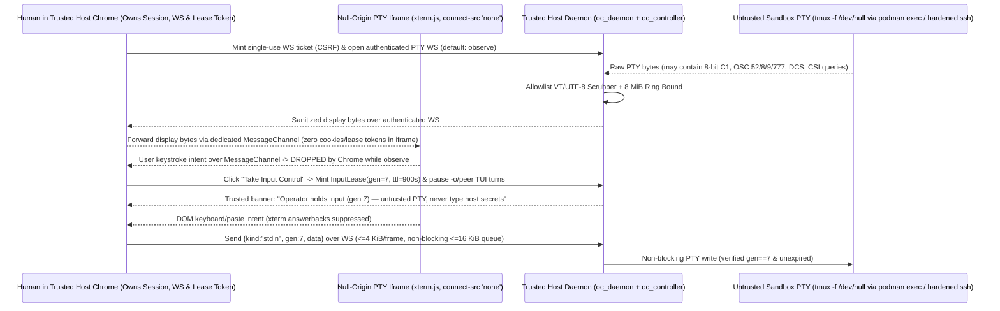

# prd_m3: Unified control plane, agent threads, embedded browser views, and confined terminals

Parent: [prd_m](prd_m.md) · related: [per-instance DNS](prd_d.md), [local HTTPS/TLS](prd_e.md),
[orchestrator and dashboard](prd_i1.md), [worker fleet, browser wall & terminals](prd_i2.md),
[credential broker](prd_i3.md), [composable config & bundles](prd_l.md),
[host credential brokering](prd_l1.md), [model telemetry](prd_m1.md),
[cross-model orchestration](prd_m2.md)

## Problem statement

Running parallel local and remote sandboxes currently scatters operator attention across multiple
Chrome profiles/windows and ad-hoc host terminals, and launches Chromium even for sandboxes that
only run backend code or security reviews. We want a single, lightweight **native desktop app +
hardened loopback web UI** (Tauri v2 + shared React/Vite frontend) that:

1. Replaces flat project lists with a clear three-level hierarchy:
   **`Project -> Sandbox (local or REMOTE, -i NAME) -> Chat / Thread`** (plus a pinned **Root
   Orchestrator `-o`** supervisor view and an optional fleet-wide PiP **"Browser Wall"**).
2. Renders active agent work as normal structured **agent threads** (like Antigravity, Codex, or
   Claude Code Desktop) where **both the human operator and the root orchestrator LLM** can message
   any authorized `"NAME"`, `"REMOTE / NAME"`, or `"@PEER"` target.
3. Provides **embedded terminal emulation** (`opencode-tui` and `shell`) and **opt-in embedded
   sandbox browser views** (zero separate host Chrome windows, even locally) inside the same app —
   backed by composable opt-in browser bundles (`cap:browser.chromium@1.0`, mirroring
   `builtin/postgres-app`), internal HTTPS via [prd_d](prd_d.md)/[prd_e](prd_e.md), and an
   authenticated CDP arbiter — without weakening `oc-sandbox`'s trust boundary against hostile
   terminal escapes, browser canvas spoofing, WebSocket hijacking, or sandbox-forged events.

## Design specification

### 1. Unified state hierarchy (`oc_daemon.py` + `$STATE/registry.sqlite`)

`oc_daemon.py` extends `OperatorControlServer` (`oc_config_mcp.py`) with a host-only `0o600` SQLite
WAL database under runtime `$STATE` (`~/.local/share/oc-sandbox/registry.sqlite`, verified via
`check_not_in_sandbox`, `assert_trusted_dir`, `O_NOFOLLOW`, guarded by
`check_not_host_production_dir` in tests) following T3Code's **Command -> Event -> Projection +
Outbox** pattern:

```text
Workspace Header (Trusted Host Chrome)
 ├── Root Orchestrator ('-o')       (Singleton supervisor thread; same Thread renderer + target picker)
 ├── Approval Inbox                 (Trusted Host Chrome ONLY — bound directly to oc_controller.view())
 ├── Browser Wall (PiP, Optional)   (Fleet-wide low-rate tile grid ONLY for sandboxes with cap:browser.chromium@1.0)
 └── Global Quota Bar               (Live 5h + 7d multi-window meters per provider account + Paid-Fallback lock)

Sidebar Tree (3-Level Hierarchy)
 └── Project (project_id, name, canonical_repo_key)
      │  Auto-discovers existing CLI sandboxes by reading ONLY host-trusted $STATE/worktrees/<NAME>
      │  metadata via O_NOFOLLOW (never running host git or parsing .git inside ~/opencode-sandbox);
      │  repo-less sandboxes group under "Scratch / Ad-hoc".
      └── Sandbox (canonical_addr: "NAME" | "REMOTE / NAME", worker_ref: "local"|REMOTE,
                   instance: NAME, incarnation_id, branch, sandbox_type, plan_digest,
                   status, model_selection, active_grants[], 1-click "Revoke Grants")
           ├── Threads[]            (Structured sessions synced from opencode serve + oc_hub)
           │    ├── #main           (Primary thread; collapsible child sub-threads for `task` subagents)
           │    └── #<side-thread>  (Optional scoped review/debug thread)
           ├── Diff & Checkpoints   (On-demand turn diffs via containerized `safe_run` + oc-bridge.py)
           ├── Browser (Optional)   (Shown ONLY when compiled plan provides cap:browser.chromium@1.0)
           └── Terminals[]          (Persistent tmux PTYs attached via podman exec / hardened ssh)
                ├── pty:opencode-tui  (Live TUI viewing the exact same opencode serve session)
                └── pty:shell         (Interactive sandbox shell)
```

### 2. Symmetric human + root orchestrator messaging & full-key write-ahead provenance

- **One Target Graph & Unambiguous Target Picker:** Both the Human Operator (via a structured target
  pill selector or explicit `/to NAME`, `/to REMOTE / NAME`, `/to @PEER` composer command — never an
  ambiguous `@@PEER` prefix) and the Root Orchestrator (`-o` calling `sandbox_send`) resolve through
  the exact same `oc_daemon.resolve_target()` and append to the same `seq`-ordered thread
  projection.
- **Zero-Drift Thread <-> `opencode-tui` Coherence:** Because the sandbox runs `opencode serve`
  with `tmux` window 0 running `opencode attach`, structured thread updates arrive as typed JSON/SSE
  events (text deltas, reasoning blocks, tool calls, token counts) without scraping ANSI, while
  switching to the `opencode-tui` terminal tab displays the exact same live session.
- **Unforgeable Full-Key Write-Ahead Provenance (Defeats Hostile `opencode serve` Spoofing &
  Cross-Thread Replay):**
  - Because the sandbox LLM shares the container UID with `opencode serve`, it can read
    `/run/secrets/oc_server_pw` and call `opencode serve` locally. Therefore **`oc_daemon` NEVER
    trusts `opencode serve`'s self-reported sender/role metadata**.
  - Before dispatching any host-originated message, `oc_daemon` mints a **host-generated 128-bit
    cryptographic `message_id`** (never trusting a server-chosen ID; if `opencode serve` does not
    preserve caller-supplied IDs on a given version, `oc_daemon` binds an explicit host-minted
    correlation nonce) and persists a write-ahead receipt keyed by the full 5-tuple
    `(sandbox_addr, incarnation_id, session_id, message_id, sha256(canonical_body)) ->
    verified_actor` in `$STATE/registry.sqlite`.
  - Incoming `/event` SSE user messages earn **`[Operator]`**, **`[Orchestrator -o]`**, or
    **`[Peer: <addr>]`** badges **if and only if** they match and atomically consume an unconsumed
    host receipt on the exact same `(sandbox_addr, incarnation_id, session_id, message_id,
    body_sha256)` — preventing cross-thread or cross-sandbox replay of an `[Operator]` badge.
  - Unmatched turns are **never** badged `[Operator]`:
    - If an operator `InputLease` on `pty:opencode-tui` (never `shell`) was active and the host PTY
      relay observed an unconsumed operator Enter keystroke in that window, consume that one-shot
      Enter token and render **`[TUI Input · In-Sandbox]`** (amber, zero directive/approval
      authority).
    - Otherwise render **`[Sandbox-Local / Unverified]`** (warning badge, zero authority).

### 3. Shared React/Vite frontend, Tauri v2 UDS bridge, and loopback web auth

- **One SPA, Two Strictly Authenticated Shells (Zero CORS Holes, Zero Tokens in URLs):**
  1. **Tauri v2 Native Desktop App (Recommended Daily Driver):** ~30–60 MB idle RAM, zero browser
     extensions. A minimal Rust backend opens `oc_daemon`'s host-only `0o600` UDS directly
     (`SO_PEERCRED` UID verified) to proxy API/SSE/PTY/Browser streams to the WebView without
     opening any cross-origin HTTP/CORS hole on loopback. The Tauri v2 capabilities JSON grants
     **zero** `fs`, `shell`, `http`, or `clipboard` plugin permissions (only native window focus,
     notifications, and the typed `oc_daemon` UDS IPC bridge).
  2. **Hardened Loopback Web Mode ([prd_i1](prd_i1.md)):** Binds `127.0.0.1` only. Launch CLI
     prints/passes a **single-use, 60-second bootstrap code** (never putting a reusable
     `operator_ui_token` in URL query strings, browser history, or CLI `argv`), exchanged via
     `POST /api/auth/exchange` for an `HttpOnly; SameSite=Strict` session cookie (with idle +
     absolute TTL) plus a double-submit CSRF token. Every HTTP request validates `Host`; every
     mutation validates exact `Origin` + CSRF token; every WebSocket upgrade requires a
     **single-use, CSRF-minted WS ticket** bound to `(session_id, target_addr, surface_kind)`.
- **Explicit CSP & Trusted Host Chrome Separation ([prd_i1](prd_i1.md), [prd_i3](prd_i3.md)):**
  - **Trusted Host Chrome CSP:** Emit the **exact bound ephemeral port** at runtime:
    `default-src 'none'; script-src 'self'; style-src 'self'; img-src 'self' data:;
    connect-src 'self' ws://127.0.0.1:<bound_port>; frame-src 'self'; frame-ancestors 'none';
    base-uri 'none'; form-action 'self'`.
  - **Null-Origin Sandboxed Iframes (PTY & Browser Canvas):** Because `<iframe sandbox="allow-scripts">`
    assigns an opaque `null` origin where `'self'` does not match, pin iframe scripts via an
    explicit CSP SHA-256 hash or exact static origin URL (`script-src 'sha256-...'` /
    `http://127.0.0.1:<bound_port>/static/confined/`), with `connect-src 'none'` and `default-src 'none'`.
  - The Sidebar Tree, Model/Variant Picker, 5h/7d Quota Bar, Paid-Fallback Lock, **Approval Inbox**
    (rendering `oc_controller.view(operator, request_id)` with exact `security_delta`, `plan_digest`,
    and `(request_id, revision, digest)` binding), **Revoke Grants**, and **Input Lease Bar** live
    exclusively in Trusted Host Chrome.
  - Thread Markdown renders strictly as an inert AST (raw HTML disabled; remote `` blocked).
    Pending approvals appear inside threads only as read-only `request_id` chips resolved by Trusted
    Chrome against `oc_controller`.
- **Containerized Turn Diffs & Safe Editor Handoff:**
  - Turn diffs and checkpoints (mirroring T3Code's `CheckpointReactor`) execute strictly inside a
    throwaway `safe_run` container on the worker (never running host `git` inside
    `~/opencode-sandbox`), streaming bounded UTF-8 diffs to the right-hand diff drawer. "Open in
    Editor / 3-Way Merge" hands off through `oc-bridge.py` (`openat(O_NOFOLLOW)` staging).

### 4. Confined embedded PTY emulation, allowlist ANSI scrubber, and `MessageChannel` bridge



- **Zero `node-pty` in containers & hardened attach:** Host `oc_daemon` attaches directly to
  worker-side `tmux -f /dev/null` via `podman exec -it` (local) or `oc_broker_ssh.py`-grade
  hardened OpenSSH (`-F /dev/null`, `ForwardAgent=no`, `ClearAllForwardings=yes`,
  `StrictHostKeyChecking=yes`, pinned `0600` `UserKnownHostsFile`, minimal sanitized env, remote).
  Enforce max concurrent PTY attachments per operator/sandbox.
- **Trusted Chrome Owns the WebSocket & `lease_token` (Zero Network / Zero Secrets in Iframe):**
  - The PTY renderer runs in `<iframe sandbox="allow-scripts">` (opaque `null` origin) with
    `connect-src 'none'`.
  - The iframe **never** opens a WebSocket and **never** sees `operator_session`, cookies,
    `lease_token`, or `__TAURI_INTERNALS__`. Trusted Host Chrome owns the authenticated WS/UDS
    connection and transfers sanitized display bytes and keystroke intents strictly over a dedicated
    `MessageChannel` (`port1`/`port2`).
  - `xterm.js` is recommended first (OSC 52 off by default, standard GC, no `wasm-unsafe-eval` CSP
    relaxation on WebKitGTK), keeping the `MessageChannel` iframe boundary pluggable for a future
    `libghostty-vt` upgrade.
- **Strict Allowlist VT/UTF-8 Scrubber & Answerback Suppression ([prd_i2](prd_i2.md)):**
  - `AllowlistVtUtf8Scrubber` in `oc_daemon` is a **strict display allowlist state machine** (not a
    denylist):
    - Permits valid UTF-8 printable text, safe C0 controls (`\r`, `\n`, `\t`, `\b`, `\x07` bell
      optionally muted), and a closed set of standard SGR/cursor/erase/scroll CSI display sequences.
    - **Drops ALL 8-bit C1 controls (`0x80..0x9F`, including `0x90` DCS, `0x9B` CSI, `0x9D` OSC,
      `0x9F` APC), ALL OSC sequences (`52`, `8`, `9`, `99`, `777`, `10`/`11`, title changes), ALL
      DCS/APC/PM/SOS strings, ALL CSI window manipulation (`CSI Ps t`), and ALL terminal query
      sequences (`ENQ`, `CSI 6 n` DSR, `CSI c` DA, `CSI > q` XTVERSION, `CSI ? ... $ p` DECRQM)**
      so a hostile sandbox cannot trigger synthetic `xterm.js` answerback bytes into stdin.
  - Inside the iframe, `xterm.js` `onData` answerback emission is suppressed; only explicit DOM
    keyboard and explicit user-initiated paste intents cross `MessageChannel` to Trusted Chrome.
  - Enforces bounded scrollback (`<= 8 MiB` / `5,000–10,000` lines host ring; `<= 512 KiB` client
    buffer) and byte-rate backpressure.
- **Read-Only Default, Non-Blocking PTY Writes, & Generation-Fenced Input Lease:**
  - Every PTY attach opens strictly **read-only (`observe`)** with a persistent Trusted Chrome banner
    reminding the operator that PTY content is untrusted sandbox output (never paste/type host
    secrets).
  - Clicking **Take Input Control** mints an ephemeral in-memory `InputLease(target, surface_kind,
    generation=g, ttl)` in `oc_controller` and pauses queued `-o`/peer injections on `opencode-tui`.
  - Host PTY writes are strictly **non-blocking** (`O_NONBLOCK`) with a bounded per-PTY outbound
    queue (`<= 16 KiB`), per-frame stdin cap (`<= 4 KiB`), and clamped `cols`/`rows` (`10..500` ×
    `4..200`) so a `SIGSTOP`ped sandbox cannot stall `oc_daemon` or block lease release.

### 5. Unified embedded sandbox browser views (opt-in, zero separate Chrome windows)

- **Conditional Sidebar Surface & PiP "Browser Wall" ([prd_i2](prd_i2.md)):**
  - Each `Sandbox` node (`"NAME"` or `"REMOTE / NAME"`) shows a **`Browser`** item **only** when
    its compiled `plan.lock.json` includes a resolved service providing `cap:browser.chromium@1.0`.
  - An optional fleet-wide **"Browser Wall"** workspace view displays live low-rate PiP tiles
    (`<= 1–2 fps`, capped JPEG/PNG frame bytes, explicit staleness/disconnect indicator) strictly
    for running sandboxes with `cap:browser.chromium@1.0`; clicking any tile expands it into the
    live per-sandbox `Browser` view.
- **Pod-Local `builtin/chromium-managed` + Internal HTTPS (`prd_d` + `prd_e`), Zero Host Ports:**
  - Keeps Chromium strictly inside the sandbox pod (`builtin/chromium-managed`,
    `security_profile = "standard"`, `memory = "2g"`, `pids_limit = 256` — **no host Wayland
    Chrome window required even on local workstations**).
  - Pod creation sets `--add-host <NAME>.oc-sandbox.internal:127.0.0.1` ([prd_d](prd_d.md)) and
    mounts **only** that instance's leaf certificate + key issued by `oc-sandbox`'s
    name-constrained CA ([prd_e](prd_e.md), CA private key NEVER enters the sandbox, leaf SAN
    restricted strictly to `<NAME>.oc-sandbox.internal`, Profile E excluding IP SANs).
  - Result: every sandbox's embedded Chromium reaches `https://<NAME>.oc-sandbox.internal` (port
    `443`) and any other pod-local port with valid TLS certificates, **zero exposed host ports, and
    zero port collisions across parallel local and `REMOTE` sandboxes**.
  - DevTools port `9222` (`max_exposure = "pod-only"`, [prd_d](prd_d.md)) is **never** published on
    the host or LAN. Host `oc_daemon` reaches the browser surface/arbiter solely over a per-job
    `0o600` UDS (or pinned-hostkey SSH `-L <local_uds>:<remote_job_uds>` on `REMOTE` workers).
- **Two In-App Browser Streaming Modes (Open Decision in [prd_m](prd_m.md)):**

| Mode | Visual Fidelity | Footprint & Transport | License & Trade-Offs |
|---|---|---|---|
| **(a) CDP Screencast (`Page.startScreencast`) + Authenticated Host Arbiter (Recommended First)** | Page viewport only (no browser URL bar, HTTPS lock icon, tabs, DevTools UI, or native OS dialogs; Trusted Chrome displays verified current URL/security state from CDP `Page`/`Security` events). | Lightweight throttled JPEG/PNG frames; ideal for PiP Browser Wall tiles and remote SSH links; zero X11/Wayland/VNC daemon in pod. | Pure BSD-2-Clause host arbiter; fastest path (~3–5 days). |
| **(b) Pod-Local Virtual Display (Xvfb / headless Wayland) + noVNC / WayVNC** | Full Chromium window: native URL bar, HTTPS lock icon, tab strip, interactive DevTools, file/print/auth dialogs. | Higher pod CPU/RAM and RFB/VNC framebuffer bandwidth; requires virtual display + VNC sidecar/entrypoint inside pod. | `noVNC` carries MPL-2.0 companion file-level terms ([prd_i2](prd_i2.md)); ~1–2 weeks; can layer on later as an optional "Full Chrome" view using the same confined iframe & `InputLease`. |

- **Identical Zero-Trust Isolation & `InputLease` Model as Embedded PTYs:**
  - Untrusted browser pixels render strictly inside a **zero-network null-origin `<iframe
    sandbox="allow-scripts">` (`connect-src 'none'`)** over a dedicated **`MessageChannel`** owned
    by **Trusted Host Chrome** (which owns the operator session, CSRF-minted single-use WS ticket
    bound to `(session_id, target_addr, surface_kind="browser")`, and `InputLease` token).
  - Opens strictly **read-only (`observe`)** with a persistent Trusted Chrome warning that rendered
    pixels are untrusted sandbox content (never enter host credentials or click fake approval modals
    drawn inside the page).
  - Clicking **"Take Control"** / **"Return to Agent"** mints/releases an ephemeral `oc_controller`
    `InputLease(target, surface_kind="browser", generation=g, ttl)` that **suspends and fences
    agent CDP mutations** (`browser_operator_lease_active`) while held, bumping `generation` on
    release, disconnect, or daemon/controller restart ([prd_i2](prd_i2.md)).
  - Disable RFB/VNC clipboard sync (`ClientCutText`/`ServerCutText`), host drag-and-drop/file
    chooser access, and automatic pop-out links by default.

### 6. Composable opt-in browser bundles, authenticated CDP arbiter, AXI vs. MCP, and orchestrator skill

- **Opt-In Composable Dependency Grouping (Mirroring `builtin/postgres-app`, [prd_l](prd_l.md)):**
  - Browser capability is strictly an optional `bundle@1` requiring `cap:browser.chromium@1.0`
    (selecting `builtin/chromium-managed` by default so no host Wayland window opens; opt-in
    `builtin/browser-desktop` remains available when a native local Wayland window is explicitly
    wanted).
  - Toggleable per `sandbox-type@1` or per launch via `with_mods` / `without_mods`: backend,
    library, and adversarial security-reviewer sandboxes incur **0 MiB Chromium RAM** and **zero
    CDP attack surface** by default.
- **Agent CDP Access (`interactive` vs. `managed` Authenticated CDP Arbiter):**
  - **`interactive` (`pod-shared`):** Agent tools (AXI CLI, `chrome-devtools-mcp`, or
    `@playwright/mcp`) connect to pod-local `127.0.0.1:9222` (never published to host).
  - **`managed` (`isolated-sidecars`, [prd_i2](prd_i2.md), [prd_l1](prd_l1.md)):** Chromium runs in
    its own isolated sidecar network namespace so raw CDP (`9222`) is **unreachable from agent
    code**. Both agent browser tools AND operator Take Control route through an **authenticated CDP
    arbiter outside the agent container** (authenticated via per-job `ocjob_...` token over the
    per-job reverse channel / UDS) enforcing:
    1. **Generation-fenced `InputLease` arbitration:** Rejects/pauses agent CDP input/navigation
       mutations while an operator `InputLease(surface_kind="browser")` is active.
    2. **Closed CDP domain/method firewall (fail-closed):** Permits safe inspection & interaction
       methods (`Page.navigate` [URL-checked], `Page.captureScreenshot`, `Accessibility.*`, `DOM.*`,
       `Runtime.evaluate`, `Input.*`, `Console.*`, `Log.*`, `Network.enable`/read-only events,
       `Performance.*`, `Emulation.*`), while **blocking** `Browser.close`,
       `Browser.setDownloadBehavior`, `Browser.grantPermissions`, `Page.setDownloadBehavior`,
       `Target.createBrowserContext` (proxy overrides), `Fetch.*` / `Network.setExtraHTTPHeaders`
       (auth injection), `SystemInfo.*`, `Tethering.*`, host-path `Page.setInterceptFileChooserDialog`
       / `DOM.setFileInputFiles` outside `/sandbox`, and navigation to `file://`, `chrome://`,
       `chrome-extension://`, or non-allowlisted origins (in `--network=none` managed pods, pinned
       to `<NAME>.oc-sandbox.internal` and pod-local loopback origins only).
- **Swappable Browser Automation Bundles — AXI vs. MCP Comparison (Open Decision in [prd_m](prd_m.md)):**

| Bundle (`bundle@1`) | Mechanism | Pros | Cons / Risks | Effort |
|---|---|---|---|---|
| **`builtin/browser-axi` (`chrome-devtools-axi`, Recommended Default)** | **0-MCP** pinned CLI (`mise.toml` + `mise.lock`) + progressive-disclosure skill talking to CDP / CDP arbiter. | Cuts token consumption **~40–66%** via TOON-compressed a11y snapshots, short generation-prefixed refs (`STALE_REF` guard), and bundled multi-step actions; keeps full console/network/perf debugging; zero extra MCP server process or tool-schema bloat (same 0-MCP pattern as `builtin/postgres-app`). | Newer CLI tool — must pin exact version/checksum in `mise.lock` and audit license/supply chain before promoting to `builtin/*`; requires agent shell execution (cannot be used by shell-disabled personas). | **2–3 days** |
| **`builtin/browser-devtools-mcp` (`chrome-devtools-mcp`, Current Baseline)** | MCP server wrapping CDP (`pinned-artifact` or pod-local). | Mature DevTools inspection; works cleanly in shell-disabled or MCP-only personas with per-tool persona filtering (`allowed_mcp_tools`). | Higher upfront MCP tool-schema tokens + verbose JSON/a11y payloads per turn. | **1–2 days** |
| **`builtin/browser-playwright-mcp` (`@playwright/mcp`)** | MCP server with ARIA ref-based Playwright E2E automation. | Strong ergonomics for multi-step form/E2E assertions and auto-waiting selectors. | Heavier Playwright runtime footprint; less direct low-level DevTools network/performance profiling than CDP-native tools. | **2–3 days** |

All three bundles require the exact same `cap:browser.chromium@1.0` service and point at the exact
same pod-local CDP / `managed` CDP arbiter endpoint, so switching between them is a one-line
`bundle@1` swap (`with_mods` / `without_mods`).

- **Orchestrator Authoring Skill Update (`docs/prds/spikes/l/orchestrator_skills/oc-sandbox-authoring/SKILL.md`):**
  Add **Pattern 4: Opt-In Composable Browser Bundles (`builtin/browser-axi` default, zero Chrome
  windows)** documenting when to omit browser bundles (backend/reviewer lanes), how to toggle them
  at launch (`with_mods = ["builtin/browser-axi"]` / `without_mods`), and providing a concrete
  `bundle@1` TOML template:

```toml
schema_version = 1
kind = "bundle@1"
id = "builtin/browser-axi"
description = "0-MCP token-efficient Chromium automation (chrome-devtools-axi over pod-local/arbiter CDP, zero host Chrome windows)."
requires_services = ["builtin/chromium-managed"]
skills = ["builtin/browser-axi-qa"]
instructions = [
  "Managed Chromium runs in-pod with valid HTTPS for https://<NAME>.oc-sandbox.internal; inspect via `chrome-devtools-axi` against $OC_CDP_URL (no host Chrome window needed)."
]

[mise_tools]
"npm:chrome-devtools-axi" = "<pinned-version>"
```

## Gate 1 pseudocode walkthrough

### A. Confined PTY WebSocket relay

```text
function handle_pty_websocket(ws, ws_ticket):
    require_exact_host_and_origin(ws.headers)                # rejects null/foreign origins
    claim = controller.consume_single_use_ws_ticket(ws_ticket)
    if claim is None or claim.surface_kind not in ("opencode-tui", "shell"):
        return close(ws, 4401, "invalid_or_expired_ws_ticket")
    sandbox = registry.resolve_running_sandbox(claim.target_addr)
    if not pty_pool.acquire_slot(claim.session_id, sandbox.sandbox_id):
        return close(ws, 4429, "max_concurrent_ptys_exceeded")

    scrubber = AllowlistVtUtf8Scrubber(max_ring_bytes=8*1024*1024)
    pty_fd   = open_confined_tmux_attach(sandbox, claim.surface_kind, nonblocking=True)
        # local podman exec tmux -f /dev/null OR oc_broker_ssh-hardened ssh attach
    write_q  = BoundedByteQueue(max_bytes=16384)
    try:
        while ws.open and sandbox.is_running() and controller.is_session_active(claim.session_id):
            if pty_fd.readable():
                clean = scrubber.feed(pty_fd.read_nonblocking(16384))
                if clean:
                    ws.send_binary(clean)
            if write_q.nonempty() and pty_fd.writable():
                written = pty_fd.write_nonblocking(write_q.peek())
                write_q.consume(written)
            if ws.has_client_frame():
                frame = parse_pty_client_frame(ws.recv(), max_stdin_bytes=4096)
                if not controller.verify_input_lease(claim.session_id, sandbox, claim.surface_kind, frame.gen):
                    ws.send_json({"type": "input_rejected", "reason": "no_or_stale_input_lease"})
                    continue
                if frame.kind == "resize":
                    pty_fd.resize_clamped(frame.cols, frame.rows, max_cols=500, max_rows=200)
                elif frame.kind == "stdin":
                    if not write_q.try_enqueue(frame.data):
                        ws.send_json({"type": "stdin_backpressure", "reason": "pty_stalled"})
                        continue
                    if claim.surface_kind == "opencode-tui" and (b"\r" in frame.data or b"\n" in frame.data):
                        record_one_shot_tui_enter_token(sandbox, now=clock())
    finally:
        controller.release_input_lease_for_conn(ws.id)       # bumps generation immediately on disconnect
        pty_pool.release_slot(claim.session_id, sandbox.sandbox_id)
        pty_fd.close()
```

### B. Embedded browser stream & authenticated `managed` CDP arbiter

```text
function handle_browser_websocket(ws, ws_ticket):
    require_exact_host_and_origin(ws.headers)                # rejects null/foreign origins
    claim = controller.consume_single_use_ws_ticket(ws_ticket)
    if claim is None or claim.surface_kind != "browser":
        return close(ws, 4401, "invalid_or_expired_ws_ticket")
    sandbox = registry.resolve_running_sandbox(claim.target_addr)
    if not sandbox.has_capability("cap:browser.chromium@1.0"):
        return close(ws, 4404, "browser_service_not_enabled")
    if not browser_pool.acquire_slot(claim.session_id, sandbox.sandbox_id):
        return close(ws, 4429, "max_concurrent_browser_views_exceeded")

    # Connect to pod browser arbiter over per-job 0o600 UDS (or ssh -L remote job UDS; never host :9222)
    arbiter = connect_job_browser_arbiter(sandbox)
    max_fps = 2 if claim.mode == "pip_wall" else 15
    try:
        arbiter.start_screencast(max_fps=max_fps, max_frame_bytes=512*1024)
        while ws.open and sandbox.is_running() and controller.is_session_active(claim.session_id):
            if arbiter.has_frame():
                frame = arbiter.read_bounded_frame(max_bytes=512*1024)
                ws.send_json({"type": "frame", "mime": frame.mime, "b64": frame.b64,
                              "url": sanitize_display_url(frame.url), "tls_state": frame.tls_state})
            if ws.has_client_frame():
                ev = parse_browser_input_event(ws.recv())    # allowlist: mouse/wheel/key/viewport only; no clipboard
                if not controller.verify_input_lease(claim.session_id, sandbox, "browser", ev.gen):
                    ws.send_json({"type": "input_rejected", "reason": "no_or_stale_input_lease"})
                    continue
                arbiter.dispatch_operator_input(ev)
    finally:
        controller.release_input_lease_for_conn(ws.id)       # bumps generation & resumes agent CDP
        browser_pool.release_slot(claim.session_id, sandbox.sandbox_id)
        arbiter.close()

function handle_agent_cdp_arbiter_command(job_lease, sandbox, cdp_req):
    if not controller.check_lease_active(job_lease.request_id):
        return cdp_error(403, "lease_revoked_or_expired")
    if cdp_req.method not in ALLOWED_AGENT_CDP_METHODS:
        return cdp_error(403, "cdp_method_denied")
    if cdp_req.is_mutation() and controller.has_active_input_lease(sandbox, surface_kind="browser"):
        return cdp_error(423, "browser_operator_lease_active")
    if cdp_req.method == "Page.navigate":
        validate_sandbox_browser_url(cdp_req.params.get("url"), sandbox)
            # Rejects file://, chrome://, chrome-extension://; in --network=none managed pods
            # permits only <NAME>.oc-sandbox.internal and pod-local loopback origins
    return forward_cdp_to_sidecar_9222(sandbox, cdp_req, timeout_s=10)
```

### Failure, recovery, and verification tests

- **Failure / recovery:**
  - On WebSocket disconnect, `oc_daemon` restart, or `oc_controller` restart, all ephemeral
    `InputLease`s (`opencode-tui`, `shell`, and `browser`) immediately invalidate and bump
    `generation`, returning attached views to read-only `observe` on reconnect; container-side
    `tmux` and `builtin/chromium-managed` preserve running sessions seamlessly.
  - A `SIGSTOP`ped sandbox fills `write_q` (`16 KiB`) and yields `stdin_backpressure` without ever
    blocking `oc_daemon`'s event loop or preventing lease release/teardown.
  - Stopping or disconnecting a remote sandbox marks its sidebar node `offline/stopped` and marks
    any PiP Browser Wall tile stale/disconnected while keeping cached threads and audit history
    readable from `$STATE/registry.sqlite`.
- **Verification tests:**
  1. Hostile ANSI allowlist red-team suite feeding split-chunk 8-bit C1 controls (`0x90`, `0x9B`,
     `0x9D`, `0x9F`), OSC 52/8/9/99/777, DCS/APC, `CSI 8 t`, `ENQ`, `CSI 6 n` DSR, `CSI c` DA,
     `CSI > q`, `CSI ? ... $ p`, and 50 MiB output floods through `AllowlistVtUtf8Scrubber`,
     verifying zero forbidden sequences survive, zero `xterm.js` answerbacks cross `MessageChannel`,
     and memory stays `<= 8 MiB`.
  2. Full-key provenance spoofing & replay tests proving a container-local `opencode serve` call
     with `OPENCODE_SERVER_PASSWORD` can NEVER earn `[Operator]` / `[Orchestrator -o]`, and
     replaying a host-dispatched `(message_id, body_sha256)` on a different `session_id` or sandbox
     is rejected as `[Sandbox-Local / Unverified]`.
  3. Lease-fencing & `SIGSTOP` stall tests proving read-only attach drops `stdin`/browser input,
     taking control pauses queued `-o` TUI turns AND blocks agent CDP mutations with
     `browser_operator_lease_active`, stale-generation input after disconnect/restart fails closed,
     and a `SIGSTOP`ped PTY returns `stdin_backpressure` without hanging `oc_daemon`.
  4. Auth, Origin, CSRF, WS-ticket, and iframe isolation tests verifying `Origin: null` and foreign
     origins are rejected on WS/mutations, single-use bootstrap codes & WS tickets cannot replay,
     and scripts inside null-origin PTY/Browser iframes (`connect-src 'none'`) cannot reach
     `oc_daemon`, cookies, `lease_token`, Tauri IPC, or `oc_controller` approvals.
  5. Browser opt-in, internal HTTPS, & CDP arbiter security tests verifying:
     - Sandboxes without a browser bundle render no `Browser` tab/PiP tile, spawn zero Chromium
       containers, and return `4404 browser_service_not_enabled` on browser WS attach;
     - Two parallel sandboxes (`feat-a`, `feat-b`) each reach `https://<NAME>.oc-sandbox.internal`
       with valid name-constrained leaf certs and zero host port bindings or collisions;
     - In `managed` (`isolated-sidecars`), agent code cannot connect directly to raw `:9222`, and
       the CDP arbiter rejects `Browser.setDownloadBehavior`, `Fetch.*`, `file://`, `chrome://`,
       and cross-origin URLs in `--network=none` pods while allowing `chrome-devtools-axi` / MCP
       workflows cleanly.

## Concrete gaps and checkboxes

- [ ] **Gap M3.1 — `oc_daemon.py` & `$STATE/registry.sqlite` projection (`oc_daemon.py`):** evolve
      `OperatorControlServer` into SQLite Command/Event/Projection + Outbox under `$STATE`,
      auto-importing host-trusted `$STATE/worktrees/<NAME>` via `O_NOFOLLOW` (zero host `git` in
      `~/opencode-sandbox`), with full 5-tuple write-ahead provenance receipts and bootstrap-code +
      cookie + CSRF + single-use WS-ticket auth.
- [ ] **Gap M3.2 — Shared React/Vite frontend + Tauri v2 UDS native shell (`ui/`):** implement
      3-level sidebar tree (with conditional `Browser` item & optional fleet PiP Browser Wall),
      pinned `-o` orchestrator view, inert Markdown thread renderer, Trusted Chrome Approval Inbox
      & 5h/7d quota bar, unambiguous target picker (`NAME`, `REMOTE / NAME`, `@PEER`), `safe_run`
      turn diff drawer, `oc-bridge.py` handoff, and minimal Tauri v2 Rust UDS bridge with zero
      `fs`/`shell`/`http`/`clipboard` capabilities; pin Node/Rust toolchains via `mise`
      ([prd_f](prd_f.md)).
- [ ] **Gap M3.3 — Confined non-blocking PTY relay & null-origin `xterm.js` iframe
      (`oc_pty_relay.py`):** implement strict allowlist `AllowlistVtUtf8Scrubber` (stripping C1,
      OSC, DCS/APC, and terminal queries), non-blocking bounded write queue (`<= 16 KiB`),
      ephemeral `oc_controller` generation-fenced `InputLease`, and `connect-src 'none'`
      `MessageChannel` `xterm.js` iframe (pluggable for future `libghostty-vt`).
- [ ] **Gap M3.4 — Opt-in embedded browser views, `managed` CDP arbiter, composable browser
      bundles, and orchestrator skill Pattern 4:** wire `builtin/chromium-managed` +
      [prd_d](prd_d.md)/[prd_e](prd_e.md) internal HTTPS (`<NAME>.oc-sandbox.internal`),
      authenticated `managed` CDP arbiter with domain/URL firewall + `InputLease` fencing,
      confined browser canvas iframe (CDP screencast first, optional virtual-display/noVNC later),
      composable `builtin/browser-axi` / `builtin/browser-devtools-mcp` /
      `builtin/browser-playwright-mcp` bundles (after `mise.lock` pinning & license check), and
      Pattern 4 in `orchestrator_skills/oc-sandbox-authoring/SKILL.md`.
