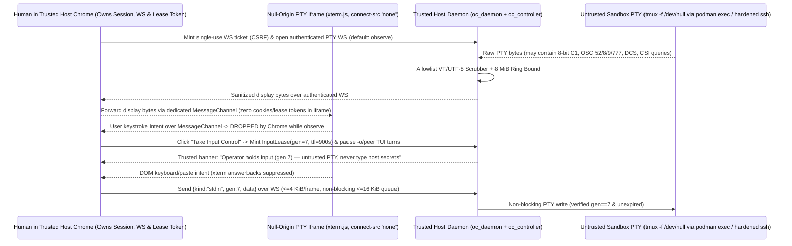

# prd_m3: Unified control plane, agent threads, and confined embedded terminals

Parent: [prd_m](prd_m.md) · related: [orchestrator and dashboard](prd_i1.md),
[worker fleet and terminals](prd_i2.md), [credential broker](prd_i3.md),
[model telemetry](prd_m1.md), [cross-model orchestration](prd_m2.md)

## Problem statement

Running parallel local and remote sandboxes currently scatters operator attention across multiple
Chrome profiles/windows and ad-hoc host terminals. We want a single, lightweight **native desktop
app + hardened loopback web UI** (Tauri v2 + shared React/Vite frontend) that:

1. Replaces flat project lists with a clear three-level hierarchy:
   **`Project -> Sandbox (local or REMOTE, -i NAME) -> Chat / Thread`** (plus a pinned **Root
   Orchestrator `-o`** supervisor view).
2. Renders active agent work as normal structured **agent threads** (like Antigravity, Codex, or
   Claude Code Desktop) where **both the human operator and the root orchestrator LLM** can message
   any authorized `"NAME"`, `"REMOTE / NAME"`, or `"@PEER"` target.
3. Provides **embedded terminal emulation** (`opencode-tui` and `shell`) inside the same app without
   weakening `oc-sandbox`'s trust boundary against hostile terminal escape sequences, fake approval
   prompts, WebSocket hijacking, or sandbox-forged session events.

## Design specification

### 1. Unified state hierarchy (`oc_daemon.py` + `$STATE/registry.sqlite`)

`oc_daemon.py` extends `OperatorControlServer` (`oc_config_mcp.py`) with a host-only `0o600` SQLite
WAL database under runtime `$STATE` (`~/.local/share/oc-sandbox/registry.sqlite`, verified via
`check_not_in_sandbox`, `assert_trusted_dir`, `O_NOFOLLOW`, guarded by
`check_not_host_production_dir` in tests) following T3Code's **Command -> Event -> Projection +
Outbox** pattern:

```text
Workspace Header (Trusted Host Chrome)
 ├── Root Orchestrator ('-o')       (Singleton supervisor thread; same Thread renderer + target picker)
 ├── Approval Inbox                 (Trusted Host Chrome ONLY — bound directly to oc_controller.view())
 └── Global Quota Bar               (Live 5h + 7d multi-window meters per provider account + Paid-Fallback lock)

Sidebar Tree (3-Level Hierarchy)
 └── Project (project_id, name, canonical_repo_key)
      │  Auto-discovers existing CLI sandboxes by reading ONLY host-trusted $STATE/worktrees/<NAME>
      │  metadata via O_NOFOLLOW (never running host git or parsing .git inside ~/opencode-sandbox);
      │  repo-less sandboxes group under "Scratch / Ad-hoc".
      └── Sandbox (canonical_addr: "NAME" | "REMOTE / NAME", worker_ref: "local"|REMOTE,
                   instance: NAME, incarnation_id, branch, sandbox_type, plan_digest,
                   status, model_selection, active_grants[], 1-click "Revoke Grants")
           ├── Threads[]            (Structured sessions synced from opencode serve + oc_hub)
           │    ├── #main           (Primary thread; collapsible child sub-threads for `task` subagents)
           │    └── #<side-thread>  (Optional scoped review/debug thread)
           ├── Diff & Checkpoints   (On-demand turn diffs via containerized `safe_run` + oc-bridge.py)
           └── Terminals[]          (Persistent tmux PTYs attached via podman exec / hardened ssh)
                ├── pty:opencode-tui  (Live TUI viewing the exact same opencode serve session)
                └── pty:shell         (Interactive sandbox shell)
```

### 2. Symmetric human + root orchestrator messaging & full-key write-ahead provenance

- **One Target Graph & Unambiguous Target Picker:** Both the Human Operator (via a structured target
  pill selector or explicit `/to NAME`, `/to REMOTE / NAME`, `/to @PEER` composer command — never an
  ambiguous `@@PEER` prefix) and the Root Orchestrator (`-o` calling `sandbox_send`) resolve through
  the exact same `oc_daemon.resolve_target()` and append to the same `seq`-ordered thread
  projection.
- **Zero-Drift Thread <-> `opencode-tui` Coherence:** Because the sandbox runs `opencode serve`
  with `tmux` window 0 running `opencode attach`, structured thread updates arrive as typed JSON/SSE
  events (text deltas, reasoning blocks, tool calls, token counts) without scraping ANSI, while
  switching to the `opencode-tui` terminal tab displays the exact same live session.
- **Unforgeable Full-Key Write-Ahead Provenance (Defeats Hostile `opencode serve` Spoofing &
  Cross-Thread Replay):**
  - Because the sandbox LLM shares the container UID with `opencode serve`, it can read
    `/run/secrets/oc_server_pw` and call `opencode serve` locally. Therefore **`oc_daemon` NEVER
    trusts `opencode serve`'s self-reported sender/role metadata**.
  - Before dispatching any host-originated message, `oc_daemon` mints a **host-generated 128-bit
    cryptographic `message_id`** (never trusting a server-chosen ID; if `opencode serve` does not
    preserve caller-supplied IDs on a given version, `oc_daemon` binds an explicit host-minted
    correlation nonce) and persists a write-ahead receipt keyed by the full 5-tuple
    `(sandbox_addr, incarnation_id, session_id, message_id, sha256(canonical_body)) ->
    verified_actor` in `$STATE/registry.sqlite`.
  - Incoming `/event` SSE user messages earn **`[Operator]`**, **`[Orchestrator -o]`**, or
    **`[Peer: <addr>]`** badges **if and only if** they match and atomically consume an unconsumed
    host receipt on the exact same `(sandbox_addr, incarnation_id, session_id, message_id,
    body_sha256)` — preventing cross-thread or cross-sandbox replay of an `[Operator]` badge.
  - Unmatched turns are **never** badged `[Operator]`:
    - If an operator `InputLease` on `pty:opencode-tui` (never `shell`) was active and the host PTY
      relay observed an unconsumed operator Enter keystroke in that window, consume that one-shot
      Enter token and render **`[TUI Input · In-Sandbox]`** (amber, zero directive/approval
      authority).
    - Otherwise render **`[Sandbox-Local / Unverified]`** (warning badge, zero authority).

### 3. Shared React/Vite frontend, Tauri v2 UDS bridge, and loopback web auth

- **One SPA, Two Strictly Authenticated Shells (Zero CORS Holes, Zero Tokens in URLs):**
  1. **Tauri v2 Native Desktop App (Recommended Daily Driver):** ~30–60 MB idle RAM, zero browser
     extensions. A minimal Rust backend opens `oc_daemon`'s host-only `0o600` UDS directly
     (`SO_PEERCRED` UID verified) to proxy API/SSE/PTY streams to the WebView without opening any
     cross-origin HTTP/CORS hole on loopback. The Tauri v2 capabilities JSON grants **zero** `fs`,
     `shell`, `http`, or `clipboard` plugin permissions (only native window focus, notifications,
     and the typed `oc_daemon` UDS IPC bridge).
  2. **Hardened Loopback Web Mode ([prd_i1](prd_i1.md)):** Binds `127.0.0.1` only. Launch CLI
     prints/passes a **single-use, 60-second bootstrap code** (never putting a reusable
     `operator_ui_token` in URL query strings, browser history, or CLI `argv`), exchanged via
     `POST /api/auth/exchange` for an `HttpOnly; SameSite=Strict` session cookie (with idle +
     absolute TTL) plus a double-submit CSRF token. Every HTTP request validates `Host`; every
     mutation validates exact `Origin` + CSRF token; every WebSocket upgrade requires a
     **single-use, CSRF-minted WS ticket** bound to `(session_id, target_addr, pty_kind)`.
- **Explicit CSP & Trusted Host Chrome Separation ([prd_i1](prd_i1.md), [prd_i3](prd_i3.md)):**
  - **Trusted Host Chrome CSP:** `default-src 'none'; script-src 'self'; style-src 'self'; img-src
    'self' data:; connect-src 'self' ws://127.0.0.1:*; frame-src 'self'; frame-ancestors 'none';
    base-uri 'none'; form-action 'self'`.
  - The Sidebar Tree, Model/Variant Picker, 5h/7d Quota Bar, Paid-Fallback Lock, **Approval Inbox**
    (rendering `oc_controller.view(operator, request_id)` with exact `security_delta`, `plan_digest`,
    and `(request_id, revision, digest)` binding), **Revoke Grants**, and **PTY Input Lease Bar**
    live exclusively in Trusted Host Chrome.
  - Thread Markdown renders strictly as an inert AST (raw HTML disabled; remote `` blocked).
    Pending approvals appear inside threads only as read-only `request_id` chips resolved by Trusted
    Chrome against `oc_controller`.
- **Containerized Turn Diffs & Safe Editor Handoff:**
  - Turn diffs and checkpoints (mirroring T3Code's `CheckpointReactor`) execute strictly inside a
    throwaway `safe_run` container on the worker (never running host `git` inside
    `~/opencode-sandbox`), streaming bounded UTF-8 diffs to the right-hand diff drawer. "Open in
    Editor / 3-Way Merge" hands off through `oc-bridge.py` (`openat(O_NOFOLLOW)` staging).

### 4. Confined embedded PTY emulation, allowlist ANSI scrubber, and `MessageChannel` bridge



- **Zero `node-pty` in containers & hardened attach:** Host `oc_daemon` attaches directly to
  worker-side `tmux -f /dev/null` via `podman exec -it` (local) or `oc_broker_ssh.py`-grade
  hardened OpenSSH (`-F /dev/null`, `ForwardAgent=no`, `ClearAllForwardings=yes`,
  `StrictHostKeyChecking=yes`, pinned `0600` `UserKnownHostsFile`, minimal sanitized env, remote).
  Enforce max concurrent PTY attachments per operator/sandbox.
- **Trusted Chrome Owns the WebSocket & `lease_token` (Zero Network / Zero Secrets in Iframe):**
  - The PTY renderer runs in `<iframe sandbox="allow-scripts">` (opaque `null` origin) with CSP
    `default-src 'none'; script-src 'self'; style-src 'self'; connect-src 'none'`.
  - The iframe **never** opens a WebSocket and **never** sees `operator_session`, cookies,
    `lease_token`, or `__TAURI_INTERNALS__`. Trusted Host Chrome owns the authenticated WS/UDS
    connection and transfers sanitized display bytes and keystroke intents strictly over a dedicated
    `MessageChannel` (`port1`/`port2`).
  - `xterm.js` is recommended first (OSC 52 off by default, standard GC, no `wasm-unsafe-eval` CSP
    relaxation on WebKitGTK), keeping the `MessageChannel` iframe boundary pluggable for a future
    `libghostty-vt` upgrade.
- **Strict Allowlist VT/UTF-8 Scrubber & Answerback Suppression ([prd_i2](prd_i2.md)):**
  - `StatefulAnsiScrubber` in `oc_daemon` is a **strict display allowlist state machine** (not a
    denylist):
    - Permits valid UTF-8 printable text, safe C0 controls (`\r`, `\n`, `\t`, `\b`, `\x07` bell
      optionally muted), and a closed set of standard SGR/cursor/erase/scroll CSI display sequences.
    - **Drops ALL 8-bit C1 controls (`0x80..0x9F`, including `0x90` DCS, `0x9B` CSI, `0x9D` OSC,
      `0x9F` APC), ALL OSC sequences (`52`, `8`, `9`, `99`, `777`, `10`/`11`, title changes), ALL
      DCS/APC/PM/SOS strings, ALL CSI window manipulation (`CSI Ps t`), and ALL terminal query
      sequences (`ENQ`, `CSI 6 n` DSR, `CSI c` DA, `CSI > q` XTVERSION, `CSI ? ... $ p` DECRQM)**
      so a hostile sandbox cannot trigger synthetic `xterm.js` answerback bytes into stdin.
  - Inside the iframe, `xterm.js` `onData` answerback emission is suppressed; only explicit DOM
    keyboard and explicit user-initiated paste intents cross `MessageChannel` to Trusted Chrome.
  - Enforces bounded scrollback (`<= 8 MiB` / `5,000–10,000` lines host ring; `<= 512 KiB` client
    buffer) and byte-rate backpressure.
- **Read-Only Default, Non-Blocking PTY Writes, & Generation-Fenced Input Lease:**
  - Every PTY attach opens strictly **read-only (`observe`)** with a persistent Trusted Chrome banner
    reminding the operator that PTY content is untrusted sandbox output (never paste/type host
    secrets).
  - Clicking **Take Input Control** mints an ephemeral in-memory `InputLease(target, generation=g,
    ttl)` in `oc_controller` and pauses queued `-o`/peer injections on `opencode-tui`.
  - Host PTY writes are strictly **non-blocking** (`O_NONBLOCK`) with a bounded per-PTY outbound
    queue (`<= 16 KiB`), per-frame stdin cap (`<= 4 KiB`), and clamped `cols`/`rows` (`10..500` ×
    `4..200`) so a `SIGSTOP`ped sandbox cannot stall `oc_daemon` or block lease release.

## Gate 1 pseudocode walkthrough

```text
function handle_pty_websocket(ws, ws_ticket):
    require_exact_host_and_origin(ws.headers)                # rejects null/foreign origins
    claim = controller.consume_single_use_ws_ticket(ws_ticket)
    if claim is None or claim.pty_kind not in ("opencode-tui", "shell"):
        return close(ws, 4401, "invalid_or_expired_ws_ticket")
    sandbox = registry.resolve_running_sandbox(claim.target_addr)
    if not pty_pool.acquire_slot(claim.session_id, sandbox.sandbox_id):
        return close(ws, 4429, "max_concurrent_ptys_exceeded")

    scrubber = AllowlistVtUtf8Scrubber(max_ring_bytes=8*1024*1024)
    pty_fd   = open_confined_tmux_attach(sandbox, claim.pty_kind, nonblocking=True)
        # local podman exec tmux -f /dev/null OR oc_broker_ssh-hardened ssh attach
    write_q  = BoundedByteQueue(max_bytes=16384)
    try:
        while ws.open and sandbox.is_running() and controller.is_session_active(claim.session_id):
            if pty_fd.readable():
                clean = scrubber.feed(pty_fd.read_nonblocking(16384))
                if clean:
                    ws.send_binary(clean)
            if write_q.nonempty() and pty_fd.writable():
                written = pty_fd.write_nonblocking(write_q.peek())
                write_q.consume(written)
            if ws.has_client_frame():
                frame = parse_pty_client_frame(ws.recv(), max_stdin_bytes=4096)
                if not controller.verify_input_lease(claim.session_id, sandbox, claim.pty_kind, frame.gen):
                    ws.send_json({"type": "input_rejected", "reason": "no_or_stale_input_lease"})
                    continue
                if frame.kind == "resize":
                    pty_fd.resize_clamped(frame.cols, frame.rows, max_cols=500, max_rows=200)
                elif frame.kind == "stdin":
                    if not write_q.try_enqueue(frame.data):
                        ws.send_json({"type": "stdin_backpressure", "reason": "pty_stalled"})
                        continue
                    if claim.pty_kind == "opencode-tui" and (b"\r" in frame.data or b"\n" in frame.data):
                        record_one_shot_tui_enter_token(sandbox, now=clock())
    finally:
        controller.release_input_lease_for_conn(ws.id)       # bumps generation immediately on disconnect
        pty_pool.release_slot(claim.session_id, sandbox.sandbox_id)
        pty_fd.close()
```

### Failure, recovery, and verification tests

- **Failure / recovery:**
  - On WebSocket disconnect, `oc_daemon` restart, or `oc_controller` restart, all ephemeral
    `InputLease`s immediately invalidate and bump `generation`, returning PTYs to read-only
    `observe` on reconnect; container-side `tmux` preserves running TUI/shell sessions seamlessly.
  - A `SIGSTOP`ped sandbox fills `write_q` (`16 KiB`) and yields `stdin_backpressure` without ever
    blocking `oc_daemon`'s event loop or preventing lease release/teardown.
  - Stopping or disconnecting a remote sandbox marks its sidebar node `offline/stopped` while
    keeping cached threads and audit history readable from `$STATE/registry.sqlite`.
- **Verification tests:**
  1. Hostile ANSI allowlist red-team suite feeding split-chunk 8-bit C1 controls (`0x90`, `0x9B`,
     `0x9D`, `0x9F`), OSC 52/8/9/99/777, DCS/APC, `CSI 8 t`, `ENQ`, `CSI 6 n` DSR, `CSI c` DA,
     `CSI > q`, `CSI ? ... $ p`, and 50 MiB output floods through `AllowlistVtUtf8Scrubber`,
     verifying zero forbidden sequences survive, zero `xterm.js` answerbacks cross `MessageChannel`,
     and memory stays `<= 8 MiB`.
  2. Full-key provenance spoofing & replay tests proving a container-local `opencode serve` call
     with `OPENCODE_SERVER_PASSWORD` can NEVER earn `[Operator]` / `[Orchestrator -o]`, and
     replaying a host-dispatched `(message_id, body_sha256)` on a different `session_id` or sandbox
     is rejected as `[Sandbox-Local / Unverified]`.
  3. Lease-fencing & `SIGSTOP` stall tests proving read-only attach drops `stdin`, taking control
     pauses queued `-o` TUI turns, stale-generation keystrokes after disconnect/restart fail
     closed, and a `SIGSTOP`ped PTY returns `stdin_backpressure` without hanging `oc_daemon`.
  4. Auth, Origin, CSRF, WS-ticket, and iframe isolation tests verifying `Origin: null` and foreign
     origins are rejected on WS/mutations, single-use bootstrap codes & WS tickets cannot replay,
     and scripts inside the null-origin `xterm.js` iframe (`connect-src 'none'`) cannot reach
     `oc_daemon`, cookies, `lease_token`, Tauri IPC, or `oc_controller` approvals.

## Concrete gaps and checkboxes

- [ ] **Gap M3.1 — `oc_daemon.py` & `$STATE/registry.sqlite` projection (`oc_daemon.py`):** evolve
      `OperatorControlServer` into SQLite Command/Event/Projection + Outbox under `$STATE`,
      auto-importing host-trusted `$STATE/worktrees/<NAME>` via `O_NOFOLLOW` (zero host `git` in
      `~/opencode-sandbox`), with full 5-tuple write-ahead provenance receipts and bootstrap-code +
      cookie + CSRF + single-use WS-ticket auth.
- [ ] **Gap M3.2 — Shared React/Vite frontend + Tauri v2 UDS native shell (`ui/`):** implement
      3-level sidebar tree, pinned `-o` orchestrator view, inert Markdown thread renderer,
      Trusted Chrome Approval Inbox & 5h/7d quota bar, unambiguous target picker (`NAME`,
      `REMOTE / NAME`, `@PEER`), `safe_run` turn diff drawer, `oc-bridge.py` handoff, and minimal
      Tauri v2 Rust UDS bridge with zero `fs`/`shell`/`http`/`clipboard` capabilities; pin
      Node/Rust toolchains via `mise` ([prd_f](prd_f.md)).
- [ ] **Gap M3.3 — Confined non-blocking PTY relay & null-origin `xterm.js` iframe
      (`oc_pty_relay.py`):** implement strict allowlist `AllowlistVtUtf8Scrubber` (stripping C1,
      OSC, DCS/APC, and terminal queries), non-blocking bounded write queue (`<= 16 KiB`),
      ephemeral `oc_controller` generation-fenced `InputLease`, and `connect-src 'none'`
      `MessageChannel` `xterm.js` iframe (pluggable for future `libghostty-vt`).
