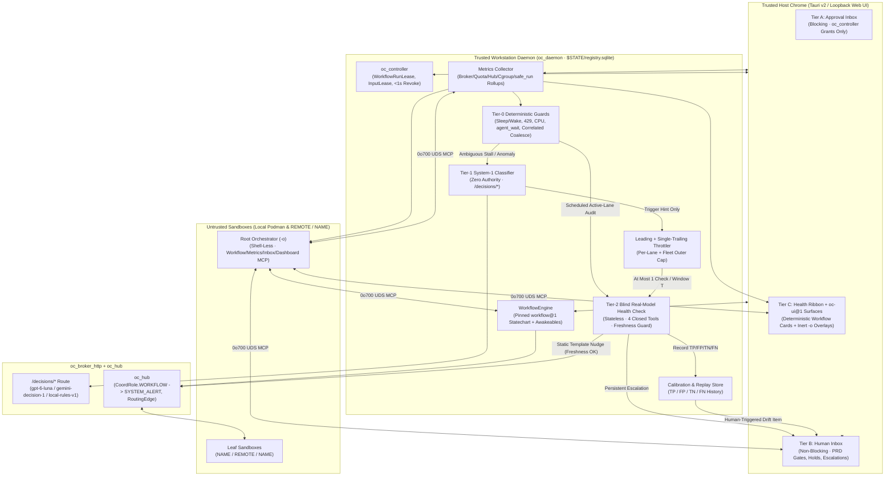

# prd_n: First-class long-running workflows, supervisory control, metrics, and non-blocking Human Inbox

[Index](README.md) · children:
[workflow@1 schema, durable statechart kernel & WorkflowRunLease](prd_n1.md),
[host metrics, zero-authority System-1 Decisions API, coalesced throttler & blind verification](prd_n2.md),
[three-tier Human Inbox, declarative oc-ui@1 dashboard surfaces & orchestrator MCP/skills](prd_n3.md) ·
related:
[orchestrator & dashboard](prd_i1.md),
[worker fleet & SSH](prd_i2.md),
[credential broker](prd_i3.md),
[composable config & plans](prd_l.md),
[host credential brokering](prd_l1.md),
[model telemetry & orchestration](prd_m.md),
[quotas & variants](prd_m1.md),
[cross-model orchestration](prd_m2.md),
[unified control plane & UI](prd_m3.md)

## Executive summary

PRD N promotes multi-sandbox operational workflows from ad-hoc orchestrator prompts and external
shell scripts into **first-class, workstation-stored, long-running declarative workflows
(`workflow@1`)**—configured, compiled, digest-pinned, and human-approved using the exact same
trust-boundary pattern as `sandbox-type@1` and `bundle@1` ([prd_l](prd_l.md)).

It delivers four tightly integrated capabilities on top of `oc_daemon`, `$STATE/registry.sqlite`,
`oc_controller`, `oc_broker_http`, `oc_hub`, and the Tauri v2 / loopback Web control plane
([prd_m](prd_m.md)):

1. **Named, durable hybrid workflows (`workflow@1`)** ([prd_n1](prd_n1.md)): declarative hierarchical
   statecharts combining deterministic host guards/steps with bounded LLM turns, Ship/Scout lane
   shapes, pinned immutable `workflow_plan_digest` snapshots, durable timers/awakeables, and
   single-owner lane leases that survive daemon restarts.
2. **Host-authoritative metrics + zero-authority System-1 / blind System-2 supervision**
   ([prd_n2](prd_n2.md)): unspoofable host-observed metrics exposed both internally to workflows and
   via MCP tools to the Root Orchestrator (`-o`), paired with a **zero-authority System-1 Decisions
   API classifier** (`gpt-6-luna` / `gemini-decision-1`) whose *only* permitted side effect is to
   request a **leading-edge + single-trailing coalesced** blind real-model health check—yielding an
   unbiased `TP / FP / TN / FN` confusion matrix, autonomous action on scheduled missed-alert
   audits, and a **human-triggered** calibration/replay loop through `oc_controller` approvals.
3. **Three-tier Human Inbox (strictly separated from Security Approvals)** ([prd_n3](prd_n3.md)):
   keeps blocking cryptographic grants exclusively in `oc_controller`'s **Approval Inbox (Tier A)**,
   while introducing a **non-blocking Human Inbox (Tier B)** for async PRD human-review gates,
   `captain_hold` decisions, and persistent stuck-lane escalations (with TOCTOU commit/digest
   pinning and auto-resolve on self-heal), plus an auto-clearing **Ephemeral Health Ribbon
   (Tier C)**.
4. **Declarative dashboard surfaces (`oc-ui@1`) and workflow skills** ([prd_n3](prd_n3.md)):
   workflows ship baked-in `[Deterministic Workflow]` health cards (zero LLM tokens, immutable by
   `-o`) plus a compiled `:ro` `orchestrator_skill` (`SKILL.md`) teaching `-o` how to maintain
   bounded `[Orchestrator Overlay]` panels over a fixed host React component catalog—zero untrusted
   JS/HTML inside Trusted Host Chrome.

---

## Architecture ranking and selected direction (3-way design review)

Three independent architecture lenses evaluated the requirements against `oc-sandbox`'s zero-trust
invariants ([AGENTS.md](../../AGENTS.md), [prd_i1](prd_i1.md), [prd_l](prd_l.md),
[prd_l1](prd_l1.md), [prd_m](prd_m.md)):

| Rank | Option Set | Core Architecture | Key Strengths | Key Weaknesses / Limits | Security Fit | Est. Effort |
|---|---|---|---|---|---|---|
| **#1 (Selected Direction)** | **Native `workflow@1` Statechart + Orthogonal 4-Tier Supervisor + Clean-Room `firstmate` Patterns** | Named declarative `workflow@1` TOML compiled to immutable `workflow_plan_digest`; SQLite event-sourced statechart + durable awakeables in `oc_daemon`; orthogonal supervisory reconciler (`Tier-0` deterministic host telemetry -> zero-authority `Tier-1` `/decisions/*` -> coalesced throttler -> blind `Tier-2` real-model health check -> `Tier-B` Human Inbox); declarative `oc-ui@1` surfaces over fixed host React catalog; clean-room port of `kunchenguid/firstmate` patterns. | Single ACID DB with `oc_hub`/`oc_controller` (`<1s` cascade revoke); zero untrusted host code or UI JS; zero-authority System-1 defeats classifier injection; full `TP/FP/TN/FN` calibration loop; identical local & `REMOTE / NAME` SSH operation; zero upstream rebase debt. | Closed predicate/action DSL means complex custom workflows delegate reasoning to `-o` via `workflow_signal` or host-only `factory_id`; expands `oc_daemon` responsibilities (mitigated by non-blocking I/O & never holding `routing_fence` across network calls). | **Best** (100% aligned with `prd_i1`, `prd_l1`, `prd_m1`–`m3`) | **~3–4 weeks** (phased on PRD M) |
| **#2** | **Embedded Durable Engine (DBOS-SQLite / Restate) + Native UI/Inbox** | Imperative Python/TS workflow functions with durable `@step` / `awakeable` primitives bridged to `oc_hub` and `oc_controller`. | Full general-purpose programming expressiveness; mature durable timer/retry primitives. | Imperative configs risk arbitrary host code execution; Restate introduces dual-store split-brain with `$STATE/registry.sqlite`; mid-run code edits hit replay-determinism hazards on 12h+ workflows; awkward for continuous fleet health supervision. | **Medium–Weak** | **~3.5–4.5 weeks** |
| **#3 (Rejected)** | **Sandboxed `firstmate` Sidecar Inside Root Orchestrator `-o`** | Run stripped `kunchenguid/firstmate` inside `-o` driving `oc_hub` via an MCP backend shim, while `oc_daemon` owns UI, Inbox, metrics, and Decisions API. | Keeps `firstmate` off host UID; reuses its `AGENTS.md` prompt playbook. | Violates `prd_i1` shell-less OS confinement of `-o` (forces enabling Bash + writable state inside `-o`, widening prompt-injection blast radius); ~80% of `firstmate` becomes dead weight; dual-state sync bugs. | **Weak** (breaks `-o` confinement) | **~3.5–5 weeks** |
| **#4 (Rejected)** | **`firstmate` as Outer Control Plane + `bin/backends/oc-sandbox.sh` Plugin** | Keep `kunchenguid/firstmate` (~150 host-UID Bash scripts, MIT) as outer control plane calling `oc-sandbox` via a new session backend. | Fast CLI prototype if zero-trust boundaries did not exist. | **Inverted trust model:** walks untrusted worktrees on host (`crew_worktree_written_since`, violating `AGENTS.md`), trusts worker-writable `status.log`, clashes with `prd_i2a` remote SSH workers (`secondmate`), bypasses `oc_controller` `plan_digest`/`SubtreeBudget`/`QuotaLedger`, still lacks `workflow@1`/metrics/Decisions/Tauri UI, high rebase tax. | **Broken** | **~5–7 weeks** + rebase tax |

**Direction locked:** **Rank #1** — build `workflow@1`, metrics, zero-authority System-1 + blind-check
supervision, three-tier Human Inbox, and `oc-ui@1` surfaces natively in `oc_daemon`, while
clean-room porting `kunchenguid/firstmate`'s proven operational patterns (crediting `firstmate` in
design notes, zero MIT code copied, zero Bash runtime adopted; see the extraction matrix in
[prd_n2](prd_n2.md#6-clean-room-firstmate-pattern-extraction-matrix)).

---

## Shared security and authority invariants

1. **Zero-Authority System-1 Classifier:** System-1 Decisions API models (`gpt-6-luna`,
   `gemini-decision-1`) can **only** log predictions and submit triggers to the coalesced throttler.
   They have **zero** direct authority to nudge sandboxes, write Human Inbox escalations, mutate
   workflow state, spawn sandboxes, or touch `oc_controller`.
2. **Blind, Stateless, Tool-Restricted System-2 Verification:** The real-model health check runs in
   a stateless single-turn host-brokered context (never full `-o`), sees **no hint** whether it was
   triggered by System-1 or by a scheduled unalerted audit, and may invoke only 4 closed,
   template-only health tools bounded by `WorkflowRunLease` caps, static host nudge templates,
   `dedupe_key` coalescing, and a pre-action freshness guard.
3. **Host-Authoritative Ground Truth Only:** Deterministic guards, stall timers, and progress resets
   consume strictly host-observed metrics (`oc_broker_http`, `QuotaLedger`, `oc_hub`, cgroups,
   `HostProvider.probe()`, containerized `safe_run`). Agent self-reports (`untrusted_claims`) are
   never allowed to satisfy guards or reset stall counters.
4. **Strict Three-Tier Inbox Separation:** Cryptographic security grants remain exclusively in
   `oc_controller`'s **Approval Inbox (Tier A)**. Async workflow/PRD reviews and escalations live
   in the **Human Inbox (Tier B)** with zero approval/execution authority. Transient warnings live
   in the **Health Ribbon (Tier C)**.
5. **Single ACID Revocation & Fencing Domain:** `WorkflowRunLease`, `CoordRole.WORKFLOW`
   (`TrustClass.SYSTEM_ALERT`, rank `0`), workflow outbox intents, and `workflow_awakeables` live in
   `$STATE/registry.sqlite` and participate in `oc_controller`'s unified `<1s` revocation cascade.

---

## Hidden traps, missing requirements, and human-approval matrix

Every hidden trap and missing requirement surfaced across the 3-lens review and follow-up hardening
is catalogued below with its exact mitigation and whether it requires **design-time human
decision**, **runtime `oc_controller` Approval Inbox grant**, **non-blocking Human Inbox trigger**,
or is a **non-negotiable baseline invariant**:

| # | Hidden Trap / Missing Requirement | Mitigation in Rank #1 | Approval / Decision Requirement | Where Specified |
|---|---|---|---|---|
| **T1** | **Prompt injection against System-1 classifier** (false-alert flood OR suppression attack blinding the classifier) | Zero-authority System-1; leading + single-trailing coalesced throttler; blind real-model verification; scheduled unalerted active-lane audits (defeats suppression); `noul("classifier_injection_suspected")` canary; bounded sanitized excerpts (`<= 512 B`). | **Mandatory security invariant** (no opt-out). **Runtime Approval Inbox** required to enable/widen `/decisions/*` routes or spend caps (`WorkflowRunLease`). | [prd_n2](prd_n2.md) |
| **T2** | **Prompt injection against the System-2 blind health-check model** | Stateless single-turn host context (not full `-o`); closed 4-tool surface (`health_record_ok`, `health_nudge_lane(template_id)`, `health_escalate_human(category)`, `health_wake_orchestrator(reason_code)`); static host nudge templates only; `WorkflowRunLease` hard caps + `dedupe_key`. | **Mandatory security invariant** (no opt-out). **Design decision needed** on dedicated lightweight blind-check model profile vs. reusing `-o` model tier. | [prd_n2](prd_n2.md#concrete-checkboxes-and-open-decisions) |
| **T3** | **Fleet-wide synchronized trigger burst** (10 compromised sandboxes all triggering at `t0`) | Per-lane leading+trailing throttler **plus** fleet-wide concurrency & rate-limit outer cap (round-robin queued). | **Mandatory security invariant**; fleet ceiling configurable in workflow/host policy (**Approval Inbox** to raise). | [prd_n2](prd_n2.md) |
| **T4** | **Stale nudge after fast self-recovery vs. fair classifier FP scoring** | Score `TP/FP` on the **exact frozen point-in-time snapshot `S1`** System-1 saw, **then** run a deterministic host **freshness guard** before executing any nudge/escalation (suppressing stale action if lane self-recovered, while preserving `TP` accuracy credit). Trailing boundary recheck evaluates fresh `S_now` while logging suppressed burst snapshots separately. | **Mandatory behavioral invariant** (no runtime approval per check; prevents false FP penalty and prevents stale nudges). | [prd_n2](prd_n2.md) |
| **T5** | **"Polite ack" false progress resets** (nudged agent replies `"Got it, continuing!"` without advancing code/tests) | Reset incident stall timer & nudge count **only** on host-verified progress (new commit SHA via `safe_run`, changed diff hash, verified test/tool-hash transition, or workflow state advance)—never on chat text alone. | **Mandatory invariant** (zero opt-out in builtin supervisor). | [prd_n2](prd_n2.md) |
| **T6** | **Workstation laptop sleep/suspend thundering herd** (lid closed 8h falsely triggers 8h stall on every lane) | Detect `wall_delta - monotonic_delta > 30s` in `oc_daemon`; enter wake grace window (default `120s`), re-probe worker/SSH liveness first, and exclude host-sleep intervals from dwell-time metrics. | **Mandatory invariant**; grace window duration configurable (default `120s`, no approval needed unless widening limits). | [prd_n2](prd_n2.md) |
| **T7** | **TOCTOU on async Human Inbox reviews** (agent pushes `def456` while human reviews PRD gate at `abc123`) | Bind every actionable Human Inbox gate to `(expected_commit_sha / expected_artifact_digest, workflow_seq)`; atomic re-check on operator click fails closed (`TARGET_CHANGED`) and refreshes card with new SHA. | **Mandatory security invariant** for all review/approval gates. | [prd_n3](prd_n3.md) |
| **T8** | **Correlated fleet-outage inbox storms** (provider `503` or dropped remote SSH host stalls 8 lanes at once) | Tier-0 correlated-fault coalescer groups by `(provider_route, remote_worker, error_class)` and emits **one** fleet-scoped Tier-B Inbox item referencing all affected lanes. | **Mandatory UX/anti-spam invariant**. | [prd_n2](prd_n2.md), [prd_n3](prd_n3.md) |
| **T9** | **Multi-workflow contention & fighting the human's keyboard** | Single-owner lane lease (`owner_workflow_id`) in SQLite (global watchdogs send advisory signals to owning workflow rather than nudging directly); auto-suspend supervision whenever `oc_controller` holds an active human `InputLease` on that sandbox. | **Mandatory safety invariant** (respects `prd_m3` `InputLease`). | [prd_n1](prd_n1.md) |
| **T10** | **Long-running workflow hot-reload / mid-run versioning** (editing `workflow@1` TOML while a run is 12h in) | Running instances pin immutable `spec_digest` (`workflow_spec_snapshots`). Edits apply to new runs; explicit `workflow migrate` allowed only at quiescent safe-points. | **Mandatory durability invariant**; **Runtime Approval Inbox** required to publish revised `workflow@1` TOML (`config_propose_revision`) or migrate with widened autonomy. | [prd_n1](prd_n1.md) |
| **T11** | **Unbiased `FN` sampling & sampling-adjusted miss-rate math** | Run scheduled blind audits only on active lanes (not idle/parked); have System-1 score the exact audit snapshot; display both raw counts (`TP/FP/TN/FN`) and sampling-adjusted miss rate on dashboard. | **Design decision needed** on default audit cadence & optional near-threshold stratification. | [prd_n2](prd_n2.md#concrete-checkboxes-and-open-decisions) |
| **T12** | **Classifier drift calibration & config thrash** | Default is **human-triggered only**: drift over minimum sample floor posts a non-blocking **Human Inbox (Tier B)** alert; operator triggers `-o` to inspect `calibration_examples_query`, run `workflow_calibration_replay` (before/after confusion-matrix diff), and submit `config_propose_revision` → **Runtime `Approval Inbox` (Tier A)** before changing live workflow/sandbox configs. | **Requires explicit human trigger** (Tier B) + **Runtime Approval Inbox** (Tier A) for every config mutation. | [prd_n2](prd_n2.md) |
| **T13** | **Daemon restart re-authorization ergonomics** (invalidating in-memory `WorkflowRunLease`s on restart) | `observe_only` runs auto-resume; active `nudge_bounded` / metered runs pause on restart and present a single batched **"Resume N paused workflows"** card in **Approval Inbox (Tier A)**. | **Runtime Approval Inbox** (Tier A) after restart unless user explicitly opts into a scoped durable lease policy (**Design decision needed**). | [prd_n1](prd_n1.md#concrete-checkboxes-and-open-decisions) |
| **T14** | **SQLite metrics write amplification** (high-frequency SSE token chunks thrashing WAL) | Aggregate high-frequency telemetry in memory inside `oc_daemon` and flush rolled-up buckets to `metrics_rollups` every `5–10s`, pruned to a bounded ring (e.g., 7–30 days). | **Mandatory implementation invariant**. | [prd_n2](prd_n2.md) |

---

## Phased milestones and ownership

Initial planning and core slices below are reserved `[*]` under **PRD N workflows & supervision**
(building on our in-progress `[*] PRD M coordination` slice); ownership of individual phases can be
re-coordinated at the start of the next implementation phase. Every implementation slice must pass
both [implementation review gates](README.md#implementation-review-gates) (Gate 1 walkthrough +
Gate 2 PR diff).

- [*] **N0 — PRD N Gate 1 design & security review** (`prd_n.md`, `prd_n1.md`, `prd_n2.md`,
      `prd_n3.md`): resolve `(decision needed)` items with the user, clear Gate 1 external security
      and architecture review, and lock the `workflow@1` / `/decisions/*` / `human_inbox_items` /
      `oc-ui@1` contracts.
- [*] **N1 — `workflow@1` schema, `oc_plan` compiler, `oc_store` authoring & SQLite statechart
      kernel** ([prd_n1](prd_n1.md)): `workflow@1` TOML validation, `SECURITY_DELTA_TRIGGERS`,
      immutable `workflow_plan_digest` & `workflow_spec_snapshots`, `WorkflowRunLease` in
      `oc_controller`, `CoordRole.WORKFLOW` (`SYSTEM_ALERT`), durable timers & awakeables,
      single-owner lane lease, and `InputLease` deferral. *(Est. 5–6 days.)*
- [*] **N2 — Host-authoritative metrics, `/decisions/*` broker, coalesced throttler, blind
      real-model verification & calibration store** ([prd_n2](prd_n2.md)): in-memory metrics
      aggregator + `metrics_rollups`, `oc_broker_http` `"decisions-typed"` policy (`gpt-6-luna`,
      `gemini-decision-1`, offline `local-rules-v1`), leading+single-trailing coalesced throttler
      with fleet cap, stateless blind health check + freshness guard, scheduled active-lane audits,
      `TP/FP/TN/FN` store + `workflow_calibration_replay`, sleep/wake detector, and
      `builtin/firstmate-supervisor` + skill. *(Est. 6–7 days.)*
- [ ] **N3 — Three-tier Human Inbox, declarative `oc-ui@1` Trusted Chrome surfaces & `-o` MCP
      tools** ([prd_n3](prd_n3.md)): `human_inbox_items` (`note`/`reply`/`receipts`/`ready`/
      `status`/`ask`/`hold`/`snooze`/auto-resolve + TOCTOU pinning), `dashboard_surfaces` closed
      React component catalog (`[Deterministic Workflow]` vs. `[Orchestrator Overlay]`), `-o` MCP
      surface (`workflow_*`, `metrics_*`, `fleet_bearings_snapshot`, `inbox_*`, `dashboard_*`,
      `calibration_*`), `builtin/prd-delivery-pipeline`, and end-to-end adversarial suite.
      *(Est. 5–7 days.)*

## Open top-level decisions

- [ ] **(decision needed)** Initial implementation slice scope:
  - **Option 1 (Recommended):** Build **N1 + N2 + N3** in vertical phased PRs, starting with the
    minimal `workflow@1` runner + `builtin/firstmate-supervisor` + `Human Inbox` + `/decisions/*`
    + metrics, then expanding general multi-stage `workflow@1` statecharts (`builtin/prd-delivery-pipeline`)
    and `oc-ui@1` overlays.
    - *Pros:* Clean abstractions from day one without retrofitting `workflow_plan_digest` or SQLite
      schemas later; delivers usable supervision + Human Inbox early.
    - *Cons:* Slightly higher upfront schema design (~1–2 days) before first runnable supervisor.
    - *Effort:* ~3–4 weeks total across 3 reviewable PRs.
  - **Option 2:** Build a hardcoded `firstmate` supervisor + `Human Inbox` + metrics first without
    `workflow@1` TOML, and generalize into `workflow@1` later.
    - *Pros:* Faster initial supervisor prototype (~1.5–2 weeks).
    - *Cons:* Requires a breaking schema/lease migration when adding user-authored named workflows
      and PRD delivery pipelines.
    - *Effort:* ~2 weeks now + ~2.5 weeks migration later (~4.5 weeks total).

- [ ] **Human review**: checked only when the user says so
