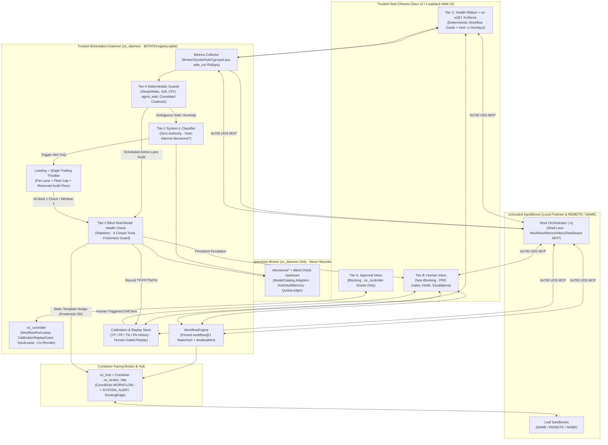

# prd_n: First-class long-running workflows, supervisory control, metrics, and non-blocking Human Inbox

[Index](README.md) · children:
[workflow@1 schema, durable statechart kernel & WorkflowRunLease](prd_n1.md),
[host metrics, zero-authority System-1 Decisions API, coalesced throttler & blind verification](prd_n2.md),
[three-tier Human Inbox, declarative oc-ui@1 dashboard surfaces & orchestrator MCP/skills](prd_n3.md) ·
related:
[orchestrator & dashboard](prd_i1.md),
[worker fleet & SSH](prd_i2.md),
[credential broker](prd_i3.md),
[composable config & plans](prd_l.md),
[host credential brokering](prd_l1.md),
[model telemetry & orchestration](prd_m.md),
[quotas & variants](prd_m1.md),
[cross-model orchestration](prd_m2.md),
[unified control plane & UI](prd_m3.md)

## Executive summary

PRD N promotes multi-sandbox operational workflows from ad-hoc orchestrator prompts and external
shell scripts into **first-class, workstation-stored, long-running declarative workflows
(`workflow@1`)**—configured, compiled, digest-pinned, and human-approved using the exact same
trust-boundary pattern as `sandbox-type@1` and `bundle@1` ([prd_l](prd_l.md)).

It delivers four tightly integrated capabilities layered onto the planned `oc_daemon`,
`$STATE/registry.sqlite`, `oc_controller`, `oc_broker_http`, `oc_hub`, and Tauri v2 / loopback Web
control plane ([prd_m](prd_m.md)). *(Baseline evidence boundary: `main` currently qualifies a
standalone local OpenCode run with a synthetic upstream and a separate fake-worker coordination
proof; joint hub/transport restart qualification, live LLM providers, SSH remote onboarding, full
quota telemetry, live `<1s` revocation across real transports, and the desktop UI remain open
prerequisites in [prd_i](prd_i.md), [prd_l](prd_l.md), and [prd_m](prd_m.md).)*

1. **Named, durable hybrid workflows (`workflow@1`)** ([prd_n1](prd_n1.md)): declarative hierarchical
   statecharts combining deterministic host guards/steps with bounded LLM turns, Ship/Scout lane
   shapes, pure side-effect-free compilation to immutable `workflow_plan_digest` snapshots (with
   approved-path materialization), compiled effect-allowlist enforcement on `observe_only`,
   unified migration/restart settlement rules, durable timers/awakeables, and single-owner lane
   leases that survive daemon restarts.
2. **Host-authoritative metrics + zero-authority System-1 / blind System-2 supervision**
   ([prd_n2](prd_n2.md)): unspoofable host-observed metrics exposed both internally to workflows and
   via per-record-authorized MCP tools to the Root Orchestrator (`-o`), paired with a
   **zero-authority System-1 Decisions API classifier** (`gpt-6-luna` / `gemini-decision-1`
   catalog entries, metrics-only by default with opt-in excerpt disclosure) whose *only* permitted
   side effect is to request a **leading-edge + single-trailing coalesced** blind real-model health
   check—yielding a stratified **reference-verdict** confusion matrix (`TP / FP / TN / FN` plus
   inclusion/abstention/drop accounting), autonomous action on scheduled missed-alert audits, and a
   **human-triggered** calibration/replay loop gated by a Tier-A `CalibrationReplayGrant`.
3. **Three-tier Human Inbox (strictly separated from Security Approvals)** ([prd_n3](prd_n3.md)):
   keeps blocking cryptographic grants exclusively in `oc_controller`'s **Approval Inbox (Tier A)**
   (including `CalibrationReplayGrant`), while introducing a **non-blocking Human Inbox (Tier B)**
   with zero grant-minting authority for async PRD human-review gates, `captain_hold` decisions,
   and persistent stuck-lane escalations (binding operator clicks to exact displayed item revision
   + content digests + live `safe_run` workspace pins, with partitioned deduplication and
   corroborated-progress auto-resolve), plus an auto-clearing **Ephemeral Health Ribbon (Tier C)**.
4. **Declarative dashboard surfaces (`oc-ui@1`) and workflow skills** ([prd_n3](prd_n3.md)):
   workflows ship baked-in `[Deterministic Workflow]` health cards (zero LLM tokens, immutable by
   `-o`) plus a compiled `:ro` `orchestrator_skill` (`SKILL.md`) teaching `-o` how to maintain
   bounded `[Orchestrator Overlay]` panels over a fixed host Svelte component catalog—zero untrusted
   JS/HTML inside Trusted Host Chrome.

---

## Architecture ranking and selected direction (3-way design review)

Three independent architecture lenses evaluated the requirements against `oc-sandbox`'s zero-trust
invariants ([AGENTS.md](../../AGENTS.md), [prd_i1](prd_i1.md), [prd_l](prd_l.md),
[prd_l1](prd_l1.md), [prd_m](prd_m.md)):

| Rank | Option Set | Core Architecture | Key Strengths | Key Weaknesses / Limits | Security Fit | Est. Effort |
|---|---|---|---|---|---|---|
| **#1 (Selected Direction)** | **Native `workflow@1` Statechart + Orthogonal 4-Tier Supervisor + Clean-Room `firstmate` Patterns** | Named declarative `workflow@1` TOML compiled to immutable `workflow_plan_digest`; SQLite event-sourced statechart + durable awakeables in `oc_daemon`; orthogonal supervisory reconciler (`Tier-0` deterministic host telemetry -> zero-authority `Tier-1` `/decisions/*` -> coalesced throttler -> blind `Tier-2` real-model health check -> `Tier-B` Human Inbox); declarative `oc-ui@1` surfaces over fixed host Svelte catalog; clean-room port of `kunchenguid/firstmate` patterns. | Single ACID DB with `oc_hub`/`oc_controller` (`<1s` cascade revoke); zero untrusted host code or UI JS; zero-authority System-1 defeats classifier injection; full `TP/FP/TN/FN` calibration loop; identical local & `REMOTE / NAME` SSH operation; zero upstream rebase debt. | Closed predicate/action DSL means complex custom workflows delegate reasoning to `-o` via `workflow_signal` or host-only `factory_id`; expands `oc_daemon` responsibilities (mitigated by non-blocking I/O & never holding `routing_fence` across network calls). | **Best** (100% aligned with `prd_i1`, `prd_l1`, `prd_m1`–`m3`) | **~3–4 weeks** (phased on PRD M) |
| **#2** | **Embedded Durable Engine (DBOS-SQLite / Restate) + Native UI/Inbox** | Imperative Python/TS workflow functions with durable `@step` / `awakeable` primitives bridged to `oc_hub` and `oc_controller`. | Full general-purpose programming expressiveness; mature durable timer/retry primitives. | Imperative configs risk arbitrary host code execution; Restate introduces dual-store split-brain with `$STATE/registry.sqlite`; mid-run code edits hit replay-determinism hazards on 12h+ workflows; awkward for continuous fleet health supervision. | **Medium–Weak** | **~3.5–4.5 weeks** |
| **#3 (Rejected)** | **Sandboxed `firstmate` Sidecar Inside Root Orchestrator `-o`** | Run stripped `kunchenguid/firstmate` inside `-o` driving `oc_hub` via an MCP backend shim, while `oc_daemon` owns UI, Inbox, metrics, and Decisions API. | Keeps `firstmate` off host UID; reuses its `AGENTS.md` prompt playbook. | Violates `prd_i1` shell-less OS confinement of `-o` (forces enabling Bash + writable state inside `-o`, widening prompt-injection blast radius); ~80% of `firstmate` becomes dead weight; dual-state sync bugs. | **Weak** (breaks `-o` confinement) | **~3.5–5 weeks** |
| **#4 (Rejected)** | **`firstmate` as Outer Control Plane + `bin/backends/oc-sandbox.sh` Plugin** | Keep `kunchenguid/firstmate` (~150 host-UID Bash scripts, MIT) as outer control plane calling `oc-sandbox` via a new session backend. | Fast CLI prototype if zero-trust boundaries did not exist. | **Inverted trust model:** walks untrusted worktrees on host (`crew_worktree_written_since`, violating `AGENTS.md`), trusts worker-writable `status.log`, clashes with `prd_i2a` remote SSH workers (`secondmate`), bypasses `oc_controller` `plan_digest`/`SubtreeBudget`/`QuotaLedger`, still lacks `workflow@1`/metrics/Decisions/Tauri UI, high rebase tax. | **Broken** | **~5–7 weeks** + rebase tax |

**Direction locked:** **Rank #1** — build `workflow@1`, metrics, zero-authority System-1 + blind-check
supervision, three-tier Human Inbox, and `oc-ui@1` surfaces natively in `oc_daemon`, while
clean-room porting `kunchenguid/firstmate`'s proven operational patterns (crediting `firstmate` in
design notes, zero MIT code copied, zero Bash runtime adopted; see the extraction matrix in
[prd_n2](prd_n2.md#6-clean-room-firstmate-pattern-extraction-matrix)).

---

## Shared security and authority invariants

1. **Zero-Authority System-1 Classifier:** System-1 Decisions API models (`gpt-6-luna`,
   `gemini-decision-1`) can **only** log predictions and submit triggers to the coalesced throttler.
   They have **zero** direct authority to nudge sandboxes, write Human Inbox escalations, mutate
   workflow state, spawn sandboxes, or touch `oc_controller`.
2. **Blind, Stateless, Tool-Restricted System-2 Verification:** The real-model health check runs in
   a stateless single-turn host-brokered context (never full `-o`), sees **no hint** whether it was
   triggered by System-1 or by a scheduled unalerted audit, and may invoke only 4 closed,
   template-only health tools bounded by `WorkflowRunLease` caps, static host nudge templates,
   `dedupe_key` coalescing, and a pre-action freshness guard.
3. **Host-Authoritative Ground Truth & Independent Progress Evidence:** Deterministic guards,
   freshness checks, stall resets, and escalation auto-resolve consume strictly host-observed
   metrics and **independent task-bound progress** (`safe_run` commit/tree/diff deltas, verified
   test transitions, broker/workflow transitions). Worker-emitted `stream_events` /
   `turn_completed` frames record *transport activity only* and can never suppress supervision or
   reset an incident without corroborating progress.
4. **Strict Three-Tier Inbox Separation & Zero Tier-B Grant Authority:** Cryptographic security
   grants (including `CalibrationReplayGrant` bound to exact outbound candidate rubric/choices
   digests) remain exclusively in `oc_controller`'s **Approval Inbox (Tier A)**. Tier-B clicks hold
   zero grant-minting authority (at most submitting a Tier-A proposal). Human resolutions verify
   the displayed revision, `action_id` membership, live awaiting lane step + unexpired awakeable,
   and live `safe_run` fingerprints atomically (emitting zero receipt or forwarded directive on a
   superseded step), and keep advisory summaries/evidence untrusted on forwarding.
5. **Per-Record Authorization & Single ACID Fencing Domain:** Every workflow, metric, calibration,
   inbox, and overlay operation enforces current `(caller, run_id, SubtreeBudget,
   target_incarnation)` authorization per record (never `workflow_id` alone). `WorkflowRunLease`,
   `CalibrationReplayGrant`, `CoordRole.WORKFLOW` (`TrustClass.SYSTEM_ALERT`, coordinated
   `oc_coord_contract.py` extension strictly below `OPERATOR_DIRECTIVE` and `cancel`), workflow
   outbox intents, supervision spend reservations (`prd_m1` durable first-write rule), and
   role-fenced `workflow_awakeables` live in `$STATE/registry.sqlite`, halt automatically whenever
   the store is degraded (`.coord_degraded` / unclean-shutdown seal), and participate in
   `oc_controller`'s target `<1s` revocation cascade (qualified once joint PRD M transport lands).
6. **Host-Internal Supervision Broker & Metrics-Only Disclosure Default:** `/decisions/*` and blind
   real-model verifier requests execute through a dedicated host-internal `oc_daemon`-only broker
   instance (never sharing container-mounted `HostHttpBrokerServer` UDS listeners) and default
   strictly to **host-allowlisted metrics only** (`excerpt_disclosure = "none"` unless explicitly
   opted in per source, destination route, and live/replay use).

---

## Hidden traps, missing requirements, and human-approval matrix

Every hidden trap and missing requirement surfaced across the 3-lens review and follow-up hardening
is catalogued below with its exact mitigation and whether it requires **design-time human
decision**, **runtime `oc_controller` Approval Inbox grant**, **non-blocking Human Inbox trigger**,
or is a **non-negotiable baseline invariant**:

| # | Hidden Trap / Missing Requirement | Mitigation in Rank #1 | Approval / Decision Requirement | Where Specified |
|---|---|---|---|---|
| **T1** | **Prompt injection & data disclosure in System-1 classifier** (false-alert flood, suppression attack, or workspace secret leakage) | Zero-authority System-1; host-internal `/decisions/*` broker (never container-mounted); **metrics-only by default** (`excerpt_disclosure = "none"`, explicit source/route/use opt-in enforced on final payload); leading + single-trailing coalesced throttler; blind real-model verification; scheduled active-lane audits; `noul("classifier_injection_suspected")` canary (positive canary strips excerpt & re-evaluates on numeric metrics). | **Mandatory security invariant** (no opt-out). **Runtime Approval Inbox (Tier A)** required to enable/widen `/decisions/*` routes, spend caps, or excerpt disclosure (`WorkflowRunLease` / `workflow_excerpt_disclosure_changed`). | [prd_n2](prd_n2.md) |
| **T2** | **Prompt injection against the System-2 blind health-check model** | Stateless single-turn host context (not full `-o`); metrics-only default with explicit excerpt disclosure policy; closed 4-tool surface (`health_record_ok`, `health_nudge_lane(template_id)`, `health_escalate_human(category)`, `health_wake_orchestrator(reason_code)`); static host nudge templates (literal single-pass substitution); 128-bit nonce framing for opted-in excerpts; `WorkflowRunLease` hard caps + `dedupe_key`. | **Mandatory security invariant** (no opt-out). **Design decision needed** on dedicated lightweight blind-check model profile vs. reusing `-o` model tier. | [prd_n2](prd_n2.md#concrete-checkboxes-and-open-decisions) |
| **T3** | **Fleet-wide synchronized trigger burst & audit starvation** (10 compromised sandboxes all triggering at `t0`) | Per-lane leading+trailing throttler **plus** fleet-wide concurrency & hourly cap (round-robin queued) **plus** a dedicated non-starvable audit floor (`fleet_audit_checks_per_hour`) reserved for scheduled unalerted `FN` audits, with explicit drop/delay/abstention accounting. | **Mandatory security invariant**; fleet ceiling configurable in workflow/host policy (**Approval Inbox** to raise). | [prd_n2](prd_n2.md) |
| **T4** | **Stale nudge after self-recovery vs. fair classifier scoring** | Score `TP/FP` on the **exact frozen point-in-time snapshot `S1`** System-1 saw, **then** run a deterministic host **freshness guard** requiring independent host-verified progress (never worker `turn_completed` alone) before suppressing an action. Trailing boundary recheck evaluates fresh `S_now` and is kept in its own stratum (excluded from System-1 `TP/FP` unless shadow-scored). | **Mandatory behavioral invariant** (no runtime approval per check). | [prd_n2](prd_n2.md) |
| **T5** | **"Polite ack" / synthetic `turn_completed` false progress resets** (worker emits fake completion or `"Got it, continuing!"` to suppress supervision) | Record stream frames / `turn_completed` strictly as **transport activity** only. Require **independent, host-verified, task-bound progress** (`safe_run` commit/tree/diff advance, verified test exit transition, broker/workflow state advance) to declare self-recovery, reset stall/nudge counters, or auto-resolve an escalation. | **Mandatory security invariant** (zero opt-out). | [prd_n2](prd_n2.md) |
| **T6** | **Workstation laptop sleep/suspend thundering herd** (lid closed 8h falsely triggers 8h stall on every lane) | Detect `wall_delta - monotonic_delta > 30s` in `oc_daemon`; enter wake grace window (default `120s`), re-probe worker/SSH liveness first, and exclude host-sleep intervals from dwell-time metrics. | **Mandatory invariant**; grace window duration configurable (default `120s`, no approval needed unless widening limits). | [prd_n2](prd_n2.md) |
| **T7** | **TOCTOU, superseded-step & stale-tab resolution on async Human Inbox reviews** (card refreshed, lane already advanced/expired, or agent pushes `def456` between display and click) | Every operator click submits `(item_id, displayed_item_revision, action_id, expected_workflow_seq, displayed_content_digest, expected_commit_sha, expected_tree_oid, expected_artifact_digest)`; inside one atomic SQLite transaction `oc_daemon` verifies displayed pins, `action_id` membership in `displayed_item_revision`, that the live lane step still awaits the same live unexpired `OPERATOR_ONLY` awakeable, and an immediate containerized `safe_run` `HEAD`/tree/`:ro` spool check before emitting `HumanDecisionReceipt` or forwarding (`STALE_ITEM_REVISION` / `INVALID_ACTION_FOR_REVISION` / `STEP_SUPERSEDED` / `AWAKEABLE_EXPIRED` / `TARGET_CHANGED` fails closed with zero receipt or forwarded directive), pinning verified SHA/digest into downstream bindings and keeping advisory text untrusted on forwarding. | **Mandatory security invariant** for all review/approval gates. | [prd_n3](prd_n3.md) |
| **T8** | **Correlated fleet-outage inbox storms & dedup key collisions** | Tier-0 correlated-fault coalescer groups by `(provider_route, remote_worker, error_class)` into one fleet-scoped Tier-B item. Partition `human_inbox_items` deduplication by `(owner_scope, source_kind, source_id, lane_paused, dedupe_key)` so an `-o` advisory post can never collide with an operator gate. | **Mandatory security & anti-spam invariant**. | [prd_n2](prd_n2.md), [prd_n3](prd_n3.md) |
| **T9** | **Multi-workflow contention, `observe_only` bypass/lane squatting, cross-run scope leaks & supervisor self-disablement** | Compiled effect-allowlist enforcement on `observe_only` auto-admission (fails closed if any launch/patch/nudge/lane-pausing/factory effect is reachable); `observe_only` observers attach via **nonexclusive `workflow_observer_subscriptions`** and can never acquire or retain exclusive `workflow_lane_leases` (leaving the operator free to start an owning workflow on the same incarnation); per-record `(caller, run_id, SubtreeBudget, target_incarnation)` authorization on all calibration/inbox/overlay/metric objects; `-o` cannot pause/stop/signal/migrate operator supervisors; `workflow_awakeables` role-fenced; human `InputLease` auto-suspend. | **Mandatory security invariant**. | [prd_n1](prd_n1.md), [prd_n3](prd_n3.md) |
| **T10** | **Long-running workflow migration, restart & outstanding-effect settlement** | Running instances pin immutable `spec_digest` (`workflow_spec_snapshots`). **Every** live migration to a new digest unconditionally requires fresh **Tier-A** authority (`WorkflowRunLease`) bound to `(new_spec_digest, new_grant_generation)` (no `observe_only` carve-out on live migration) at a full quiescent safe-point (zero in-flight outbox dispatches, `/decisions/*` or blind-check calls, firing timers, or pending awakeables/decisions), invalidating stale callbacks. Apply `prd_m1` durable first-write & uncertain-outcome settlement to all supervision calls; re-verify lease, incarnation, lane ownership, and `InputLease` before any late tool result acts. | **Mandatory durability & security invariant**; **Runtime Approval Inbox (Tier A)** required for config revision (`config_propose_revision`) and **every** live migration to a new digest. | [prd_n1](prd_n1.md) |
| **T11** | **Reference-verdict sampling, abstentions & cap-drop bias** | Run scheduled blind audits only on active lanes under a reserved non-starvable fleet audit floor; label blind-model output as **reference verdict** (not infallible ground truth); track actual inclusion rates, cap drops/delays, abstentions, and explicit strata (`triggered_leading`, `triggered_trailing`, `scheduled_audit_uniform`, `scheduled_audit_near_threshold`) before policy tuning. | **Design decision needed** on default audit cadence & optional near-threshold stratification. | [prd_n2](prd_n2.md#concrete-checkboxes-and-open-decisions) |
| **T12** | **Classifier drift calibration, unapproved outbound replay rubric, unleased replay spend & Tier-B grant escalation** | Default is **human-triggered only**: drift posts a non-blocking **Human Inbox (Tier B)** alert; candidate tuning is prepared **locally offline first** via pure `compile_workflow_plan()` (zero upstream calls); requesting replay creates a **Tier-A `Approval Inbox` proposal** (Tier B has zero grant authority) displaying the exact outbound `rubric`/`choices` and binding `(requesting_principal, run_id, candidate_spec_digest, candidate_rubric_digest, sample_scope, route/model, disclosure policy, call/spend caps, expiry)` in `CalibrationReplayGrant` **before** any paid replay (any rubric/choice edit requires fresh Tier-A approval). Subsequent config edits require a separate **Tier-A** `config_propose_revision` approval. | **Requires Tier-A Approval Inbox grant** (`CalibrationReplayGrant` bound to exact outbound rubric/choices digest) prior to paid replay **plus** separate **Tier-A Approval Inbox** grant for any config mutation. | [prd_n2](prd_n2.md), [prd_n3](prd_n3.md) |
| **T13** | **Daemon restart re-authorization, degraded-store halt & budget exhaustion** | `observe_only` runs auto-resume (effect-allowlisted, concurrency/rate-capped); active/metered runs pause on restart for a batched **"Resume N paused workflows"** card in **Approval Inbox (Tier A)**. Any `.coord_degraded` / unclean-shutdown state halts `WorkflowEngine` completely until `confirm_recovery()`. Spend exhaustion falls back to Tier-0 deterministic monitoring + Tier-B notice; late results re-verify active lease/incarnation/lane/human-lease regardless of restart UX. | **Runtime Approval Inbox (Tier A)** after restart unless user explicitly opts into a scoped durable lease policy (**Design decision needed**). | [prd_n1](prd_n1.md#concrete-checkboxes-and-open-decisions) |
| **T14** | **SQLite metrics write amplification & container-probe thrash** | Aggregate high-frequency telemetry in memory inside `oc_daemon` and flush rolled-up buckets to `metrics_rollups` every `5–10s` (pruned ring). Run containerized `safe_run` git probes lazily/on-demand (per-lane concurrency `1`, hard timeout) rather than every `60s` tick. | **Mandatory implementation invariant**. | [prd_n2](prd_n2.md) |

---

## Phased milestones and ownership

Initial planning and core slices **N0–N2** are reserved `[*]` under **PRD N workflows &
supervision** (**N3** remains open `[ ]`); ownership of individual phases can be re-coordinated at
the start of the next implementation phase. Every implementation slice must pass both
[implementation review gates](README.md#implementation-review-gates) (Gate 1 walkthrough + Gate 2
PR diff).

**Upstream prerequisites on `main` (`4ed06c41`):** `main` currently records a standalone local
OpenCode proof with a synthetic upstream and a separate fake-worker coordination proof
([prd_m](prd_m.md#first-poc-split)). Offline/synthetic unit and regression proofs for **N1** and
**N2** can proceed against the merged coordination primitives, while end-to-end live local/remote
qualification, live `<1s` revocation cascades across real transports, live provider quotas, and
desktop surfaces explicitly depend on completing the open upstream slices:
- Joint local OpenCode transport + `oc_hub` restart qualification ([prd_m](prd_m.md#first-poc-split))
- Live provider routes & full `5h`/`7d` `QuotaLedger` telemetry ([prd_m1](prd_m1.md), [prd_i4](prd_i4.md))
- SSH remote worker onboarding (`REMOTE / NAME`, [prd_i2](prd_i2.md))
- Trusted Host Chrome ([M3a loopback first](prd_m3a.md), [M3b Tauri desktop](prd_m3b.md))

Wave 1 of the [delivery order](#delivery-order) is a local, synthetic slice. From the list above
it needs the joint local transport proof and Trusted Host Chrome. It does not need live provider
routes or SSH onboarding, provided the operator confirms the synthetic route. Live and remote
qualification of the same pipeline still depends on every item above.

- [*] **N0 — PRD N Gate 1 design & security review** (`prd_n.md`, `prd_n1.md`, `prd_n2.md`,
      `prd_n3.md`): resolve `(decision needed)` items with the user, clear Gate 1 external security
      and architecture review, and lock the `workflow@1` / `/decisions/*` / `human_inbox_items` /
      `oc-ui@1` contracts.
- [*] **N1 — `workflow@1` schema, `oc_plan` compiler, `oc_store` authoring & SQLite statechart
      kernel** ([prd_n1](prd_n1.md)): `workflow@1` TOML validation, `SECURITY_DELTA_TRIGGERS`,
      immutable `workflow_plan_digest` & `workflow_spec_snapshots`, `WorkflowRunLease` in
      `oc_controller`, `CoordRole.WORKFLOW` (`SYSTEM_ALERT`), durable timers & awakeables,
      single-owner lane lease, and `InputLease` deferral. *(Est. 5–6 days.)*
- [*] **N2 — Host-authoritative metrics, `/decisions/*` broker, coalesced throttler, blind
      real-model verification & calibration store** ([prd_n2](prd_n2.md)): in-memory metrics
      aggregator + `metrics_rollups`, `oc_broker_http` `"decisions-typed"` policy (`gpt-6-luna`,
      `gemini-decision-1`, offline `local-rules-v1`), leading+single-trailing coalesced throttler
      with fleet cap, stateless blind health check + freshness guard, scheduled active-lane audits,
      `TP/FP/TN/FN` store + `workflow_calibration_replay`, sleep/wake detector, and
      `builtin/firstmate-supervisor` + skill. *(Est. 6–7 days.)*
- [ ] **N3 — Three-tier Human Inbox, declarative `oc-ui@1` Trusted Chrome surfaces & `-o` MCP
      tools** ([prd_n3](prd_n3.md)): `human_inbox_items` (`note`/`reply`/`receipts`/`ready`/
      `status`/`ask`/`hold`/`snooze`/auto-resolve + TOCTOU pinning), `dashboard_surfaces` closed
      Svelte component catalog (`[Deterministic Workflow]` vs. `[Orchestrator Overlay]`), `-o` MCP
      surface (`workflow_*`, `metrics_*`, `fleet_bearings_snapshot`, `inbox_*`, `dashboard_*`,
      `calibration_*`), `builtin/prd-delivery-pipeline`, and end-to-end adversarial suite.
      *(Est. 5–7 days.)*

## Delivery order

Operator direction from the 2026-11-28 planning session. This section orders the workflow side.
The control-plane side is ordered in [prd_m](prd_m.md#delivery-order). The two lists share wave
numbers and the same [shared blockers and decisions](#shared-blockers-and-decisions). Change both
in one PR when a wave moves.

A `[ ]` below tracks delivery in this plan. It does not open or release a
[reservation](README.md#workstream-reservations). An item inside a reserved scope keeps its
owner, named in brackets where the index reserves it. N0 to N2 stay reserved to PRD N workflows &
supervision.

Direction recorded:

- The first end-to-end example is our own interpretation of `kunchenguid/firstmate`, starting
  with a **minimal crew pipeline**: one ship lane, one `safe_run` verification and one
  non-blocking human gate, as a cut-down `builtin/prd-delivery-pipeline`. It shows an LLM lane
  beside a deterministic step and a human decision, which the fleet supervisor alone does not.
- The fleet supervisor (`builtin/firstmate-supervisor`) follows in Wave 2, observe-only first.
- The first waves use built-in host actions only. Authored deterministic steps are scoped for
  the roadmap in [prd_n1](prd_n1.md#authoring-surface-and-authored-deterministic-steps) and are
  not a foundation.
- This puts the pipeline ahead of the supervisor, which reverses the sequence inside Option 1 of
  the [initial slice decision](#open-top-level-decisions). The N1 to N3 milestones above keep
  their content. Only their order of delivery changes.

### Wave 0: prove and decide

- [ ] Add a synthetic crew pipeline run, its lease approval and its human gate to the shared
      fixture set ([Gap M3.6](prd_m3.md#concrete-gaps-and-checkboxes)).
- [ ] Design the missing workflow screens ([prd_m3a1](prd_m3a1.md#design-supplement)).
      [Reserved: Dashboard design.]
- [ ] Reciprocal review of this PRD and its children, the open part of N0.
      [Reserved: PRD N workflows & supervision.]
- [ ] Settle the decisions the built-in crew pipeline needs, and only those:
  - the [initial slice scope](#open-top-level-decisions);
  - the [restart behaviour](prd_n1.md#concrete-checkboxes-and-open-decisions) for active runs,
    because the pipeline holds a run lease;
  - the operator's confirmation of the synthetic model route for Wave 1;
  - design and security review of the workflow list, definition and run views
    ([prd_n3 §4](prd_n3.md#4-workflow-views-and-change-review)).

The other open decisions in this PRD and its children do not block Wave 1. Each is settled
before the wave that uses it:

- Wave 2: the [authoring surface](prd_n1.md#authoring-surface-and-authored-deterministic-steps)
  and the typed stage contracts and bindings, which return N1 to Gate 1; the blind-check model
  tier and audit sampling ([prd_n2](prd_n2.md#concrete-checkboxes-and-open-decisions)); overlays
  outside a run ([prd_n3](prd_n3.md#concrete-checkboxes-and-open-decisions)).
- Wave 3: the runtime for
  [authored steps](prd_n1.md#authoring-surface-and-authored-deterministic-steps).

### Wave 1: thin live slice

Parallel once Wave 0 lands. Control-plane items for this wave are in
[prd_m](prd_m.md#wave-1-thin-live-slice), with the shared finish line. That finish line is
defined for both outcomes of the tech-stack spike: the Tauri app if it passes, the authenticated
loopback dashboard if it fails. The items below are the same either way.

- [ ] A minimal statechart kernel: the part of [N1](prd_n1.md) the pipeline needs. That is the
      schema and pure compile for `deterministic`, `ship_lane` and `human_gate_async` stages,
      the run lease, and the event-sourced engine with awakeables. It uses the reviewed schema
      as it stands, with only the bindings that design already defines.
      [Reserved: PRD N workflows & supervision.]
- [ ] The minimal `builtin/prd-delivery-pipeline` and its skill ([prd_n3](prd_n3.md)). On the
      synthetic route the reviewer can share the implementor's route.
- [ ] The Human Inbox store, read projection and resolve path with the display-bound checks
      ([prd_n3 §1](prd_n3.md#1-three-tier-human-inbox-strict-separation-from-oc_controller-approvals)).
- [ ] Workflow list, definition and run views
      ([prd_n3 §4](prd_n3.md#4-workflow-views-and-change-review)).

### Wave 2: widen

- [ ] The fleet supervisor, observe-only first: host metrics, the classifier route, the
      throttler and the blind check ([prd_n2](prd_n2.md)).
      [Reserved: PRD N workflows & supervision.]
- [ ] Parallel lanes, the scout lane and the full delivery pipeline ([prd_n1](prd_n1.md)).
      [Reserved: PRD N workflows & supervision.]
- [ ] Orchestrator overlays and the orchestrator's tool surface
      ([prd_n3 §2 and §3](prd_n3.md#2-declarative-dashboard-surfaces-oc-ui1--zero-untrusted-js-in-trusted-host-chrome)).
- [ ] Workflow change review ([prd_n3 §4](prd_n3.md#4-workflow-views-and-change-review)).

### Wave 3: later

- [ ] Bounded nudging on live routes, calibration and replay ([prd_n2](prd_n2.md)).
- [ ] Live providers and remote workers ([prd_i4](prd_i4.md), [prd_i2](prd_i2.md)).
      [Reserved: Outside-in integrations.]
- [ ] The spike for authored deterministic steps
      ([prd_n1](prd_n1.md#authoring-surface-and-authored-deterministic-steps)).

### Shared blockers and decisions

[prd_m](prd_m.md#shared-blockers-and-decisions) carries the same list. Keep the two in step.

Decisions:

- Shell order: [prd_m control-plane decision](prd_m.md#control-plane-decision), settled by the
  [tech-stack spike](prd_m3b.md#tech-stack-spike).
- How much of the UI is built on UI SDK primitives: [prd_m3a2](prd_m3a2.md#open-decision).
- Process for the design supplement: [prd_m3a1](prd_m3a1.md#design-supplement).
- Frontend conventions and development add-ons: [prd_m3a3](prd_m3a3.md#open-decisions).
- Workflow authoring surface and authored deterministic steps:
  [prd_n1](prd_n1.md#authoring-surface-and-authored-deterministic-steps).
- Configuration editing interface: [prd_j](prd_j.md#later-configuration-and-editor).
- Secret storage and broker integration: [prd_i3](prd_i3.md#open-choices).
- Loopback cookie port-sharing ([prd_m3a](prd_m3a.md)) matters only if loopback ever carries real
  authority again.

Dependencies owned elsewhere:

- Credential brokering for sandboxes: [prd_i3](prd_i3.md), [prd_i3a](prd_i3a.md),
  [prd_i4](prd_i4.md) and [prd_l1](prd_l1.md). The dashboard's part is the Approval Inbox and
  grant revocation.
- Sandbox profiles and the config tools the orchestrator uses: the
  [prd_l](prd_l.md) production port.
- Named workstream [reservations](README.md#workstream-reservations). Take an epic by reserving it
  there.

## Open top-level decisions

- [ ] **(decision needed)** Initial implementation slice scope:
  - *Operator direction, 2026-11-28:* the first example is the minimal crew pipeline, built as a
    `workflow@1` statechart with built-in actions, ahead of the supervisor
    ([delivery order](#delivery-order)). That is Option 1's approach with its sequence
    reversed. The choice between the options below is still to be confirmed.
  - **Option 1 (Recommended):** Build **N1 + N2 + N3** in vertical phased PRs, starting with the
    minimal `workflow@1` runner + `builtin/firstmate-supervisor` + `Human Inbox` + `/decisions/*`
    + metrics, then expanding general multi-stage `workflow@1` statecharts (`builtin/prd-delivery-pipeline`)
    and `oc-ui@1` overlays.
    - *Pros:* Clean abstractions from day one without retrofitting `workflow_plan_digest` or SQLite
      schemas later; delivers usable supervision + Human Inbox early.
    - *Cons:* Slightly higher upfront schema design (~1–2 days) before first runnable supervisor.
    - *Effort:* ~3–4 weeks total across 3 reviewable PRs.
  - **Option 2:** Build a hardcoded `firstmate` supervisor + `Human Inbox` + metrics first without
    `workflow@1` TOML, and generalize into `workflow@1` later.
    - *Pros:* Faster initial supervisor prototype (~1.5–2 weeks).
    - *Cons:* Requires a breaking schema/lease migration when adding user-authored named workflows
      and PRD delivery pipelines.
    - *Effort:* ~2 weeks now + ~2.5 weeks migration later (~4.5 weeks total).

- [ ] **Human review**: checked only when the user says so
