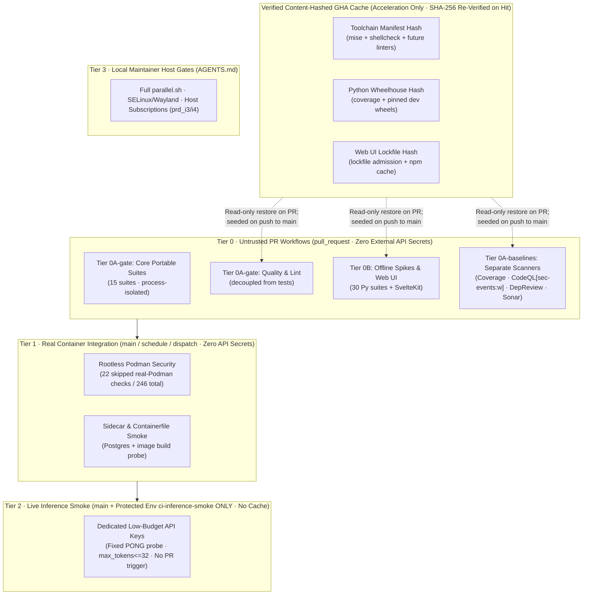

# prd_o · CI build & test duration trends, expanded test scope, and content-hashed GitHub Actions caching

[Index](README.md) · children:
[CI build & test duration trends and bottleneck analysis](prd_o1.md),
[CI test-scope expansion, integration tiers & secret-gated inference smoke tests](prd_o2.md),
[deterministic content-hashed GitHub Actions caching](prd_o3.md) ·
related:
[host tool dependencies](prd_f.md),
[credential broker](prd_i3.md),
[subscription lifecycle](prd_i4.md),
[contributor checks & repository layout](prd_k.md),
[composable sandbox plans](prd_l.md),
[control plane & Web UI](prd_m.md),
[durable workflows & supervision](prd_n.md)

## Executive summary

Hosted CI on `gorban/opencode-sandbox` (`origin/main` at `9b608f431eedf7e55137c6dfe1abead9ffd2cba8`)
successfully enforces a clean portable baseline (`oc-sandbox PR` + `oc-sandbox baselines` +
SonarQube Cloud), but an empirical audit of **257 historical workflow runs**
(`2026-11-21` through `2026-11-23`) reveals four growing gaps as the repository expands past
`85,286` lines of code:

1. **Duration trends & reliability drag ([prd_o1](prd_o1.md)):**
   - `oc-sandbox PR` has a steady **~99 s** median wall clock (`min 91 s`, `p90 137 s`, `max 286 s`),
     dominated by serial execution of `tests` (`p50 72 s`, of which `tests/security.sh` stubs take
     `~35.8 s` / `58%`) **followed by** `quality` (`needs: tests`, `p50 14 s`).
   - `oc-sandbox PR` had a **16.0% historical failure rate** (`21/131` runs overall; `8/50` in the
     last 100 runs), and **6/6 inspected recent failures** were unauthenticated GitHub API
     `403 Forbidden` rate-limit errors inside `tools/ci/toolchain.py` when `mise` verified
     `github:koalaman/shellcheck@0.9.0` artifact attestations from shared runner IPs — establishing
     a recurring infrastructure failure mode.
   - `oc-sandbox baselines` grew **+29% in 48 hours** (median `56 s -> 62 s -> 72 s`) as
     `CodeQL baseline (python)` scaled (`p50 70 s`, `max 89 s`) with newly merged spike modules.
2. **Test-scope gaps across spikes, UI, real containers, and basic inference ([prd_o2](prd_o2.md)):**
   - `tools/ci/run.py` runs **15** core suites under `tests/`, while **30 Python spike test modules**
     under `docs/prds/spikes/` (`l/`, `l_m_profile/`, `m/`, `n/`) and the SvelteKit/TypeScript UI
     project (`docs/prds/spikes/m/web-ui/`, pinned `package-lock.json`, `vite build`, `svelte-check`,
     3 `node --test` suites, 1 Playwright spec) do **not** run in GitHub Actions at all.
   - Real Podman security tests (`tests/security.sh` without `OC_TEST_NO_PODMAN=1`: `246` total
     checks, of which `224` already run stubbed and `22` real-Podman checks are skipped), real
     Postgres/sidecar parallel tests (`tests/parallel.sh`), and live basic LLM inference
     wire-contract checks are currently absent from hosted CI.
   - Answering whether GitHub Actions secrets are required: **no** for all Tier 0 PR gates and
     Tier 1 container integration tests, and **yes — strictly isolated to a dedicated Tier 2
     protected GitHub Environment (`ci-inference-smoke`) on `main` / `schedule` / `workflow_dispatch`
     only** if we add live basic inference smoke tests (never using personal OAuth/subscription
     credentials from [prd_i3](prd_i3.md)/[prd_i4](prd_i4.md), and never running on `pull_request`
     or fork code).
3. **Zero GitHub Actions caching today ([prd_o3](prd_o3.md)):**
   - The repository currently holds **`0` cache entries (`0` bytes)** out of GitHub's `10 GB`
     repository cache quota (`7`-day idle TTL).
   - Every PR run re-downloads `mise-v2026.10.21-linux-x64.tar.xz` (`<= 64 MiB` cap / `175 MB`
     extracted binary), `shellcheck-v0.9.0.linux.x86_64.tar.xz`, and
     `coverage-7.11.0-py3-none-any.whl` from PyPI. Once Node/SvelteKit (`npm`), additional Python
     wheels, and container builds join CI, uncached repeated runs during multi-PR bursts will
     multiply runner time and external rate-limit risk.
   - PRD O3 specifies **zero-trust, content-hashed caching**: cache keys hashed strictly from the
     exact pinned dependency list and checksums being pulled, exact-key restore (`restore-keys`
     omitted for executable artifacts), mandatory SHA-256 verification on every cache hit before
     execution, `main`-seeded warm caches with read-only PR restore (reducing routine PR cache
     churn while relying on ref-scoping, per-hit SHA-256 verification, and cold-run correctness
     after eviction), and **zero caching** in any secret-bearing Tier 2 job.
4. **Strict scope boundary:**
   - PRD O builds on [prd_k](prd_k.md) (contributor checks, SonarQube Cloud qualification, SBOM/Grype,
     and SSH remote acceptance) without modifying `prd_k` reservations or duplicating `prd_i3`/`prd_i4`
     local subscription acceptance work.

## Non-negotiable security invariants

Every implementation PR derived from PRD O must satisfy all six invariants and pass both
[implementation review gates](README.md#implementation-review-gates):

1. **Zero secrets on untrusted triggers:** `pull_request` workflows (Tier 0) and any fork-reachable
   job must carry zero repository/environment API secrets, minimal `permissions` (`contents: read`
   or `{}`), and `persist-credentials: false` on every `actions/checkout`. Never use
   `pull_request_target` to execute PR head code.
2. **Cache is untrusted acceleration, never a trust root:** Every cached executable, archive, or
   package restored from GitHub Actions cache must pass cryptographic SHA-256 verification against
   tracked lockfiles/manifests in the checked-out revision **before** execution. Omit loose
   `restore-keys` prefixes for executable toolchains and wheels.
3. **No cache in secret-bearing jobs:** Tier 2 live inference jobs must never read from or write to
   GitHub Actions cache, preventing cache-poisoning escalation into secret-bearing runners.
4. **Strict separation of CI API keys from personal subscriptions:** Tier 2 basic inference tests
   use dedicated, least-privilege, hard-capped CI API keys stored only in a protected GitHub
   Environment (`ci-inference-smoke`, restricted to `main` + optional required reviewer). Personal
   OAuth/subscription credentials (`prd_i3`/`prd_i4`) are never placed in GitHub Actions.
5. **No prompt injection, redirect exfiltration, or secret leakage in Tier 2:** Inference smoke
   tests send only static, hardcoded synthetic probes to hardcoded HTTPS provider endpoints (with
   `3xx` redirects refused, proxy/`*_BASE_URL` overrides scrubbed, step-scoped secrets, header-only
   Gemini keys, and no free-form `workflow_dispatch` inputs or custom checkout refs), enforce
   strict token/request/timeout caps, forbid uploading raw HTTP artifacts, and drop/redact raw
   response headers and raw error bodies before logging.
6. **Pinned workflow actions and exact SHA checks:** Every third-party GitHub Action is pinned to a
   full 40-hex commit SHA; `oc-sandbox PR` continues verifying the exact `GITHUB_SHA` (synthetic
   merge SHA on `pull_request`, or the `main` commit SHA when run on `push` to `main`) and keeps
   SonarQube Cloud green on both PRs and `main`.

## Phased rollout and open decisions

Implementation starts only after the maintainer resolves the `(decision needed)` items below and
each slice passes Gate 1 walkthrough review:

- **Phase O-A (Fast reliability & latency wins — 0.5–1 day):**
  - [ ] `(decision needed)` Approve decoupling `quality` from `needs: tests`, adding PR-only
    `concurrency` cancellation (`cancel-in-progress: ${{ github.event_name == 'pull_request' }}`
    with non-colliding group keys for `main`), and process-per-worker suite parallelism in
    `tools/ci/run.py` ([prd_o1](prd_o1.md#latency-reduction-and-reliability-options)).
  - [ ] `(decision needed)` Choose the `mise` 403 rate-limit remediation + verified toolchain
    caching strategy ([prd_o1](prd_o1.md#option-o1-b-eliminate-mise-403-rate-limit-failures),
    [prd_o3](prd_o3.md#cache-scoping-and-seeding-options)).
- **Phase O-B (Expanded offline PR test scope + package caching — 1–2 days):**
  - [ ] `(decision needed)` Choose how the 30 offline Python spike test modules and the
    `docs/prds/spikes/m/web-ui/` SvelteKit suite enter Tier 0 CI (always-on vs path-filtered vs
    promoted-only) ([prd_o2](prd_o2.md#tier-0b-offline-spike-suites-and-sveltekit-web-ui)).
  - [ ] `(decision needed)` Approve the canonical manifest-hashed cache key scheme and `<= 3 GB`
    quota budget ([prd_o3](prd_o3.md#content-hashed-cache-key-design)).
- **Phase O-C (Real container integration spike — 1–2 days):**
  - [ ] `(decision needed)` Approve an `ubuntu-24.04` hosted-runner feasibility spike for rootless
    Podman (`tests/security.sh` real mode) vs self-hosted/ephemeral runner vs keeping real Podman
    local-only ([prd_o2](prd_o2.md#tier-1-real-container-integration-tests)).
- **Phase O-D (Optional secret-gated basic inference smoke — 1–2 days):**
  - [ ] `(decision needed)` Decide whether to enable Tier 2 secret-gated basic live inference smoke
    tests under protected GitHub Environment `ci-inference-smoke` (`schedule` + `workflow_dispatch`
    on `main`), or keep live provider inference manual/local only
    ([prd_o2](prd_o2.md#tier-2-secret-gated-basic-live-inference-smoke-tests)).

## Child PRDs

- [prd_o1.md](prd_o1.md): Empirical CI duration trends (`257` runs), critical-path step timings,
  root cause of the `16%` `mise` 403 failure rate, and latency-reduction options.
- [prd_o2.md](prd_o2.md): Complete test-scope audit, 4-tier CI trust matrix, spike/UI/Podman
  integration options, and secret-gated basic inference smoke architecture.
- [prd_o3.md](prd_o3.md): GitHub Actions cache economics (`10 GB` / `7`-day TTL), canonical
  manifest-hashed keying by exact dependency list, zero-trust SHA-256 verification on cache hits,
  and seeding/eviction design.

- [ ] **Human review**: checked only when the user says so
