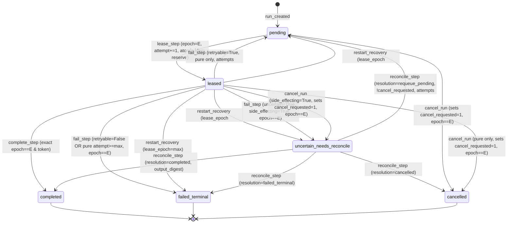

# PRD N Durable Workflow Restart & Replay Kernel Walkthrough (Gate 1)

Parent plans: [prd_n](../../../prd_n.md) · [prd_n1](../../../prd_n1.md) ·
Baseline spike: [docs/prds/spikes/n/WALKTHROUGH.md](../WALKTHROUGH.md) ·
Review gates: [implementation review gates](../../../README.md#implementation-review-gates)

---

## 1. Scope, Core Kernel Invariant, and Explicit Non-Goals

This Gate 1 walkthrough specifies a small, self-contained, 100% offline qualification slice under
`docs/prds/spikes/n/restart/` proving **one core durable workflow kernel invariant**:

> **Core Invariant — Lease-Epoch-Fenced Idempotent Step Recovery Across SQLite WAL Restarts:**
> A crashed and restarted workflow supervisor resumes cleanly from durable SQLite WAL state with a
> strictly monotonic persisted `supervisor_epoch >= 1`, **never double-executes** an
> already-committed or in-flight-uncertain side-effecting step, **fences out every stale-epoch
> heartbeat, completion, failure, or reconciliation** from prior epochs
> (`lease_epoch != current_epoch`), prevents `idempotency_key` reuse across crashes/retries, and
> preserves a gap-free, unbroken SHA-256 hash-chained event log whose pure replay from `seq 0`
> reconstructs the **exact** materialized run, step, idempotency, reconciliation, and shutdown
> state across arbitrary crash/restart sequences.

### Owned File Boundary (Strictly Disjoint)

All documents, modules, and tests for this lane live exclusively under
`docs/prds/spikes/n/restart/`:

1. `docs/prds/spikes/n/restart/WALKTHROUGH.md` — this Gate 1 walkthrough (reviewed before any
   Python code is written).
2. `docs/prds/spikes/n/restart/oc_restart_contract.py` — frozen dataclasses, closed enums, hard
   bounds, exception hierarchy, strict `allow_nan=False` canonical JSON & depth-bounded parser,
   domain-separated SHA-256 hash-chain codec, shared `compute_run_status()`, and pure deterministic
   state-machine reducer `reduce_event_log()`.
3. `docs/prds/spikes/n/restart/oc_restart_journal.py` — hardened SQLite WAL durable journal
   (`WorkflowRestartJournal`), verification-first filesystem admission, exclusive single-supervisor
   `flock` lockfile, scoped per-operation monotonic deadlines, SQLite non-`STRICT` storage-class
   gated reads, atomic `BEGIN IMMEDIATE` epoch-fenced recovery, and lock-free read-only replay
   verifier (`verify_journal_replay_readonly()`).
4. `docs/prds/spikes/n/restart/oc_restart_harness.py` — deterministic crash-point fault-injecting
   supervisor (`DurableWorkflowSupervisor`), external `SyntheticEffectTracker`, explicit
   idempotent reconciler, and read-only plan-binding adapter.
5. `docs/prds/spikes/n/restart/test_workflow_restart.py` — exhaustive stdlib `unittest` offline
   qualification suite covering every crash, fencing, idempotency, replay-tampering, storage-class,
   deadline, and filesystem-boundary scenario.

### Read-Only Imports (Zero Edits Outside `docs/prds/spikes/n/restart/`)

This slice uses **pure Python standard library** plus strictly read-only imports from existing
merged spike modules (zero modifications to any shared or parent file):

- `docs/prds/spikes/n/oc_workflow_schema.py`: `ALLOWED_EFFECTS`, `WorkflowSpec`,
  `WorkflowSchemaError`, `canonical_json_bytes`, `domain_sha256`, `parse_strict_bool`,
  `parse_strict_int`, `validate_clean_str`.
- `docs/prds/spikes/n/oc_workflow_plan.py`: `OBSERVE_ONLY_ALLOWED_EFFECTS`, `AdmissionReceipt`,
  `AuthorityError`, `ClockSnapshot`, `CompiledWorkflowPlan`, `RunAuthorityStore`,
  `WorkflowPlanError`, `recompute_plan_digests`.
- `docs/prds/spikes/n/oc_workflow_supervision.py`: `ProgressFingerprint` (optional host-verified
  progress evidence digested into reconciliation receipts).
- `docs/prds/spikes/l/oc_schema.py`: `PolicyError`, `assert_trusted_dir`,
  `check_not_host_production_dir`, `check_not_in_sandbox`.
- `docs/prds/spikes/l/oc_broker_common.py`: `_UMASK_LOCK`.

### Explicit Non-Goals

- **Zero live actions:** No Podman, no network/HTTP/UDS sockets, no live LLM providers, no SSH
  workers, no real `oc_hub` transport or `oc_controller` daemon wiring.
- **Zero host-state mutation:** Never touches real `~/.config/oc-sandbox`,
  `~/.local/share/oc-sandbox`, or `~/opencode-sandbox`; all test fixtures run inside disposable
  owner-only (`0o700`) temporary directories.
- **Zero shared-file edits:** Does not modify `oc-sandbox`, `oc-bridge.py`, `oc_coord_contract.py`,
  `oc_registry.py`, `oc_hub.py`, `oc_projection*.py`, `docs/prds/spikes/n/oc_workflow_*.py`, or
  any PRD `Human review` checkbox.
- **Zero open product decisions resolved:** Leaves PRD N1's open restart UX decision (Option A:
  batched Tier-A "Resume N paused workflows" card vs. Option B: opt-in signed durable auto-resume,
  [prd_n1.md](../../../prd_n1.md#concrete-checkboxes-and-open-decisions)) completely open; this
  lane qualifies the lower-level epoch-fencing, uncertain-step settlement, and replay-parity kernel
  substrate required by both options.

---

## 2. Trust Boundaries, Hardened Filesystem Admission, & SQLite WAL Discipline

### 2.1 Filesystem Admission (Strict Parity with `docs/prds/spikes/m/oc_registry.py` & `docs/prds/spikes/m/projection/oc_projection_db.py`)

Every open—both read-write supervisor boot (`WorkflowRestartJournal.open_and_recover`) and lock-free
read-only replay inspection (`verify_journal_replay_readonly`)—enforces strict verification-first
filesystem admission:

```python
_DB_FILENAME = "workflow_restart.sqlite"
_DB_ALL_FILES = ("", "-wal", "-shm", "-journal")
_LOCK_FILENAME = ".workflow_restart.lock"

function assert_raw_no_user_symlink_ancestors(raw: Path) -> None:
    # Preserve '..' lexically (never call normpath/resolve first!) so a path like
    # /tmp/user_symlink/../safe inspects /tmp/user_symlink via os.lstat and fails closed.
    anchored = raw if raw.is_absolute() else (Path.cwd() / raw)
    parts = anchored.parts
    if not parts:
        return
    acc = Path(parts[0])
    for idx, part in enumerate(parts):
        if idx > 0:
            acc = acc / part
        try:
            st = os.lstat(acc)
            if stat.S_ISLNK(st.st_mode) and st.st_uid != 0:
                raise RestartStorageError(f"state_dir_symlink_ancestor_rejected: {acc}")
        except FileNotFoundError:
            pass
        except OSError as exc:
            raise RestartStorageError(f"state_dir_ancestor_unreadable: {acc}") from exc

function assert_existing_ancestors_trusted(phys: Path) -> None:
    # Walk up to deepest existing ancestor, then verify every ancestor up to '/' is a
    # non-symlink directory owned by euid or root and not group/world-writable unless root sticky.
    uid = os.geteuid()
    cur = phys
    while not cur.exists() and cur.parent != cur:
        cur = cur.parent
    while True:
        try:
            st = os.lstat(cur)
        except OSError as exc:
            raise RestartStorageError(f"state_dir_ancestor_unreadable: {cur}") from exc
        if stat.S_ISLNK(st.st_mode) or not stat.S_ISDIR(st.st_mode):
            raise RestartStorageError(f"state_dir_ancestor_not_dir: {cur}")
        if st.st_uid not in (uid, 0):
            raise RestartStorageError(f"state_dir_ancestor_wrong_owner: {cur}")
        is_root_sticky = st.st_uid == 0 and bool(st.st_mode & stat.S_ISVTX)
        if (st.st_mode & 0o022) != 0 and not is_root_sticky:
            raise RestartStorageError(f"state_dir_ancestor_writable: {cur}")
        if cur.parent == cur:
            break
        cur = cur.parent

function create_private_dir_locked(phys: Path, *, deadline: float) -> None:
    # Create only the missing leaf state_dir under _UMASK_LOCK + umask(0o077) with mode 0o700.
    # Require phys.parent to already exist and pass ancestor checks; NEVER chmod an existing dir!
    if not phys.parent.exists():
        raise RestartStorageError("state_dir_parent_missing")
    remaining_s = check_deadline_s(deadline)
    if not _UMASK_LOCK.acquire(timeout=remaining_s):
        raise RestartStorageError("op_deadline_exceeded")
    try:
        check_deadline_ms(deadline)
        old_umask = os.umask(0o077)
        try:
            os.mkdir(phys, 0o700)
        except FileExistsError:
            # Concurrent creation; post-check verifies exact mode 0o700 without chmod repair.
            pass
        except OSError as exc:
            raise RestartStorageError("state_dir_create_failed") from exc
        finally:
            os.umask(old_umask)
    finally:
        _UMASK_LOCK.release()

function verify_regular_private_file_nofollow(
    path: Path, *, required: bool, label: str
) -> None:
    # Always open O_RDONLY | O_NOFOLLOW | O_NONBLOCK so a pre-placed FIFO cannot hang!
    try:
        fd = os.open(path, os.O_RDONLY | os.O_NOFOLLOW | os.O_NONBLOCK)
    except FileNotFoundError as exc:
        if required:
            raise RestartStorageError(f"{label}_missing") from exc
        return
    except OSError as exc:
        if exc.errno == errno.ELOOP:
            raise RestartStorageError(f"{label}_symlink_rejected") from exc
        raise RestartStorageError(f"{label}_unreadable") from exc
    try:
        st = os.fstat(fd)
        if not stat.S_ISREG(st.st_mode):
            raise RestartStorageError(f"{label}_not_regular")
        if st.st_nlink != 1:
            raise RestartStorageError(f"{label}_hardlink_rejected")
        if st.st_uid != os.geteuid():
            raise RestartStorageError(f"{label}_wrong_owner")
        if stat.S_IMODE(st.st_mode) != 0o600:
            raise RestartStorageError(f"{label}_unsafe_mode")
    finally:
        os.close(fd)

function verify_all_db_files(db_path: Path, *, required_main: bool) -> None:
    for idx, suffix in enumerate(_DB_ALL_FILES):
        label = "journal_db" if idx == 0 else f"journal_sidecar_{suffix.lstrip('-')}"
        verify_regular_private_file_nofollow(
            Path(f"{db_path}{suffix}"),
            required=(idx == 0 and required_main),
            label=label,
        )

function admit_state_dir(
    state_dir: Path,
    *,
    sandbox_root: Path | None,
    create_if_missing: bool,
    deadline: float,
) -> tuple[Path, Path]:
    raw = Path(state_dir)
    if raw.is_symlink():
        raise RestartStorageError("state_dir_symlink_rejected")
    assert_raw_no_user_symlink_ancestors(raw)
    try:
        phys = check_not_in_sandbox(raw, sandbox_root)
        check_not_host_production_dir(raw)
        check_not_host_production_dir(phys)
    except PolicyError as exc:
        raise RestartStorageError(str(exc)) from exc
    if phys.is_symlink():
        raise RestartStorageError("state_dir_symlink_rejected")
    if not phys.exists():
        if not create_if_missing:
            raise RestartStorageError("state_dir_missing")
        assert_existing_ancestors_trusted(phys)
        create_private_dir_locked(phys, deadline=deadline)
    try:
        trusted_dir = assert_trusted_dir(phys, sandbox_root=sandbox_root)
    except PolicyError as exc:
        raise RestartStorageError(str(exc)) from exc
    dir_st = os.lstat(trusted_dir)
    if stat.S_IMODE(dir_st.st_mode) != 0o700:
        raise RestartStorageError("state_dir_unsafe_mode")
    db_path = trusted_dir / _DB_FILENAME
    verify_all_db_files(db_path, required_main=(not create_if_missing))
    return trusted_dir, db_path
```

Key admission invariants:
- **Never repairs unsafe permissions:** An existing `state_dir` with mode `!= 0o700` (e.g., `0o755`,
  `0o770`, or `0o500`) or an existing DB/sidecar/lockfile with mode `!= 0o600` (e.g., `0o644`)
  fails closed immediately without calling `chmod` / `fchmod`.
- **Non-blocking FIFO/device defense:** Every file probe uses `O_RDONLY | O_NOFOLLOW | O_NONBLOCK`
  before `os.fstat(fd)`, rejecting symlinks (`ELOOP`), FIFOs/sockets/devices (`not S_ISREG`),
  hardlinks (`st_nlink != 1`), and foreign owners (`st_uid != os.geteuid()`).
- **Raw `..`-preserving symlink-ancestor defense:** Rejects non-root symlinks along the raw lexical
  path before `check_not_in_sandbox` resolves symlinks or `..`, maps unexpected `OSError` to
  `RestartStorageError`, and permits root-owned OS directory aliases (e.g., `/home -> /var/home` on
  Fedora Atomic).
- **Host production & sandbox exclusion:** Both raw and resolved paths are checked via
  `check_not_in_sandbox` and `check_not_host_production_dir`.

### 2.2 Exclusive Supervisor Lockfile, Post-Lock DB Re-Verification, & Lock-Free Read-Only Replay

- **Active supervisor lock (`.workflow_restart.lock`):**
  - Opened under `_UMASK_LOCK` + `umask(0o077)` with `O_CREAT | O_RDWR | O_NOFOLLOW | O_NONBLOCK`
    at mode `0o600`.
  - Immediately `fstat`ed to verify `S_ISREG`, `st_nlink == 1`, `st_uid == os.geteuid()`, and exact
    `0o600` (rejecting pre-existing `0o644`, symlink, FIFO, or hardlink without repairing modes!).
  - Acquires `fcntl.flock(fd, fcntl.LOCK_EX | fcntl.LOCK_NB)` (failing closed immediately with
    `RestartStorageError("supervisor_lock_held")` if another live supervisor holds the journal).
  - Verifies post-`flock` inode identity (`os.lstat(lock_path)` matches `os.fstat(fd)` `(st_dev,
    st_ino)`) to prevent unlinked-file lock races.
  - **Post-lock DB file re-verification:** Immediately *after* acquiring `.workflow_restart.lock`
    and *before* opening SQLite, re-runs `verify_all_db_files(db_path, required_main=False)` to
    close any TOCTOU window between pre-lock directory admission and exclusive lock acquisition.
  - On simulated crash (`simulate_crash()`), the harness abruptly closes the SQLite connection and
    lock FD **without** emitting `supervisor_stopped`, leaving `dirty_shutdown = 1` in SQLite.
- **Lock-free read-only replay verifier (`verify_journal_replay_readonly`):**
  - Never creates files, never acquires `.workflow_restart.lock`, and opens SQLite strictly with
    `file:<quoted_path>?mode=ro` + `PRAGMA query_only = ON` + `PRAGMA trusted_schema = OFF` +
    `PRAGMA cell_size_check = ON` + `PRAGMA temp_store = MEMORY` + `BEGIN DEFERRED` / `ROLLBACK`
    (exact `docs/prds/spikes/m/projection/oc_projection_db.py` discipline).

### 2.3 Scoped Monotonic Deadlines, Lock-Safe Pragma Order, & `_UMASK_LOCK` Hygiene

Every journal open, transaction, and replay operation accepts `max_op_ms: int`
(`50 <= max_op_ms <= 10_000`, default `2000`, rejecting `bool`/non-`int`) and computes **one single
monotonic deadline**: `deadline = time.monotonic() + (max_op_ms / 1000.0)`.

```python
@contextmanager
function scoped_op_deadline(conn: sqlite3.Connection, deadline: float) -> Iterator[None]:
    # Install busy_timeout + VM progress handler for THIS operation only, and unconditionally
    # clear conn.set_progress_handler(None, 0) in finally: so a boot deadline NEVER leaks onto
    # subsequent operations sharing the persistent supervisor connection!
    apply_remaining_busy_timeout(conn, deadline)
    install_progress_deadline(conn, deadline)
    try:
        yield
    except sqlite3.OperationalError as exc:
        raise map_sqlite_error(exc, deadline) from exc
    except sqlite3.DatabaseError as exc:
        raise RestartStorageError("journal_db_corrupt") from exc
    finally:
        try:
            conn.set_progress_handler(None, 0)
        except sqlite3.Error:
            pass

function open_sqlite_bounded(db_path: Path, *, readonly: bool, deadline: float) -> sqlite3.Connection:
    # 1. Validate & build SQLite URI BEFORE acquiring _UMASK_LOCK so a surrogate-escaped POSIX path
    #    (UnicodeEncodeError) can never strand _UMASK_LOCK.
    try:
        mode = "ro" if readonly else "rwc"
        uri = f"file:{quote(str(db_path), safe='/')}?mode={mode}"
    except UnicodeEncodeError as exc:
        raise RestartStorageError("journal_uri_unencodable") from exc

    # 2. Acquire _UMASK_LOCK bounded by remaining deadline; recompute remaining budget AFTER lock
    #    acquisition so expiry prevents calling sqlite3.connect() at all!
    remaining_s = check_deadline_s(deadline)
    if not _UMASK_LOCK.acquire(timeout=remaining_s):
        raise RestartStorageError("op_deadline_exceeded")
    conn = None
    try:
        remaining_ms = check_deadline_ms(deadline)
        old_umask = os.umask(0o077)
        try:
            conn = sqlite3.connect(
                uri,
                uri=True,
                isolation_level=None,
                timeout=max(0.001, remaining_ms / 1000.0),
                check_same_thread=False,
            )
            conn.row_factory = dict_row_factory
            # 3. Install connection-local safety pragmas, busy_timeout, AND progress handler BEFORE
            #    any lock-acquiring pragma (such as PRAGMA journal_mode = WAL)!
            conn.execute("PRAGMA temp_store = MEMORY")
            conn.execute("PRAGMA trusted_schema = OFF")
            conn.execute("PRAGMA cell_size_check = ON")
            conn.execute("PRAGMA foreign_keys = ON")
            with scoped_op_deadline(conn, deadline):
                if readonly:
                    conn.execute("PRAGMA query_only = ON")
                else:
                    conn.execute("PRAGMA journal_mode = WAL")
                    conn.execute("PRAGMA synchronous = FULL")
            return conn
        except BaseException:
            safe_close(conn)
            raise
        finally:
            os.umask(old_umask)
    finally:
        _UMASK_LOCK.release()
```

- **Schema-object integrity guard (`verify_no_unexpected_schema_objects`):** Inside both boot and
  read-only replay transactions, query:
  ```sql
  SELECT type, name FROM sqlite_master WHERE type IN ('trigger', 'view') LIMIT 1
  ```
  If ANY trigger or view exists -> fail closed immediately with
  `JournalIntegrityError("unexpected_schema_object")` (blocking malicious SQLite triggers or forged
  views masquerading as tables). Also verify all 6 core tables exist with `type = 'table'` on
  non-empty / read-only opens.
- **Zero FD leaks:** Every error path inside open, recovery, transaction, or read-only replay
  unconditionally rolls back and closes the SQLite connection (and releases `.workflow_restart.lock`
  on boot failure).

---

## 3. Durable SQLite Schema, Non-`STRICT` Storage-Class Gates, & Hash Chain

### 3.1 SQLite Tables (`workflow_restart.sqlite`)

```sql
-- Single-row supervisor durability & hash-chain head anchor
CREATE TABLE IF NOT EXISTS supervisor_meta (
    id INTEGER PRIMARY KEY CHECK (id = 1),
    current_epoch INTEGER NOT NULL CHECK (current_epoch >= 1),
    last_event_seq INTEGER NOT NULL CHECK (last_event_seq >= 0),
    head_hash TEXT NOT NULL,
    dirty_shutdown INTEGER NOT NULL CHECK (dirty_shutdown IN (0, 1)),
    updated_at_us INTEGER NOT NULL CHECK (updated_at_us >= 0)
);

-- Durable workflow run state pinned to immutable CompiledWorkflowPlan digests
CREATE TABLE IF NOT EXISTS workflow_runs (
    run_id TEXT PRIMARY KEY,
    workflow_id TEXT NOT NULL,
    spec_digest TEXT NOT NULL,
    workflow_plan_digest TEXT NOT NULL,
    grant_generation INTEGER NOT NULL CHECK (grant_generation >= 1),
    status TEXT NOT NULL,
    cancel_requested INTEGER NOT NULL DEFAULT 0 CHECK (cancel_requested IN (0, 1)),
    created_epoch INTEGER NOT NULL CHECK (created_epoch >= 1),
    created_at_us INTEGER NOT NULL CHECK (created_at_us >= 0),
    updated_at_us INTEGER NOT NULL CHECK (updated_at_us >= 0)
);

-- Durable per-step state machine & fencing token state
CREATE TABLE IF NOT EXISTS workflow_steps (
    run_id TEXT NOT NULL,
    step_id TEXT NOT NULL,
    step_order INTEGER NOT NULL CHECK (step_order >= 0),
    state_name TEXT NOT NULL,
    effect_kind TEXT NOT NULL,
    side_effecting INTEGER NOT NULL CHECK (side_effecting IN (0, 1)),
    depends_on_json TEXT NOT NULL,
    max_attempts INTEGER NOT NULL CHECK (max_attempts >= 1),
    status TEXT NOT NULL,
    attempt_no INTEGER NOT NULL CHECK (attempt_no >= 0),
    lease_epoch INTEGER NOT NULL CHECK (lease_epoch >= 0),
    idempotency_key TEXT,
    output_digest TEXT,
    failure_reason TEXT,
    updated_at_us INTEGER NOT NULL CHECK (updated_at_us >= 0),
    PRIMARY KEY (run_id, step_id),
    FOREIGN KEY (run_id) REFERENCES workflow_runs(run_id)
);

-- Durable per-run idempotency registry reserved ATOMICALLY at lease_step time (never deleted!)
CREATE TABLE IF NOT EXISTS step_idempotency_keys (
    run_id TEXT NOT NULL,
    idempotency_key TEXT NOT NULL,
    step_id TEXT NOT NULL,
    attempt_no INTEGER NOT NULL CHECK (attempt_no >= 1),
    lease_epoch INTEGER NOT NULL CHECK (lease_epoch >= 1),
    outcome_status TEXT NOT NULL,
    output_digest TEXT,
    failure_reason TEXT,
    recorded_seq INTEGER NOT NULL CHECK (recorded_seq >= 1),
    PRIMARY KEY (run_id, idempotency_key),
    UNIQUE (run_id, step_id, attempt_no),
    FOREIGN KEY (run_id, step_id) REFERENCES workflow_steps(run_id, step_id)
);

-- Durable reconciliation receipts for uncertain side-effecting steps
CREATE TABLE IF NOT EXISTS step_reconciliations (
    run_id TEXT NOT NULL,
    reconciliation_key TEXT NOT NULL,
    step_id TEXT NOT NULL,
    attempt_no INTEGER NOT NULL CHECK (attempt_no >= 1),
    reconciled_epoch INTEGER NOT NULL CHECK (reconciled_epoch >= 1),
    resolution TEXT NOT NULL,
    output_digest TEXT,
    evidence_digest TEXT NOT NULL,
    reason TEXT NOT NULL,
    recorded_seq INTEGER NOT NULL CHECK (recorded_seq >= 1),
    PRIMARY KEY (run_id, reconciliation_key),
    FOREIGN KEY (run_id, step_id) REFERENCES workflow_steps(run_id, step_id)
);

-- Append-only SHA-256 hash-chained event journal (seq 1..last_event_seq, zero gaps)
CREATE TABLE IF NOT EXISTS workflow_event_log (
    seq INTEGER PRIMARY KEY,
    supervisor_epoch INTEGER NOT NULL CHECK (supervisor_epoch >= 1),
    event_type TEXT NOT NULL,
    run_id TEXT,
    step_id TEXT,
    payload_json TEXT NOT NULL,
    created_at_us INTEGER NOT NULL CHECK (created_at_us >= 0),
    prev_hash TEXT NOT NULL,
    entry_hash TEXT NOT NULL
);
```

### 3.2 Exact Integer Timestamps, Canonical JSON Pre-Scan, & Domain-Separated Hash Chain

- **Strict `ClockSnapshot` & signed-64-bit bounds:**
  - Every `ClockSnapshot(monotonic_s, wall_s)` is validated finite, non-bool, `monotonic_s >= 0`,
    `wall_s >= 0`, and `created_at_us = round(clock.wall_s * 1_000_000)` within
    `0 <= created_at_us <= MAX_INT64` (`(1 << 63) - 1`).
  - `grant_generation`, `supervisor_epoch`, and `seq` are strictly bounded within
    `1 <= val <= MAX_INT64`.
- **Genesis hash & entry hash (`EVENT_GENESIS_HASH = "0" * 64`, `EVENT_HASH_DOMAIN = "oc-wf-restart-event-v1:"`):**
  ```python
  entry_hash = domain_sha256(
      EVENT_HASH_DOMAIN,
      {
          "created_at_us": event.created_at_us,
          "event_type": event.event_type,
          "payload": event.payload,       # decoded canonical dict, depth <= 8, zero floats
          "prev_hash": event.prev_hash,
          "run_id": event.run_id,
          "seq": event.seq,
          "step_id": event.step_id,
          "supervisor_epoch": event.supervisor_epoch,
      },
  )
  ```
- **Depth-pre-scanned, duplicate-key-rejecting, byte-canonical JSON decode (`parse_canonical_json_blob`):**
  Used on EVERY `payload_json` and `depends_on_json` cell read from SQLite:
  1. Require `len(raw_blob) <= MAX_EVENT_PAYLOAD_BYTES` (`16_384`); decode strict UTF-8 (else
     `JournalIntegrityError("invalid_utf8_json")`).
  2. **O(N) nesting-depth pre-scan BEFORE `json.loads()`:** Walk characters tracking `in_string` /
     `escaped` state; increment `depth` on `{`/`[`, decrement on `}`/`]`; immediately raise
     `JournalIntegrityError("json_depth_exceeded")` if `depth > MAX_JSON_DEPTH` (`8`) or
     `depth < 0`. This defeats 16 KiB nested-bracket `RecursionError` DoS before entering Python's
     recursive JSON parser (and still catches `(json.JSONDecodeError, RecursionError, ValueError)`
     -> `JournalIntegrityError`).
  3. Call `json.loads(text, object_pairs_hook=_reject_duplicate_keys, parse_float=_reject_floats, parse_constant=_reject_constants)`:
     - Duplicate object keys -> `JournalIntegrityError("duplicate_json_key")`.
     - Any float or `NaN`/`Inf`/`-Inf` -> `JournalIntegrityError("disallowed_json_float")`.
  4. Recursively validate every decoded key/string leaf via `validate_clean_str(..., allow_empty=True)`
     (zero NUL, C0/DEL/C1 control, BiDi, or unpaired surrogates) and every integer within signed
     64-bit bounds.
  5. **Strict byte-for-byte canonical check:** Require
     `raw_blob == canonical_json_bytes(decoded)`! Any reordered keys, extra whitespace, duplicate
     keys, or non-canonical escaping in stored `payload_json` or `depends_on_json` fails closed
     immediately with `JournalIntegrityError("non_canonical_payload_json")`!
- **Event-sourced clean shutdown (`EventType.SUPERVISOR_STOPPED`):**
  - `close_clean(clock)` appends a hash-chained `supervisor_stopped` event under `current_epoch`
    and sets `supervisor_meta.dirty_shutdown = 0` atomically inside `BEGIN IMMEDIATE`.
  - `reduce_event_log()` tracks `dirty_shutdown` (`1` on `supervisor_started`, `0` on
    `supervisor_stopped`) so `supervisor_meta.dirty_shutdown` is verified during replay parity,
    while recovery fencing of any `leased` step with `lease_epoch < new_epoch` remains
    **unconditional** regardless of `dirty_shutdown`.

### 3.3 SQLite Non-`STRICT` Storage-Class & Cell-Size Gating on Every Read

Because SQLite tables without `STRICT` permit arbitrary `BLOB`, `TEXT`, `REAL`, or `NULL` values
to be injected into declared `INTEGER` or `TEXT` columns via tampered DB files, **every SQL read in
`oc_restart_journal.py` gates storage class and byte length inside SQL before values cross into
Python**:

| Column Class | Exact Covered Columns | SQL Projection Pattern | Failure Action |
|---|---|---|---|
| Singleton anchor `id` | `supervisor_meta.id` | `CASE WHEN typeof(id) = 'integer' AND id = 1 THEN id ELSE NULL END AS id, (typeof(id) != 'integer' OR id != 1) AS id_malformed` | `JournalIntegrityError("malformed_storage_class")` |
| Required `INTEGER` | `supervisor_meta.(current_epoch, last_event_seq, updated_at_us)`, `workflow_runs.(grant_generation, created_epoch, created_at_us, updated_at_us)`, `workflow_steps.(step_order, max_attempts, attempt_no, lease_epoch, updated_at_us)`, `step_idempotency_keys.(attempt_no, lease_epoch, recorded_seq)`, `step_reconciliations.(attempt_no, reconciled_epoch, recorded_seq)`, `workflow_event_log.(seq, supervisor_epoch, created_at_us)` | `CASE WHEN typeof(col) = 'integer' THEN col ELSE NULL END AS col, (typeof(col) != 'integer') AS col_malformed` | `JournalIntegrityError("malformed_storage_class")` |
| Boolean `INTEGER` flag | `supervisor_meta.dirty_shutdown`, `workflow_runs.cancel_requested`, `workflow_steps.side_effecting` | `CASE WHEN typeof(col) = 'integer' AND col IN (0, 1) THEN col ELSE NULL END AS col, (typeof(col) != 'integer' OR col NOT IN (0, 1)) AS col_malformed` | `JournalIntegrityError("malformed_storage_class")` |
| Required 64-hex SHA-256 | `supervisor_meta.head_hash`, `workflow_runs.(spec_digest, workflow_plan_digest)`, `step_reconciliations.evidence_digest`, `workflow_event_log.(prev_hash, entry_hash)` | `CASE WHEN typeof(col) = 'text' AND LENGTH(CAST(col AS BLOB)) = 64 THEN col ELSE NULL END AS col, (typeof(col) != 'text' OR LENGTH(CAST(col AS BLOB)) != 64) AS col_malformed` | `JournalIntegrityError("malformed_storage_class")` |
| Nullable 64-hex SHA-256 | `workflow_steps.output_digest`, `step_idempotency_keys.output_digest`, `step_reconciliations.output_digest` | `CASE WHEN col IS NULL THEN NULL WHEN typeof(col) = 'text' AND LENGTH(CAST(col AS BLOB)) = 64 THEN col ELSE NULL END AS col, (col IS NOT NULL AND (typeof(col) != 'text' OR LENGTH(CAST(col AS BLOB)) != 64)) AS col_malformed` | `JournalIntegrityError("malformed_storage_class")` |
| Required bounded `TEXT` | `workflow_runs.(run_id, workflow_id, status)`, `workflow_steps.(run_id, step_id, state_name, effect_kind, status)`, `step_idempotency_keys.(run_id, idempotency_key, step_id, outcome_status)`, `step_reconciliations.(run_id, reconciliation_key, step_id, resolution, reason)`, `workflow_event_log.event_type` | `CASE WHEN typeof(col) = 'text' AND LENGTH(CAST(col AS BLOB)) <= cap THEN col ELSE NULL END AS col, (typeof(col) != 'text' OR LENGTH(CAST(col AS BLOB)) > cap) AS col_malformed` (`cap=64` for enums/statuses, `128` for IDs/keys, `256` for reasons) | `JournalIntegrityError("malformed_storage_class")` |
| Nullable bounded `TEXT` | `workflow_steps.(idempotency_key, failure_reason)`, `step_idempotency_keys.failure_reason`, `workflow_event_log.(run_id, step_id)` | Nullable variant of above (`col IS NOT NULL AND (...)`) | `JournalIntegrityError("malformed_storage_class")` |
| Bounded canonical JSON | `workflow_event_log.payload_json`, `workflow_steps.depends_on_json` | `CASE WHEN typeof(col) = 'text' AND LENGTH(CAST(col AS BLOB)) <= 16384 THEN CAST(col AS BLOB) ELSE NULL END AS col_blob, (typeof(col) != 'text' OR LENGTH(CAST(col AS BLOB)) > 16384) AS col_malformed` | `JournalIntegrityError("malformed_storage_class")` |

Additional Python-side validation on decoded rows:
- Every SHA-256 digest column is validated strictly against `^[0-9a-f]{64}$` (`re.ASCII`) — rejecting
  `"z" * 64` or uppercase hex.
- Every enum/status column (`status`, `outcome_status`, `resolution`, `event_type`, `effect_kind`) is
  validated against its closed enum/set.
- **Bounded row streaming & parity caps:**
  - `supervisor_meta` is queried with `LIMIT 2` (asserting `len == 0` only when all 5 other tables
    are empty during RW init, and `len == 1` with `id == 1` and `last_event_seq >= 1` otherwise).
  - `workflow_event_log` is streamed with `ORDER BY seq ASC LIMIT (MAX_REPLAY_EVENTS + 1)` with
    periodic `check_deadline_ms(deadline)` checks; `> MAX_REPLAY_EVENTS` rows raises
    `JournalIntegrityError("replay_event_limit_exceeded")`.
  - Every materialized table (`workflow_runs`, `workflow_steps`, `step_idempotency_keys`,
    `step_reconciliations`) is read with `LIMIT (len(replayed_table) + 1)` and periodic deadline
    checks; exceeding `len(replayed_table)` immediately raises
    `ReplayMismatchError("unexpected_extra_materialized_rows")`.

---

## 4. Durable Step State Machine, Epoch Fencing, & Idempotency Rules

### 4.1 Closed State Machine, `cancel_requested`, & Shared `compute_run_status()`



- **Fail-closed `side_effecting` classification invariant:**
  - `PURE_IDEMPOTENT_EFFECTS = frozenset({"read_metrics", "update_health_projection"})` (strict
    subset of `oc_workflow_plan.OBSERVE_ONLY_ALLOWED_EFFECTS`).
  - Any `StepSpec` whose `effect_kind` is outside `PURE_IDEMPOTENT_EFFECTS` MUST have
    `side_effecting = True` (otherwise `RestartValidationError("mutating_effect_must_be_side_effecting")`).
- **One shared pure `compute_run_status(steps, *, cancel_requested: bool) -> RunStatus`** (used
  identically by every SQLite write transaction and by `reduce_event_log()`):
  ```python
  function compute_run_status(
      steps: Mapping[str, WorkflowStepRecord],
      *,
      cancel_requested: bool,
  ) -> RunStatus:
      statuses = {step.status for step in steps.values()}
      if StepStatus.UNCERTAIN_NEEDS_RECONCILE in statuses:
          return RunStatus.PAUSED_NEEDS_RECONCILE
      if cancel_requested:
          return RunStatus.CANCELLED
      if StepStatus.FAILED_TERMINAL in statuses:
          if StepStatus.PENDING not in statuses and StepStatus.LEASED not in statuses:
              return RunStatus.FAILED
          return RunStatus.RUNNING
      if statuses == {StepStatus.COMPLETED}:
          return RunStatus.COMPLETED
      if StepStatus.PENDING in statuses or StepStatus.LEASED in statuses:
          return RunStatus.RUNNING
      return RunStatus.CANCELLED
  ```
- **Non-resurrectable cancellation invariant:**
  - `cancel_run(run_id, reason, clock)` is allowed only on `RUNNING` or `PAUSED_NEEDS_RECONCILE`
    runs with `cancel_requested == False` (rejects already-terminal or already-cancel-requested
    runs with `InvalidStepTransitionError`).
  - Atomically sets `workflow_runs.cancel_requested = 1`, cancels all `pending` steps and `leased`
    pure steps (`step_idempotency_keys.outcome_status = 'cancelled'`), transitions any `leased`
    `side_effecting=True` steps to `uncertain_needs_reconcile` (`outcome_status =
    'uncertain_needs_reconcile'`), appends `run_cancelled`, and sets
    `workflow_runs.status = compute_run_status(steps, cancel_requested=True)`.
  - Once `cancel_requested == 1`, `reconcile_step(..., resolution="requeue_pending")` is
    **unconditionally forbidden** (`InvalidStepTransitionError("cannot_requeue_cancelled_or_exhausted_step")`)
    so a cancelled run can NEVER be resurrected back into `RUNNING`.

### 4.2 Atomic `idempotency_key` Reservation, Epoch Precedence, & Exact Callback Semantics

Every leased step binds an immutable 5-tuple fencing token:

```python
@dataclass(frozen=True)
class StepLeaseToken:
    run_id: str
    step_id: str
    attempt_no: int        # >= 1, strictly monotonic per step
    lease_epoch: int       # == supervisor_epoch at lease commit
    idempotency_key: str   # unique within run_id (<= 128 ASCII chars)
```

Exact rules across all 5 step/run operations:

1. **`lease_step(run_id, step_id, clock, idempotency_key=None)` — Atomic Idempotency Reservation:**
   - Rejects leasing if `run.status != RunStatus.RUNNING` or `run.cancel_requested` or
     `step.status != StepStatus.PENDING` or any `dep` in `step.depends_on` is not `COMPLETED` or
     `step.attempt_no >= step.max_attempts`.
   - Mints or validates `idempotency_key` (`<= 128` clean ASCII token) and checks
     `step_idempotency_keys(run_id, idempotency_key)`: **if already present (regardless of its
     `outcome_status`: `leased`, `completed`, `failed_terminal`, `requeued_pending`,
     `uncertain_needs_reconcile`, or `cancelled`), immediately raises `IdempotencyConflictError`!**
   - Atomically inside `BEGIN IMMEDIATE`: increments `attempt_no`, sets `status = 'leased'`,
     `lease_epoch = current_epoch`, `idempotency_key = key`, **inserts
     `step_idempotency_keys(..., outcome_status='leased', output_digest=NULL, failure_reason=NULL,
     recorded_seq=seq)`**, and appends `step_leased`. Because `step_idempotency_keys` rows are
     never deleted and updated in place on every transition, an `idempotency_key` from any
     in-flight, crashed, requeued, failed, cancelled, or reconciled attempt can **never** be reused.
2. **`heartbeat_step(token, clock)` — Fenced Read-Only Liveness Verification (Zero Event Bloat):**
   - Checks `token.lease_epoch == current_epoch` first (else `StaleEpochError`, zero writes).
   - Verifies live authority (when bound), `run.status == 'running'`, and exact active lease
     `(status == 'leased', attempt_no == token.attempt_no, lease_epoch == token.lease_epoch,
     idempotency_key == token.idempotency_key)` (else `StaleEpochError` /
     `InvalidStepTransitionError`).
   - Returns `HeartbeatAck(run_id, step_id, attempt_no, lease_epoch, supervisor_epoch=current_epoch)`
     with **zero** `workflow_event_log` writes (avoiding WAL write amplification per PRD N Trap
     T14).
3. **`complete_step(CompleteStepRequest(token, output_digest, clock))`:**
   - **Epoch fence first:** `token.lease_epoch != current_epoch` -> `StaleEpochError` (zero writes).
   - Validates `output_digest` strictly matches `^[0-9a-f]{64}$`.
   - Checks `step_idempotency_keys(run_id, token.idempotency_key)`:
     - If `outcome_status == 'completed'`: identical `(step_id, attempt_no, lease_epoch,
       output_digest)` -> returns `StepAckResult(status="deduplicated_already_completed",
       duplicate=True)` with zero new events; any differing field -> `IdempotencyConflictError`.
     - If `outcome_status` is any other non-`'leased'` status -> `IdempotencyConflictError`.
   - Requires active `leased` match on `workflow_steps`; atomically updates `workflow_steps` to
     `completed`, updates `step_idempotency_keys.outcome_status = 'completed'` + `output_digest`,
     recomputes `workflow_runs.status`, and appends `step_completed`.
4. **`fail_step(FailStepRequest(token, reason, retryable, uncertain, clock))`:**
   - **Epoch fence first:** `token.lease_epoch != current_epoch` -> `StaleEpochError` (zero writes).
   - Forbids `retryable and uncertain` simultaneously (`RestartValidationError`).
   - Active-epoch idempotent deduplication: if `step_idempotency_keys` has
     `outcome_status == 'failed_terminal'` and `not retryable and not uncertain` and identical
     `(step_id, attempt_no, lease_epoch, failure_reason == reason)` -> returns
     `StepAckResult(status="deduplicated_already_failed", duplicate=True)` with zero new events;
     conflicting payload -> `IdempotencyConflictError`.
   - Requires active `leased` match:
     - `uncertain=True`: permitted ONLY when `step.side_effecting` is `True` (else
       `RestartValidationError`); transitions `leased -> uncertain_needs_reconcile`, updates
       `step_idempotency_keys.outcome_status = 'uncertain_needs_reconcile'`, appends
       `step_marked_uncertain`.
     - `retryable=True`: if `step.side_effecting` is `True` -> fails closed with
       `InvalidStepTransitionError("side_effecting_step_cannot_auto_retry")`; if pure and
       `attempt_no < max_attempts` -> `leased -> pending` (`outcome_status = 'requeued_pending'`,
       appends `step_requeued_pending`); if pure and `attempt_no >= max_attempts` ->
       `leased -> failed_terminal` (`outcome_status = 'failed_terminal'`, appends
       `step_failed_terminal`).
     - `retryable=False, uncertain=False`: `leased -> failed_terminal` (`outcome_status =
       'failed_terminal'`, appends `step_failed_terminal`).
5. **`reconcile_step(ReconcileStepRequest(run_id, step_id, expected_attempt_no, expected_epoch, reconciliation_key, resolution, output_digest, evidence_digest, reason, clock))`:**
   - Strict field validation: `output_digest` MUST be a valid lowercase 64-hex string **iff**
     `resolution == ReconcileResolution.COMPLETED` and **MUST be `None`** for `requeue_pending`,
     `failed_terminal`, and `cancelled` (else `RestartValidationError`). `evidence_digest` MUST be
     valid lowercase 64-hex; `reason` clean `<= MAX_REASON_BYTES`.
   - **Epoch fence first:** `expected_epoch != current_epoch` -> `StaleEpochError` (zero writes).
   - **Cross-restart idempotent deduplication:** Look up `(run_id, reconciliation_key)` in
     `step_reconciliations`:
     - If found and `(step_id, attempt_no == expected_attempt_no, resolution, output_digest,
       evidence_digest, reason)` match identically (even if `stored.reconciled_epoch <
       current_epoch` after a later restart!) -> return `ReconciliationReceipt(...,
       reconciled_epoch=stored.reconciled_epoch, duplicate=True)` with zero new events!
     - If ANY of `(step_id, attempt_no, resolution, output_digest, evidence_digest, reason)`
       differs -> raise `IdempotencyConflictError`!
   - Otherwise require `step.status == 'uncertain_needs_reconcile'` and
     `step.attempt_no == expected_attempt_no`; forbid `resolution == 'requeue_pending'` if
     `run.cancel_requested` or `step.attempt_no >= step.max_attempts`
     (`InvalidStepTransitionError`); atomically update `workflow_steps`, update the attempt's
     `step_idempotency_keys.outcome_status` in place (`completed` | `requeued_pending` |
     `failed_terminal` | `cancelled`), insert `step_reconciliations`, recompute
     `workflow_runs.status`, and append `step_reconciled`.

---

## 5. Pseudocode Walkthrough

### 5.1 Atomic Boot, Replay Verification, & Epoch-Fenced Recovery (`oc_restart_journal.py`)

```python
class WorkflowRestartJournal:
    @classmethod
    def open_and_recover(
        cls,
        state_dir: Path,
        *,
        clock: ClockSnapshot,
        sandbox_root: Path | None = None,
        max_op_ms: int = DEFAULT_MAX_OP_MS,
        crash_point: CrashPoint = CrashPoint.NONE,
    ) -> tuple[WorkflowRestartJournal, RecoveryReport]:
        deadline = time.monotonic() + (validate_max_op_ms(max_op_ms) / 1000.0)
        created_at_us = clock_to_wall_us(clock)
        trusted_dir, db_path = admit_state_dir(
            state_dir, sandbox_root=sandbox_root, create_if_missing=True, deadline=deadline
        )
        lock_fd = acquire_exclusive_supervisor_lock(trusted_dir, deadline=deadline)
        conn = None
        try:
            # Re-verify DB & sidecar files AFTER holding exclusive lock (closes TOCTOU window).
            verify_all_db_files(db_path, required_main=False)
            conn = open_sqlite_bounded(db_path, readonly=False, deadline=deadline)
            with scoped_op_deadline(conn, deadline):
                conn.execute("BEGIN IMMEDIATE")
                verify_no_unexpected_schema_objects(conn, require_core_tables=False)
                ensure_schema(conn)

                meta = read_meta_strict(conn, allow_missing=True)
                if meta is None:
                    # Refuse epoch reset if ANY other table is non-empty!
                    assert_all_other_tables_empty(conn)
                    new_epoch = 1
                    dirty_recovery = False
                    init_meta_row(conn, epoch=1, updated_at_us=created_at_us)
                    prior_snapshot = empty_replayed_snapshot(epoch=0)
                else:
                    # Existing journal MUST have last_event_seq >= 1 and exact replay parity!
                    prior_snapshot = verify_and_replay_locked(conn, meta, deadline)
                    new_epoch = meta.current_epoch + 1
                    dirty_recovery = (meta.dirty_shutdown == 1)

                # Persist monotonic supervisor_epoch and dirty_shutdown = 1 BEFORE any dispatch.
                append_event(
                    conn,
                    epoch=new_epoch,
                    event_type=EventType.SUPERVISOR_STARTED,
                    run_id=None,
                    step_id=None,
                    payload={"dirty_recovery": dirty_recovery, "prior_epoch": new_epoch - 1},
                    created_at_us=created_at_us,
                )

                # Unconditionally fence EVERY leased step from any prior epoch (lease_epoch < new_epoch)
                # deterministically ordered by (run_id ASC, step_order ASC, step_id ASC):
                for step in sorted_leased_steps_from_prior_epochs(prior_snapshot, new_epoch):
                    if step.side_effecting:
                        # FAIL CLOSED: never auto-re-execute uncertain side-effecting step!
                        transition_step_uncertain(conn, step, new_epoch, created_at_us)
                    elif step.attempt_no < step.max_attempts:
                        transition_step_requeued(conn, step, new_epoch, created_at_us)
                    else:
                        transition_step_failed_terminal(
                            conn, step, new_epoch, "max_attempts_exceeded_on_recovery", created_at_us
                        )
                    recompute_and_persist_run_status(conn, step.run_id, created_at_us)

                update_meta_head(
                    conn,
                    current_epoch=new_epoch,
                    dirty_shutdown=1,
                    updated_at_us=created_at_us,
                )

                if crash_point is CrashPoint.DURING_RECOVERY_BEFORE_COMMIT:
                    conn.execute("ROLLBACK")
                    raise SimulatedSupervisorCrash("DURING_RECOVERY_BEFORE_COMMIT")

                conn.execute("COMMIT")
            # scoped_op_deadline unconditionally cleared progress handler on exit!

            if crash_point is CrashPoint.AFTER_RECOVERY_COMMIT_BEFORE_DISPATCH:
                raise SimulatedSupervisorCrash("AFTER_RECOVERY_COMMIT_BEFORE_DISPATCH")

            return cls(trusted_dir, db_path, lock_fd, conn, new_epoch), RecoveryReport(...)
        except BaseException:
            safe_rollback_and_close(conn)
            release_lock_fd(lock_fd)
            raise
```

### 5.2 Plan-Digest Verification, Cross-Restart `AdmissionReceipt` Reconstruction, & Two-Phase Dispatch (`oc_restart_harness.py`)

- **Run creation (`create_run_from_plan`):**
  1. Calls `recompute_plan_digests(plan)` and verifies recomputed `(spec_digest, skill_sha256,
     workflow_plan_digest)` match `plan` and `receipt` (catching any tampered `CompiledWorkflowPlan`
     object before writing to SQLite!).
  2. Verifies `authority_store.verify_active(receipt, clock=clock,
     expected_plan_digest=plan.workflow_plan_digest)`.
  3. Persists `(run_id, workflow_id, spec_digest, workflow_plan_digest, grant_generation)` durably
     in `workflow_runs` and in the `run_created` event.
- **Cross-restart live authority re-verification:**
  - Across restarts (when a `RunAuthorityStore` is attached to `DurableWorkflowSupervisor`), the
    supervisor does **not** rely on ephemeral in-memory receipts: it reconstructs
    `AdmissionReceipt(run_id=run.run_id, grant_generation=run.grant_generation,
    workflow_plan_digest=run.workflow_plan_digest, workflow_id=run.workflow_id)` directly from the
    replay-verified `workflow_runs` row and calls
    `authority_store.verify_active(reconstructed_receipt, clock=t_now,
    expected_plan_digest=run.workflow_plan_digest)` **both** before `lease_step()` and before
    `complete_step()`. If a run is revoked or expires mid-step, `complete_step()` fails closed with
    `AuthorityError`!

```python
class DurableWorkflowSupervisor:
    def run_step_once(
        self,
        run_id: str,
        step_id: str,
        *,
        worker: SyntheticStepWorker,
        clock_provider: Callable[[], ClockSnapshot],
        idempotency_key: str | None = None,
        crash_point: CrashPoint = CrashPoint.NONE,
        captured_tokens: list[StepLeaseToken] | None = None,
    ) -> StepExecutionOutcome:
        # 0. Reconstruct AdmissionReceipt from durable workflow_runs row & verify live authority.
        t_lease = clock_provider()
        self._verify_live_run_authority(run_id, t_lease)

        # 1. PHASE 1 (DURABLE FIRST-WRITE): Commit status='leased' AND reserve idempotency_key
        #    in step_idempotency_keys BEFORE invoking worker!
        token = self._journal.lease_step(
            run_id=run_id,
            step_id=step_id,
            clock=t_lease,
            idempotency_key=idempotency_key,
        )
        if captured_tokens is not None:
            captured_tokens.append(token)

        if crash_point is CrashPoint.AFTER_LEASE_COMMIT_BEFORE_WORKER:
            self.simulate_crash()
            raise SimulatedSupervisorCrash("AFTER_LEASE_COMMIT_BEFORE_WORKER")

        # 2. WORKER EXECUTION (outside SQLite write transaction):
        work_result = worker.execute(token)

        if crash_point is CrashPoint.AFTER_WORKER_EXEC_BEFORE_COMPLETE_COMMIT:
            self.simulate_crash()
            raise SimulatedSupervisorCrash("AFTER_WORKER_EXEC_BEFORE_COMPLETE_COMMIT")

        # 3. PHASE 2 (FENCED COMMIT): Recheck live authority at fresh clock, then commit fenced ack.
        t_done = clock_provider()
        self._verify_live_run_authority(run_id, t_done)
        ack = self._journal.complete_step(
            CompleteStepRequest(
                token=token,
                output_digest=work_result.output_digest,
                clock=t_done,
            )
        )
        return StepExecutionOutcome(token=token, ack=ack)
```

### 5.3 Pure Deterministic Replay Reducer & Unconditional Parity (`oc_restart_contract.py`)

```python
function reduce_event_log(events: Sequence[JournalEvent]) -> ReplayedSnapshot:
    state = MutableReplayState(epoch=0, last_seq=0, head_hash=EVENT_GENESIS_HASH, dirty_shutdown=1)
    for event in events:
        require(event.seq == state.last_seq + 1, ReplayMismatchError("event_seq_gap_or_order"))
        require(event.supervisor_epoch >= max(1, state.epoch), ReplayMismatchError("non_monotonic_epoch"))
        require(hmac.compare_digest(event.prev_hash, state.head_hash), JournalIntegrityError("hash_chain_broken"))
        expected_hash = compute_event_hash(event)
        require(hmac.compare_digest(event.entry_hash, expected_hash), JournalIntegrityError("entry_hash_mismatch"))
        apply_event_strict(state, event)   # uses shared compute_run_status() & updates idempotency/reconcile maps
        state.epoch = event.supervisor_epoch
        state.last_seq = event.seq
        state.head_hash = event.entry_hash
    return state.freeze()
```

`verify_materialized_parity(conn, meta, replayed, deadline)` **unconditionally** verifies (requiring
`meta.last_event_seq >= 1` and `len(events) == meta.last_event_seq`):
- `(meta.current_epoch, meta.last_event_seq, meta.head_hash, meta.dirty_shutdown)` ==
  `(replayed.supervisor_epoch, replayed.last_event_seq, replayed.head_hash, replayed.dirty_shutdown)`,
- Exact row-for-row parity (with `LIMIT (len(expected) + 1)`) on `workflow_runs`, `workflow_steps`,
  `step_idempotency_keys`, and `step_reconciliations`.

---

## 6. Hard Bounds & SonarCloud Architecture Constraints (`oc_restart_contract.py`)

```python
RESTART_SCHEMA_VERSION = "oc.n.workflow_restart@1"
EVENT_GENESIS_HASH = "0" * 64
EVENT_HASH_DOMAIN = "oc-wf-restart-event-v1:"
IDEM_KEY_DOMAIN = "oc-wf-step-idem-v1:"
EVIDENCE_DIGEST_DOMAIN = "oc-wf-reconcile-evidence-v1:"

MAX_INT64 = (1 << 63) - 1
MAX_RUNS = 256
MAX_STEPS_PER_RUN = 64
MAX_STEP_ATTEMPTS = 16
MAX_REPLAY_EVENTS = 50_000
MAX_EVENT_PAYLOAD_BYTES = 16_384
MAX_JSON_DEPTH = 8
MAX_ID_BYTES = 128
MAX_REASON_BYTES = 256
MIN_OP_MS = 50
DEFAULT_MAX_OP_MS = 2_000
MAX_OP_MS = 10_000
```

Engineering & maintainability constraints:
- All parameter-heavy operations use small frozen request dataclasses (`CreateRunRequest`,
  `CompleteStepRequest`, `FailStepRequest`, `ReconcileStepRequest`) keeping every function at
  `<= 8` parameters (`<= 12` cap).
- Every function is decomposed to keep cyclomatic complexity `<= 10` (`<= 12` cap).
- All error codes, SQL column names, and domain prefixes are defined once as module constants (zero
  duplicated `>= 10`-char string literals).

---

## 7. Failure & Recovery Matrix (Pinned Exception Mapping)

| Failure / Edge Condition | Exact Exception / Outcome | Journal Side Effect |
|---|---|---|
| Pre-crash worker sends `heartbeat_step`, `complete_step`, or `fail_step` with `lease_epoch != current_epoch` | `StaleEpochError("stale_lease_epoch")` | **Zero** DB writes, **zero** events |
| `lease_step` reusing any previously reserved `idempotency_key` (in-flight, crashed, requeued, failed, cancelled, or reconciled) | `IdempotencyConflictError` | **Zero** DB writes |
| Active-epoch duplicate `complete_step` / `fail_step(retryable=False)` with identical payload | `StepAckResult(..., duplicate=True)` | **Zero** new events |
| Duplicate `idempotency_key` with conflicting `output_digest`, `failure_reason`, `step_id`, or `attempt_no` | `IdempotencyConflictError` | **Zero** DB writes |
| Crash right after `leased` commit BEFORE worker runs (`side_effecting=False`) | Restart bumps `epoch += 1`, requeues step to `pending`, re-leases under `epoch+1` (`attempt_no=2`), completes cleanly | Atomic recovery commit |
| Crash right after `leased` commit BEFORE worker runs (`side_effecting=True`) | Restart bumps `epoch += 1`, transitions step to `uncertain_needs_reconcile`, run -> `paused_needs_reconcile`; zero auto-re-execution | Atomic recovery commit |
| Crash AFTER worker executes side effect BEFORE `complete_step` commit (`side_effecting=True`) | Restart bumps `epoch += 1`, transitions step to `uncertain_needs_reconcile`; explicit `reconcile_step(resolution="completed")` resolves -> **total worker executions == 1** | Atomic recovery commit |
| Crash DURING restart recovery BEFORE `COMMIT` (`DURING_RECOVERY_BEFORE_COMMIT`) | SQLite WAL rolls back cleanly; subsequent restart recovers cleanly with zero partial state or seq gaps | Clean rollback |
| Crash AFTER recovery `COMMIT` BEFORE dispatch (3-epoch multi-crash chain) | Epoch advances `1 -> 2 -> 3`; already-fenced steps preserved; full replay parity holds | Atomic recovery commit |
| `fail_step(retryable=True)` on `side_effecting=True` step | `InvalidStepTransitionError("side_effecting_step_cannot_auto_retry")` | **Zero** DB writes |
| `fail_step(retryable=True)` on pure step at `attempt_no >= max_attempts` | Transitions to `failed_terminal` (`outcome_status = 'failed_terminal'`) | Atomic commit |
| `cancel_run` followed by `reconcile_step(resolution="requeue_pending")` | `InvalidStepTransitionError("cannot_requeue_cancelled_or_exhausted_step")` | **Zero** DB writes |
| `reconcile_step` with `expected_epoch != current_epoch` | `StaleEpochError` | **Zero** DB writes |
| `reconcile_step` with `output_digest` on non-`completed` resolution (or missing on `completed`) | `RestartValidationError` | **Zero** DB writes |
| `reconcile_step` duplicate `reconciliation_key` (same epoch or across restart) | Identical `(step_id, attempt_no, resolution, output_digest, evidence_digest, reason)` -> `ReconciliationReceipt(duplicate=True)`; any diff -> `IdempotencyConflictError` | Zero new events / fail closed |
| Deleted `supervisor_meta` with non-empty tables OR `last_event_seq == 0` on existing DB | `JournalIntegrityError("meta_missing_nonempty_journal" / "invalid_meta_seq")` | Boot/replay fails closed |
| 16 KiB deeply nested JSON, duplicate keys, floats, or non-canonical whitespace in `payload_json` | `JournalIntegrityError` (O(N) pre-scan prevents `RecursionError`) | Boot/replay fails closed |
| Tampered `entry_hash` / `prev_hash`, invalid hex (`"z"*64`), negative/zero/gapped `seq`, non-monotonic epoch, or extra materialized rows | `JournalIntegrityError` / `ReplayMismatchError` | Boot/replay fails closed |
| SQLite non-`STRICT` tamper (`BLOB`/`TEXT` in `id`, `current_epoch`, `seq`, `supervisor_epoch`, `attempt_no`, `reconciled_epoch`, `outcome_status`, `side_effecting`, `cancel_requested`) or unexpected trigger/view | `JournalIntegrityError("malformed_storage_class" / "unexpected_schema_object")` | Boot/replay fails closed |
| `ClockSnapshot` overflow (`> MAX_INT64` us), negative `monotonic_s`/`wall_s`, `NaN`/`Inf`, or `grant_generation` overflow | `RestartValidationError` | Rejected pre-write |
| Revoked/expired `RunAuthorityStore` record (including mid-step) or tampered `CompiledWorkflowPlan` digest | `AuthorityError` / `AdmissionDeniedError` | Rejected pre-commit |
| Second live supervisor while lock held | `RestartStorageError("supervisor_lock_held")` | Refused immediately |
| Symlink `state_dir`, user symlink ancestor via `..`, production/sandbox dir, unsafe mode (`0o755`/`0o644` DB/sidecar/lock), hardlink, or FIFO | `RestartStorageError` (non-blocking, zero mode repair) | Refused immediately |
| Held SQLite write lock or `_UMASK_LOCK` past `max_op_ms` | `RestartStorageError("op_deadline_exceeded")` (progress handler unconditionally cleared in `finally:`) | Fails closed promptly |

---

## 8. Open Choices Surfaced for Gate 1 Review

1. **Non-mutating stale-epoch rejections & read-only `heartbeat_step`:** Stale-epoch callbacks
   raise `StaleEpochError` without writing to `workflow_event_log`, and active-epoch
   `heartbeat_step` verifies lease liveness read-only without appending events—preventing WAL
   bloat and matching PRD N Trap T14.
2. **Whole-run pause (`paused_needs_reconcile`) on any uncertain side-effecting step:** Blocks
   further step dispatches for that run until explicit idempotent reconciliation resolves all
   uncertain steps, preventing uncoordinated downstream/sibling side effects.
3. **Exact integer microsecond timestamps (`created_at_us`) & float-free journal JSON:** Converts
   validated finite `ClockSnapshot.wall_s` to exact signed-64-bit integer microseconds inside the
   hash chain and forbids JSON floats in `payload_json`, guaranteeing byte-for-byte canonical hash
   stability across Python/SQLite round-trips.
4. **Event-sourced `supervisor_stopped` & `cancel_requested`:** Persists clean shutdowns and
   run-cancellation intent in the hash chain so `dirty_shutdown`, `cancel_requested`, and
   `workflow_runs.status` (via shared `compute_run_status()`) are 100% replay-verifiable.
5. **Disjoint spike DB filename (`workflow_restart.sqlite`) inside test-owned `0o700` dir:** Keeps
   this offline kernel-invariant spike isolated from `oc_registry.py`'s `registry.sqlite`.

---

## 9. Offline Qualification & Verification Plan (`test_workflow_restart.py`)

All tests run 100% offline via:
```bash
python3 -B -m unittest discover -s docs/prds/spikes/n/restart -p 'test_*.py'
```
under both default `$HOME` and `TMPDIR=/tmp` using disposable owner-only (`0o700`) temporary
directories:

1. **Plan-bound run creation, mid-step authority revocation, & strict contract validation:**
   - Compiles a real `workflow@1` TOML plan via read-only `compile_workflow_plan()`, verifies
     `recompute_plan_digests()`, and admits via `evaluate_admission()` + `RunAuthorityStore`;
     verifies a **tampered `CompiledWorkflowPlan` digest** is rejected at run creation.
   - Verifies cross-restart `AdmissionReceipt` reconstruction from durable `workflow_runs` and
     **mid-step `RunAuthorityStore` revocation** (revoked between `lease_step` and `complete_step`
     -> fails closed with `AuthorityError` and zero committed completion).
   - Rejects mutating `effect_kind` with `side_effecting=False`, cyclic `depends_on` DAGs,
     duplicate `step_id`, NUL/control/BiDi strings, `bool`-as-`int`, `NaN`/`Inf`, negative
     `monotonic_s`/`wall_s`, and `ClockSnapshot` / `grant_generation` signed-64-bit overflow.
2. **Crash BEFORE worker invocation (`AFTER_LEASE_COMMIT_BEFORE_WORKER`):**
   - **Pure/idempotent step (`side_effecting=False`):** Commits `leased` + reserves
     `idempotency_key` under epoch `1`, crashes before worker runs (`executions == 0`), restarts
     into epoch `2`, auto-requeues to `pending`, re-leases under `(attempt_no=2, lease_epoch=2)`
     with a fresh `idempotency_key`, executes once (`executions == 1`), and completes with exact
     replay parity.
   - **Side-effecting step (`side_effecting=True`):** Commits `leased` under epoch `1`, crashes
     before worker runs (`executions == 0`), restarts into epoch `2`, moves fail-closed to
     `uncertain_needs_reconcile` (`paused_needs_reconcile`), blocks auto-dispatch, then resolves
     via `reconcile_step(resolution="requeue_pending")` -> re-leases under epoch `2` -> executes
     once (`executions == 1`) and completes.
3. **Crash AFTER side-effect BEFORE commit (`AFTER_WORKER_EXEC_BEFORE_COMPLETE_COMMIT`) — Zero Double Side Effects:**
   - Side-effecting step commits `leased` under epoch `1`, worker executes external side effect
     (`SyntheticEffectTracker.count == 1`), supervisor crashes before `complete_step` commit.
   - Restart into epoch `2`: step moves to `uncertain_needs_reconcile`, run moves to
     `paused_needs_reconcile`, `dispatch_next_eligible()` refuses re-execution (`count` stays `1`).
   - Reconciler verifies external receipt + `ProgressFingerprint` evidence digest and calls
     `reconcile_step(resolution="completed", output_digest=...)`: step transitions to `completed`,
     downstream dependent step completes, and **`SyntheticEffectTracker.count == 1` (ZERO double
     execution!)**.
4. **Stale pre-crash worker fencing (`StaleEpochError`) & `fail_step` / `cancel_run` boundaries:**
   - Pre-crash worker tokens from epoch `1` attempt `heartbeat_step`, `complete_step`, and
     `fail_step` after restart into epoch `2`: **every** call raises `StaleEpochError` with zero DB
     writes, zero event-log growth, and unchanged `head_hash`; fabricated future `lease_epoch` and
     stale `attempt_no` are equally rejected.
   - Active-epoch `heartbeat_step` succeeds read-only with zero event-log writes.
   - `fail_step(retryable=True)` on `side_effecting=True` raises `InvalidStepTransitionError`;
     `fail_step(retryable=True)` on pure step at `attempt_no >= max_attempts` transitions to
     `failed_terminal`.
   - **`cancel_run` + `requeue_pending` refusal:** `cancel_run` with an in-flight
     `side_effecting=True` step sets `cancel_requested = 1` and moves step to
     `uncertain_needs_reconcile`; `reconcile_step(resolution="requeue_pending")` is **refused**
     (`InvalidStepTransitionError`), while `reconcile_step(resolution="cancelled")` settles the run
     to `CANCELLED` with full replay parity.
5. **Atomic `idempotency_key` non-reuse & `reconciliation_key` replay (same epoch & cross-restart):**
   - Attempting `lease_step` reusing an `idempotency_key` from an **in-flight, crashed-requeued,
     retryably-failed, or reconciled** attempt fails closed with `IdempotencyConflictError`.
   - Replaying active-epoch `complete_step` with identical `(token, output_digest)` returns
     `duplicate=True` with zero new events; conflicting `output_digest` raises
     `IdempotencyConflictError`.
   - Replaying `reconcile_step` with identical `reconciliation_key` + semantic fields returns
     `duplicate=True` both within the same epoch **and after a subsequent supervisor restart**
     (passing the new `expected_epoch == current_epoch`); differing `reason`/`resolution`/`digest`
     raises `IdempotencyConflictError`; passing `output_digest` on non-`completed` resolution
     raises `RestartValidationError`.
6. **Crash DURING recovery & 3-epoch / 4-epoch multi-crash chain replay parity:**
   - Injects `DURING_RECOVERY_BEFORE_COMMIT` on restart from epoch `1`: verifies SQLite rollback
     leaves epoch `1` intact with zero partial rows, and subsequent recovery cleanly enters epoch
     `2` with unbroken hash chain.
   - Drives a full multi-crash chain across epochs `1 -> 2 -> 3 -> 4` combining all 4 crash points,
     reconciliation, and `close_clean()` (`supervisor_stopped`, `dirty_shutdown = 0`); verifies
     `verify_journal_replay_readonly()` reconstructs the exact `ReplayedSnapshot` from `seq 0`
     matching all materialized tables and `dirty_shutdown` byte-for-byte.
   - Verifies pure step exhausting `max_attempts` across crashes transitions to `failed_terminal`.
7. **Tampered journal, deleted `supervisor_meta`, JSON DoS, & SQLite non-`STRICT` storage-class attacks:**
   - **Deleted `supervisor_meta` / `last_event_seq == 0`:** Deleting `supervisor_meta` while
     `workflow_runs` or `workflow_event_log` is non-empty fails closed with
     `JournalIntegrityError("meta_missing_nonempty_journal")` (never resetting epoch to `1`);
     setting `supervisor_meta.last_event_seq = 0` on an existing DB fails closed in both recovery
     and `verify_journal_replay_readonly()`.
   - **16 KiB nested JSON DoS & non-canonical `payload_json`:** Injecting 16 KiB nested
     `"[" * 16000` / `'{"a":' * 2000`, duplicate JSON keys (`{"a":1,"a":2}`), floats, or
     non-canonical whitespace in `payload_json` fails closed with `JournalIntegrityError` (zero
     `RecursionError`).
   - **Hash chain, hex, seq, trigger/view, & extra-row tampering:** Tampered `entry_hash`/
     `prev_hash`, invalid hex `"z" * 64`, negative/zero/gapped `seq`, direct mutation of
     `workflow_steps.status` / `workflow_runs.status`, extra injected materialized row exceeding
     `len(replayed) + 1`, and injected SQLite `TRIGGER` or `VIEW` all fail closed.
   - **Non-`STRICT` SQLite storage-class attacks:** Storing `BLOB`/`TEXT` in
     `supervisor_meta.(id, current_epoch)`, `workflow_event_log.supervisor_epoch`,
     `workflow_steps.(attempt_no, side_effecting)`, `workflow_runs.cancel_requested`,
     `step_reconciliations.reconciled_epoch`, or `step_idempotency_keys.outcome_status` fails
     closed at SQL gating (`JournalIntegrityError("malformed_storage_class")`) without transferring
     oversized BLOBs into Python.
8. **Filesystem boundary, lock exclusivity, & scoped deadline cleanup:**
   - Rejects symlink `state_dir`, user-owned symlink ancestor behind `..`
     (`/tmp/.../user_link/../target`), production host dirs (`~/.config/oc-sandbox`,
     `~/.local/share/oc-sandbox`), sandbox dir (`~/opencode-sandbox`), unsafe dir mode (`0o755`),
     unsafe DB/sidecar/**lockfile** mode (`0o644` — never auto-repaired!), hardlinked DB
     (`os.link`), symlinked `-wal`/`-shm`, and pre-placed FIFO (`os.mkfifo`) at DB/sidecar/lockfile
     without blocking.
   - Verifies `.workflow_restart.lock` rejects a second concurrent supervisor with
     `RestartStorageError("supervisor_lock_held")`, while `verify_journal_replay_readonly()`
     succeeds lock-free and rejects SQL writes.
   - Verifies held SQLite write lock past `max_op_ms=50` fails promptly with
     `RestartStorageError("op_deadline_exceeded")`, held `_UMASK_LOCK` past `max_op_ms=50` fails
     with zero `sqlite3.connect` calls, surrogate-escaped URI failure never strands `_UMASK_LOCK`,
     and **post-boot progress-handler cleanup** (boot with `max_op_ms=50`, elapse > 60 ms, then run
     a subsequent `create_run` / `lease_step` with `max_op_ms=2000` -> succeeds cleanly!).
